# Complete Declared Relationship Atlas

13 October 2026 metadata; one line/sheet per complete FK. Declarations are not standard-table engine enforcement.

## R01 FK_ACCOUNT_PARENT

`CORE.ACCOUNT (PARENT_ACCOUNT_ID)` -> `CORE.ACCOUNT (ACCOUNT_ID)`. Parent per child: 0..1; children per parent: 0..many. Non-identifying.

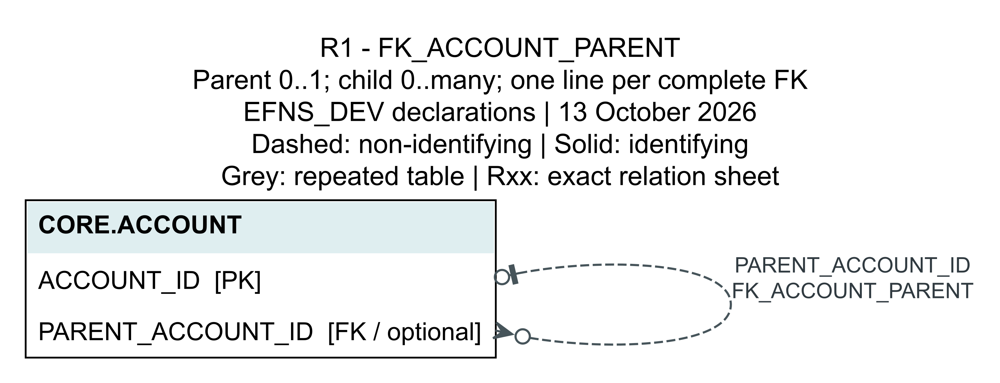

## R02 FK_ACCOUNT_GRADING_STATION

`CORE.ACCOUNT (GRADING_STATION_ACCOUNT_ID)` -> `CORE.ACCOUNT (ACCOUNT_ID)`. Parent per child: 0..1; children per parent: 0..many. Non-identifying.

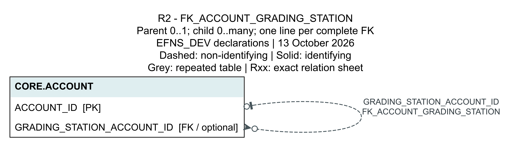

## R03 FK_ACCOUNT_PULLET_GROWER

`CORE.ACCOUNT (PULLET_GROWER_ACCOUNT_ID)` -> `CORE.ACCOUNT (ACCOUNT_ID)`. Parent per child: 0..1; children per parent: 0..many. Non-identifying.

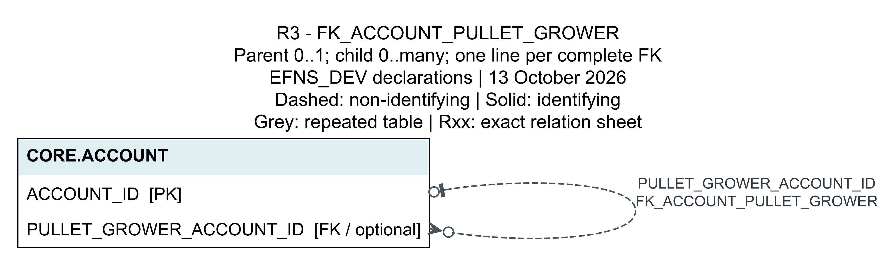

## R04 FK_FACILITY_ACCOUNT

`CORE.FACILITY (ACCOUNT_ID)` -> `CORE.ACCOUNT (ACCOUNT_ID)`. Parent per child: 1; children per parent: 0..many. Non-identifying.

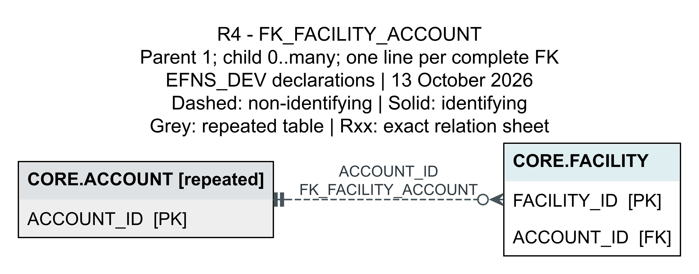

## R05 FK_PRODUCTION_ACCOUNT

`CORE.PRODUCTION_RECORD (PRODUCER_ACCOUNT_ID)` -> `CORE.ACCOUNT (ACCOUNT_ID)`. Parent per child: 0..1; children per parent: 0..many. Non-identifying.

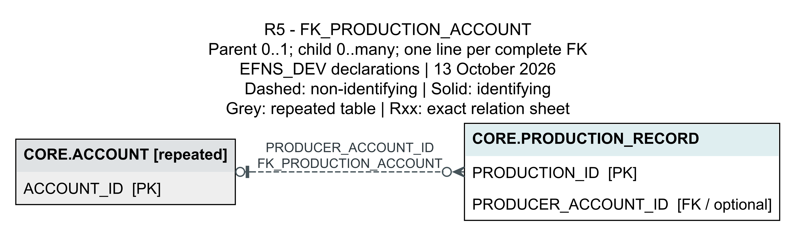

## R06 FK_QUOTA_ACCOUNT

`CORE.QUOTA_REGISTRATION (ACCOUNT_ID)` -> `CORE.ACCOUNT (ACCOUNT_ID)`. Parent per child: 1; children per parent: 0..many. Non-identifying.

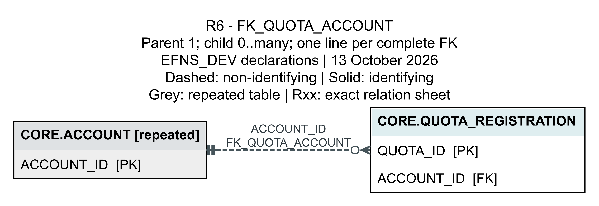

## R07 FK_FLOCK_ACCOUNT

`CORE.FLOCK (ACCOUNT_ID)` -> `CORE.ACCOUNT (ACCOUNT_ID)`. Parent per child: 1; children per parent: 0..many. Non-identifying.

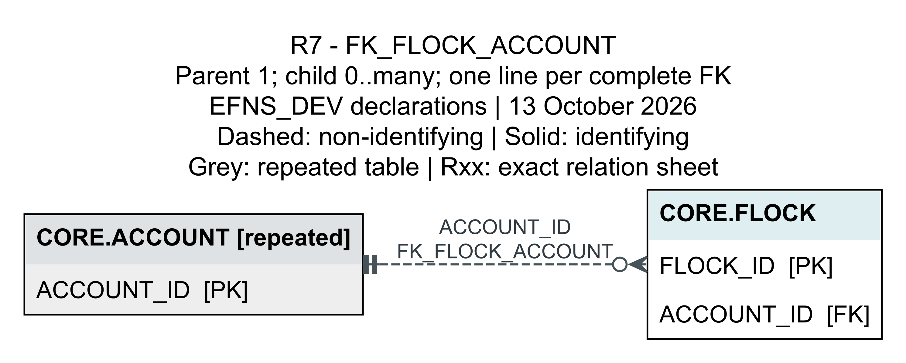

## R08 FK_QUOTA_TRANSACTION_OWNER

`CORE.QUOTA_TRANSACTION (OWNER_ACCOUNT_ID)` -> `CORE.ACCOUNT (ACCOUNT_ID)`. Parent per child: 1; children per parent: 0..many. Non-identifying.

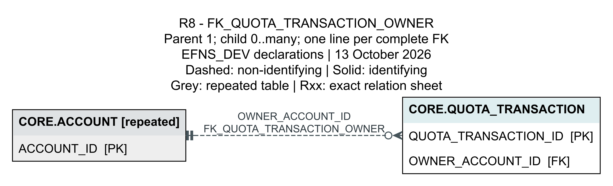

## R09 FK_QUOTA_TRANSACTION_RELATED_ACCOUNT

`CORE.QUOTA_TRANSACTION (RELATED_ACCOUNT_ID)` -> `CORE.ACCOUNT (ACCOUNT_ID)`. Parent per child: 0..1; children per parent: 0..many. Non-identifying.

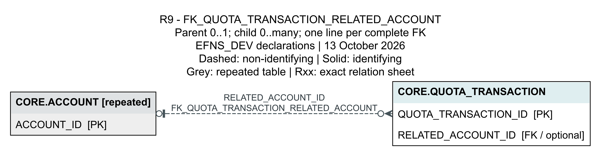

## R10 FK_SALMONELLA_TEST_ACCOUNT

`CORE.SALMONELLA_TEST (ACCOUNT_ID)` -> `CORE.ACCOUNT (ACCOUNT_ID)`. Parent per child: 1; children per parent: 0..many. Non-identifying.

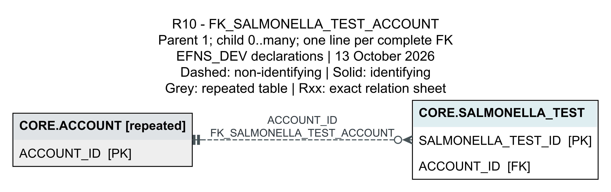

## R11 FK_FARM_LOCATION_ACCOUNT

`CORE.FARM_LOCATION (ACCOUNT_ID)` -> `CORE.ACCOUNT (ACCOUNT_ID)`. Parent per child: 1; children per parent: 0..many. Non-identifying.

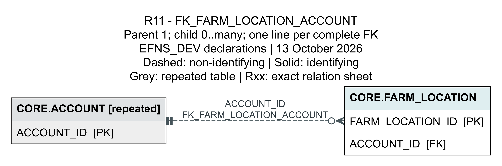

## R12 FK_CONTACT_ACCOUNT

`CORE.CONTACT (ACCOUNT_ID)` -> `CORE.ACCOUNT (ACCOUNT_ID)`. Parent per child: 0..1; children per parent: 0..many. Non-identifying.

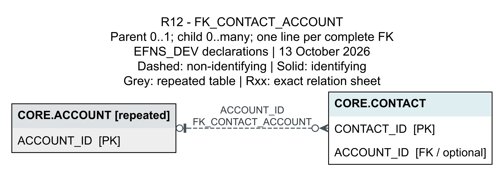

## R13 FK_PRODUCTION_GRADER_ACCOUNT

`CORE.PRODUCTION_RECORD (GRADER_ACCOUNT_ID)` -> `CORE.ACCOUNT (ACCOUNT_ID)`. Parent per child: 0..1; children per parent: 0..many. Non-identifying.

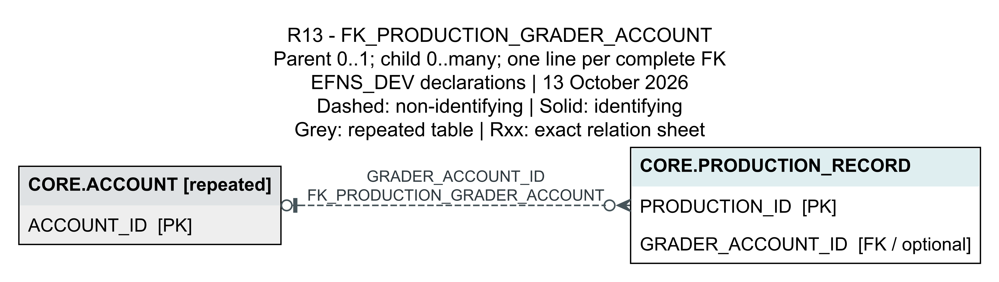

## R14 FK_FACILITY_DETAIL_FACILITY

`CORE.FACILITY_DETAIL (FACILITY_ID)` -> `CORE.FACILITY (FACILITY_ID)`. Parent per child: 1; children per parent: 0..many. Non-identifying.

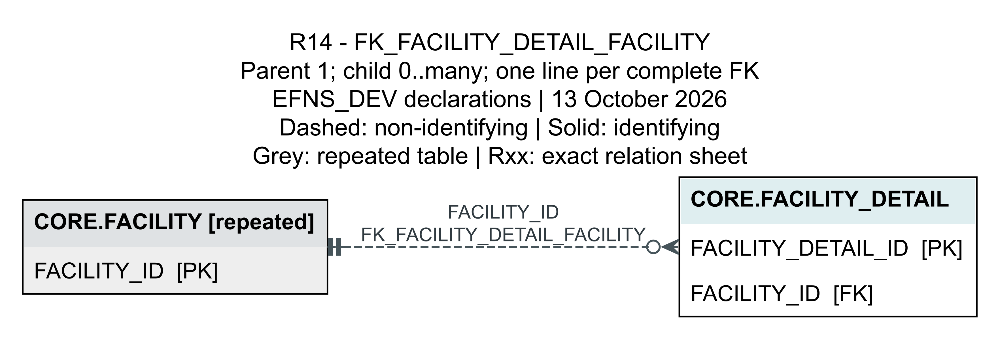

## R15 FK_PRODUCTION_FACILITY

`CORE.PRODUCTION_RECORD (FACILITY_ID)` -> `CORE.FACILITY (FACILITY_ID)`. Parent per child: 0..1; children per parent: 0..many. Non-identifying.

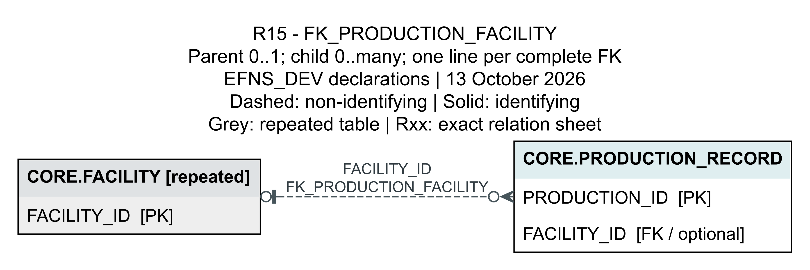

## R16 FK_FLOCK_FACILITY

`CORE.FLOCK (FACILITY_ID)` -> `CORE.FACILITY (FACILITY_ID)`. Parent per child: 0..1; children per parent: 0..many. Non-identifying.

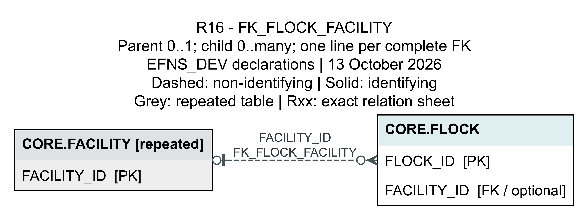

## R17 FK_FLOCK_DETAIL

`CORE.FLOCK (FACILITY_DETAIL_ID)` -> `CORE.FACILITY_DETAIL (FACILITY_DETAIL_ID)`. Parent per child: 0..1; children per parent: 0..many. Non-identifying.

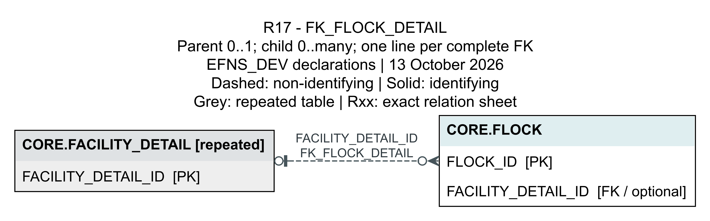

## R18 FK_FACILITY_FARM_LOCATION

`CORE.FACILITY (FARM_LOCATION_ID)` -> `CORE.FARM_LOCATION (FARM_LOCATION_ID)`. Parent per child: 0..1; children per parent: 0..many. Non-identifying.

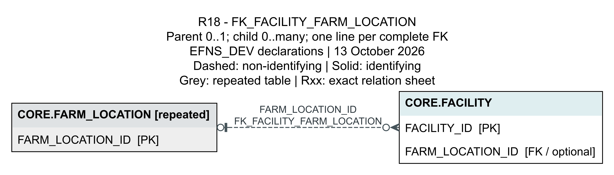

## R19 FK_FLOCK_TRANSACTION_FLOCK

`CORE.FLOCK_TRANSACTION (FLOCK_ID)` -> `CORE.FLOCK (FLOCK_ID)`. Parent per child: 1; children per parent: 0..many. Non-identifying.

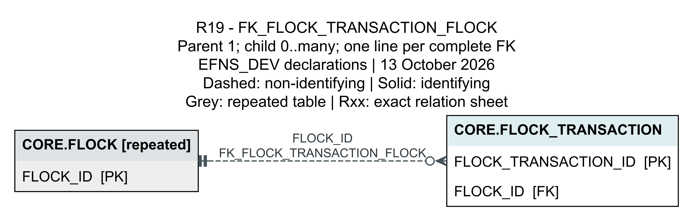

## R20 FK_PRODUCTION_FLOCK

`CORE.PRODUCTION_RECORD (FLOCK_ID)` -> `CORE.FLOCK (FLOCK_ID)`. Parent per child: 0..1; children per parent: 0..many. Non-identifying.

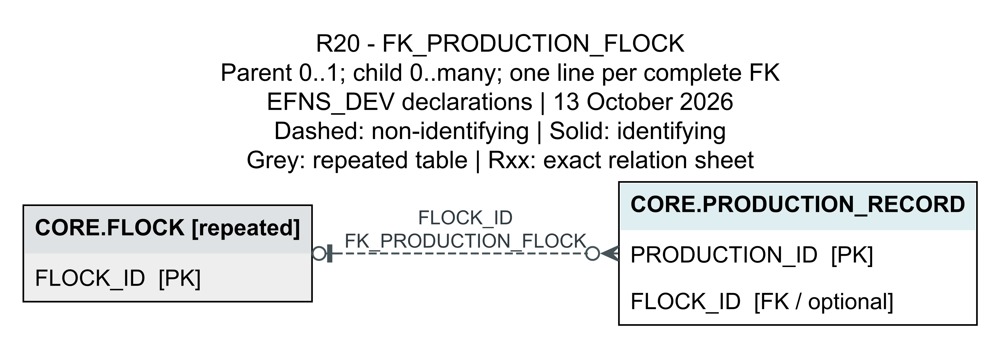

## R21 FK_SALMONELLA_TEST_FLOCK

`CORE.SALMONELLA_TEST (FLOCK_ID)` -> `CORE.FLOCK (FLOCK_ID)`. Parent per child: 1; children per parent: 0..many. Non-identifying.

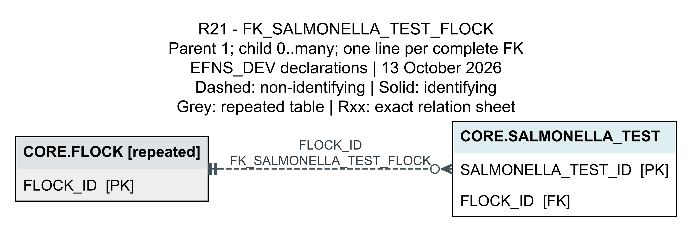

## R22 FK_SIZE_PRODUCTION

`CORE.PRODUCTION_SIZE_BREAKDOWN (PRODUCTION_ID)` -> `CORE.PRODUCTION_RECORD (PRODUCTION_ID)`. Parent per child: 1; children per parent: 0..many. Non-identifying.

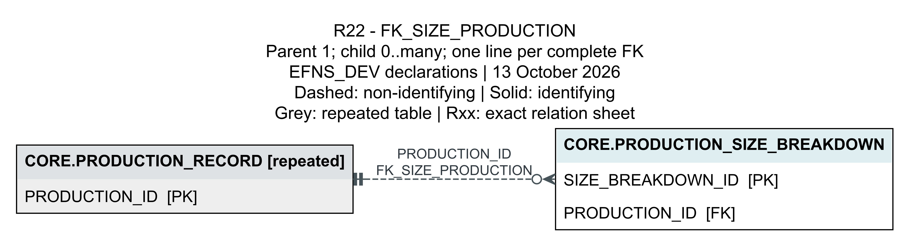

## R23 FK_FLOCK_QUOTA

`CORE.FLOCK (QUOTA_ID)` -> `CORE.QUOTA_REGISTRATION (QUOTA_ID)`. Parent per child: 0..1; children per parent: 0..many. Non-identifying.

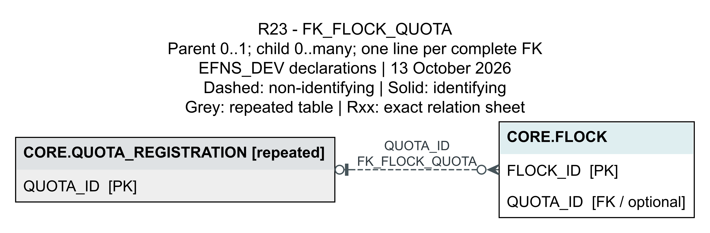

## R24 FK_QUOTA_TRANSACTION_QUOTA

`CORE.QUOTA_TRANSACTION (QUOTA_ID)` -> `CORE.QUOTA_REGISTRATION (QUOTA_ID)`. Parent per child: 1; children per parent: 0..many. Non-identifying.

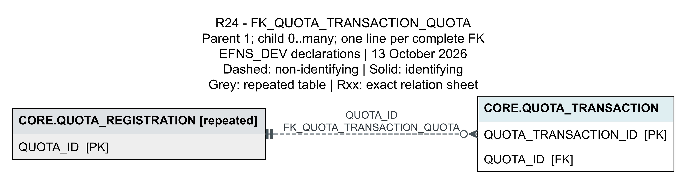

## R25 FK_QUOTA_TRANSACTION_RELATED_QUOTA

`CORE.QUOTA_TRANSACTION (RELATED_QUOTA_ID)` -> `CORE.QUOTA_REGISTRATION (QUOTA_ID)`. Parent per child: 0..1; children per parent: 0..many. Non-identifying.

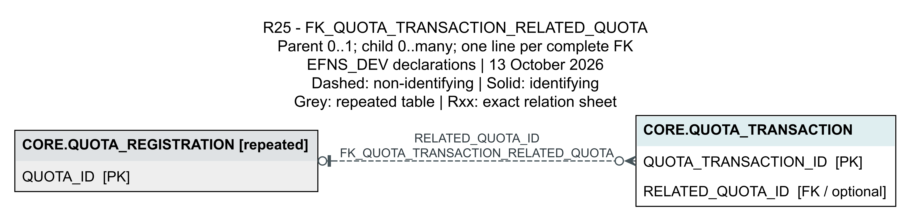

## R26 FK_QUOTA_TRANSACTION_RELATED_TRANSACTION

`CORE.QUOTA_TRANSACTION (RELATED_TRANSACTION_ID)` -> `CORE.QUOTA_TRANSACTION (QUOTA_TRANSACTION_ID)`. Parent per child: 0..1; children per parent: 0..many. Non-identifying.

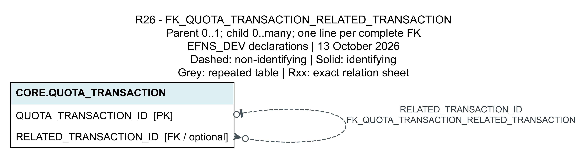

## R27 FK_SALMONELLA_SAMPLE_TEST

`CORE.SALMONELLA_TEST_SAMPLE (SALMONELLA_TEST_ID)` -> `CORE.SALMONELLA_TEST (SALMONELLA_TEST_ID)`. Parent per child: 1; children per parent: 0..many. Non-identifying.

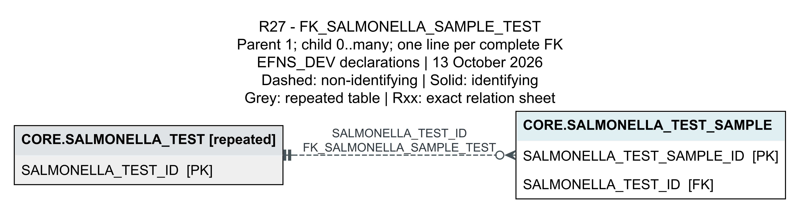

## R28 FK_PRODUCTION_IMPORT

`CORE.PRODUCTION_RECORD (IMPORT_ID)` -> `RAW.IMPORT_BATCH (IMPORT_ID)`. Parent per child: 1; children per parent: 0..many. Non-identifying.

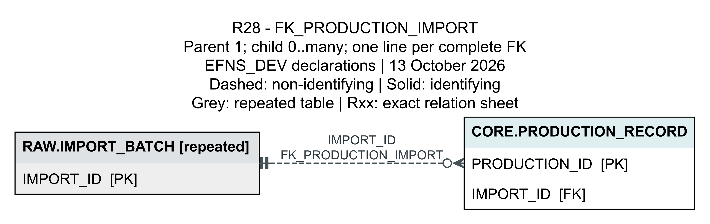

## R29 FK_RAW_ROW_IMPORT

`RAW.IMPORT_RAW_ROW (IMPORT_ID)` -> `RAW.IMPORT_BATCH (IMPORT_ID)`. Parent per child: 1; children per parent: 0..many. Non-identifying.

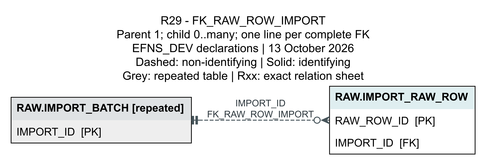

## R30 FK_MIGRATION_RAW_ROW_BATCH

`RAW.MIGRATION_RAW_ROW (MIGRATION_BATCH_ID)` -> `RAW.MIGRATION_BATCH (MIGRATION_BATCH_ID)`. Parent per child: 1; children per parent: 0..many. Identifying.

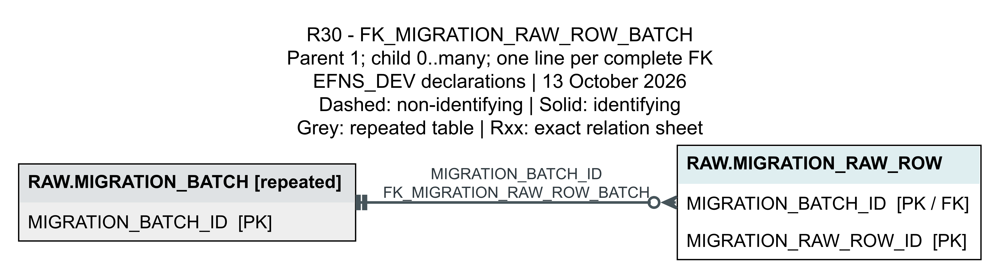

## R31 FK_MIGRATION_ID_MAP_BATCH

`RAW.MIGRATION_ID_MAP (MIGRATION_BATCH_ID)` -> `RAW.MIGRATION_BATCH (MIGRATION_BATCH_ID)`. Parent per child: 1; children per parent: 0..many. Non-identifying.

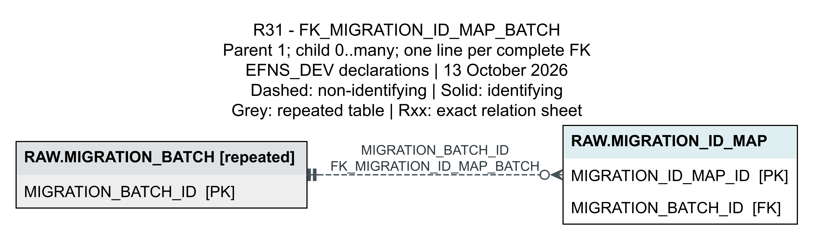

## R32 FK_MIGRATION_FILE_BATCH

`RAW.MIGRATION_FILE (MIGRATION_BATCH_ID)` -> `RAW.MIGRATION_BATCH (MIGRATION_BATCH_ID)`. Parent per child: 1; children per parent: 0..many. Non-identifying.

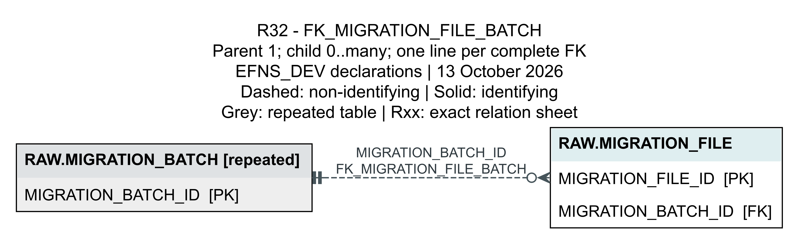

## R33 FK_MIGRATION_RECONCILIATION_BATCH

`RAW.MIGRATION_RECONCILIATION (MIGRATION_BATCH_ID)` -> `RAW.MIGRATION_BATCH (MIGRATION_BATCH_ID)`. Parent per child: 1; children per parent: 0..many. Non-identifying.

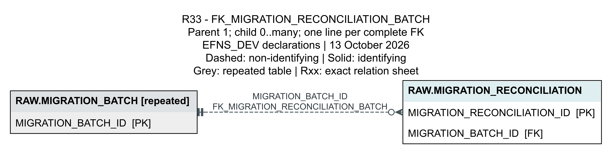

## R34 FK_MIGRATION_ERROR_BATCH

`RAW.MIGRATION_ERROR (MIGRATION_BATCH_ID)` -> `RAW.MIGRATION_BATCH (MIGRATION_BATCH_ID)`. Parent per child: 1; children per parent: 0..many. Non-identifying.

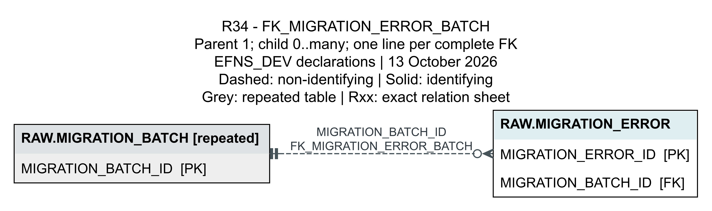

## R35 FK_MIGRATION_CORRECTION_ORIGINAL_BATCH

`RAW.MIGRATION_CORRECTION_BATCH (ORIGINAL_MIGRATION_BATCH_ID)` -> `RAW.MIGRATION_BATCH (MIGRATION_BATCH_ID)`. Parent per child: 1; children per parent: 0..many. Non-identifying.

## R36 FK_MIGRATION_CORRECTION_ROW_ORIGINAL_BATCH

`RAW.MIGRATION_CORRECTION_ROW (ORIGINAL_MIGRATION_BATCH_ID)` -> `RAW.MIGRATION_BATCH (MIGRATION_BATCH_ID)`. Parent per child: 1; children per parent: 0..many. Non-identifying.

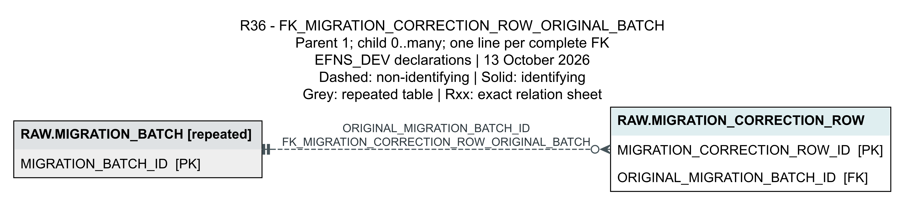

## R37 FK_MIGRATION_CORRECTION_ROW_BATCH

`RAW.MIGRATION_CORRECTION_ROW (MIGRATION_CORRECTION_BATCH_ID)` -> `RAW.MIGRATION_CORRECTION_BATCH (MIGRATION_CORRECTION_BATCH_ID)`. Parent per child: 1; children per parent: 0..many. Non-identifying.

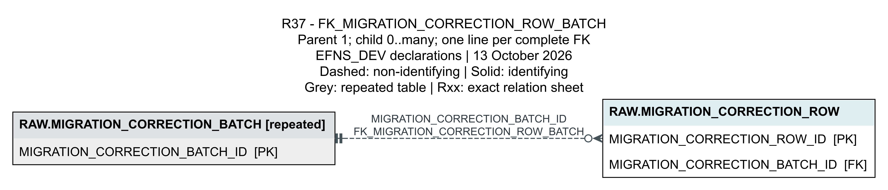

## R38 FK_MIGRATION_CORRECTION_RAW_ROW

`RAW.MIGRATION_CORRECTION_ROW (ORIGINAL_MIGRATION_BATCH_ID, MIGRATION_RAW_ROW_ID)` -> `RAW.MIGRATION_RAW_ROW (MIGRATION_BATCH_ID, MIGRATION_RAW_ROW_ID)`. Parent per child: 1; children per parent: 0..many. Non-identifying.

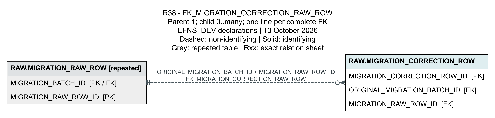

## R39 FK_MIGRATION_ID_MAP_RAW_ROW

`RAW.MIGRATION_ID_MAP (MIGRATION_BATCH_ID, MIGRATION_RAW_ROW_ID)` -> `RAW.MIGRATION_RAW_ROW (MIGRATION_BATCH_ID, MIGRATION_RAW_ROW_ID)`. Parent per child: 1; children per parent: 0..1. Non-identifying.

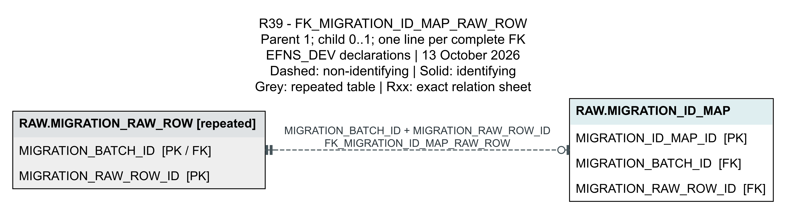
