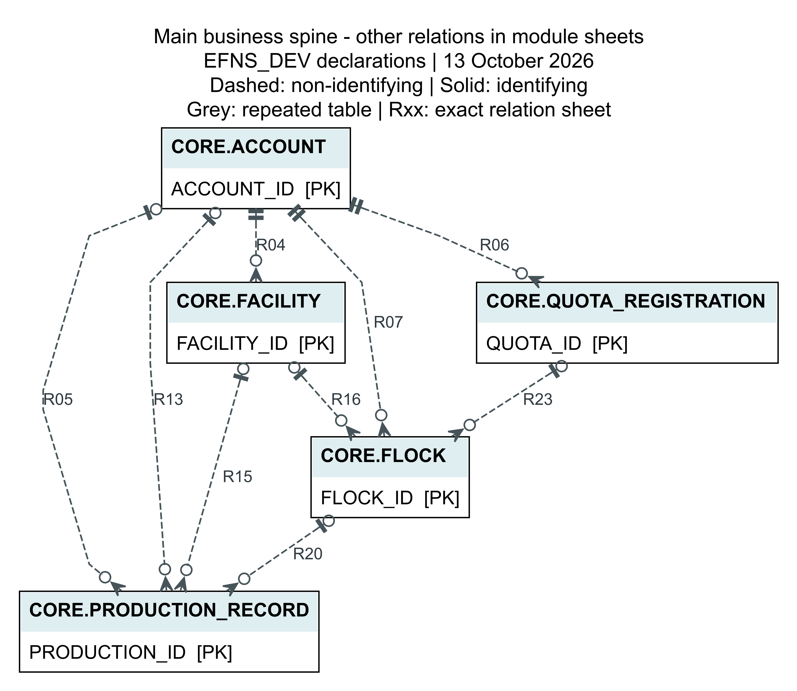
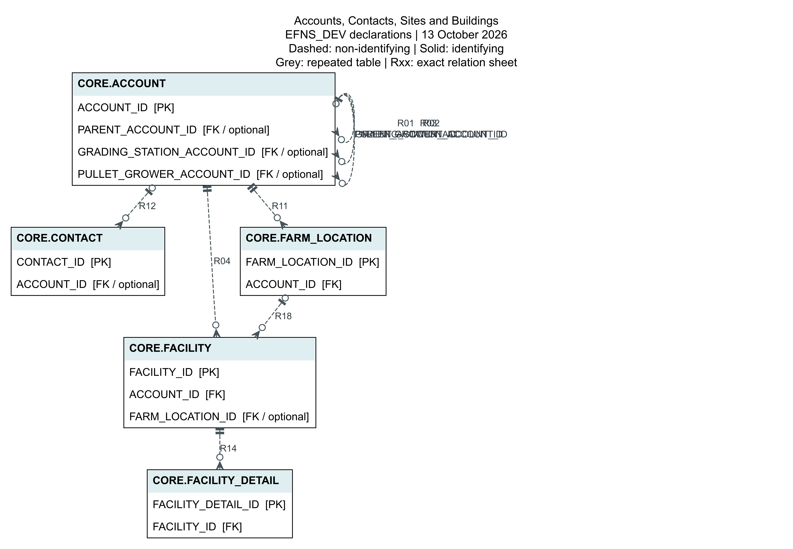
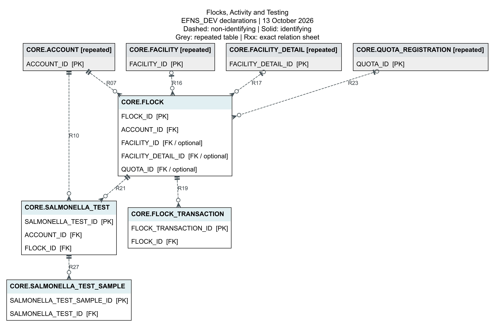
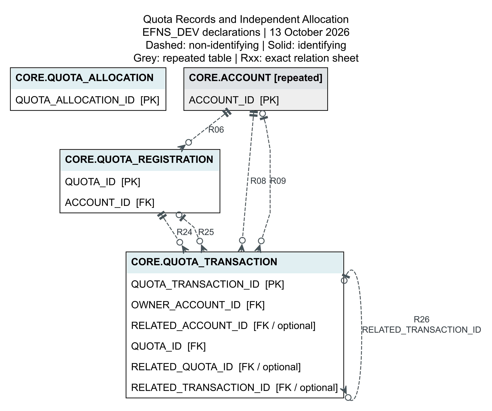
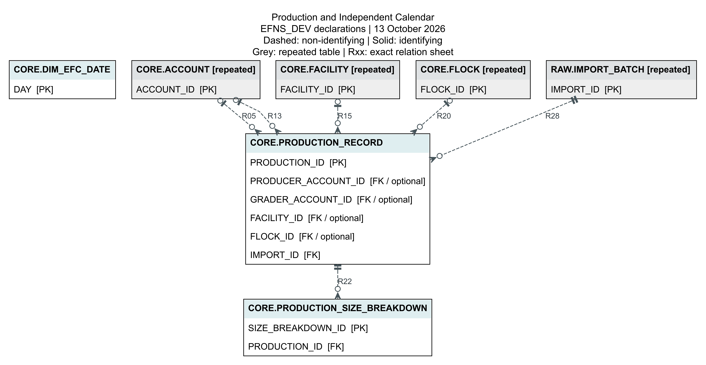
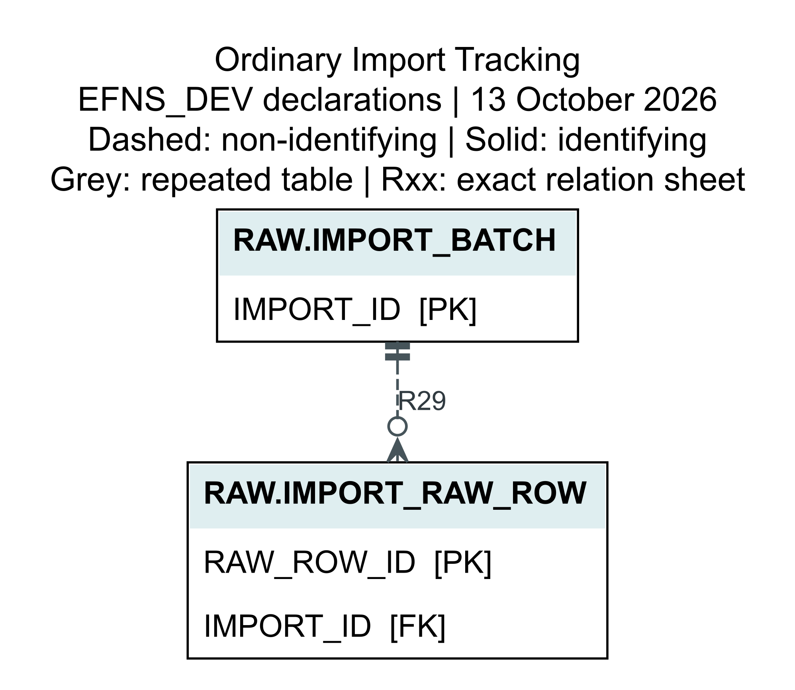
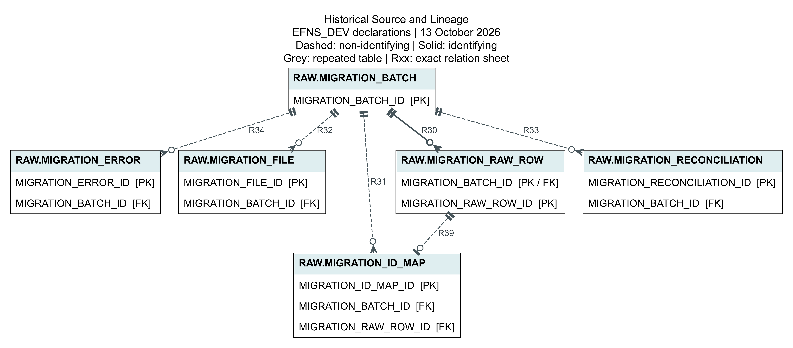
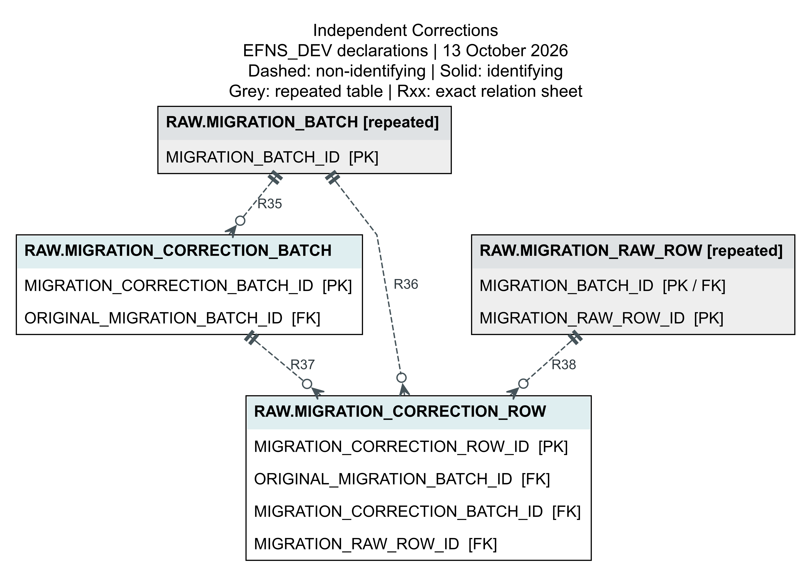
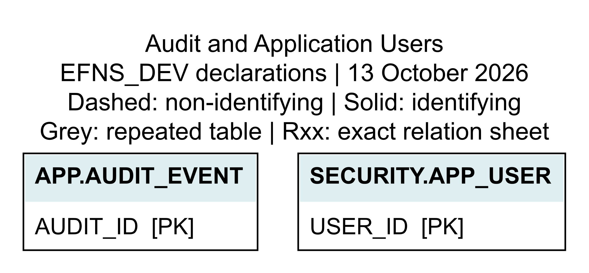

# EFNS Database Design and Maintenance Manual

**Working documentation draft for Dr. Lu Yang and future maintainers**
**13 October 2026 - EFNS_DEV only - Not approved**

**Targeted dictionary revision:** input explanations, examples and claim-specific
evidence were reviewed against local code and the preserved evidence package.
This revision does not refresh the database snapshot, rerun queries, change the
ERD or imply a new deployment. Snapshot/execution dates below remain unchanged.

## 1. Purpose, Audience and Scope

This manual explains the implemented EFNS development database as a connected
information system, rather than as a collection of presentation slides. It is
intended for Dr. Lu Yang to review the design and for a future maintainer to
understand what is stored, how records enter the database, how relationships
are used, and what the current reports can legitimately answer. It also gives
EFNS readers a way to distinguish stored evidence from an unconfirmed business
interpretation. The database is implemented in Snowflake and accessed by a
Streamlit application; this is not a proposal to begin implementing it.

The scope is the 27 deployed tables in CORE, RAW, APP and SECURITY and the four
REPORTING views. Stages, procedures, the Streamlit object, roles and warehouse
are supporting platform objects, not additional business tables. The inventory
does not claim to document every Snowflake account-level object, every local
SQLite table or every possible future integration. No production environment
was accessed. This documentation work did not execute DDL, business writes,
cleanup, migration, correction submission or deployment.

Evidence identifiers distinguish what can be asserted. [E01] is the current
read-only DEV structure and integrity snapshot. [E02] contains current aggregate
queries. [E03] reruns the saved deployed-source snapshot against current DEV using
a SELECT-only executor. [E04] identifies the 12 October downloaded application
package and prior deployment verification. It does not establish that the live
package was redownloaded on 13 October. [E05] is the local implementation and
mapping inventory. [E06] is the Work Plan; [E07] is the v1.4 review PDF; [E08]
is the previous dictionary and handoff archive. [E09] is the dated business-rule
record and user-reported acceptance. [E10] contains official platform guidance
and external documentation examples. The evidence index lists exact files and
query receipts. A new file modification time is not proof of a new deployment.

An implemented technical rule is not automatically an approved business rule.
This manual explicitly labels unresolved units, codes, ownership interpretations
and calculations. Examples with invented identifiers are **illustrative examples**,
not real EFNS records or successful test submissions. The document does not
contain raw contact names, addresses, emails or complete original source rows.

## 2. Business Activities and Data Requirements

The Database Developer Work Plan [E06] identifies producers, farms/facilities,
Flocks, egg production, graders, bird inventory, quota and leases as major scope
areas. It asks for entity relationships, a schema, a data dictionary, validation,
standardized entry, spreadsheet import and reports. It also mentions boxes versus
dozens and future integrations. These are collected scope requirements, not a
signed specification for converting every historical number into a final balance.
The current database implements record storage and query paths in these areas;
current inventory, available quota and some period calculations remain undefined.

EFNS needs to identify an organization once even when it acts as producer, grader
or another participant. Staff need to list contacts and farm addresses, distinguish
a site from its buildings, and retain successive Flocks in a building. A transaction
or a test is an event concerning a Flock; it should not replace the Flock header.
Quota registration likewise needs an identity separate from subsequent activity.
Production must be queryable by its producer and reporting period, including cases
where historical files supplied no Flock or Facility reference.

Sara's 8 October confirmation, recorded in [E09], establishes that one Facility can
house different Flocks successively and more than one Flock concurrently. There is
no confirmed maximum. Each current Flock has only one nullable Facility reference;
this confirmation does not imply that one Flock occupies several Facilities or
that cross-Account boarding is approved. Six historical ownership conflicts and
their 57 dependent transactions remain pending.

Seven list/report use cases connect these requirements to the design in Section 9.
They test whether the schema can retrieve the relevant records without accidental
row multiplication. They do not prove that a numerical sum is a legally available
quota or a biologically correct live-bird inventory. Independent lists of contacts,
sites and buildings are intentional: joining three one-to-many lists together
would create a contact-by-site-by-building Cartesian multiplication for each Account.

## 3. Database Organisation and Object Inventory

CORE contains the 15 business/reference tables. RAW contains ten source and
operation-tracking tables. APP contains one audit table, and SECURITY contains
one application-user registry. Thus the main business model is 15 tables, while
the complete database documentation covers 27. The four REPORTING views are
stored query definitions, not independent copies of the business rows.

RAW is evidence and tracking, but not a universal route for every write. Its
MIGRATION_* family supports the complete historical package and independent
corrections. IMPORT_BATCH/IMPORT_RAW_ROW support ordinary Production and
Flock/Quota uploads. Manual forms normally validate and write directly to CORE
through the repository, then record an application audit operation. They do not
manufacture a MIGRATION_RAW_ROW for every manual change.

CORE stores typed record attributes and declared relationships. Typed storage
does not prove business interpretation: TOTAL can be a valid decimal while its
unit remains unconfirmed. REPORTING defines useful read projections and LEFT JOIN
paths. The application also constructs read-only display fields such as Facility
source and separate Account roles; those display fields are not automatically
columns in a deployed SQL view. APP/SECURITY record operations and permissions,
not producer business identity.

The independently calculated counts and complete classified inventory follow
below. Each table links to its specification and full dictionary, including tables
with no declared FK and tables currently containing no records.

| Measure | Value |
| --- | --- |
| tables | 27 |
| views | 4 |
| table_columns | 440 |
| view_columns | 80 |
| PK | 27 |
| FK | 39 |
| UNIQUE | 6 |
| NOT_NULL_table_fields | 138 |
| CHECK | 1 |
| identifying_FK | 1 |

| Object | Kind | Module | Grain | Fields | Specification | Current DEV rows |
| --- | --- | --- | --- | --- | --- | --- |
| APP.AUDIT_EVENT | Table | Audit and Application Users | One audit event; ENTITY_ID is a polymorphic text reference, not a declared business FK. | 8 | 7.1 | 102 |
| CORE.ACCOUNT | Table | Accounts, Contacts, Sites and Buildings | One business organization/account identity. | 43 | 7.2 | 159 |
| CORE.CONTACT | Table | Accounts, Contacts, Sites and Buildings | One contact identity, optionally linked to an Account. | 23 | 7.3 | 80 |
| CORE.DIM_EFC_DATE | Table | Production and Independent Calendar | One distinct DAY target; multiple original date source rows can map to it. | 27 | 7.4 | 26310 |
| CORE.FACILITY | Table | Accounts, Contacts, Sites and Buildings | One Account-owned facility/building identity; optional farm location. | 18 | 7.5 | 249 |
| CORE.FACILITY_DETAIL | Table | Accounts, Contacts, Sites and Buildings | One facility detail/history record, not another Facility identity. | 19 | 7.6 | 153 |
| CORE.FARM_LOCATION | Table | Accounts, Contacts, Sites and Buildings | One Account-owned farm-location identity. | 14 | 7.7 | 48 |
| CORE.FLOCK | Table | Flocks, Activity and Testing | One Flock identity with one optional Facility reference; multiple Flocks may share a Facility. | 28 | 7.8 | 2724 |
| CORE.FLOCK_TRANSACTION | Table | Flocks, Activity and Testing | One recorded activity/transaction referring to a Flock. | 8 | 7.9 | 17455 |
| CORE.PRODUCTION_RECORD | Table | Production and Independent Calendar | One source/manual production observation; source GUID identifies historical marketing rows. | 60 | 7.10 | 45182 |
| CORE.PRODUCTION_SIZE_BREAKDOWN | Table | Production and Independent Calendar | One size-band child row for a production record; historical wide sizes are separate storage. | 6 | 7.11 | 0 |
| CORE.QUOTA_ALLOCATION | Table | Quota Records and Independent Allocation | One historical allocation identity; no Account FK is declared. | 10 | 7.12 | 28 |
| CORE.QUOTA_REGISTRATION | Table | Quota Records and Independent Allocation | One quota registration identity; historical registration number may be unknown. | 11 | 7.13 | 197 |
| CORE.QUOTA_TRANSACTION | Table | Quota Records and Independent Allocation | One quota transaction identity; related quota and related transaction are separate roles. | 15 | 7.14 | 1636 |
| CORE.SALMONELLA_TEST | Table | Flocks, Activity and Testing | One test identity; test and Flock Account roles remain distinct. | 17 | 7.15 | 540 |
| CORE.SALMONELLA_TEST_SAMPLE | Table | Flocks, Activity and Testing | One sample record belonging to one test; not one sample per test by rule. | 10 | 7.16 | 1 |
| RAW.IMPORT_BATCH | Table | Ordinary Import Tracking | One production/operational import tracking identity. | 16 | 7.17 | 5 |
| RAW.IMPORT_RAW_ROW | Table | Ordinary Import Tracking | One preserved production/operational upload source row. | 14 | 7.18 | 57 |
| RAW.MIGRATION_BATCH | Table | Historical Source and Lineage | One historical package batch, not one daily upload. | 12 | 7.19 | 2 |
| RAW.MIGRATION_CORRECTION_BATCH | Table | Independent Corrections | One independent correction attempt/batch linked to an original historical batch. | 8 | 7.20 | 1 |
| RAW.MIGRATION_CORRECTION_ROW | Table | Independent Corrections | One source-row correction/review trace within a correction batch. | 15 | 7.21 | 271 |
| RAW.MIGRATION_ERROR | Table | Historical Source and Lineage | One validation or runtime error record; multiple errors may refer to a source row. | 9 | 7.22 | 349 |
| RAW.MIGRATION_FILE | Table | Historical Source and Lineage | One source-file metadata record within a historical batch. | 9 | 7.23 | 23 |
| RAW.MIGRATION_ID_MAP | Table | Historical Source and Lineage | One Ready source-row lineage; many date lineages may share a DAY target. | 9 | 7.24 | 95087 |
| RAW.MIGRATION_RAW_ROW | Table | Historical Source and Lineage | One original source row identified by batch plus RAW row ID. | 14 | 7.25 | 95358 |
| RAW.MIGRATION_RECONCILIATION | Table | Historical Source and Lineage | One batch/entity summary, not a target record. | 9 | 7.26 | 14 |
| SECURITY.APP_USER | Table | Audit and Application Users | One application user/security identity. | 8 | 7.27 | 1 |
| REPORTING.VW_ACCOUNT_FACILITY | View | Read projections | Account/Facility pair; null Facility placeholder for Account with none | 20 | Section 8 view definition | 310 |
| REPORTING.VW_FLOCK_DETAIL | View | Read projections | One Flock with parent labels | 22 | Section 8 view definition | 2724 |
| REPORTING.VW_PRODUCTION_SIZE_DETAIL | View | Read projections | One size-child row or one null-child placeholder per Production | 9 | Section 8 view definition | 45182 |
| REPORTING.VW_PRODUCTION_SUMMARY | View | Read projections | One Production observation | 29 | Section 8 view definition | 45182 |

## 4. Spreadsheet Import / Migration

The chapter name groups file-based inputs for readers. Actual formats, required
files and tracking differ by route. The complete historical migration is not
interchangeable with a one-file ordinary update, and the Production workbook
format is not an arbitrary CSV contract.

### 4.1 Complete EIMS Export Package

Historical Migration Import accepts the full versioned package. The current v3
mapping names fourteen CSV exports with Dataverse logical headers. The parser
supports CSV and Excel content, and the page permits CSV/XLSX/XLSM upload, but
package identity/completeness still uses contract filenames; this does not imply
that arbitrary Excel names replace the fourteen required v3 CSV names. Earlier
v1/v2 contracts remain explicit alternatives resolved by mapping version [E05].

The original Jensen files were reported to be the complete EIMS export at that
time, not a sample [E09]. Each source row is read under its header, mapped to target
fields and checked for types, required attributes, identifiers and parent references.
GUIDs are retained as CORE identities. Names are display attributes, not matching
keys. Explicit null-like text becomes null; valid signed historical measures are
not rewritten. The parser normalizes header names to uppercase in RAW_DATA and
serializes parsed values to JSON, so a RAW payload is a row representation, not a
byte-for-byte original CSV. Original file bytes, when staged, have separate file
hash and stage-path evidence in MIGRATION_FILE.

SCRIBE_ID and other source attributes not projected to a business column remain
in the original row payload. ID mapping stores normalized source/target identity
and full RAW-row reference; it does not add a separate SCRIBE_ID field to every
CORE table. The mapping CSV in the package lists actual logical source headers,
target columns and converters without changing the fourteen-file contract.

Preparation preserves source/file records, READY and REJECTED classifications,
validation messages and normalized values when available. Rejected rows can have
null NORMALIZED_DATA; their original payload remains available. The user confirms
the separate commit operation. Parent entities are written before children in one
CORE transaction. ID-map lineage is persisted using batch plus RAW row identity,
including each date source row. A target key of type date is bound as stable ISO
text at the migration persistence boundary, while business date columns and JSON
date serialization keep their intended types.

If any write fails, the CORE transaction is rolled back. The original insert error
is retained; a later commit/rollback/audit error must not replace it. Sanitized
runtime diagnostics and FAILED state are persisted after rollback in a separate
transaction. A failed batch can be retried under the original identity after RAW
completeness and existing targets are checked. A successfully committed batch is
not reimported wholesale. Old failures remain history, not current failure state.

### 4.2 Ordinary Flock and Quota Uploads

Daily Flock & Quota Import accepts one or more CSV, XLSX or XLSM files without
fixed filenames or the other historical entities. It supports FLOCK,
QUOTA_REGISTRATION, FLOCK_TRANSACTION and QUOTA_TRANSACTION. Auto-detection
uses normalized headings, including friendly templates and relevant logical
source names. Account and Salmonella files are recognized as unsupported content,
not passed through Flock validation as malformed Flocks.

Review and validation are in memory. The page displays file/entity/row counts and
preview, distinguishes unsupported files from rejected rows, and provides an
error CSV. Parents can already exist in the database; users are not required to
upload their Account or Facility file. Lookups must be unambiguous. Existing IDs
or business identifiers and deterministic generated identities help prevent an
ordinary update from creating a duplicate. Names are not universal identity keys.
Per-file upload size follows the Streamlit configured server.maxUploadSize
(the helper defaults to 200 MB, but the running setting is authoritative).

The separate confirmed commit rechecks parents, target action and duplicate
package hash inside a transaction. Quota registration precedes Flock and then
transactions in the repository write order. All accepted writes, IMPORT_BATCH
and IMPORT_RAW_ROW tracking commit together or roll back. RAW payloads identify
source filename/entity/values and retain row validation/action details. There is
no MIGRATION_* package for this route. Standard-table key declarations do not
eliminate a check-then-insert race between independent sessions.

### 4.3 Production Workbook Import

The current Production Import page supports only XLSX/XLSM with the saved **EIMS 3**
worksheet, columns A:AI, header on Excel row 10 (header=9). Data-row source numbering
starts at Excel row 11, including the earlier header/preamble. It reads saved
values; it does not run macros or recalculate formulas. Historical marketings.csv
is handled by the full package route, not this workbook page.

The reader removes wholly empty rows and rows with missing Producer # before
normalization. Therefore IMPORT_RAW_ROW preserves the retained parsed rows, not
every physical Excel row. This is a factual limitation of the current input path,
not a claim that excluded content was reviewed as a rejected row. Required columns,
year/week and numeric checks are applied. This ordinary workbook validator rejects
negative numeric measures; historical v3 migration separately permits applicable
signed source measures. A missing Total creates a warning and remains unknown.

The saved workbook headings map to Production wide fields. Source week, producer
and grader text are retained; account/Facility/Flock references initially remain
null and MATCH_STATUS is UNMATCHED rather than being guessed from names. The
writer stores IMPORT_BATCH, IMPORT_RAW_ROW and PRODUCTION_RECORD together.
Production IDs are generated UUIDs, not a verified existing source GUID in this
workbook route. Exact-file duplicate detection exists, but the page offers an
explicit allow-duplicate override. Changed/reuploaded content can require review;
the route is not a universal deterministic deduplication engine.

### 4.4 Independent Correction and Complete Example

Illustrative example: an export row identifies quota Q-EXAMPLE and Account
A-EXAMPLE, with a null business registration number. Under the confirmed historical
exception, its GUID, source name, Account and type can be preserved without
manufacturing a number. The rejected original RAW row and messages stay unchanged.
A correction preview checks the current parent, classifies the independent row,
and a confirmed correction commit would add the eligible CORE row and correction
trace. This example was not submitted and its abbreviated identifiers are not
valid Dataverse GUID fixtures.

The actual documented correction [E02/E03] committed 13 registrations, 92 quota
transactions and seven tests, totaling 112 targets. Preview now returns those
rows as ALREADY_COMMITTED, zero READY_CORE, and 159 PENDING_CONFIRMATION.
The review payload retains unresolved business references. Stored READY_CORE
on a committed correction row is its original disposition, not proof that it is
still waiting to be committed. Corrections validate full original source identity
and available file/entity/ordinal metadata; they are safe to recheck without
duplicating the previously committed targets.

## 5. Manual Data Entry

Manual entry is a distinct input path. Account, Facility, Facility Detail, Farm
Location, Flock, Flock Transaction, Quota Registration, Quota Transaction and
Salmonella Test pages construct record dictionaries, run page/repository checks,
and call upsert methods. They do not require a historical file package. A dedicated
manual Contact, Allocation or Calendar editing workflow is not demonstrated by
the current reference-data page. Production Data is primarily browse/filter/export
and relationship review, not evidence of a general-purpose manual marketing form.

Requiredness must be read at three levels: the deployed database nullable flag,
the normal entry validator, and the specific import contract. FLOCK.FACILITY_ID
is nullable for historical storage, while normal Flock entry requires a Facility.
Historical quota registration numbers can be unknown; normal entry still requires
a number. Historical test and Flock Accounts can differ with existing references;
normal test validation still checks Account/permit agreement. A current historical
exception must not be inferred to waive every normal operational check.

Illustrative Account example: a user enters Example Farm Ltd and a registration
label but leaves both coordinate boxes blank. The form parses them to Python None
and the executor binds true SQL NULL, not the string "None" and not zero. If the
user supplies 0 for either coordinate, zero is valid and remains numeric. A text
coordinate or latitude outside -90..90 / longitude outside -180..180 produces a
specific field error and prevents submission without clearing the filled form.
This is an illustrative explanation of tested behavior, not a new DEV write.

On successful save the repository creates or updates the identified CORE record.
Existing update flows use the stored UPDATED_AT token for optimistic concurrency
where supported, so a stale edit can be refused instead of silently overwriting
another user's work. Authorization checks sit outside individual UI buttons in
AuthorizedRepository, with page-level permissions as well. A successful operation
is recorded in the audit store after its business repository operation. Manual
audit is an operation trail, not the same source-row/file lineage as migration;
it does not guarantee a complete before/after version of every changed column.

The UI and repository do not have identical validation coverage in every entity.
For example, Account Name and Facility Detail Name are checked in their forms;
normal Facility/Facility Detail repository methods delegate to generic upsert,
while Flock, quota and test methods explicitly run entity validators. A selected
existing parent in a form is not a database-enforced FK or proof of a concurrency-
safe universal repository guard. Field definitions identify known checks without
claiming that every conceivable non-UI caller has equivalent protection.

## 6. Design Principles, Keys and Relationships

A primary key identifies the stored row. A foreign key declares that a child value
refers to a parent key, sometimes in a distinct role. A UNIQUE constraint declares
an intended alternative identity. Composite keys use all named members in order:
MIGRATION_RAW_ROW is identified by MIGRATION_BATCH_ID plus MIGRATION_RAW_ROW_ID,
and its composite references are one relationship each, not two unrelated edges.

On the deployed standard Snowflake tables, PK/FK/UNIQUE are informational and
reported ENFORCED=NO. NOT NULL and the actual CHECK on FLOCK.BIRD_COUNT are engine
checks, as are column types. Hybrid-table behavior is different and is not applied
to these tables. The deployed GET_DDL includes the CHECK even though the table-
constraint inventory query does not return it as a separate CHECK row; the coverage
report therefore reconciles DDL and metadata rather than declaring that no CHECK
exists. Official guidance is cited in [E10].

Repository validation, authorization and transaction handling enforce additional
rules. Referential scanning provides a point-in-time check of actual data. A clean
scan cannot prove that two independent sessions can never create duplicate keys.
The shared-session lock serializes use of that connection, not all sessions. The
integrity export is manually invoked; no automated schedule is claimed.

Separating identity headers from event/detail children explains the current design:
one Flock has multiple transactions/tests; one test has sample children; one quota
registration has transactions. This limits overwriting and enables history. It is
not a declaration that every field satisfies strict third normal form. In particular,
Production has both wide source measures and a size-child extension, and source
labels may coexist with linked Account identities for traceability.

An optional FK permits zero or one recorded parent for each child, while the parent
can usually have zero to many child rows. Null means an association is absent or
unknown in this record, not that no real-world relation exists. A missing optional
parent must not cause a report to drop the child. An identifying relationship occurs
when the FK participates in the child's PK: RAW_ROW to MIGRATION_BATCH is the one
current identifying edge. The other 38 are non-identifying, including composite
correction/map references whose children have independent surrogate PKs.

The diagrams use dashed non-identifying lines, solid identifying lines, Crow's Foot
endpoints and labelled self-reference loops. Grey repeated parent boxes are the same
physical tables. No invented links connect QUOTA_ALLOCATION or DIM_EFC_DATE to
Account or Production. The key-only overview is for orientation; detailed module
and relationship sheets preserve all declared relationships. Full-field panels
are split rather than squeezed into unreadable single-page pictures.



**Figure 1.** Main business spine only; omitted relationships are not removed from the model. All 28 CORE FKs appear in complete_core_poster.svg and the module/relationship atlas. Independent reference tables remain unconnected. Rxx labels identify exact FK sheets. Use module/individual sheets at normal Word size, not a reduced reference poster.



**Figure 2.** Accounts, Contacts, Sites and Buildings. Grey parents repeat the same physical table. Relationship-sheet index supplies every exact FK and composite member order; full fields have separate readable panels.



**Figure 3.** Flocks, Activity and Testing. Grey parents repeat the same physical table. Relationship-sheet index supplies every exact FK and composite member order; full fields have separate readable panels.



**Figure 4.** Quota Records and Independent Allocation. Grey parents repeat the same physical table. Relationship-sheet index supplies every exact FK and composite member order; full fields have separate readable panels.



**Figure 5.** Production and Independent Calendar. Grey parents repeat the same physical table. Relationship-sheet index supplies every exact FK and composite member order; full fields have separate readable panels.



**Figure 6.** Ordinary Import Tracking. Grey parents repeat the same physical table. Relationship-sheet index supplies every exact FK and composite member order; full fields have separate readable panels.



**Figure 7.** Historical Source and Lineage. Grey parents repeat the same physical table. Relationship-sheet index supplies every exact FK and composite member order; full fields have separate readable panels.



**Figure 8.** Independent Corrections. Grey parents repeat the same physical table. Relationship-sheet index supplies every exact FK and composite member order; full fields have separate readable panels.



**Figure 9.** Audit and Application Users. Grey parents repeat the same physical table. Relationship-sheet index supplies every exact FK and composite member order; full fields have separate readable panels.


## 7. Business and Tracking Module Specifications

The following specifications cover every deployed table, not just CORE. Each states
purpose, grain, structural explanation, keys, optionality, parent/child use, input
route, supported work, an illustrative example and limitations. Exact field storage,
source conversion and rules follow in Section 8. Incoming references listed here
are declarations, not a claim that every target is referenced in the current data.

### 7.1 APP.AUDIT_EVENT

**Purpose and business context.** AUDIT_EVENT records who performed an application operation, its action and entity reference, time and optional sanitized details.

**Row grain.** One audit event; ENTITY_ID is a polymorphic text reference, not a declared business FK.

**Why separate.** Audit is support information, separate from business Accounts. ENTITY_ID is a polymorphic VARCHAR(1000) value, not a foreign key to every target table.

**Identity.** PK `AUDIT_ID`. No alternative UNIQUE identity is declared.

**Outgoing relationships and use.**

No declared outgoing foreign key. No relationship is invented from similar field names.

**Referenced by.** No declared incoming FK.

**Important attributes.** `AUDIT_ID`, `ACTOR_USER_ID`, `ACTOR_EMAIL`, `ACTION`. Complete fields: Section 8, APP.AUDIT_EVENT; metadata/enhanced_dictionary.csv.

**Input and update route.** AuthorizedRepository records successful operations through the authentication store. Import entity IDs are chosen according to the operation result; business repository transactions complete before the wrapper records the audit.

**Queries and work.** Use the Audit Log for operation history and actor/action filters. Snowflake runtime privileges permit append/read but prevent direct audit deletion in the checked deployment.

**Example.** An illustrative CREATE ACCOUNT operation records an actor, Account entity reference and time. An import audit instead identifies its import/batch, not a stringified result dictionary. All identifiers/values in this illustration are invented; no record was submitted.

**Limits / confirmation.** An audit event is not a complete versioned before/after history of every business field. Retention and user deactivation policy need confirmation.

**Evidence.** E01 storage and declaration; E05 input/validator code; E03/E04 executed evidence when named. Full-field sheets: erd/full/APP_AUDIT_EVENT_*.svg; exact relation sheets: erd/relationships/*.svg.

### 7.2 CORE.ACCOUNT

**Purpose and business context.** ACCOUNT stores the organization identity used by producers, graders and other business participants. Role flags allow one organization to perform several functions without creating a separate identity for each role.

**Row grain.** One business organization/account identity.

**Why separate.** Separating organizations from their contacts, locations and buildings prevents an address change or an additional contact from requiring a second organization record. This explains the implemented structure; it is not a recovered original design decision.

**Identity.** PK `ACCOUNT_ID`. No alternative UNIQUE identity is declared.

**Outgoing relationships and use.**

- **FK_ACCOUNT_PARENT**: `CORE.ACCOUNT.PARENT_ACCOUNT_ID = CORE.ACCOUNT.ACCOUNT_ID`. Each child has 0..1 parent; each parent has 0..many children. Non-identifying: child retains its independent PK. Optional storage reference. Record retention depends on each query's actual JOIN/filter; nullability alone does not guarantee retention. [E01].
- **FK_ACCOUNT_GRADING_STATION**: `CORE.ACCOUNT.GRADING_STATION_ACCOUNT_ID = CORE.ACCOUNT.ACCOUNT_ID`. Each child has 0..1 parent; each parent has 0..many children. Non-identifying: child retains its independent PK. Optional storage reference. Record retention depends on each query's actual JOIN/filter; nullability alone does not guarantee retention. [E01].
- **FK_ACCOUNT_PULLET_GROWER**: `CORE.ACCOUNT.PULLET_GROWER_ACCOUNT_ID = CORE.ACCOUNT.ACCOUNT_ID`. Each child has 0..1 parent; each parent has 0..many children. Non-identifying: child retains its independent PK. Optional storage reference. Record retention depends on each query's actual JOIN/filter; nullability alone does not guarantee retention. [E01].

**Referenced by.** CORE.ACCOUNT (PARENT_ACCOUNT_ID); CORE.ACCOUNT (GRADING_STATION_ACCOUNT_ID); CORE.ACCOUNT (PULLET_GROWER_ACCOUNT_ID); CORE.FACILITY (ACCOUNT_ID); CORE.PRODUCTION_RECORD (PRODUCER_ACCOUNT_ID); CORE.QUOTA_REGISTRATION (ACCOUNT_ID); CORE.FLOCK (ACCOUNT_ID); CORE.QUOTA_TRANSACTION (OWNER_ACCOUNT_ID); CORE.QUOTA_TRANSACTION (RELATED_ACCOUNT_ID); CORE.SALMONELLA_TEST (ACCOUNT_ID); CORE.FARM_LOCATION (ACCOUNT_ID); CORE.CONTACT (ACCOUNT_ID); CORE.PRODUCTION_RECORD (GRADER_ACCOUNT_ID)

**Important attributes.** `ACCOUNT_ID`, `PARENT_ACCOUNT_ID`, `GRADING_STATION_ACCOUNT_ID`, `PULLET_GROWER_ACCOUNT_ID`, `REGISTRATION_NUMBER`, `ORGANIZATION_NAME`, `ADDRESS_LINE1`. Complete fields: Section 8, CORE.ACCOUNT; metadata/enhanced_dictionary.csv.

**Input and update route.** The Jensen account export supplies Dataverse GUIDs; the Accounts form creates or updates individual records through the repository. Account primary-contact text and the CONTACT list are distinct sources, with no automatic synchronization demonstrated.

**Queries and work.** Use it to label ownership and participant roles, then query each child list separately. A self-link identifies another Account in a recorded role; it does not establish legal ownership, a verified commercial relationship or a reporting formula.

**Example.** An illustrative organization Example Farm Ltd can have both producer and grader role flags while retaining one Account GUID; contacts and buildings reference that same identity. All identifiers/values in this illustration are invented; no record was submitted.

**Limits / confirmation.** Confirm the authority of CONTACT_* versus CONTACT, the business meaning of the three self-link roles, and retention/ownership change policy.

**Evidence.** E01 storage and declaration; E05 input/validator code; E03/E04 executed evidence when named. Full-field sheets: erd/full/CORE_ACCOUNT_*.svg; exact relation sheets: erd/relationships/*.svg.

### 7.3 CORE.CONTACT

**Purpose and business context.** CONTACT preserves individual contact records, including name components, communication details and source contact metadata. Its optional Account link associates a person with an organization when that reference is available.

**Row grain.** One contact identity, optionally linked to an Account.

**Why separate.** One organization may have several contacts. A separate contact identity prevents additional people from overwriting the single primary-contact text stored on ACCOUNT.

**Identity.** PK `CONTACT_ID`. No alternative UNIQUE identity is declared.

**Outgoing relationships and use.**

- **FK_CONTACT_ACCOUNT**: `CORE.CONTACT.ACCOUNT_ID = CORE.ACCOUNT.ACCOUNT_ID`. Each child has 0..1 parent; each parent has 0..many children. Non-identifying: child retains its independent PK. Optional storage reference. Record retention depends on each query's actual JOIN/filter; nullability alone does not guarantee retention. [E01].

**Referenced by.** No declared incoming FK.

**Important attributes.** `CONTACT_ID`, `ACCOUNT_ID`, `FULL_NAME`, `FIRST_NAME`, `MIDDLE_NAME`. Complete fields: Section 8, CORE.CONTACT; metadata/enhanced_dictionary.csv.

**Input and update route.** The historical contact.csv mapping supplies the contact GUID and optional parentcustomerid reference. The EIMS Reference Data page queries the imported list; a dedicated manual Contact editing workflow is not demonstrated.

**Queries and work.** List contacts for an Account without joining them to every farm location and Facility in the same result. Contact absence is not proof that the organization has no contact; information may reside only in ACCOUNT.CONTACT_*.

**Example.** An illustrative Contact has its own GUID and an Account reference to Example Farm Ltd. A second Contact can reference the same Account without overwriting the first or ACCOUNT.CONTACT_NAME. All identifiers/values in this illustration are invented; no record was submitted.

**Limits / confirmation.** Confirm authoritative contact selection and synchronization. PRIME_CONTACT preserves the source flag, not a database-enforced one-primary-contact rule.

**Evidence.** E01 storage and declaration; E05 input/validator code; E03/E04 executed evidence when named. Full-field sheets: erd/full/CORE_CONTACT_*.svg; exact relation sheets: erd/relationships/*.svg.

### 7.4 CORE.DIM_EFC_DATE

**Purpose and business context.** DIM_EFC_DATE preserves the supplied EFC calendar attributes for each distinct calendar DAY. It is reference data, not a production observation or an import batch.

**Row grain.** One distinct DAY target; multiple original date source rows can map to it.

**Why separate.** Several source rows can describe the same target day. The target grain is one DAY, while RAW and ID mapping preserve every source row and ElementCode lineage.

**Identity.** PK `DAY`. No alternative UNIQUE identity is declared.

**Outgoing relationships and use.**

No declared outgoing foreign key. No relationship is invented from similar field names.

**Referenced by.** No declared incoming FK.

**Important attributes.** `DAY`, `EFC_YEAR`, `EFC_WEEK_NUMBER`, `EFC_WEEK`. Complete fields: Section 8, CORE.DIM_EFC_DATE; metadata/enhanced_dictionary.csv.

**Input and update route.** DateConverter$.csv is grouped by DAY during historical preparation; ELEMENT_CODES collects codes for repeated days. The original source rows remain separately traceable.

**Queries and work.** Look up stored calendar attributes for a known day. There is no declared Production FK and no confirmed producer/week-to-EFC-period join; joining a week/year to many daily rows can multiply Production.

**Example.** Two illustrative source rows have DAY=2026-01-15 but different ElementCodes. There is one target DAY, two source rows and two source-to-target lineages; both codes are retained. All identifiers/values in this illustration are invented; no record was submitted.

**Limits / confirmation.** Confirm the authoritative production date, week start and boundary/period rules before using this reference for production period aggregation.

**Evidence.** E01 storage and declaration; E05 input/validator code; E03/E04 executed evidence when named. Full-field sheets: erd/full/CORE_DIM_EFC_DATE_*.svg; exact relation sheets: erd/relationships/*.svg.

### 7.5 CORE.FACILITY

**Purpose and business context.** FACILITY identifies a building or housing facility owned by one recorded Account, with an optional farm-site association. Lifecycle dates and housing attributes describe that building rather than a particular Flock.

**Row grain.** One Account-owned facility/building identity; optional farm location.

**Why separate.** The building persists while different Flocks use it over time or concurrently. Replacing a Facility row whenever a Flock changes would lose history; FLOCK instead references this stable building identity.

**Identity.** PK `FACILITY_ID`. No alternative UNIQUE identity is declared.

**Outgoing relationships and use.**

- **FK_FACILITY_ACCOUNT**: `CORE.FACILITY.ACCOUNT_ID = CORE.ACCOUNT.ACCOUNT_ID`. Each child has 1 parent; each parent has 0..many children. Non-identifying: child retains its independent PK. Required storage reference; parent-validation coverage is route-specific, not guaranteed by this declaration. [E01].
- **FK_FACILITY_FARM_LOCATION**: `CORE.FACILITY.FARM_LOCATION_ID = CORE.FARM_LOCATION.FARM_LOCATION_ID`. Each child has 0..1 parent; each parent has 0..many children. Non-identifying: child retains its independent PK. Optional storage reference. Record retention depends on each query's actual JOIN/filter; nullability alone does not guarantee retention. [E01].

**Referenced by.** CORE.FACILITY_DETAIL (FACILITY_ID); CORE.PRODUCTION_RECORD (FACILITY_ID); CORE.FLOCK (FACILITY_ID)

**Important attributes.** `FACILITY_ID`, `ACCOUNT_ID`, `FARM_LOCATION_ID`, `FACILITY_NAME`, `FACILITY_TYPE`, `STATUS`. Complete fields: Section 8, CORE.FACILITY; metadata/enhanced_dictionary.csv.

**Input and update route.** Historical new_facility.csv data and the Facilities form populate this table. Manual choices remain Account-scoped. Sara confirmed sequential and concurrent Flocks, not cross-Account boarding.

**Queries and work.** List all Flocks by FACILITY_ID. There is no unique constraint on FLOCK.FACILITY_ID, no single-active-Flock rule and no fixed occupancy cap. Do not aggregate Production by joining every Flock at a Facility.

**Example.** An illustrative Building 1 belongs to Account A and optionally Site East. Flocks F1 and F2 can both reference Building 1; the Facility row is not replaced when the next Flock arrives. All identifiers/values in this illustration are invented; no record was submitted.

**Limits / confirmation.** The Facility Account and Flock Account may conflict in source data. Six such Flocks remain pending; ownership change or boarding requires evidence, not automatic reconciliation.

**Evidence.** E01 storage and declaration; E05 input/validator code; E03/E04 executed evidence when named. Full-field sheets: erd/full/CORE_FACILITY_*.svg; exact relation sheets: erd/relationships/*.svg.

### 7.6 CORE.FACILITY_DETAIL

**Purpose and business context.** FACILITY_DETAIL is a separately identified set of housing/detail attributes for a Facility, including cage information and installation measures. It is not a second building identity.

**Row grain.** One facility detail/history record, not another Facility identity.

**Why separate.** Separating details allows several source detail records to refer to the same Facility without overwriting the Facility header. A date field alone does not make this a complete valid-from/valid-to history model.

**Identity.** PK `FACILITY_DETAIL_ID`. No alternative UNIQUE identity is declared.

**Outgoing relationships and use.**

- **FK_FACILITY_DETAIL_FACILITY**: `CORE.FACILITY_DETAIL.FACILITY_ID = CORE.FACILITY.FACILITY_ID`. Each child has 1 parent; each parent has 0..many children. Non-identifying: child retains its independent PK. Required storage reference; parent-validation coverage is route-specific, not guaranteed by this declaration. [E01].

**Referenced by.** CORE.FLOCK (FACILITY_DETAIL_ID)

**Important attributes.** `FACILITY_DETAIL_ID`, `FACILITY_ID`, `DETAIL_NAME`, `DETAIL_TYPE`, `STATUS`. Complete fields: Section 8, CORE.FACILITY_DETAIL; metadata/enhanced_dictionary.csv.

**Input and update route.** Historical efc_facilitydetails.csv and the Facility Details form populate the table. FLOCK.FACILITY_DETAIL_ID can select a detail belonging to its chosen Facility.

**Queries and work.** List detail rows for a Facility or show the selected detail on a Flock. The repository validates the chosen detail/Facility combination; a simple FK alone does not enforce that combination.

**Example.** An illustrative cage-detail row records installation date and a supplied cage count for Building 1. A second detail row has a separate GUID; neither is a new Facility. All identifiers/values in this illustration are invented; no record was submitted.

**Limits / confirmation.** Measurement units, cage-capacity interpretation and the effective lifetime of a detail record require EFNS confirmation.

**Evidence.** E01 storage and declaration; E05 input/validator code; E03/E04 executed evidence when named. Full-field sheets: erd/full/CORE_FACILITY_DETAIL_*.svg; exact relation sheets: erd/relationships/*.svg.

### 7.7 CORE.FARM_LOCATION

**Purpose and business context.** FARM_LOCATION describes an Account-owned farm site or address identity. It stores an address and communication information separately from individual buildings at the site.

**Row grain.** One Account-owned farm-location identity.

**Why separate.** An Account can have several sites and a site can contain several Facilities. This split permits changing site details without duplicating the address into every building record.

**Identity.** PK `FARM_LOCATION_ID`. No alternative UNIQUE identity is declared.

**Outgoing relationships and use.**

- **FK_FARM_LOCATION_ACCOUNT**: `CORE.FARM_LOCATION.ACCOUNT_ID = CORE.ACCOUNT.ACCOUNT_ID`. Each child has 1 parent; each parent has 0..many children. Non-identifying: child retains its independent PK. Required storage reference; parent-validation coverage is route-specific, not guaranteed by this declaration. [E01].

**Referenced by.** CORE.FACILITY (FARM_LOCATION_ID)

**Important attributes.** `FARM_LOCATION_ID`, `ACCOUNT_ID`, `LOCATION_NAME`, `ADDRESS_1`, `ADDRESS_2`. Complete fields: Section 8, CORE.FARM_LOCATION; metadata/enhanced_dictionary.csv.

**Input and update route.** The new_farmlocation.csv mapping retains its source GUID and Account reference. Farm Locations provides manual entry and update, checked for an existing Account, a location name and a supported operational status.

**Queries and work.** Use it to list sites for an Account and optionally list Facilities linked to the site. FACILITY.FARM_LOCATION_ID is nullable, so an unlinked Facility must not disappear from a building list.

**Example.** An illustrative Account has Site East and Site West with different site GUIDs. Each address stays on its own site record rather than creating two Accounts. All identifiers/values in this illustration are invented; no record was submitted.

**Limits / confirmation.** Historical address text is preserved, not geocoded or standardized into a verified postal-address service.

**Evidence.** E01 storage and declaration; E05 input/validator code; E03/E04 executed evidence when named. Full-field sheets: erd/full/CORE_FARM_LOCATION_*.svg; exact relation sheets: erd/relationships/*.svg.

### 7.8 CORE.FLOCK

**Purpose and business context.** FLOCK identifies one recorded chicken flock and preserves registration, lifecycle dates, bird measures and original references. A Flock has one optional Facility reference in the deployed model.

**Row grain.** One Flock identity with one optional Facility reference; multiple Flocks may share a Facility.

**Why separate.** Stable Flock identity separates the group of birds from later transactions and tests. Multiple Flocks can reference the same Facility without merging identities or overwriting earlier placement history.

**Identity.** PK `FLOCK_ID`. No alternative UNIQUE identity is declared.

**Outgoing relationships and use.**

- **FK_FLOCK_ACCOUNT**: `CORE.FLOCK.ACCOUNT_ID = CORE.ACCOUNT.ACCOUNT_ID`. Each child has 1 parent; each parent has 0..many children. Non-identifying: child retains its independent PK. Required storage reference; parent-validation coverage is route-specific, not guaranteed by this declaration. [E01].
- **FK_FLOCK_FACILITY**: `CORE.FLOCK.FACILITY_ID = CORE.FACILITY.FACILITY_ID`. Each child has 0..1 parent; each parent has 0..many children. Non-identifying: child retains its independent PK. Optional storage reference. Record retention depends on each query's actual JOIN/filter; nullability alone does not guarantee retention. [E01].
- **FK_FLOCK_DETAIL**: `CORE.FLOCK.FACILITY_DETAIL_ID = CORE.FACILITY_DETAIL.FACILITY_DETAIL_ID`. Each child has 0..1 parent; each parent has 0..many children. Non-identifying: child retains its independent PK. Optional storage reference. Record retention depends on each query's actual JOIN/filter; nullability alone does not guarantee retention. [E01].
- **FK_FLOCK_QUOTA**: `CORE.FLOCK.QUOTA_ID = CORE.QUOTA_REGISTRATION.QUOTA_ID`. Each child has 0..1 parent; each parent has 0..many children. Non-identifying: child retains its independent PK. Optional storage reference. Record retention depends on each query's actual JOIN/filter; nullability alone does not guarantee retention. [E01].

**Referenced by.** CORE.FLOCK_TRANSACTION (FLOCK_ID); CORE.PRODUCTION_RECORD (FLOCK_ID); CORE.SALMONELLA_TEST (FLOCK_ID)

**Important attributes.** `FLOCK_ID`, `ACCOUNT_ID`, `FACILITY_ID`, `FACILITY_DETAIL_ID`, `QUOTA_ID`, `FLOCK_NUMBER`, `FLOCK_QUOTA_TYPE`, `STATUS`. Complete fields: Section 8, CORE.FLOCK; metadata/enhanced_dictionary.csv.

**Input and update route.** new_flocks.csv retains the Dataverse GUID. Flock display number falls back from efc_flocknumber to new_name and finally the GUID, while the GUID remains the identity. Operational entry has stricter required fields than historical migration.

**Queries and work.** Use the Flock list, known placement/disposal dates, transactions and tests. Actual disposal is separate from EST_DISPOSAL. Unknown dates and partial activity do not prove that a Facility is vacant or a Flock is currently active.

**Example.** Illustrative Flocks F1 and F2 belong to the same Account and share Building 1, including overlapping known placement dates. Their identities and histories remain separate; unknown disposal dates stay unknown. All identifiers/values in this illustration are invented; no record was submitted.

**Limits / confirmation.** Account equality with Facility remains an application/migration check. Shared Facility use is confirmed; cross-Account use, current inventory and complete occupancy intervals are not.

**Evidence.** E01 storage and declaration; E05 input/validator code; E03/E04 executed evidence when named. Full-field sheets: erd/full/CORE_FLOCK_*.svg; exact relation sheets: erd/relationships/*.svg.

### 7.9 CORE.FLOCK_TRANSACTION

**Purpose and business context.** FLOCK_TRANSACTION records a dated activity or quantity event referencing a Flock. Each transaction has its own identity rather than replacing the registered Flock measures.

**Row grain.** One recorded activity/transaction referring to a Flock.

**Why separate.** A Flock can have many activity records. This preserves the sequence and individual source records; summing transaction quantities is not automatically a valid current-bird-inventory calculation.

**Identity.** PK `FLOCK_TRANSACTION_ID`. No alternative UNIQUE identity is declared.

**Outgoing relationships and use.**

- **FK_FLOCK_TRANSACTION_FLOCK**: `CORE.FLOCK_TRANSACTION.FLOCK_ID = CORE.FLOCK.FLOCK_ID`. Each child has 1 parent; each parent has 0..many children. Non-identifying: child retains its independent PK. Required storage reference; parent-validation coverage is route-specific, not guaranteed by this declaration. [E01].

**Referenced by.** No declared incoming FK.

**Important attributes.** `FLOCK_TRANSACTION_ID`, `FLOCK_ID`, `TRANSACTION_TYPE`, `QUANTITY`, `TRANSACTION_DATE`. Complete fields: Section 8, CORE.FLOCK_TRANSACTION; metadata/enhanced_dictionary.csv.

**Input and update route.** new_flocktransaction.csv supplies historical rows. The operational importer and Flock Transactions form require a real parent Flock; unresolved historical parent links remain outside CORE in correction review.

**Queries and work.** List transactions by FLOCK_ID, date and type. Join each transaction to its one Flock and that Flock to its Account/Facility, not to all Flocks at the same Facility.

**Example.** An illustrative activity row records a supplied Count type and quantity 100 for F1 on 2026-01-15. A later activity is another transaction, not a replacement of that event or proof of current inventory. All identifiers/values in this illustration are invented; no record was submitted.

**Limits / confirmation.** Confirm the meaning and sign of each activity code before calculating inventory. Twenty-eight missing Flock links and fifty-seven dependent records remain pending.

**Evidence.** E01 storage and declaration; E05 input/validator code; E03/E04 executed evidence when named. Full-field sheets: erd/full/CORE_FLOCK_TRANSACTION_*.svg; exact relation sheets: erd/relationships/*.svg.

### 7.10 CORE.PRODUCTION_RECORD

**Purpose and business context.** PRODUCTION_RECORD stores one production/marketing observation. Multiple records for one producer and week are legal; PRODUCTION_ID, not producer/week, identifies the row.

**Row grain.** One source/manual production observation; source GUID identifies historical marketing rows.

**Why separate.** Separate producer, grader, Facility and Flock references preserve roles rather than transferring ownership to a building owner. Historical wide size measures coexist with an unused child-table extension, but must not be added twice.

**Identity.** PK `PRODUCTION_ID`. No alternative UNIQUE identity is declared.

**Outgoing relationships and use.**

- **FK_PRODUCTION_ACCOUNT**: `CORE.PRODUCTION_RECORD.PRODUCER_ACCOUNT_ID = CORE.ACCOUNT.ACCOUNT_ID`. Each child has 0..1 parent; each parent has 0..many children. Non-identifying: child retains its independent PK. Optional storage reference. Record retention depends on each query's actual JOIN/filter; nullability alone does not guarantee retention. [E01].
- **FK_PRODUCTION_GRADER_ACCOUNT**: `CORE.PRODUCTION_RECORD.GRADER_ACCOUNT_ID = CORE.ACCOUNT.ACCOUNT_ID`. Each child has 0..1 parent; each parent has 0..many children. Non-identifying: child retains its independent PK. Optional storage reference. Record retention depends on each query's actual JOIN/filter; nullability alone does not guarantee retention. [E01].
- **FK_PRODUCTION_FACILITY**: `CORE.PRODUCTION_RECORD.FACILITY_ID = CORE.FACILITY.FACILITY_ID`. Each child has 0..1 parent; each parent has 0..many children. Non-identifying: child retains its independent PK. Optional storage reference. Record retention depends on each query's actual JOIN/filter; nullability alone does not guarantee retention. [E01].
- **FK_PRODUCTION_FLOCK**: `CORE.PRODUCTION_RECORD.FLOCK_ID = CORE.FLOCK.FLOCK_ID`. Each child has 0..1 parent; each parent has 0..many children. Non-identifying: child retains its independent PK. Optional storage reference. Record retention depends on each query's actual JOIN/filter; nullability alone does not guarantee retention. [E01].
- **FK_PRODUCTION_IMPORT**: `CORE.PRODUCTION_RECORD.IMPORT_ID = RAW.IMPORT_BATCH.IMPORT_ID`. Each child has 1 parent; each parent has 0..many children. Non-identifying: child retains its independent PK. Required storage reference; parent-validation coverage is route-specific, not guaranteed by this declaration. [E01].

**Referenced by.** CORE.PRODUCTION_SIZE_BREAKDOWN (PRODUCTION_ID)

**Important attributes.** `PRODUCTION_ID`, `PRODUCER_ACCOUNT_ID`, `GRADER_ACCOUNT_ID`, `FACILITY_ID`, `FLOCK_ID`, `IMPORT_ID`, `GRADER_NAME`, `PRODUCER_NUMBER`, `GRADER_NUMBER`. Complete fields: Section 8, CORE.PRODUCTION_RECORD; metadata/enhanced_dictionary.csv.

**Input and update route.** Historical new_marketings.csv retains its GUID and Account references. The separate saved EIMS workbook importer creates random production IDs, preserves workbook rows and initially leaves relationships unmatched. Existing other source types are not proof of a supported current CSV upload page.

**Queries and work.** Use REPORTING_YEAR/WEEK from the record itself and TOTAL for Source Total. Report Facility display prefers the direct reference, then the linked Flock reference, without rewriting stored references or producer ownership.

**Example.** Two illustrative observations for one producer/week have TOTAL=0 and TOTAL=1483. They keep distinct Production IDs and group to 1483; an all-NULL producer group stays NULL. All identifiers/values in this illustration are invented; no record was submitted.

**Limits / confirmation.** Original Jensen Production has no Facility/Flock links; current DEV also contains other records with valid links. Measurement units, size classifications and EFC-period attribution remain unconfirmed.

**Evidence.** E01 storage and declaration; E05 input/validator code; E03/E04 executed evidence when named. Full-field sheets: erd/full/CORE_PRODUCTION_RECORD_*.svg; exact relation sheets: erd/relationships/*.svg.

### 7.11 CORE.PRODUCTION_SIZE_BREAKDOWN

**Purpose and business context.** PRODUCTION_SIZE_BREAKDOWN stores one size-band quantity child of a production observation, with its own child identity.

**Row grain.** One size-band child row for a production record; historical wide sizes are separate storage.

**Why separate.** A child representation can hold several size bands without adding more columns. Historical production currently uses wide size columns; this structure is an implemented extension, not a claimed active historical data conversion.

**Identity.** PK `SIZE_BREAKDOWN_ID`. No alternative UNIQUE identity is declared.

**Outgoing relationships and use.**

- **FK_SIZE_PRODUCTION**: `CORE.PRODUCTION_SIZE_BREAKDOWN.PRODUCTION_ID = CORE.PRODUCTION_RECORD.PRODUCTION_ID`. Each child has 1 parent; each parent has 0..many children. Non-identifying: child retains its independent PK. Required storage reference; parent-validation coverage is route-specific, not guaranteed by this declaration. [E01].

**Referenced by.** No declared incoming FK.

**Important attributes.** `SIZE_BREAKDOWN_ID`, `PRODUCTION_ID`, `SIZE_BAND`, `QUANTITY`. Complete fields: Section 8, CORE.PRODUCTION_SIZE_BREAKDOWN; metadata/enhanced_dictionary.csv.

**Input and update route.** The deployed child schema is present and generate_size_breakdown produces local synthetic rows. No current SnowflakeRepository size-child insert method was found; _insert_production writes only the parent. The preserved DEV snapshot has zero child rows.

**Queries and work.** Query actual child rows by PRODUCTION_ID and SIZE_BAND. The size-detail LEFT JOIN also preserves production with no child; its placeholder must not be treated as a size observation.

**Example.** An illustrative Production record can have child rows for Large and Medium with separate child IDs. They must not be added to already-populated wide Large/Medium fields as another copy of the same quantity. All identifiers/values in this illustration are invented; no record was submitted.

**Limits / confirmation.** Confirm future authoritative size representation, band codes and units before using both sources in any calculation.

**Evidence.** E01 storage and declaration; E05 input/validator code; E03/E04 executed evidence when named. Full-field sheets: erd/full/CORE_PRODUCTION_SIZE_BREAKDOWN_*.svg; exact relation sheets: erd/relationships/*.svg.

### 7.12 CORE.QUOTA_ALLOCATION

**Purpose and business context.** QUOTA_ALLOCATION preserves historical allocation entries with quantity, quota type, province and effective date. It has no declared Account or registration foreign key.

**Row grain.** One historical allocation identity; no Account FK is declared.

**Why separate.** This is independently identified source/reference information. Similar quota type or province is insufficient evidence of a unique Account relationship.

**Identity.** PK `QUOTA_ALLOCATION_ID`. No alternative UNIQUE identity is declared.

**Outgoing relationships and use.**

No declared outgoing foreign key. No relationship is invented from similar field names.

**Referenced by.** No declared incoming FK.

**Important attributes.** `QUOTA_ALLOCATION_ID`, `ALLOCATION_COUNT`, `COMMENTS`, `EFFECTIVE_DATE`. Complete fields: Section 8, CORE.QUOTA_ALLOCATION; metadata/enhanced_dictionary.csv.

**Input and update route.** efc_allocations.csv is handled by the historical mapping. EIMS Reference Data queries allocation entries; the four-entity operational importer does not write them.

**Queries and work.** List allocation history using its own attributes. Any Account-level allocation report would require an explicitly confirmed mapping, not a join invented from shared text.

**Example.** An illustrative allocation has its own GUID, effective date, recorded province/type and count. No Account link is invented merely because a registration has the same type/province. All identifiers/values in this illustration are invented; no record was submitted.

**Limits / confirmation.** Confirm allocation unit, beneficiary scope and relationship to registrations before using it in quota balances.

**Evidence.** E01 storage and declaration; E05 input/validator code; E03/E04 executed evidence when named. Full-field sheets: erd/full/CORE_QUOTA_ALLOCATION_*.svg; exact relation sheets: erd/relationships/*.svg.

### 7.13 CORE.QUOTA_REGISTRATION

**Purpose and business context.** QUOTA_REGISTRATION records one quota registration of an Account. Its GUID is the identity; the business registration number and source name are descriptive attributes.

**Row grain.** One quota registration identity; historical registration number may be unknown.

**Why separate.** The registration header is separated from later activity so the history can be retained independently of a current display or reference number.

**Identity.** PK `QUOTA_ID`. No alternative UNIQUE identity is declared.

**Outgoing relationships and use.**

- **FK_QUOTA_ACCOUNT**: `CORE.QUOTA_REGISTRATION.ACCOUNT_ID = CORE.ACCOUNT.ACCOUNT_ID`. Each child has 1 parent; each parent has 0..many children. Non-identifying: child retains its independent PK. Required storage reference; parent-validation coverage is route-specific, not guaranteed by this declaration. [E01].

**Referenced by.** CORE.FLOCK (QUOTA_ID); CORE.QUOTA_TRANSACTION (QUOTA_ID); CORE.QUOTA_TRANSACTION (RELATED_QUOTA_ID)

**Important attributes.** `QUOTA_ID`, `ACCOUNT_ID`, `REGISTRATION_NUMBER`, `QUOTA_NAME`, `QUOTA_TYPE`. Complete fields: Section 8, CORE.QUOTA_REGISTRATION; metadata/enhanced_dictionary.csv.

**Input and update route.** new_quota.csv maps the source GUID, Account, quota name/type and dates. Historical REGISTRATION_NUMBER can be null by confirmed exception. The manual and operational rules continue requiring it.

**Queries and work.** List registrations and their transaction histories by QUOTA_ID. A missing historical business number must remain visibly unknown rather than being manufactured from a GUID or another field.

**Example.** An illustrative historical registration retains its GUID, source name, Account and quota type while REGISTRATION_NUMBER is NULL. Normal new entry still needs a business number. All identifiers/values in this illustration are invented; no record was submitted.

**Limits / confirmation.** The definition of available quota, lease validity and registration lifecycle requires confirmation; STATUS alone is not a balance algorithm.

**Evidence.** E01 storage and declaration; E05 input/validator code; E03/E04 executed evidence when named. Full-field sheets: erd/full/CORE_QUOTA_REGISTRATION_*.svg; exact relation sheets: erd/relationships/*.svg.

### 7.14 CORE.QUOTA_TRANSACTION

**Purpose and business context.** QUOTA_TRANSACTION stores one dated quota activity with a primary registration and owner Account, plus optional related Account, registration and transaction roles.

**Row grain.** One quota transaction identity; related quota and related transaction are separate roles.

**Why separate.** Distinct related columns preserve the roles involved in the source event. A self-reference can connect activities without claiming that every link is a reversal, transfer or lease.

**Identity.** PK `QUOTA_TRANSACTION_ID`. No alternative UNIQUE identity is declared.

**Outgoing relationships and use.**

- **FK_QUOTA_TRANSACTION_OWNER**: `CORE.QUOTA_TRANSACTION.OWNER_ACCOUNT_ID = CORE.ACCOUNT.ACCOUNT_ID`. Each child has 1 parent; each parent has 0..many children. Non-identifying: child retains its independent PK. Required storage reference; parent-validation coverage is route-specific, not guaranteed by this declaration. [E01].
- **FK_QUOTA_TRANSACTION_RELATED_ACCOUNT**: `CORE.QUOTA_TRANSACTION.RELATED_ACCOUNT_ID = CORE.ACCOUNT.ACCOUNT_ID`. Each child has 0..1 parent; each parent has 0..many children. Non-identifying: child retains its independent PK. Optional storage reference. Record retention depends on each query's actual JOIN/filter; nullability alone does not guarantee retention. [E01].
- **FK_QUOTA_TRANSACTION_QUOTA**: `CORE.QUOTA_TRANSACTION.QUOTA_ID = CORE.QUOTA_REGISTRATION.QUOTA_ID`. Each child has 1 parent; each parent has 0..many children. Non-identifying: child retains its independent PK. Required storage reference; parent-validation coverage is route-specific, not guaranteed by this declaration. [E01].
- **FK_QUOTA_TRANSACTION_RELATED_QUOTA**: `CORE.QUOTA_TRANSACTION.RELATED_QUOTA_ID = CORE.QUOTA_REGISTRATION.QUOTA_ID`. Each child has 0..1 parent; each parent has 0..many children. Non-identifying: child retains its independent PK. Optional storage reference. Record retention depends on each query's actual JOIN/filter; nullability alone does not guarantee retention. [E01].
- **FK_QUOTA_TRANSACTION_RELATED_TRANSACTION**: `CORE.QUOTA_TRANSACTION.RELATED_TRANSACTION_ID = CORE.QUOTA_TRANSACTION.QUOTA_TRANSACTION_ID`. Each child has 0..1 parent; each parent has 0..many children. Non-identifying: child retains its independent PK. Optional storage reference. Record retention depends on each query's actual JOIN/filter; nullability alone does not guarantee retention. [E01].

**Referenced by.** CORE.QUOTA_TRANSACTION (RELATED_TRANSACTION_ID)

**Important attributes.** `QUOTA_TRANSACTION_ID`, `OWNER_ACCOUNT_ID`, `RELATED_ACCOUNT_ID`, `QUOTA_ID`, `RELATED_QUOTA_ID`, `RELATED_TRANSACTION_ID`, `TRANSACTION_TYPE`, `EFFECTIVE_DATE`, `END_DATE`. Complete fields: Section 8, CORE.QUOTA_TRANSACTION; metadata/enhanced_dictionary.csv.

**Input and update route.** new_quotatransactions.csv preserves signed and zero historical QUOTA_COUNT. Operational entry requires a positive count and existing references; the source owner is derived/checked against the registration.

**Queries and work.** Query by QUOTA_ID and dates; expose owner/counterparty separately. A related-transaction link is optional and must not create an accidental recursive duplicate in a flat history list.

**Example.** An illustrative historical event records QUOTA_COUNT=-12.5 and a real quota parent. The sign is preserved; this illustration does not classify it as transfer-out or compute availability. All identifiers/values in this illustration are invented; no record was submitted.

**Limits / confirmation.** Thirty-eight missing registrations and thirty dependent transactions remain pending. Activity sums are not confirmed available quota; PRICE currency and activity code meaning remain open.

**Evidence.** E01 storage and declaration; E05 input/validator code; E03/E04 executed evidence when named. Full-field sheets: erd/full/CORE_QUOTA_TRANSACTION_*.svg; exact relation sheets: erd/relationships/*.svg.

### 7.15 CORE.SALMONELLA_TEST

**Purpose and business context.** SALMONELLA_TEST records a test event and its recorded Account, Flock, result, dates and case/invoice references. The test Account is a separate role from the Flock Account.

**Row grain.** One test identity; test and Flock Account roles remain distinct.

**Why separate.** Tests accumulate over a Flock lifetime and may have several sample children. Keeping test headers separate allows a test to remain visible even if no sample row was supplied.

**Identity.** PK `SALMONELLA_TEST_ID`. No alternative UNIQUE identity is declared.

**Outgoing relationships and use.**

- **FK_SALMONELLA_TEST_ACCOUNT**: `CORE.SALMONELLA_TEST.ACCOUNT_ID = CORE.ACCOUNT.ACCOUNT_ID`. Each child has 1 parent; each parent has 0..many children. Non-identifying: child retains its independent PK. Required storage reference; parent-validation coverage is route-specific, not guaranteed by this declaration. [E01].
- **FK_SALMONELLA_TEST_FLOCK**: `CORE.SALMONELLA_TEST.FLOCK_ID = CORE.FLOCK.FLOCK_ID`. Each child has 1 parent; each parent has 0..many children. Non-identifying: child retains its independent PK. Required storage reference; parent-validation coverage is route-specific, not guaranteed by this declaration. [E01].

**Referenced by.** CORE.SALMONELLA_TEST_SAMPLE (SALMONELLA_TEST_ID)

**Important attributes.** `SALMONELLA_TEST_ID`, `ACCOUNT_ID`, `FLOCK_ID`, `PERMIT_NUMBER`, `TESTING_DATE`, `INSPECTOR`. Complete fields: Section 8, CORE.SALMONELLA_TEST; metadata/enhanced_dictionary.csv.

**Input and update route.** new_flocksalmonellatesting.csv is handled by the complete historical migration, not the operational Flock/Quota importer. Historical test/Flock Accounts may differ; normal test entry retains its separate ownership and permit checks.

**Queries and work.** LEFT JOIN samples by SALMONELLA_TEST_ID for a test/sample list. Count distinct test IDs for tests; count actual non-null sample IDs for child records.

**Example.** An illustrative test T1 references F1 and its recorded test Account. A historical test Account differing from the Flock Account is retained under the explicit historical rule, not silently rewritten. All identifiers/values in this illustration are invented; no record was submitted.

**Limits / confirmation.** NUMBER_OF_SAMPLES is a recorded source measure, not necessarily COUNT(sample rows). Statistical attribution and the sample-count unit need confirmation.

**Evidence.** E01 storage and declaration; E05 input/validator code; E03/E04 executed evidence when named. Full-field sheets: erd/full/CORE_SALMONELLA_TEST_*.svg; exact relation sheets: erd/relationships/*.svg.

### 7.16 CORE.SALMONELLA_TEST_SAMPLE

**Purpose and business context.** SALMONELLA_TEST_SAMPLE preserves one sample record linked to a test, including sample reference, test area and source serotype/phage attributes.

**Row grain.** One sample record belonging to one test; not one sample per test by rule.

**Why separate.** Sample details are children of the test event. The fact that only one historical sample was supplied does not restrict a test to one sample or prove that more records were lost.

**Identity.** PK `SALMONELLA_TEST_SAMPLE_ID`. No alternative UNIQUE identity is declared.

**Outgoing relationships and use.**

- **FK_SALMONELLA_SAMPLE_TEST**: `CORE.SALMONELLA_TEST_SAMPLE.SALMONELLA_TEST_ID = CORE.SALMONELLA_TEST.SALMONELLA_TEST_ID`. Each child has 1 parent; each parent has 0..many children. Non-identifying: child retains its independent PK. Required storage reference; parent-validation coverage is route-specific, not guaranteed by this declaration. [E01].

**Referenced by.** No declared incoming FK.

**Important attributes.** `SALMONELLA_TEST_SAMPLE_ID`, `SALMONELLA_TEST_ID`, `SAMPLE_REFERENCE`, `COMMENTS`, `TEST_AREA`. Complete fields: Section 8, CORE.SALMONELLA_TEST_SAMPLE; metadata/enhanced_dictionary.csv.

**Input and update route.** new_salmonellasample.csv is written after tests in the migration dependency order. The current operational importer does not accept this entity.

**Queries and work.** List actual samples for a test. A null placeholder produced by a LEFT JOIN is not a sample row and must not be counted as one.

**Example.** Illustrative samples S1 and S2 both reference test T1 and retain different sample references. A test without samples still appears in a LEFT JOIN with a null child, not a fabricated sample. All identifiers/values in this illustration are invented; no record was submitted.

**Limits / confirmation.** Interpretation of sample area and organism codes requires authoritative laboratory/EFNS definitions.

**Evidence.** E01 storage and declaration; E05 input/validator code; E03/E04 executed evidence when named. Full-field sheets: erd/full/CORE_SALMONELLA_TEST_SAMPLE_*.svg; exact relation sheets: erd/relationships/*.svg.

### 7.17 RAW.IMPORT_BATCH

**Purpose and business context.** IMPORT_BATCH records a non-MIGRATION import operation, its source/file hash, reporting context, counts and status. This includes Production workbook imports and ordinary Flock/Quota uploads.

**Row grain.** One production/operational import tracking identity.

**Why separate.** A separate header allows multiple preserved upload rows and target records to share one operation identity, while file hash checks reduce accidental repeated imports.

**Identity.** PK `IMPORT_ID`. Alternative declared keys: UQ_IMPORT_BATCH_HASH (FILE_HASH).

**Outgoing relationships and use.**

No declared outgoing foreign key. No relationship is invented from similar field names.

**Referenced by.** CORE.PRODUCTION_RECORD (IMPORT_ID); RAW.IMPORT_RAW_ROW (IMPORT_ID)

**Important attributes.** `IMPORT_ID`, `FILENAME`, `SOURCE`, `FILE_HASH`. Complete fields: Section 8, RAW.IMPORT_BATCH; metadata/enhanced_dictionary.csv.

**Input and update route.** Production and operational repository methods insert this header with accepted target writes. Historical migration also creates production tracking needed by the required PRODUCTION_RECORD.IMPORT_ID reference.

**Queries and work.** Inspect import history and associate a Production record with its import. Flock/Quota targets have no declared IMPORT_ID column; their per-row source/action information resides in import RAW payloads/audit.

**Example.** An illustrative ordinary upload batch identifies one file hash and ten reviewed rows, eight accepted and two rejected. Its header records operation counts, not ten business organizations. All identifiers/values in this illustration are invented; no record was submitted.

**Limits / confirmation.** The UNIQUE file-hash declaration is informational on standard tables. Production has an explicit allow-duplicate option; cross-session uniqueness remains a concurrency risk.

**Evidence.** E01 storage and declaration; E05 input/validator code; E03/E04 executed evidence when named. Full-field sheets: erd/full/RAW_IMPORT_BATCH_*.svg; exact relation sheets: erd/relationships/*.svg.

### 7.18 RAW.IMPORT_RAW_ROW

**Purpose and business context.** IMPORT_RAW_ROW preserves a parsed source row for ordinary imports, along with validation/matching information and optional reviewed relationships.

**Row grain.** One preserved production/operational upload source row.

**Why separate.** Keeping row payloads separately from targets enables error review and later matching without replacing the source row with only the final typed values.

**Identity.** PK `RAW_ROW_ID`. No alternative UNIQUE identity is declared.

**Outgoing relationships and use.**

- **FK_RAW_ROW_IMPORT**: `RAW.IMPORT_RAW_ROW.IMPORT_ID = RAW.IMPORT_BATCH.IMPORT_ID`. Each child has 1 parent; each parent has 0..many children. Non-identifying: child retains its independent PK. Required storage reference; parent-validation coverage is route-specific, not guaranteed by this declaration. [E01].

**Referenced by.** No declared incoming FK.

**Important attributes.** `RAW_ROW_ID`, `IMPORT_ID`, `SOURCE_ROW_NUMBER`, `RAW_DATA`, `VALIDATION_STATUS`. Complete fields: Section 8, RAW.IMPORT_RAW_ROW; metadata/enhanced_dictionary.csv.

**Input and update route.** Production Import stores the rows retained by its saved-workbook reader; operational Flock/Quota imports store source_filename/source_entity/values inside RAW_DATA. Initial operational review is in memory and does not write this table.

**Queries and work.** Query rows by IMPORT_ID and source ordinal. Payload field names differ by input route; SOURCE_ROW_NUMBER must be interpreted using the route-specific header convention.

**Example.** An illustrative operational row preserves source_filename, source_entity and original values within RAW_DATA, plus rejected validation messages when its parent cannot be resolved. All identifiers/values in this illustration are invented; no record was submitted.

**Limits / confirmation.** A parsed JSON row is not a byte-identical original workbook. The Production reader skips wholly empty rows and rows with no Producer #; document this boundary rather than claiming every Excel row is saved.

**Evidence.** E01 storage and declaration; E05 input/validator code; E03/E04 executed evidence when named. Full-field sheets: erd/full/RAW_IMPORT_RAW_ROW_*.svg; exact relation sheets: erd/relationships/*.svg.

### 7.19 RAW.MIGRATION_BATCH

**Purpose and business context.** MIGRATION_BATCH describes a versioned complete historical source package, including package hash, source/ready/rejected counts and commit status.

**Row grain.** One historical package batch, not one daily upload.

**Why separate.** The header makes the mapping version and outcome explicit. A committed package is not replaced by a later correction round; correction history has its own identity.

**Identity.** PK `MIGRATION_BATCH_ID`. Alternative declared keys: UQ_MIGRATION_BATCH_HASH (PACKAGE_HASH).

**Outgoing relationships and use.**

No declared outgoing foreign key. No relationship is invented from similar field names.

**Referenced by.** RAW.MIGRATION_RAW_ROW (MIGRATION_BATCH_ID); RAW.MIGRATION_ID_MAP (MIGRATION_BATCH_ID); RAW.MIGRATION_FILE (MIGRATION_BATCH_ID); RAW.MIGRATION_RECONCILIATION (MIGRATION_BATCH_ID); RAW.MIGRATION_ERROR (MIGRATION_BATCH_ID); RAW.MIGRATION_CORRECTION_BATCH (ORIGINAL_MIGRATION_BATCH_ID); RAW.MIGRATION_CORRECTION_ROW (ORIGINAL_MIGRATION_BATCH_ID)

**Important attributes.** `MIGRATION_BATCH_ID`, `PACKAGE_HASH`, `SCHEMA_VERSION`, `STATUS`. Complete fields: Section 8, RAW.MIGRATION_BATCH; metadata/enhanced_dictionary.csv.

**Input and update route.** Historical Migration Import requires the complete fourteen-file v3 package. Staging/preparation writes RAW, and a separate confirmed commit writes eligible targets in one transaction.

**Queries and work.** Inspect status and COMMITTED_AT before interpreting saved errors. Old failed attempts remain audit history after a successful commit, not evidence of a current failure.

**Example.** An illustrative complete package has fourteen file records and its own package hash. A failed commit can be retried under the same batch identity; a separate correction does not overwrite a committed header. All identifiers/values in this illustration are invented; no record was submitted.

**Limits / confirmation.** A DEV_MIGRATION_ prefix is not proof of synthetic origin. Automated migration cleanup is disabled; historical NTZ time provenance remains unverified.

**Evidence.** E01 storage and declaration; E05 input/validator code; E03/E04 executed evidence when named. Full-field sheets: erd/full/RAW_MIGRATION_BATCH_*.svg; exact relation sheets: erd/relationships/*.svg.

### 7.20 RAW.MIGRATION_CORRECTION_BATCH

**Purpose and business context.** MIGRATION_CORRECTION_BATCH records an independent supplemental correction round linked to the original historical batch.

**Row grain.** One independent correction attempt/batch linked to an original historical batch.

**Why separate.** An independent header preserves the already committed original batch and allows eligible corrections plus unresolved reviews to have their own commit outcome.

**Identity.** PK `MIGRATION_CORRECTION_BATCH_ID`. No alternative UNIQUE identity is declared.

**Outgoing relationships and use.**

- **FK_MIGRATION_CORRECTION_ORIGINAL_BATCH**: `RAW.MIGRATION_CORRECTION_BATCH.ORIGINAL_MIGRATION_BATCH_ID = RAW.MIGRATION_BATCH.MIGRATION_BATCH_ID`. Each child has 1 parent; each parent has 0..many children. Non-identifying: child retains its independent PK. Required storage reference; parent-validation coverage is route-specific, not guaranteed by this declaration. [E01].

**Referenced by.** RAW.MIGRATION_CORRECTION_ROW (MIGRATION_CORRECTION_BATCH_ID)

**Important attributes.** `MIGRATION_CORRECTION_BATCH_ID`, `ORIGINAL_MIGRATION_BATCH_ID`, `STATUS`, `READY_ROW_COUNT`, `PENDING_ROW_COUNT`. Complete fields: Section 8, RAW.MIGRATION_CORRECTION_BATCH; metadata/enhanced_dictionary.csv.

**Input and update route.** The correction preview reinterprets rejected source rows under confirmed exceptions and current parent lookups. A separate confirmed commit persists eligible targets and review traces atomically.

**Queries and work.** A committed-with-pending state can correctly mean eligible records were saved while other rows still require evidence. Current preview separates ALREADY_COMMITTED from READY_CORE.

**Example.** An illustrative correction round accepts two rows and preserves one pending row, committing as committed-with-pending. This is successful eligible writing, not approval of the unresolved relation. All identifiers/values in this illustration are invented; no record was submitted.

**Limits / confirmation.** No new correction was submitted here. Correcting parent links needs original source evidence and must not generate virtual parents or weaken all ownership rules.

**Evidence.** E01 storage and declaration; E05 input/validator code; E03/E04 executed evidence when named. Full-field sheets: erd/full/RAW_MIGRATION_CORRECTION_BATCH_*.svg; exact relation sheets: erd/relationships/*.svg.

### 7.21 RAW.MIGRATION_CORRECTION_ROW

**Purpose and business context.** MIGRATION_CORRECTION_ROW is the independent correction/review trace for one rejected original source row within a correction round.

**Row grain.** One source-row correction/review trace within a correction batch.

**Why separate.** The correction row retains the original batch and RAW identity, original source metadata, target ID, disposition, relation status, reason and corrected/review payload. Original RAW and original rejection history remain unchanged.

**Identity.** PK `MIGRATION_CORRECTION_ROW_ID`. Alternative declared keys: UQ_MIGRATION_CORRECTION_RAW_ROW (MIGRATION_CORRECTION_BATCH_ID, MIGRATION_RAW_ROW_ID).

**Outgoing relationships and use.**

- **FK_MIGRATION_CORRECTION_ROW_ORIGINAL_BATCH**: `RAW.MIGRATION_CORRECTION_ROW.ORIGINAL_MIGRATION_BATCH_ID = RAW.MIGRATION_BATCH.MIGRATION_BATCH_ID`. Each child has 1 parent; each parent has 0..many children. Non-identifying: child retains its independent PK. Required storage reference; parent-validation coverage is route-specific, not guaranteed by this declaration. [E01].
- **FK_MIGRATION_CORRECTION_ROW_BATCH**: `RAW.MIGRATION_CORRECTION_ROW.MIGRATION_CORRECTION_BATCH_ID = RAW.MIGRATION_CORRECTION_BATCH.MIGRATION_CORRECTION_BATCH_ID`. Each child has 1 parent; each parent has 0..many children. Non-identifying: child retains its independent PK. Required storage reference; parent-validation coverage is route-specific, not guaranteed by this declaration. [E01].
- **FK_MIGRATION_CORRECTION_RAW_ROW**: `RAW.MIGRATION_CORRECTION_ROW.ORIGINAL_MIGRATION_BATCH_ID = RAW.MIGRATION_RAW_ROW.MIGRATION_BATCH_ID AND RAW.MIGRATION_CORRECTION_ROW.MIGRATION_RAW_ROW_ID = RAW.MIGRATION_RAW_ROW.MIGRATION_RAW_ROW_ID`. Each child has 1 parent; each parent has 0..many children. Non-identifying: child retains its independent PK. Required storage reference; parent-validation coverage is route-specific, not guaranteed by this declaration. [E01].

**Referenced by.** No declared incoming FK.

**Important attributes.** `MIGRATION_CORRECTION_ROW_ID`, `ORIGINAL_MIGRATION_BATCH_ID`, `MIGRATION_CORRECTION_BATCH_ID`, `MIGRATION_RAW_ROW_ID`, `SOURCE_FILENAME`, `SOURCE_ENTITY`, `SOURCE_ROW_NUMBER`. Complete fields: Section 8, RAW.MIGRATION_CORRECTION_ROW; metadata/enhanced_dictionary.csv.

**Input and update route.** Correction helpers validate single-batch input, source uniqueness and metadata before writing. Committed target lookup prevents the original 112 targets from appearing newly eligible again.

**Queries and work.** Query pending payloads and source references for business review. A stored READY_CORE disposition in a committed correction is a historical classification; it does not mean the row still awaits submission.

**Example.** An illustrative correction references original (B1,R1), retains its source file/ordinal and reason, and records an independent corrected payload. The original rejected RAW row is not edited. All identifiers/values in this illustration are invented; no record was submitted.

**Limits / confirmation.** The source composite FK checks the declared reference, not all duplicated source metadata; application checks provide the additional batch/file/entity/ordinal consistency protection.

**Evidence.** E01 storage and declaration; E05 input/validator code; E03/E04 executed evidence when named. Full-field sheets: erd/full/RAW_MIGRATION_CORRECTION_ROW_*.svg; exact relation sheets: erd/relationships/*.svg.

### 7.22 RAW.MIGRATION_ERROR

**Purpose and business context.** MIGRATION_ERROR stores a validation or sanitized runtime failure associated with a historical batch and, where available, file/entity/row/field.

**Row grain.** One validation or runtime error record; multiple errors may refer to a source row.

**Why separate.** Multiple errors may describe one source row, and a failed attempt can be followed by success. Keeping errors independently avoids destroying diagnostic history when a batch is later committed.

**Identity.** PK `MIGRATION_ERROR_ID`. No alternative UNIQUE identity is declared.

**Outgoing relationships and use.**

- **FK_MIGRATION_ERROR_BATCH**: `RAW.MIGRATION_ERROR.MIGRATION_BATCH_ID = RAW.MIGRATION_BATCH.MIGRATION_BATCH_ID`. Each child has 1 parent; each parent has 0..many children. Non-identifying: child retains its independent PK. Required storage reference; parent-validation coverage is route-specific, not guaranteed by this declaration. [E01].

**Referenced by.** No declared incoming FK.

**Important attributes.** `MIGRATION_ERROR_ID`, `MIGRATION_BATCH_ID`, `SOURCE_FILENAME`, `SOURCE_ENTITY`, `SOURCE_ROW_NUMBER`. Complete fields: Section 8, RAW.MIGRATION_ERROR; metadata/enhanced_dictionary.csv.

**Input and update route.** Preparation saves validation reasons. Commit exceptions are preserved after CORE rollback in a separate failure-persistence transaction, without replacing the original exception with an audit or rollback failure.

**Queries and work.** Read status first, then display old errors as historical failed attempts for committed batches. Count distinct rejected RAW rows, not error rows, when reporting rejected records.

**Example.** An illustrative missing Account message and invalid date message can both refer to one rejected row. That is two errors but one rejected source record; later success does not erase the messages. All identifiers/values in this illustration are invented; no record was submitted.

**Limits / confirmation.** Error message sanitization limits sensitive SQL/details; an aggregate runtime reason may not identify a specific original source row.

**Evidence.** E01 storage and declaration; E05 input/validator code; E03/E04 executed evidence when named. Full-field sheets: erd/full/RAW_MIGRATION_ERROR_*.svg; exact relation sheets: erd/relationships/*.svg.

### 7.23 RAW.MIGRATION_FILE

**Purpose and business context.** MIGRATION_FILE describes one uploaded source file within a historical package: name, entity, content hash, size, row count and preserved stage path.

**Row grain.** One source-file metadata record within a historical batch.

**Why separate.** File-level evidence is separate from row payloads so package completeness and safe retry can be checked without guessing from target-table totals.

**Identity.** PK `MIGRATION_FILE_ID`. No alternative UNIQUE identity is declared.

**Outgoing relationships and use.**

- **FK_MIGRATION_FILE_BATCH**: `RAW.MIGRATION_FILE.MIGRATION_BATCH_ID = RAW.MIGRATION_BATCH.MIGRATION_BATCH_ID`. Each child has 1 parent; each parent has 0..many children. Non-identifying: child retains its independent PK. Required storage reference; parent-validation coverage is route-specific, not guaranteed by this declaration. [E01].

**Referenced by.** No declared incoming FK.

**Important attributes.** `MIGRATION_FILE_ID`, `MIGRATION_BATCH_ID`, `SOURCE_FILENAME`, `SOURCE_ENTITY`, `FILE_HASH`. Complete fields: Section 8, RAW.MIGRATION_FILE; metadata/enhanced_dictionary.csv.

**Input and update route.** The stage/preparation route writes this record for each expected file. File bytes can be retained in the internal stage, whereas MIGRATION_RAW_ROW is a parsed JSON representation.

**Queries and work.** Compare the expected package to saved file metadata and stage paths before retrying an incomplete failed preparation. The filename itself is not the business identity.

**Example.** An illustrative account.csv file record stores its hash, byte size, row count and stage path. Several row records belong to that one file, not one file record per row. All identifiers/values in this illustration are invented; no record was submitted.

**Limits / confirmation.** Presence of metadata is not independently a proof that staged bytes are still readable; full byte/file availability was not retested here.

**Evidence.** E01 storage and declaration; E05 input/validator code; E03/E04 executed evidence when named. Full-field sheets: erd/full/RAW_MIGRATION_FILE_*.svg; exact relation sheets: erd/relationships/*.svg.

### 7.24 RAW.MIGRATION_ID_MAP

**Purpose and business context.** MIGRATION_ID_MAP records one source-row-to-target lineage. SOURCE_ENTITY selects the target entity and TARGET_ID stores its key as text rather than a declared polymorphic CORE FK.

**Row grain.** One Ready source-row lineage; many date lineages may share a DAY target.

**Why separate.** The unique source pair (MIGRATION_BATCH_ID, MIGRATION_RAW_ROW_ID) separates source identity from target identity. Many date lineages can legitimately point to the same DAY.

**Identity.** PK `MIGRATION_ID_MAP_ID`. Alternative declared keys: UQ_MIGRATION_SOURCE_ROW (MIGRATION_BATCH_ID, MIGRATION_RAW_ROW_ID).

**Outgoing relationships and use.**

- **FK_MIGRATION_ID_MAP_BATCH**: `RAW.MIGRATION_ID_MAP.MIGRATION_BATCH_ID = RAW.MIGRATION_BATCH.MIGRATION_BATCH_ID`. Each child has 1 parent; each parent has 0..many children. Non-identifying: child retains its independent PK. Required storage reference; parent-validation coverage is route-specific, not guaranteed by this declaration. [E01].
- **FK_MIGRATION_ID_MAP_RAW_ROW**: `RAW.MIGRATION_ID_MAP.MIGRATION_BATCH_ID = RAW.MIGRATION_RAW_ROW.MIGRATION_BATCH_ID AND RAW.MIGRATION_ID_MAP.MIGRATION_RAW_ROW_ID = RAW.MIGRATION_RAW_ROW.MIGRATION_RAW_ROW_ID`. Each child has 1 parent; each parent has 0..1 children. Non-identifying: child retains its independent PK. Required storage reference; parent-validation coverage is route-specific, not guaranteed by this declaration. [E01].

**Referenced by.** No declared incoming FK.

**Important attributes.** `MIGRATION_ID_MAP_ID`, `MIGRATION_BATCH_ID`, `MIGRATION_RAW_ROW_ID`, `SOURCE_ENTITY`, `SOURCE_ID`, `TARGET_ID`. Complete fields: Section 8, RAW.MIGRATION_ID_MAP; metadata/enhanced_dictionary.csv.

**Input and update route.** Successful migration/retry persistence creates or reuses lineage using the complete source identity. The added non-null RAW ID references the composite RAW key.

**Queries and work.** For target-existence checks, choose the mapped entity key and join it to TARGET_ID; count distinct target IDs per entity. Preserve the 675 additional date lineages separately from target counts.

**Example.** Two illustrative date RAW identities (B1,R1) and (B1,R2) map to target DAY 2026-01-15. The unique source-pair rule permits both while preventing a second lineage for (B1,R1). All identifiers/values in this illustration are invented; no record was submitted.

**Limits / confirmation.** Legacy duplicate-date map UUIDs were canonically paired with equivalent source rows during the repair; the original UUID-to-row ordering was not stored and is not claimed recovered.

**Evidence.** E01 storage and declaration; E05 input/validator code; E03/E04 executed evidence when named. Full-field sheets: erd/full/RAW_MIGRATION_ID_MAP_*.svg; exact relation sheets: erd/relationships/*.svg.

### 7.25 RAW.MIGRATION_RAW_ROW

**Purpose and business context.** MIGRATION_RAW_ROW retains one parsed historical source row, its file/ordinal, string source/target IDs, validation status and normalized payload when available.

**Row grain.** One original source row identified by batch plus RAW row ID.

**Why separate.** Its composite primary key is (MIGRATION_BATCH_ID, MIGRATION_RAW_ROW_ID). Row IDs are batch-local; repeated single IDs across batches are preserved rather than deleted.

**Identity.** PK `MIGRATION_BATCH_ID, MIGRATION_RAW_ROW_ID`. No alternative UNIQUE identity is declared.

**Outgoing relationships and use.**

- **FK_MIGRATION_RAW_ROW_BATCH**: `RAW.MIGRATION_RAW_ROW.MIGRATION_BATCH_ID = RAW.MIGRATION_BATCH.MIGRATION_BATCH_ID`. Each child has 1 parent; each parent has 0..many children. Identifying: child PK includes the reference. Required storage reference; parent-validation coverage is route-specific, not guaranteed by this declaration. [E01].

**Referenced by.** RAW.MIGRATION_CORRECTION_ROW (ORIGINAL_MIGRATION_BATCH_ID, MIGRATION_RAW_ROW_ID); RAW.MIGRATION_ID_MAP (MIGRATION_BATCH_ID, MIGRATION_RAW_ROW_ID)

**Important attributes.** `MIGRATION_BATCH_ID`, `MIGRATION_RAW_ROW_ID`, `SOURCE_FILENAME`, `SOURCE_ENTITY`, `SOURCE_ROW_NUMBER`. Complete fields: Section 8, RAW.MIGRATION_RAW_ROW; metadata/enhanced_dictionary.csv.

**Input and update route.** data/migration.py normalizes header names to uppercase and stores original cell values in RAW_DATA; JSON serialization and parsing mean this is not byte-identical to CSV. Rejected rows may have null NORMALIZED_DATA.

**Queries and work.** Join every correction or ID-map lookup using both batch and RAW row ID. Preserve rejected rows for independent correction review, not for ordinary business balance calculations.

**Example.** Illustrative batches B1 and B2 both contain RAW row R1. (B1,R1) and (B2,R1) are distinct source rows; a correction for B1 must not join R1 from B2. All identifiers/values in this illustration are invented; no record was submitted.

**Limits / confirmation.** SOURCE_ID describes an entity key, including ISO DAY, not a full source-row identity. A date repeated at source legitimately appears in several rows.

**Evidence.** E01 storage and declaration; E05 input/validator code; E03/E04 executed evidence when named. Full-field sheets: erd/full/RAW_MIGRATION_RAW_ROW_*.svg; exact relation sheets: erd/relationships/*.svg.

### 7.26 RAW.MIGRATION_RECONCILIATION

**Purpose and business context.** MIGRATION_RECONCILIATION records a batch/entity summary of source, ready, rejected and inserted rows.

**Row grain.** One batch/entity summary, not a target record.

**Why separate.** Stored operational summary is distinct from row lineage. It helps users review results but cannot alone prove every mapped CORE target exists.

**Identity.** PK `MIGRATION_RECONCILIATION_ID`. Alternative declared keys: UQ_MIGRATION_RECONCILIATION (MIGRATION_BATCH_ID, SOURCE_ENTITY).

**Outgoing relationships and use.**

- **FK_MIGRATION_RECONCILIATION_BATCH**: `RAW.MIGRATION_RECONCILIATION.MIGRATION_BATCH_ID = RAW.MIGRATION_BATCH.MIGRATION_BATCH_ID`. Each child has 1 parent; each parent has 0..many children. Non-identifying: child retains its independent PK. Required storage reference; parent-validation coverage is route-specific, not guaranteed by this declaration. [E01].

**Referenced by.** No declared incoming FK.

**Important attributes.** `MIGRATION_RECONCILIATION_ID`, `MIGRATION_BATCH_ID`, `SOURCE_ENTITY`, `SOURCE_ROWS`, `READY_ROWS`. Complete fields: Section 8, RAW.MIGRATION_RECONCILIATION; metadata/enhanced_dictionary.csv.

**Input and update route.** Prepare/commit methods persist counters under the declared batch/entity UNIQUE identity. A separate read-only target/lineage join provides independent verification.

**Queries and work.** Compare source dispositions, distinct target IDs and actual target existence. Date deduplication explains why ready source rows can exceed inserted targets.

**Example.** An illustrative date entity has ten ready source rows and nine inserted DAY targets because one date repeats. The counters describe different grains and are explained by preserved lineage. All identifiers/values in this illustration are invented; no record was submitted.

**Limits / confirmation.** Reused targets and independent corrections must be counted explicitly; cumulative inserted counters are not automatically unique migration-attributable records.

**Evidence.** E01 storage and declaration; E05 input/validator code; E03/E04 executed evidence when named. Full-field sheets: erd/full/RAW_MIGRATION_RECONCILIATION_*.svg; exact relation sheets: erd/relationships/*.svg.

### 7.27 SECURITY.APP_USER

**Purpose and business context.** APP_USER stores an application user identity, email/display label, application role, active state and login/maintenance timestamps.

**Row grain.** One application user/security identity.

**Why separate.** Application users are not the organizations in ACCOUNT. The Snowflake authentication mode uses Snowflake identity and this role registry rather than creating a business Account for each user.

**Identity.** PK `USER_ID`. Alternative declared keys: UQ_APP_USER_EMAIL (EMAIL).

**Outgoing relationships and use.**

No declared outgoing foreign key. No relationship is invented from similar field names.

**Referenced by.** No declared incoming FK.

**Important attributes.** `USER_ID`, `EMAIL`, `DISPLAY_NAME`, `ROLE`. Complete fields: Section 8, SECURITY.APP_USER; metadata/enhanced_dictionary.csv.

**Input and update route.** SnowflakeAuthStore reads/manages the user registry under application permissions; local development has a separate SQLite AuthStore implementation, outside this deployed database inventory.

**Queries and work.** Map the authenticated person to Admin, Data Editor, Reporting Viewer or Developer permissions. These application roles are not interchangeable with Snowflake database ownership or grant roles.

**Example.** An illustrative Reporting Viewer identity can query/export allowed reports but is not a business Account and does not gain CREATE_DATA solely because it can view a producer. All identifiers/values in this illustration are invented; no record was submitted.

**Limits / confirmation.** The table has no declared actor FK from AUDIT_EVENT. This is not inherently an error: audit references are retained independently; retention and deactivation effects still require a policy.

**Evidence.** E01 storage and declaration; E05 input/validator code; E03/E04 executed evidence when named. Full-field sheets: erd/full/SECURITY_APP_USER_*.svg; exact relation sheets: erd/relationships/*.svg.


## 8. Complete Data Dictionary

This section embeds all table fields and all view output fields. It is not replaced
by a link to a spreadsheet. The enhanced JSON/CSV and readable HTML are companion
representations of these entries. The prior 12 October workbook is retained as
source evidence; it is not relabelled as the new enhanced dictionary.

Each entry includes exact storage metadata, key membership/reference, technical
definition, source/transform, units or codes, null/zero/sign policy, checks, example,
use and confirmation status. Examples are synthetic representations, not observed
real values. A stored default is copied exactly; explicit NULL in a writer does not
necessarily invoke that default. Unmapped fields remain documented rather than
inventing an input source or deleting them because their non-null count is zero.

Each object's fields now appear in complementary A/B/C tables rather than repeated
cards. A records storage/defaults, B explains meaning/use and concrete values,
and C preserves input/rules/units and field-specific evidence references. The
Field Evidence Index resolves each reference by claim, not with one universal
list of evidence or one universal business-confirmation status. See the separate
source-explanation gap register for paths not found in the reviewed implementation.

### How to Read the Complete Dictionary

The inventory remains 440 table fields plus 80 view outputs. Each object has
three complementary narrow tables keyed by the exact field name: (A) storage,
(B) meaning/use/example, and (C) source, checks and evidence. These are not three
different fields. An empty deployed default is written **No default declared**;
it does not mean DEFAULT NULL and does not change an explicit bound SQL NULL.

Shared rules: NULL is absence/unknown rather than numeric zero or the text None.
True zero and historical signed measures retain their values. Standard-table
PK/FK/UNIQUE are declarations, not engine enforcement; NOT NULL and the actual
CHECK remain separate. A nullable FK does not guarantee row retention: inspect
the actual JOIN and filter. Specific exceptions/validators are listed in C.

All examples are fabricated storage representations, not real records, approved
codes, confirmed units or executed submissions. Example parent identities must
refer to real example parents to form a valid related dataset. Date/period labels
illustrate the converter; they do not establish an EFC-period reporting rule.
Signed quota/disposed examples explicitly illustrate history, not daily entry.

Evidence is claim-specific. F001..F520 resolve in Field_Evidence_Index.md and
metadata/field_claim_evidence.json: M = deployed storage, P = source mapping,
C = local assignment/writer/validator, Q = saved executed counts/results,
B = cited business confirmation. An absent category is not inferred. The same
type of evidence can support many fields, but not unrelated business assertions.
Saved query dates remain 13 October; this revision did not execute new queries.

Units, code meanings, input provenance and business interpretation have separate
statuses; technical support is not automatically an approved formula. Current
writer capability is not proof that a particular historical row came from it.
The explicit gap register identifies unimplemented/unlocated assignment paths.
An unlisted field-specific code/check means none was established beyond the
shown metadata and table rules, not that validation is disabled. Non-null/zero
figures are the saved snapshot counts, not new query results. Full claim details
and equivalent expanded notes remain in the JSON/CSV and field evidence index.

### APP.AUDIT_EVENT - Complete Fields

AUDIT_EVENT records who performed an application operation, its action and entity reference, time and optional sanitized details. One audit event; ENTITY_ID is a polymorphic text reference, not a declared business FK.

<!-- FIELD APP.AUDIT_EVENT.AUDIT_ID -->
<!-- FIELD APP.AUDIT_EVENT.ACTOR_USER_ID -->
<!-- FIELD APP.AUDIT_EVENT.ACTOR_EMAIL -->
<!-- FIELD APP.AUDIT_EVENT.ACTION -->
<!-- FIELD APP.AUDIT_EVENT.ENTITY_TYPE -->
<!-- FIELD APP.AUDIT_EVENT.ENTITY_ID -->
<!-- FIELD APP.AUDIT_EVENT.DETAILS -->
<!-- FIELD APP.AUDIT_EVENT.OCCURRED_AT -->
#### A. Storage metadata

| Field | SQL type | Nullable | Default |
| --- | --- | --- | --- |
| AUDIT_ID | TEXT(36) | NO | No default declared |
| ACTOR_USER_ID | TEXT(36) | YES | No default declared |
| ACTOR_EMAIL | TEXT(320) | NO | No default declared |
| ACTION | TEXT(100) | NO | No default declared |
| ENTITY_TYPE | TEXT(100) | NO | No default declared |
| ENTITY_ID | TEXT(1000) | YES | No default declared |
| DETAILS | VARIANT | YES | No default declared |
| OCCURRED_AT | TIMESTAMP_TZ(9) | NO | CONVERT_TIMEZONE('UTC', CAST(CURRENT_TIMESTAMP() AS TIMESTAMP_TZ(9))) |

#### B. Definitions, use and examples

| Field | Definition and use | Illustrative value |
| --- | --- | --- |
| AUDIT_ID | Writer-generated persistent record identity for one audit event; ENTITY_ID is a polymorphic text reference, not a declared business FK. Use the full declared key, not a display name. Use: Audit audit id display/filter/reference; no polymorphic FK enforcement is implied. | 00000000-0000-0000-0000-000000000101 |
| ACTOR_USER_ID | Application actor identifier retained by the audit writer; no declared user FK. Use: Audit actor user id display/filter/reference; no polymorphic FK enforcement is implied. | 00000000-0000-0000-0000-000000000101 |
| ACTOR_EMAIL | Email identifier supplied by the application audit writer for the actor. Use: Audit actor email display/filter/reference; no polymorphic FK enforcement is implied. | example.editor@nsegg.ca |
| ACTION | Audit operation name supplied by application authorization/audit code. Use: Audit action display/filter/reference; no polymorphic FK enforcement is implied. | CREATE |
| ENTITY_TYPE | Name of the entity/operation category recorded with the audit event. Use: Audit entity type display/filter/reference; no polymorphic FK enforcement is implied. | ACCOUNT |
| ENTITY_ID | Polymorphic audit reference to the affected record/import/batch; VARCHAR(1000), not a universal FK. Use: Audit entity id display/filter/reference; no polymorphic FK enforcement is implied. | 00000000-0000-0000-0000-000000000101 |
| DETAILS | Optional audit JSON details supplied by the writer; no full before/after business-row history is guaranteed. Use: Audit details display/filter/reference; no polymorphic FK enforcement is implied. | {"example": true} |
| OCCURRED_AT | Audit event timestamp, stored with timezone/offset. Use: Audit occurred at display/filter/reference; no polymorphic FK enforcement is implied. | 2026-01-15T12:00:00+00:00 |

#### C. Input, rules and claim-specific evidence

| Field | Source and specific rules | Evidence / status |
| --- | --- | --- |
| AUDIT_ID | SnowflakeAuthStore._insert_audit: uuid4(). Keys: PK:PK_AUDIT_EVENT. | F001 (Metadata; Code; Executed query). Mapping/assignment supported; saved non-null 102 |
| ACTOR_USER_ID | SnowflakeAuthStore._insert_audit: actor.user_id. | F002 (Metadata; Code; Executed query). Mapping/assignment supported; saved non-null 102 |
| ACTOR_EMAIL | SnowflakeAuthStore._insert_audit: actor.email. | F003 (Metadata; Code; Executed query). Mapping/assignment supported; saved non-null 102 |
| ACTION | SnowflakeAuthStore._insert_audit: str(action). Codes: Code is interpreted within APP.AUDIT_EVENT only; see the named writer and workflow/permission constants, not Dataverse lifecycle assumptions. | F004 (Metadata; Code; Executed query). Mapping/assignment supported; saved non-null 102 |
| ENTITY_TYPE | SnowflakeAuthStore._insert_audit: str(entity_type). | F005 (Metadata; Code; Executed query). Mapping/assignment supported; saved non-null 102 |
| ENTITY_ID | SnowflakeAuthStore._insert_audit: entity_id argument. | F006 (Metadata; Code; Executed query). Mapping/assignment supported; saved non-null 102 |
| DETAILS | SnowflakeAuthStore._insert_audit: json.dumps(details or {}, sort_keys=True), then PARSE_JSON. | F007 (Metadata; Code; Executed query). Mapping/assignment supported; saved non-null 102 |
| OCCURRED_AT | SnowflakeAuthStore._insert_audit: CONVERT_TIMEZONE('UTC', CURRENT_TIMESTAMP()). Default: see A; applied only when omitted. | F008 (Metadata; Code; Executed query). Mapping/assignment supported; saved non-null 102 |

### CORE.ACCOUNT - Complete Fields

ACCOUNT stores the organization identity used by producers, graders and other business participants. Role flags allow one organization to perform several functions without creating a separate identity for each role. One business organization/account identity.

<!-- FIELD CORE.ACCOUNT.ACCOUNT_ID -->
<!-- FIELD CORE.ACCOUNT.REGISTRATION_NUMBER -->
<!-- FIELD CORE.ACCOUNT.ORGANIZATION_NAME -->
<!-- FIELD CORE.ACCOUNT.ADDRESS_LINE1 -->
<!-- FIELD CORE.ACCOUNT.ADDRESS_LINE2 -->
<!-- FIELD CORE.ACCOUNT.ADDRESS_LINE3 -->
<!-- FIELD CORE.ACCOUNT.CITY -->
<!-- FIELD CORE.ACCOUNT.PROVINCE -->
<!-- FIELD CORE.ACCOUNT.POSTAL_CODE -->
<!-- FIELD CORE.ACCOUNT.COUNTRY_REGION -->
<!-- FIELD CORE.ACCOUNT.LATITUDE -->
<!-- FIELD CORE.ACCOUNT.LONGITUDE -->
<!-- FIELD CORE.ACCOUNT.CONTACT_NAME -->
<!-- FIELD CORE.ACCOUNT.CONTACT_PHONE -->
<!-- FIELD CORE.ACCOUNT.CONTACT_EMAIL -->
<!-- FIELD CORE.ACCOUNT.FAX -->
<!-- FIELD CORE.ACCOUNT.WEBSITE -->
<!-- FIELD CORE.ACCOUNT.LICENCE_NUMBER -->
<!-- FIELD CORE.ACCOUNT.PARENT_ACCOUNT_ID -->
<!-- FIELD CORE.ACCOUNT.GRADING_STATION_ACCOUNT_ID -->
<!-- FIELD CORE.ACCOUNT.PULLET_GROWER_ACCOUNT_ID -->
<!-- FIELD CORE.ACCOUNT.PROVINCE_OF_REGISTRATION -->
<!-- FIELD CORE.ACCOUNT.SPENT_FOWL_PLANS -->
<!-- FIELD CORE.ACCOUNT.DEFAULT_ON_REPORTS -->
<!-- FIELD CORE.ACCOUNT.NO_SVG -->
<!-- FIELD CORE.ACCOUNT.DESCRIPTION -->
<!-- FIELD CORE.ACCOUNT.PRODUCER_ROLE -->
<!-- FIELD CORE.ACCOUNT.BREEDER_ROLE -->
<!-- FIELD CORE.ACCOUNT.HATCHERY_ROLE -->
<!-- FIELD CORE.ACCOUNT.PULLET_GROWER_ROLE -->
<!-- FIELD CORE.ACCOUNT.GRADER_ROLE -->
<!-- FIELD CORE.ACCOUNT.PROCESSOR_BREAKER_ROLE -->
<!-- FIELD CORE.ACCOUNT.DISPOSAL_PLANT_ROLE -->
<!-- FIELD CORE.ACCOUNT.UNREGULATED_ROLE -->
<!-- FIELD CORE.ACCOUNT.PROV_BOARD_EFC_ROLE -->
<!-- FIELD CORE.ACCOUNT.GOVERNMENT_ROLE -->
<!-- FIELD CORE.ACCOUNT.VENDOR_ROLE -->
<!-- FIELD CORE.ACCOUNT.RESEARCH_EXEMPT_ROLE -->
<!-- FIELD CORE.ACCOUNT.SHIPPER_ROLE -->
<!-- FIELD CORE.ACCOUNT.OTHER_ROLE -->
<!-- FIELD CORE.ACCOUNT.STATUS -->
<!-- FIELD CORE.ACCOUNT.CREATED_AT -->
<!-- FIELD CORE.ACCOUNT.UPDATED_AT -->
#### A. Storage metadata

| Field | SQL type | Nullable | Default |
| --- | --- | --- | --- |
| ACCOUNT_ID | TEXT(36) | NO | No default declared |
| REGISTRATION_NUMBER | TEXT(64) | YES | No default declared |
| ORGANIZATION_NAME | TEXT(255) | NO | No default declared |
| ADDRESS_LINE1 | TEXT(255) | YES | No default declared |
| ADDRESS_LINE2 | TEXT(255) | YES | No default declared |
| ADDRESS_LINE3 | TEXT(255) | YES | No default declared |
| CITY | TEXT(100) | YES | No default declared |
| PROVINCE | TEXT(50) | YES | No default declared |
| POSTAL_CODE | TEXT(20) | YES | No default declared |
| COUNTRY_REGION | TEXT(100) | YES | No default declared |
| LATITUDE | NUMBER(10,7) | YES | No default declared |
| LONGITUDE | NUMBER(10,7) | YES | No default declared |
| CONTACT_NAME | TEXT(255) | YES | No default declared |
| CONTACT_PHONE | TEXT(50) | YES | No default declared |
| CONTACT_EMAIL | TEXT(255) | YES | No default declared |
| FAX | TEXT(50) | YES | No default declared |
| WEBSITE | TEXT(500) | YES | No default declared |
| LICENCE_NUMBER | TEXT(64) | YES | No default declared |
| PARENT_ACCOUNT_ID | TEXT(36) | YES | No default declared |
| GRADING_STATION_ACCOUNT_ID | TEXT(36) | YES | No default declared |
| PULLET_GROWER_ACCOUNT_ID | TEXT(36) | YES | No default declared |
| PROVINCE_OF_REGISTRATION | TEXT(50) | YES | No default declared |
| SPENT_FOWL_PLANS | TEXT(2000) | YES | No default declared |
| DEFAULT_ON_REPORTS | BOOLEAN | YES | FALSE |
| NO_SVG | BOOLEAN | YES | FALSE |
| DESCRIPTION | TEXT(4000) | YES | No default declared |
| PRODUCER_ROLE | BOOLEAN | YES | FALSE |
| BREEDER_ROLE | BOOLEAN | YES | FALSE |
| HATCHERY_ROLE | BOOLEAN | YES | FALSE |
| PULLET_GROWER_ROLE | BOOLEAN | YES | FALSE |
| GRADER_ROLE | BOOLEAN | YES | FALSE |
| PROCESSOR_BREAKER_ROLE | BOOLEAN | YES | FALSE |
| DISPOSAL_PLANT_ROLE | BOOLEAN | YES | FALSE |
| UNREGULATED_ROLE | BOOLEAN | YES | FALSE |
| PROV_BOARD_EFC_ROLE | BOOLEAN | YES | FALSE |
| GOVERNMENT_ROLE | BOOLEAN | YES | FALSE |
| VENDOR_ROLE | BOOLEAN | YES | FALSE |
| RESEARCH_EXEMPT_ROLE | BOOLEAN | YES | FALSE |
| SHIPPER_ROLE | BOOLEAN | YES | FALSE |
| OTHER_ROLE | BOOLEAN | YES | FALSE |
| STATUS | TEXT(30) | YES | 'Active' |
| CREATED_AT | TIMESTAMP_NTZ(9) | YES | CURRENT_TIMESTAMP() |
| UPDATED_AT | TIMESTAMP_NTZ(9) | YES | CURRENT_TIMESTAMP() |

#### B. Definitions, use and examples

| Field | Definition and use | Illustrative value |
| --- | --- | --- |
| ACCOUNT_ID | Source Dataverse GUID retained without name-based replacement for one business organization/account identity. Use the full declared key, not a display name. Use: Account detail/list or its recorded account id attribute; only explicit FK columns support identity joins. | 00000000-0000-0000-0000-000000000101 |
| REGISTRATION_NUMBER | Business registration number; daily requiredness and historical quota exceptions are distinct. Use: Account detail/list or its recorded registration number attribute; only explicit FK columns support identity joins. | EX-REG-01 |
| ORGANIZATION_NAME | Account organization display name; not a primary or deduplication key. Use: Account detail/list or its recorded organization name attribute; only explicit FK columns support identity joins. | Example Farm Ltd |
| ADDRESS_LINE1 | First stored organization/contact address line; source text is retained rather than verified against a postal service. Use: Account detail/list or its recorded address line1 attribute; only explicit FK columns support identity joins. | 1 Example Road |
| ADDRESS_LINE2 | Second stored address line, preserving additional source address detail independently of line 1. Use: Account detail/list or its recorded address line2 attribute; only explicit FK columns support identity joins. | Unit 2 |
| ADDRESS_LINE3 | Third Account address line; not supplied by the current v3 Account field map. Use: Account detail/list or its recorded address line3 attribute; only explicit FK columns support identity joins. | Example route |
| CITY | Recorded municipality text for this organization/contact/site; no city reference table is declared. Use: Account detail/list or its recorded city attribute; only explicit FK columns support identity joins. | Example City |
| PROVINCE | Recorded province/state text or source display code; it is not an Account reference. Use: Account detail/list or its recorded province attribute; only explicit FK columns support identity joins. | NS |
| POSTAL_CODE | Recorded postal/ZIP text, preserving letters and formatting; numeric conversion would lose meaning. Use: Account detail/list or its recorded postal code attribute; only explicit FK columns support identity joins. | A1A 1A1 |
| COUNTRY_REGION | Recorded country/region text; no authoritative country-code catalogue is enforced. Use: Account detail/list or its recorded country region attribute; only explicit FK columns support identity joins. | Canada |
| LATITUDE | Optional geographic latitude in degrees, parsed as a finite number within -90 to 90 in Account entry; blank binds SQL NULL. Use: Account detail/list or its recorded latitude attribute; only explicit FK columns support identity joins. | 0 |
| LONGITUDE | Optional geographic longitude in degrees, parsed as a finite number within -180 to 180; zero is a valid coordinate. Use: Account detail/list or its recorded longitude attribute; only explicit FK columns support identity joins. | -63.50 |
| CONTACT_NAME | Account primary contact text, not an authoritative synchronization link to CONTACT. Use: Account detail/list or its recorded contact name attribute; only explicit FK columns support identity joins. | Example Contact |
| CONTACT_PHONE | Account primary contact phone text, separate from CONTACT records. Use: Account detail/list or its recorded contact phone attribute; only explicit FK columns support identity joins. | 555-0100 |
| CONTACT_EMAIL | Account primary contact email text, separate from CONTACT records. Use: Account detail/list or its recorded contact email attribute; only explicit FK columns support identity joins. | contact@example.org |
| FAX | Stored fax contact text; formatting is not a numeric quantity. Use: Account detail/list or its recorded fax attribute; only explicit FK columns support identity joins. | 555-0102 |
| WEBSITE | Stored website address text; presence is not proof that the endpoint was verified. Use: Account detail/list or its recorded website attribute; only explicit FK columns support identity joins. | https://example.org |
| LICENCE_NUMBER | Account licence/account-number source text; distinct from the primary GUID and registration display number. Use: Account detail/list or its recorded licence number attribute; only explicit FK columns support identity joins. | EX-LICENCE-NUMBER |
| PARENT_ACCOUNT_ID | Recorded parent-organization role; business hierarchy semantics require confirmation. Use: Account detail/list or its recorded parent account id attribute; only explicit FK columns support identity joins. | 00000000-0000-0000-0000-000000000101 |
| GRADING_STATION_ACCOUNT_ID | Account recorded as the organization's grading-station role, independent of a Production grader. Use: Account detail/list or its recorded grading station account id attribute; only explicit FK columns support identity joins. | 00000000-0000-0000-0000-000000000101 |
| PULLET_GROWER_ACCOUNT_ID | Account recorded as the pullet-grower role, independent of free-text Flock pullet-grower attributes. Use: Account detail/list or its recorded pullet grower account id attribute; only explicit FK columns support identity joins. | 00000000-0000-0000-0000-000000000101 |
| PROVINCE_OF_REGISTRATION | Source province-of-registration text, separate from the mailing-address province. Use: Account detail/list or its recorded province of registration attribute; only explicit FK columns support identity joins. | EX-PROVINCE-OF-REGISTRATION |
| SPENT_FOWL_PLANS | Account planning attribute retained in the deployed schema; the current v3 mapping does not populate it and operational meaning needs confirmation. Use: Account detail/list or its recorded spent fowl plans attribute; only explicit FK columns support identity joins. | Example planning note |
| DEFAULT_ON_REPORTS | Source/default-report-selection flag; not a guarantee that every current report filters this way. Use: Account detail/list or its recorded default on reports attribute; only explicit FK columns support identity joins. | false |
| NO_SVG | Legacy Account flag retained in the deployed schema; the acronym, permitted use and source authority require EFNS confirmation. Use: Account detail/list or its recorded no svg attribute; only explicit FK columns support identity joins. | false |
| DESCRIPTION | Source descriptive notes for the Account; free text is not an identity or join key. Use: Account detail/list or its recorded description attribute; only explicit FK columns support identity joins. | EX-DESCRIPTION |
| PRODUCER_ROLE | Account producer role flag. One Account can have several roles; this does not create another Account identity or prove all historical participation. Use: Account role view/filter for producer, without creating a second Account. | false |
| BREEDER_ROLE | Account breeder role flag. One Account can have several roles; this does not create another Account identity or prove all historical participation. Use: Account role view/filter for breeder, without creating a second Account. | false |
| HATCHERY_ROLE | Account hatchery role flag. One Account can have several roles; this does not create another Account identity or prove all historical participation. Use: Account role view/filter for hatchery, without creating a second Account. | false |
| PULLET_GROWER_ROLE | Account pullet grower role flag. One Account can have several roles; this does not create another Account identity or prove all historical participation. Use: Account role view/filter for pullet grower, without creating a second Account. | false |
| GRADER_ROLE | Account grader role flag. One Account can have several roles; this does not create another Account identity or prove all historical participation. Use: Account role view/filter for grader, without creating a second Account. | false |
| PROCESSOR_BREAKER_ROLE | Account processor breaker role flag. One Account can have several roles; this does not create another Account identity or prove all historical participation. Use: Account role view/filter for processor breaker, without creating a second Account. | false |
| DISPOSAL_PLANT_ROLE | Account disposal plant role flag. One Account can have several roles; this does not create another Account identity or prove all historical participation. Use: Account role view/filter for disposal plant, without creating a second Account. | false |
| UNREGULATED_ROLE | Account unregulated role flag. One Account can have several roles; this does not create another Account identity or prove all historical participation. Use: Account role view/filter for unregulated, without creating a second Account. | false |
| PROV_BOARD_EFC_ROLE | Account prov board efc role flag. One Account can have several roles; this does not create another Account identity or prove all historical participation. Use: Account role view/filter for prov board efc, without creating a second Account. | false |
| GOVERNMENT_ROLE | Account government role flag. One Account can have several roles; this does not create another Account identity or prove all historical participation. Use: Account role view/filter for government, without creating a second Account. | false |
| VENDOR_ROLE | Account vendor role flag. One Account can have several roles; this does not create another Account identity or prove all historical participation. Use: Account role view/filter for vendor, without creating a second Account. | false |
| RESEARCH_EXEMPT_ROLE | Account research exempt role flag. One Account can have several roles; this does not create another Account identity or prove all historical participation. Use: Account role view/filter for research exempt, without creating a second Account. | false |
| SHIPPER_ROLE | Account shipper role flag. One Account can have several roles; this does not create another Account identity or prove all historical participation. Use: Account role view/filter for shipper, without creating a second Account. | false |
| OTHER_ROLE | Account other role flag. One Account can have several roles; this does not create another Account identity or prove all historical participation. Use: Account role view/filter for other, without creating a second Account. | false |
| STATUS | Stored state/category in this table; an import transaction status, a user state and a historical Dataverse display status have different scopes. Use: Account detail/list or its recorded status attribute; only explicit FK columns support identity joins. | Active |
| CREATED_AT | Recorded creation timestamp. Repository writes explicitly use UTC; historical NTZ provenance may be unverified. Use: Record provenance / modification display; UPDATED_AT is the optimistic-edit token where that writer uses it. | 2026-01-15 12:00:00 |
| UPDATED_AT | Recorded last modification timestamp. Historical naive values are not automatically interpreted as UTC. Use: Record provenance / modification display; UPDATED_AT is the optimistic-edit token where that writer uses it. | 2026-01-15 12:00:00 |

#### C. Input, rules and claim-specific evidence

| Field | Source and specific rules | Evidence / status |
| --- | --- | --- |
| ACCOUNT_ID | Historical v3: account.csv.accountid -> ACCOUNT_ID; converter string. Manual form 3_Accounts_Facilities_Flocks.py record[ACCOUNT_ID] = view.record_id. SnowflakeRepository.upsert_account -> _upsert_with_executor binds supplied MODEL fields; this is write capability, not proof of a particular row origin. Local synthetic generator generate_accounts assigns _make_id(rng); not evidence of a real imported value. Keys: PK:PK_ACCOUNT. Checks: Historical v3 required after conversion/parent derivation. Historical identity policy: guid; duplicate source IDs rejected except explicit DAY deduplication. | F009 (Metadata; Mapping; Code; Executed query). Mapping/assignment supported; saved non-null 159 |
| REGISTRATION_NUMBER | Historical v3: account.csv.efc_registrationnumber -> REGISTRATION_NUMBER; converter string. Manual form 3_Accounts_Facilities_Flocks.py record[REGISTRATION_NUMBER] = registration.strip() or None. SnowflakeRepository.upsert_account -> _upsert_with_executor binds supplied MODEL fields; this is write capability, not proof of a particular row origin. Local synthetic generator generate_accounts assigns f'NS-{1000 + i}'; not evidence of a real imported value. | F010 (Metadata; Mapping; Code; Executed query). Mapping/assignment supported; saved non-null 121 |
| ORGANIZATION_NAME | Historical v3: account.csv.name -> ORGANIZATION_NAME; converter string. Manual form 3_Accounts_Facilities_Flocks.py record[ORGANIZATION_NAME] = account_name.strip(). SnowflakeRepository.upsert_account -> _upsert_with_executor binds supplied MODEL fields; this is write capability, not proof of a particular row origin. Local synthetic generator generate_accounts assigns org; not evidence of a real imported value. Checks: Historical v3 required after conversion/parent derivation. Normal form/validator requires this field; enforcement layer is route-specific, not a universal database rule. | F011 (Metadata; Mapping; Code; Executed query). Mapping/assignment supported; saved non-null 159 |
| ADDRESS_LINE1 | Historical v3: account.csv.address1_line1 -> ADDRESS_LINE1; converter string. Manual form 3_Accounts_Facilities_Flocks.py record[ADDRESS_LINE1] = street1.strip() or None. SnowflakeRepository.upsert_account -> _upsert_with_executor binds supplied MODEL fields; this is write capability, not proof of a particular row origin. Local synthetic generator generate_accounts assigns f"{rng.randint(1, 999)} {rng.choice(['Main St', 'Rural Route', 'Highway', 'Farm Rd', 'Church St'])}"; not evidence of a real imported value. | F012 (Metadata; Mapping; Code; Executed query). Mapping/assignment supported; saved non-null 85 |
| ADDRESS_LINE2 | Historical v3: account.csv.address1_line2 -> ADDRESS_LINE2; converter string. Manual form 3_Accounts_Facilities_Flocks.py record[ADDRESS_LINE2] = street2.strip() or None. SnowflakeRepository.upsert_account -> _upsert_with_executor binds supplied MODEL fields; this is write capability, not proof of a particular row origin. Local synthetic generator generate_accounts assigns rng.choice(['', '', 'Unit A', 'Site 2']); not evidence of a real imported value. | F013 (Metadata; Mapping; Code; Executed query). Mapping/assignment supported; saved non-null 15 |
| ADDRESS_LINE3 | Manual form 3_Accounts_Facilities_Flocks.py record[ADDRESS_LINE3] = street3.strip() or None. SnowflakeRepository.upsert_account -> _upsert_with_executor binds supplied MODEL fields; this is write capability, not proof of a particular row origin. Local synthetic generator generate_accounts assigns ''; not evidence of a real imported value. | F014 (Metadata; Code; Executed query). Mapping/assignment supported; saved non-null 3 |
| CITY | Historical v3: account.csv.address1_city -> CITY; converter string. Manual form 3_Accounts_Facilities_Flocks.py record[CITY] = city.strip() or None. SnowflakeRepository.upsert_account -> _upsert_with_executor binds supplied MODEL fields; this is write capability, not proof of a particular row origin. Local synthetic generator generate_accounts assigns city; not evidence of a real imported value. | F015 (Metadata; Mapping; Code; Executed query). Mapping/assignment supported; saved non-null 137 |
| PROVINCE | Historical v3: account.csv.address1_stateorprovince -> PROVINCE; converter string. Manual form 3_Accounts_Facilities_Flocks.py record[PROVINCE] = province. SnowflakeRepository.upsert_account -> _upsert_with_executor binds supplied MODEL fields; this is write capability, not proof of a particular row origin. Local synthetic generator generate_accounts assigns prov; not evidence of a real imported value. | F016 (Metadata; Mapping; Code; Executed query). Mapping/assignment supported; saved non-null 142 |
| POSTAL_CODE | Historical v3: account.csv.address1_postalcode -> POSTAL_CODE; converter string. Manual form 3_Accounts_Facilities_Flocks.py record[POSTAL_CODE] = postal_code.strip() or None. SnowflakeRepository.upsert_account -> _upsert_with_executor binds supplied MODEL fields; this is write capability, not proof of a particular row origin. Local synthetic generator generate_accounts assigns f"{postal_prefix} {rng.randint(0, 9)}{rng.choice('ABCDEFGHJKLMNPQRSTUVWXYZ')}{rng.randint(0, 9)}"; not evidence of a real imported value. | F017 (Metadata; Mapping; Code; Executed query). Mapping/assignment supported; saved non-null 85 |
| COUNTRY_REGION | Historical v3: account.csv.address1_country -> COUNTRY_REGION; converter string. Manual form 3_Accounts_Facilities_Flocks.py record[COUNTRY_REGION] = country.strip() or None. SnowflakeRepository.upsert_account -> _upsert_with_executor binds supplied MODEL fields; this is write capability, not proof of a particular row origin. Local synthetic generator generate_accounts assigns 'Canada'; not evidence of a real imported value. | F018 (Metadata; Mapping; Code; Executed query). Mapping/assignment supported; saved non-null 86 |
| LATITUDE | Historical v3: account.csv.address1_latitude -> LATITUDE; converter decimal. Local synthetic generator generate_accounts assigns None; not evidence of a real imported value. Checks: parse_optional_coordinate checks finite numeric/range; optional blank stays None. Units: Geographic degrees (-90..90). Value policy: Blank binds NULL; zero retained; finite/range validation in Account entry. Unknown coordinates never become 0. | F019 (Metadata; Mapping; Code; Executed query). Mapping/assignment supported; saved non-null 11 / zeros 1 |
| LONGITUDE | Historical v3: account.csv.address1_longitude -> LONGITUDE; converter decimal. Local synthetic generator generate_accounts assigns None; not evidence of a real imported value. Checks: parse_optional_coordinate checks finite numeric/range; optional blank stays None. Units: Geographic degrees (-180..180). Value policy: Blank binds NULL; zero retained; finite/range validation in Account entry. Unknown coordinates never become 0. | F020 (Metadata; Mapping; Code; Executed query). Mapping/assignment supported; saved non-null 11 / zeros 0 |
| CONTACT_NAME | Historical v3: account.csv.primarycontactidname -> CONTACT_NAME; converter string. Local synthetic generator generate_accounts assigns f'{first} {last}'; not evidence of a real imported value. | F021 (Metadata; Mapping; Code; Executed query). Mapping/assignment supported; saved non-null 46 |
| CONTACT_PHONE | Historical v3: account.csv.telephone1 -> CONTACT_PHONE; converter string. Manual form 3_Accounts_Facilities_Flocks.py record[CONTACT_PHONE] = phone.strip() or None. SnowflakeRepository.upsert_account -> _upsert_with_executor binds supplied MODEL fields; this is write capability, not proof of a particular row origin. Local synthetic generator generate_accounts assigns f'(902) {rng.randint(200, 999)}-{rng.randint(1000, 9999)}'; not evidence of a real imported value. | F022 (Metadata; Mapping; Code; Executed query). Mapping/assignment supported; saved non-null 74 |
| CONTACT_EMAIL | Historical v3: account.csv.emailaddress1 -> CONTACT_EMAIL; converter string. Manual form 3_Accounts_Facilities_Flocks.py record[CONTACT_EMAIL] = email.strip() or None. SnowflakeRepository.upsert_account -> _upsert_with_executor binds supplied MODEL fields; this is write capability, not proof of a particular row origin. Local synthetic generator generate_accounts assigns f'{first.lower()}.{last.lower()}@example-farm.ca'; not evidence of a real imported value. | F023 (Metadata; Mapping; Code; Executed query). Mapping/assignment supported; saved non-null 105 |
| FAX | Historical v3: account.csv.fax -> FAX; converter string. Manual form 3_Accounts_Facilities_Flocks.py record[FAX] = fax.strip() or None. SnowflakeRepository.upsert_account -> _upsert_with_executor binds supplied MODEL fields; this is write capability, not proof of a particular row origin. Local synthetic generator generate_accounts assigns None; not evidence of a real imported value. | F024 (Metadata; Mapping; Code; Executed query). Mapping/assignment supported; saved non-null 28 |
| WEBSITE | Historical v3: account.csv.websiteurl -> WEBSITE; converter string. Manual form 3_Accounts_Facilities_Flocks.py record[WEBSITE] = website.strip() or None. SnowflakeRepository.upsert_account -> _upsert_with_executor binds supplied MODEL fields; this is write capability, not proof of a particular row origin. Local synthetic generator generate_accounts assigns None; not evidence of a real imported value. | F025 (Metadata; Mapping; Code; Executed query). Mapping/assignment supported; saved non-null 10 |
| LICENCE_NUMBER | Historical v3: account.csv.accountnumber -> LICENCE_NUMBER; converter string. Local synthetic generator generate_accounts assigns f'LIC-{rng.randint(10000, 99999)}'; not evidence of a real imported value. | F026 (Metadata; Mapping; Code; Executed query). Mapping/assignment supported; saved non-null 10 |
| PARENT_ACCOUNT_ID | Manual form 3_Accounts_Facilities_Flocks.py record[PARENT_ACCOUNT_ID] = lookup_options[parent_label]. SnowflakeRepository.upsert_account -> _upsert_with_executor binds supplied MODEL fields; this is write capability, not proof of a particular row origin. Local synthetic generator generate_accounts assigns None; not evidence of a real imported value. Keys: FK:FK_ACCOUNT_PARENT -> CORE.ACCOUNT.ACCOUNT_ID. | F027 (Metadata; Code; Executed query). Mapping/assignment supported; saved non-null 1 |
| GRADING_STATION_ACCOUNT_ID | Historical v3: account.csv.crg_gradingstation -> GRADING_STATION_ACCOUNT_ID; converter string. Manual form 3_Accounts_Facilities_Flocks.py record[GRADING_STATION_ACCOUNT_ID] = lookup_options[grading_label]. SnowflakeRepository.upsert_account -> _upsert_with_executor binds supplied MODEL fields; this is write capability, not proof of a particular row origin. Local synthetic generator generate_accounts assigns None; not evidence of a real imported value. Keys: FK:FK_ACCOUNT_GRADING_STATION -> CORE.ACCOUNT.ACCOUNT_ID. Checks: Historical parser verifies referenced ready parent; correction preview can use existing CORE. | F028 (Metadata; Mapping; Code; Executed query). Mapping/assignment supported; saved non-null 26 |
| PULLET_GROWER_ACCOUNT_ID | Historical v3: account.csv.efns_pulletgroweraccount -> PULLET_GROWER_ACCOUNT_ID; converter string. Manual form 3_Accounts_Facilities_Flocks.py record[PULLET_GROWER_ACCOUNT_ID] = lookup_options[pullet_label]. SnowflakeRepository.upsert_account -> _upsert_with_executor binds supplied MODEL fields; this is write capability, not proof of a particular row origin. Local synthetic generator generate_accounts assigns None; not evidence of a real imported value. Keys: FK:FK_ACCOUNT_PULLET_GROWER -> CORE.ACCOUNT.ACCOUNT_ID. Checks: Historical parser verifies referenced ready parent; correction preview can use existing CORE. | F029 (Metadata; Mapping; Code; Executed query). Mapping/assignment supported; saved non-null 27 |
| PROVINCE_OF_REGISTRATION | Historical v3: account.csv.new_provinceofregistration -> PROVINCE_OF_REGISTRATION; converter string. Manual form 3_Accounts_Facilities_Flocks.py record[PROVINCE_OF_REGISTRATION] = province_registration. SnowflakeRepository.upsert_account -> _upsert_with_executor binds supplied MODEL fields; this is write capability, not proof of a particular row origin. Local synthetic generator generate_accounts assigns prov; not evidence of a real imported value. | F030 (Metadata; Mapping; Code; Executed query). Mapping/assignment supported; saved non-null 17 |
| SPENT_FOWL_PLANS | Manual form 3_Accounts_Facilities_Flocks.py record[SPENT_FOWL_PLANS] = spent_fowl_plans.strip() or None. SnowflakeRepository.upsert_account -> _upsert_with_executor binds supplied MODEL fields; this is write capability, not proof of a particular row origin. Local synthetic generator generate_accounts assigns None; not evidence of a real imported value. | F031 (Metadata; Code; Executed query). Mapping/assignment supported; Requires EFNS confirmation of CORE.ACCOUNT.SPENT_FOWL_PLANS business interpretation; input/storage path is independently documented; saved non-null 3 |
| DEFAULT_ON_REPORTS | Historical v3: account.csv.efc_defaultonreports -> DEFAULT_ON_REPORTS; converter boolean. Manual form 3_Accounts_Facilities_Flocks.py record[DEFAULT_ON_REPORTS] = default_reports. SnowflakeRepository.upsert_account -> _upsert_with_executor binds supplied MODEL fields; this is write capability, not proof of a particular row origin. Local synthetic generator generate_accounts assigns False; not evidence of a real imported value. Default: see A; applied only when omitted. | F032 (Metadata; Mapping; Code; Executed query). Mapping/assignment supported; saved non-null 31 |
| NO_SVG | Manual form 3_Accounts_Facilities_Flocks.py record[NO_SVG] = no_svg. SnowflakeRepository.upsert_account -> _upsert_with_executor binds supplied MODEL fields; this is write capability, not proof of a particular row origin. Local synthetic generator generate_accounts assigns False; not evidence of a real imported value. Default: see A; applied only when omitted. | F033 (Metadata; Code; Executed query). Mapping/assignment supported; Requires EFNS confirmation of CORE.ACCOUNT.NO_SVG business interpretation; input/storage path is independently documented; saved non-null 11 |
| DESCRIPTION | Historical v3: account.csv.description -> DESCRIPTION; converter string. Manual form 3_Accounts_Facilities_Flocks.py record[DESCRIPTION] = description.strip() or None. SnowflakeRepository.upsert_account -> _upsert_with_executor binds supplied MODEL fields; this is write capability, not proof of a particular row origin. Local synthetic generator generate_accounts assigns None; not evidence of a real imported value. | F034 (Metadata; Mapping; Code; Executed query). Mapping/assignment supported; saved non-null 18 |
| PRODUCER_ROLE | Historical v3: account.csv.new_producer -> PRODUCER_ROLE; converter boolean. Local synthetic generator generate_accounts assigns is_producer; not evidence of a real imported value. Default: see A; applied only when omitted. | F035 (Metadata; Mapping; Code; Executed query). Mapping/assignment supported; saved non-null 152 |
| BREEDER_ROLE | Historical v3: account.csv.new_breeder -> BREEDER_ROLE; converter boolean. Local synthetic generator generate_accounts assigns is_breeder; not evidence of a real imported value. Default: see A; applied only when omitted. | F036 (Metadata; Mapping; Code; Executed query). Mapping/assignment supported; saved non-null 102 |
| HATCHERY_ROLE | Historical v3: account.csv.new_hatchery -> HATCHERY_ROLE; converter boolean. Local synthetic generator generate_accounts assigns is_hatchery; not evidence of a real imported value. Default: see A; applied only when omitted. | F037 (Metadata; Mapping; Code; Executed query). Mapping/assignment supported; saved non-null 102 |
| PULLET_GROWER_ROLE | Historical v3: account.csv.new_pulletgrower -> PULLET_GROWER_ROLE; converter boolean. Local synthetic generator generate_accounts assigns rng.random() < 0.2; not evidence of a real imported value. Default: see A; applied only when omitted. | F038 (Metadata; Mapping; Code; Executed query). Mapping/assignment supported; saved non-null 102 |
| GRADER_ROLE | Historical v3: account.csv.new_grader -> GRADER_ROLE; converter boolean. Local synthetic generator generate_accounts assigns is_grader; not evidence of a real imported value. Default: see A; applied only when omitted. | F039 (Metadata; Mapping; Code; Executed query). Mapping/assignment supported; saved non-null 102 |
| PROCESSOR_BREAKER_ROLE | Historical v3: account.csv.new_processorbreaker -> PROCESSOR_BREAKER_ROLE; converter boolean. Local synthetic generator generate_accounts assigns False; not evidence of a real imported value. Default: see A; applied only when omitted. | F040 (Metadata; Mapping; Code; Executed query). Mapping/assignment supported; saved non-null 102 |
| DISPOSAL_PLANT_ROLE | Historical v3: account.csv.new_disposalplant -> DISPOSAL_PLANT_ROLE; converter boolean. Local synthetic generator generate_accounts assigns False; not evidence of a real imported value. Default: see A; applied only when omitted. | F041 (Metadata; Mapping; Code; Executed query). Mapping/assignment supported; saved non-null 102 |
| UNREGULATED_ROLE | Historical v3: account.csv.new_unregulated -> UNREGULATED_ROLE; converter boolean. Local synthetic generator generate_accounts assigns False; not evidence of a real imported value. Default: see A; applied only when omitted. | F042 (Metadata; Mapping; Code; Executed query). Mapping/assignment supported; saved non-null 102 |
| PROV_BOARD_EFC_ROLE | Historical v3: account.csv.new_provboardefc -> PROV_BOARD_EFC_ROLE; converter boolean. Local synthetic generator generate_accounts assigns False; not evidence of a real imported value. Default: see A; applied only when omitted. | F043 (Metadata; Mapping; Code; Executed query). Mapping/assignment supported; saved non-null 102 |
| GOVERNMENT_ROLE | Historical v3: account.csv.new_government -> GOVERNMENT_ROLE; converter boolean. Local synthetic generator generate_accounts assigns False; not evidence of a real imported value. Default: see A; applied only when omitted. | F044 (Metadata; Mapping; Code; Executed query). Mapping/assignment supported; saved non-null 102 |
| VENDOR_ROLE | Historical v3: account.csv.new_vendor -> VENDOR_ROLE; converter boolean. Local synthetic generator generate_accounts assigns False; not evidence of a real imported value. Default: see A; applied only when omitted. | F045 (Metadata; Mapping; Code; Executed query). Mapping/assignment supported; saved non-null 102 |
| RESEARCH_EXEMPT_ROLE | Historical v3: account.csv.new_researchexempt -> RESEARCH_EXEMPT_ROLE; converter boolean. Local synthetic generator generate_accounts assigns False; not evidence of a real imported value. Default: see A; applied only when omitted. | F046 (Metadata; Mapping; Code; Executed query). Mapping/assignment supported; saved non-null 102 |
| SHIPPER_ROLE | Historical v3: account.csv.new_shipper -> SHIPPER_ROLE; converter boolean. Local synthetic generator generate_accounts assigns False; not evidence of a real imported value. Default: see A; applied only when omitted. | F047 (Metadata; Mapping; Code; Executed query). Mapping/assignment supported; saved non-null 102 |
| OTHER_ROLE | Historical v3: account.csv.new_other -> OTHER_ROLE; converter boolean. Local synthetic generator generate_accounts assigns False; not evidence of a real imported value. Default: see A; applied only when omitted. | F048 (Metadata; Mapping; Code; Executed query). Mapping/assignment supported; saved non-null 102 |
| STATUS | Historical v3: account.csv.statuscode_displayname -> STATUS; converter string. Manual form 3_Accounts_Facilities_Flocks.py record[STATUS] = status. SnowflakeRepository.upsert_account -> _upsert_with_executor binds supplied MODEL fields; this is write capability, not proof of a particular row origin. Local synthetic generator generate_accounts assigns 'Active' if rng.random() < 0.85 else 'Inactive'; not evidence of a real imported value. Default: see A; applied only when omitted. Codes: Confirm business meaning/inclusion of ACCOUNT.STATUS source display codes; stored historical status is not inferred lifecycle. | F049 (Metadata; Mapping; Code; Executed query). Mapping/assignment supported; Business code interpretation unconfirmed; saved non-null 159 |
| CREATED_AT | Manual form 3_Accounts_Facilities_Flocks.py record[CREATED_AT] = timestamp_column('Created On'). SnowflakeRepository.upsert_account -> _upsert_with_executor binds supplied MODEL fields; this is write capability, not proof of a particular row origin. SnowflakeRepository._insert_migration_core emits UTC_NOW_NTZ; operational generic upsert maintains creation/update times where applicable. Historical NTZ provenance remains separate. Default: see A; applied only when omitted. | F050 (Metadata; Code; Executed query). Mapping/assignment supported; saved non-null 159 |
| UPDATED_AT | SnowflakeRepository.upsert_account -> _upsert_with_executor binds supplied MODEL fields; this is write capability, not proof of a particular row origin. SnowflakeRepository._insert_migration_core emits UTC_NOW_NTZ; operational generic upsert maintains creation/update times where applicable. Historical NTZ provenance remains separate. Default: see A; applied only when omitted. | F051 (Metadata; Code; Executed query). Caller/default capability documented; saved non-null 159 |

### CORE.CONTACT - Complete Fields

CONTACT preserves individual contact records, including name components, communication details and source contact metadata. Its optional Account link associates a person with an organization when that reference is available. One contact identity, optionally linked to an Account.

<!-- FIELD CORE.CONTACT.CONTACT_ID -->
<!-- FIELD CORE.CONTACT.ACCOUNT_ID -->
<!-- FIELD CORE.CONTACT.FULL_NAME -->
<!-- FIELD CORE.CONTACT.FIRST_NAME -->
<!-- FIELD CORE.CONTACT.MIDDLE_NAME -->
<!-- FIELD CORE.CONTACT.LAST_NAME -->
<!-- FIELD CORE.CONTACT.JOB_TITLE -->
<!-- FIELD CORE.CONTACT.EMAIL -->
<!-- FIELD CORE.CONTACT.PHONE -->
<!-- FIELD CORE.CONTACT.MOBILE_PHONE -->
<!-- FIELD CORE.CONTACT.FAX -->
<!-- FIELD CORE.CONTACT.ADDRESS_LINE1 -->
<!-- FIELD CORE.CONTACT.ADDRESS_LINE2 -->
<!-- FIELD CORE.CONTACT.CITY -->
<!-- FIELD CORE.CONTACT.PROVINCE -->
<!-- FIELD CORE.CONTACT.POSTAL_CODE -->
<!-- FIELD CORE.CONTACT.COUNTRY_REGION -->
<!-- FIELD CORE.CONTACT.EIMS_CONTACT_NUMBER -->
<!-- FIELD CORE.CONTACT.LANGUAGE_PREFERENCE -->
<!-- FIELD CORE.CONTACT.PRIME_CONTACT -->
<!-- FIELD CORE.CONTACT.STATUS -->
<!-- FIELD CORE.CONTACT.CREATED_AT -->
<!-- FIELD CORE.CONTACT.UPDATED_AT -->
#### A. Storage metadata

| Field | SQL type | Nullable | Default |
| --- | --- | --- | --- |
| CONTACT_ID | TEXT(36) | NO | No default declared |
| ACCOUNT_ID | TEXT(36) | YES | No default declared |
| FULL_NAME | TEXT(500) | NO | No default declared |
| FIRST_NAME | TEXT(255) | YES | No default declared |
| MIDDLE_NAME | TEXT(255) | YES | No default declared |
| LAST_NAME | TEXT(255) | YES | No default declared |
| JOB_TITLE | TEXT(255) | YES | No default declared |
| EMAIL | TEXT(500) | YES | No default declared |
| PHONE | TEXT(100) | YES | No default declared |
| MOBILE_PHONE | TEXT(100) | YES | No default declared |
| FAX | TEXT(100) | YES | No default declared |
| ADDRESS_LINE1 | TEXT(500) | YES | No default declared |
| ADDRESS_LINE2 | TEXT(500) | YES | No default declared |
| CITY | TEXT(255) | YES | No default declared |
| PROVINCE | TEXT(100) | YES | No default declared |
| POSTAL_CODE | TEXT(50) | YES | No default declared |
| COUNTRY_REGION | TEXT(100) | YES | No default declared |
| EIMS_CONTACT_NUMBER | TEXT(100) | YES | No default declared |
| LANGUAGE_PREFERENCE | TEXT(100) | YES | No default declared |
| PRIME_CONTACT | BOOLEAN | YES | No default declared |
| STATUS | TEXT(100) | YES | No default declared |
| CREATED_AT | TIMESTAMP_NTZ(9) | YES | CAST(CONVERT_TIMEZONE('UTC', CAST(CURRENT_TIMESTAMP() AS TIMESTAMP_TZ(9))) AS TIMESTAMP_NTZ(9)) |
| UPDATED_AT | TIMESTAMP_NTZ(9) | YES | CAST(CONVERT_TIMEZONE('UTC', CAST(CURRENT_TIMESTAMP() AS TIMESTAMP_TZ(9))) AS TIMESTAMP_NTZ(9)) |

#### B. Definitions, use and examples

| Field | Definition and use | Illustrative value |
| --- | --- | --- |
| CONTACT_ID | Source Dataverse GUID retained without name-based replacement for one contact identity, optionally linked to an Account. Use the full declared key, not a display name. Use: Contact contact id in its table-specific list/detail/history; aggregate only at the documented grain. | 00000000-0000-0000-0000-000000000101 |
| ACCOUNT_ID | Account associated with this contact record; references CORE.ACCOUNT.ACCOUNT_ID. This role must not be replaced by another similarly named reference. Use: Contact account id in its table-specific list/detail/history; aggregate only at the documented grain. | 00000000-0000-0000-0000-000000000101 |
| FULL_NAME | Stored contact display name; CONTACT is a list, separate from Account primary contact fields. Use: Contact full name in its table-specific list/detail/history; aggregate only at the documented grain. | Example Contact |
| FIRST_NAME | Contact given-name component retained separately from the full display name. Use: Contact first name in its table-specific list/detail/history; aggregate only at the documented grain. | Example |
| MIDDLE_NAME | Contact middle-name component when supplied; absence is not an invalid contact identity. Use: Contact middle name in its table-specific list/detail/history; aggregate only at the documented grain. | Q |
| LAST_NAME | Contact family-name component; never used as the unique contact key. Use: Contact last name in its table-specific list/detail/history; aggregate only at the documented grain. | Contact |
| JOB_TITLE | Recorded professional/organizational role text for the contact, not an application permission role. Use: Contact job title in its table-specific list/detail/history; aggregate only at the documented grain. | Office coordinator |
| EMAIL | Stored contact email or application login email depending on table; see table-specific definition below. Use: Contact email in its table-specific list/detail/history; aggregate only at the documented grain. | example.editor@nsegg.ca |
| PHONE | Stored landline/primary phone text for the contact or farm site, not a numerical measure. Use: Contact phone in its table-specific list/detail/history; aggregate only at the documented grain. | 555-0100 |
| MOBILE_PHONE | Contact mobile phone text; no automatic relationship to Account primary contact phone. Use: Contact mobile phone in its table-specific list/detail/history; aggregate only at the documented grain. | 555-0101 |
| FAX | Stored fax contact text; formatting is not a numeric quantity. Use: Contact fax in its table-specific list/detail/history; aggregate only at the documented grain. | 555-0102 |
| ADDRESS_LINE1 | First stored organization/contact address line; source text is retained rather than verified against a postal service. Use: Contact address line1 in its table-specific list/detail/history; aggregate only at the documented grain. | 1 Example Road |
| ADDRESS_LINE2 | Second stored address line, preserving additional source address detail independently of line 1. Use: Contact address line2 in its table-specific list/detail/history; aggregate only at the documented grain. | Unit 2 |
| CITY | Recorded municipality text for this organization/contact/site; no city reference table is declared. Use: Contact city in its table-specific list/detail/history; aggregate only at the documented grain. | Example City |
| PROVINCE | Recorded province/state text or source display code; it is not an Account reference. Use: Contact province in its table-specific list/detail/history; aggregate only at the documented grain. | NS |
| POSTAL_CODE | Recorded postal/ZIP text, preserving letters and formatting; numeric conversion would lose meaning. Use: Contact postal code in its table-specific list/detail/history; aggregate only at the documented grain. | A1A 1A1 |
| COUNTRY_REGION | Recorded country/region text; no authoritative country-code catalogue is enforced. Use: Contact country region in its table-specific list/detail/history; aggregate only at the documented grain. | Canada |
| EIMS_CONTACT_NUMBER | Legacy EIMS contact display/reference number preserved independently of CONTACT_ID. Use: Contact eims contact number in its table-specific list/detail/history; aggregate only at the documented grain. | EX-EIMS-CONTACT-NUMBER |
| LANGUAGE_PREFERENCE | Source language preference text/code; permitted languages and code meanings require confirmation. Use: Contact language preference in its table-specific list/detail/history; aggregate only at the documented grain. | EX-LANGUAGE-PREFERENCE |
| PRIME_CONTACT | Source contact-primary flag; there is no unique filtered constraint enforcing one primary Contact per Account. Use: Contact prime contact in its table-specific list/detail/history; aggregate only at the documented grain. | false |
| STATUS | Stored state/category in this table; an import transaction status, a user state and a historical Dataverse display status have different scopes. Use: Contact status in its table-specific list/detail/history; aggregate only at the documented grain. | Active |
| CREATED_AT | Recorded creation timestamp. Repository writes explicitly use UTC; historical NTZ provenance may be unverified. Use: Record provenance / modification display; UPDATED_AT is the optimistic-edit token where that writer uses it. | 2026-01-15 12:00:00 |
| UPDATED_AT | Recorded last modification timestamp. Historical naive values are not automatically interpreted as UTC. Use: Record provenance / modification display; UPDATED_AT is the optimistic-edit token where that writer uses it. | 2026-01-15 12:00:00 |

#### C. Input, rules and claim-specific evidence

| Field | Source and specific rules | Evidence / status |
| --- | --- | --- |
| CONTACT_ID | Historical v3: contact.csv.contactid -> CONTACT_ID; converter string. Keys: PK:PK_CONTACT. Checks: Historical v3 required after conversion/parent derivation. Historical identity policy: guid; duplicate source IDs rejected except explicit DAY deduplication. | F052 (Metadata; Mapping; Code; Executed query). Mapping/assignment supported; saved non-null 80 |
| ACCOUNT_ID | Historical v3: contact.csv.parentcustomerid -> ACCOUNT_ID; converter string. Keys: FK:FK_CONTACT_ACCOUNT -> CORE.ACCOUNT.ACCOUNT_ID. Checks: Historical parser verifies referenced ready parent; correction preview can use existing CORE. | F053 (Metadata; Mapping; Code; Executed query). Mapping/assignment supported; saved non-null 55 |
| FULL_NAME | Historical v3: contact.csv.fullname -> FULL_NAME; converter string. Checks: Historical v3 required after conversion/parent derivation. | F054 (Metadata; Mapping; Code; Executed query). Mapping/assignment supported; saved non-null 80 |
| FIRST_NAME | Historical v3: contact.csv.firstname -> FIRST_NAME; converter string. | F055 (Metadata; Mapping; Code; Executed query). Mapping/assignment supported; saved non-null 80 |
| MIDDLE_NAME | Historical v3: contact.csv.middlename -> MIDDLE_NAME; converter string. | F056 (Metadata; Mapping; Code; Executed query). Mapping/assignment supported; saved non-null 3 |
| LAST_NAME | Historical v3: contact.csv.lastname -> LAST_NAME; converter string. | F057 (Metadata; Mapping; Code; Executed query). Mapping/assignment supported; saved non-null 80 |
| JOB_TITLE | Historical v3: contact.csv.jobtitle -> JOB_TITLE; converter string. | F058 (Metadata; Mapping; Code; Executed query). Mapping/assignment supported; saved non-null 20 |
| EMAIL | Historical v3: contact.csv.emailaddress1 -> EMAIL; converter string. | F059 (Metadata; Mapping; Code; Executed query). Mapping/assignment supported; saved non-null 53 |
| PHONE | Historical v3: contact.csv.telephone1 -> PHONE; converter string. | F060 (Metadata; Mapping; Code; Executed query). Mapping/assignment supported; saved non-null 65 |
| MOBILE_PHONE | Historical v3: contact.csv.mobilephone -> MOBILE_PHONE; converter string. | F061 (Metadata; Mapping; Code; Executed query). Mapping/assignment supported; saved non-null 19 |
| FAX | Historical v3: contact.csv.fax -> FAX; converter string. | F062 (Metadata; Mapping; Code; Executed query). Mapping/assignment supported; saved non-null 34 |
| ADDRESS_LINE1 | Historical v3: contact.csv.address1_line1 -> ADDRESS_LINE1; converter string. | F063 (Metadata; Mapping; Code; Executed query). Mapping/assignment supported; saved non-null 54 |
| ADDRESS_LINE2 | Historical v3: contact.csv.address1_line2 -> ADDRESS_LINE2; converter string. | F064 (Metadata; Mapping; Code; Executed query). Mapping/assignment supported; saved non-null 9 |
| CITY | Historical v3: contact.csv.address1_city -> CITY; converter string. | F065 (Metadata; Mapping; Code; Executed query). Mapping/assignment supported; saved non-null 55 |
| PROVINCE | Historical v3: contact.csv.address1_stateorprovince -> PROVINCE; converter string. | F066 (Metadata; Mapping; Code; Executed query). Mapping/assignment supported; saved non-null 77 |
| POSTAL_CODE | Historical v3: contact.csv.address1_postalcode -> POSTAL_CODE; converter string. | F067 (Metadata; Mapping; Code; Executed query). Mapping/assignment supported; saved non-null 54 |
| COUNTRY_REGION | Historical v3: contact.csv.address1_country -> COUNTRY_REGION; converter string. | F068 (Metadata; Mapping; Code; Executed query). Mapping/assignment supported; saved non-null 16 |
| EIMS_CONTACT_NUMBER | Historical v3: contact.csv.efc_eimscontactnumber -> EIMS_CONTACT_NUMBER; converter string. | F069 (Metadata; Mapping; Code; Executed query). Mapping/assignment supported; saved non-null 60 |
| LANGUAGE_PREFERENCE | Historical v3: contact.csv.efc_languagepreference -> LANGUAGE_PREFERENCE; converter string. Codes: Confirm business meaning/inclusion of CONTACT.LANGUAGE_PREFERENCE source display codes; stored historical status is not inferred lifecycle. | F070 (Metadata; Mapping; Code; Executed query). Mapping/assignment supported; Requires EFNS confirmation of CORE.CONTACT.LANGUAGE_PREFERENCE business interpretation; input/storage path is independently documented; saved non-null 60 |
| PRIME_CONTACT | Historical v3: contact.csv.efc_primecontact -> PRIME_CONTACT; converter boolean. | F071 (Metadata; Mapping; Code; Executed query). Mapping/assignment supported; saved non-null 72 |
| STATUS | Historical v3: contact.csv.statuscode_displayname -> STATUS; converter string. Codes: Confirm business meaning/inclusion of CONTACT.STATUS source display codes; stored historical status is not inferred lifecycle. | F072 (Metadata; Mapping; Code; Executed query). Mapping/assignment supported; Business code interpretation unconfirmed; saved non-null 80 |
| CREATED_AT | SnowflakeRepository._insert_migration_core emits UTC_NOW_NTZ; operational generic upsert maintains creation/update times where applicable. Historical NTZ provenance remains separate. Default: see A; applied only when omitted. | F073 (Metadata; Code; Executed query). Caller/default capability documented; saved non-null 80 |
| UPDATED_AT | SnowflakeRepository._insert_migration_core emits UTC_NOW_NTZ; operational generic upsert maintains creation/update times where applicable. Historical NTZ provenance remains separate. Default: see A; applied only when omitted. | F074 (Metadata; Code; Executed query). Caller/default capability documented; saved non-null 80 |

### CORE.DIM_EFC_DATE - Complete Fields

DIM_EFC_DATE preserves the supplied EFC calendar attributes for each distinct calendar DAY. It is reference data, not a production observation or an import batch. One distinct DAY target; multiple original date source rows can map to it.

<!-- FIELD CORE.DIM_EFC_DATE.DAY -->
<!-- FIELD CORE.DIM_EFC_DATE.EFC_YEAR -->
<!-- FIELD CORE.DIM_EFC_DATE.EFC_WEEK_NUMBER -->
<!-- FIELD CORE.DIM_EFC_DATE.EFC_WEEK -->
<!-- FIELD CORE.DIM_EFC_DATE.EFC_WEEK_LABEL -->
<!-- FIELD CORE.DIM_EFC_DATE.EFC_LONG_NAME -->
<!-- FIELD CORE.DIM_EFC_DATE.EFC_PERIOD -->
<!-- FIELD CORE.DIM_EFC_DATE.EFC_PERIOD_ALIAS -->
<!-- FIELD CORE.DIM_EFC_DATE.EFC_QUARTER -->
<!-- FIELD CORE.DIM_EFC_DATE.ELEMENT_CODE -->
<!-- FIELD CORE.DIM_EFC_DATE.ELEMENT_CODES -->
<!-- FIELD CORE.DIM_EFC_DATE.PREVIOUS_QUARTER -->
<!-- FIELD CORE.DIM_EFC_DATE.PREV_YEAR -->
<!-- FIELD CORE.DIM_EFC_DATE.PREV_WEEK -->
<!-- FIELD CORE.DIM_EFC_DATE.PREV_QUARTER -->
<!-- FIELD CORE.DIM_EFC_DATE.DATE_VALUE -->
<!-- FIELD CORE.DIM_EFC_DATE.MONTH_NUMBER -->
<!-- FIELD CORE.DIM_EFC_DATE.MONTH_TEXT -->
<!-- FIELD CORE.DIM_EFC_DATE.DAYS_IN_MONTH -->
<!-- FIELD CORE.DIM_EFC_DATE.YEAR_NUMBER -->
<!-- FIELD CORE.DIM_EFC_DATE.YEAR_MONTH -->
<!-- FIELD CORE.DIM_EFC_DATE.QUARTER_NUMBER -->
<!-- FIELD CORE.DIM_EFC_DATE.DAYS_IN_QUARTER -->
<!-- FIELD CORE.DIM_EFC_DATE.YEAR_QUARTER -->
<!-- FIELD CORE.DIM_EFC_DATE.DAY_STRING -->
<!-- FIELD CORE.DIM_EFC_DATE.CREATED_AT -->
<!-- FIELD CORE.DIM_EFC_DATE.UPDATED_AT -->
#### A. Storage metadata

| Field | SQL type | Nullable | Default |
| --- | --- | --- | --- |
| DAY | DATE | NO | No default declared |
| EFC_YEAR | NUMBER(4,0) | YES | No default declared |
| EFC_WEEK_NUMBER | NUMBER(2,0) | YES | No default declared |
| EFC_WEEK | TEXT(50) | YES | No default declared |
| EFC_WEEK_LABEL | TEXT(100) | YES | No default declared |
| EFC_LONG_NAME | TEXT(255) | YES | No default declared |
| EFC_PERIOD | NUMBER(4,0) | YES | No default declared |
| EFC_PERIOD_ALIAS | TEXT(100) | YES | No default declared |
| EFC_QUARTER | NUMBER(2,0) | YES | No default declared |
| ELEMENT_CODE | TEXT(100) | YES | No default declared |
| ELEMENT_CODES | TEXT(16000) | YES | No default declared |
| PREVIOUS_QUARTER | TEXT(100) | YES | No default declared |
| PREV_YEAR | NUMBER(4,0) | YES | No default declared |
| PREV_WEEK | NUMBER(4,0) | YES | No default declared |
| PREV_QUARTER | NUMBER(4,0) | YES | No default declared |
| DATE_VALUE | DATE | YES | No default declared |
| MONTH_NUMBER | NUMBER(2,0) | YES | No default declared |
| MONTH_TEXT | TEXT(20) | YES | No default declared |
| DAYS_IN_MONTH | NUMBER(2,0) | YES | No default declared |
| YEAR_NUMBER | NUMBER(4,0) | YES | No default declared |
| YEAR_MONTH | TEXT(20) | YES | No default declared |
| QUARTER_NUMBER | NUMBER(2,0) | YES | No default declared |
| DAYS_IN_QUARTER | NUMBER(3,0) | YES | No default declared |
| YEAR_QUARTER | TEXT(20) | YES | No default declared |
| DAY_STRING | TEXT(100) | YES | No default declared |
| CREATED_AT | TIMESTAMP_NTZ(9) | YES | CAST(CONVERT_TIMEZONE('UTC', CAST(CURRENT_TIMESTAMP() AS TIMESTAMP_TZ(9))) AS TIMESTAMP_NTZ(9)) |
| UPDATED_AT | TIMESTAMP_NTZ(9) | YES | CAST(CONVERT_TIMEZONE('UTC', CAST(CURRENT_TIMESTAMP() AS TIMESTAMP_TZ(9))) AS TIMESTAMP_NTZ(9)) |

#### B. Definitions, use and examples

| Field | Definition and use | Illustrative value |
| --- | --- | --- |
| DAY | Typed distinct calendar day key. Source rows with this same day map to one target while their separate lineages and ElementCodes remain. Use: Calendar lookup of day for DAY; not an unconfirmed Production period JOIN. | 2026-01-15 |
| EFC_YEAR | Source EFC year assignment for DAY, not inferred from production reporting year. Use: Calendar lookup of efc year for DAY; not an unconfirmed Production period JOIN. | 2026 |
| EFC_WEEK_NUMBER | Source EFC week-number assignment; week start/boundary semantics must be confirmed before production use. Use: Calendar lookup of efc week number for DAY; not an unconfirmed Production period JOIN. | 3 |
| EFC_WEEK | Source EFC week text/code representation; distinct from the numeric week component. Use: Calendar lookup of efc week for DAY; not an unconfirmed Production period JOIN. | EX-WEEK-03 |
| EFC_WEEK_LABEL | Alternative source EFCWeek1 label, not a calculated production week. Use: Calendar lookup of efc week label for DAY; not an unconfirmed Production period JOIN. | Example EFC week 3 |
| EFC_LONG_NAME | Source long calendar label; preserves display evidence rather than defining a formula. Use: Calendar lookup of efc long name for DAY; not an unconfirmed Production period JOIN. | Example EFC calendar label |
| EFC_PERIOD | Source EFC period assignment for DAY; a production-to-DAY rule is still required. Use: Calendar lookup of efc period for DAY; not an unconfirmed Production period JOIN. | 1 |
| EFC_PERIOD_ALIAS | Source period alias text, not a separate period-key relation. Use: Calendar lookup of efc period alias for DAY; not an unconfirmed Production period JOIN. | EX-PERIOD-01 |
| EFC_QUARTER | Source EFC quarter code; not automatically the ordinary calendar quarter. Use: Calendar lookup of efc quarter for DAY; not an unconfirmed Production period JOIN. | 1 |
| ELEMENT_CODE | Representative source ElementCode for this DAY; additional codes are retained in ELEMENT_CODES and RAW. Use: Calendar lookup of element code for DAY; not an unconfirmed Production period JOIN. | EX-DATE-01 |
| ELEMENT_CODES | Array of ElementCodes aggregated from all ready source rows for this DAY; not an array of discarded rows. Use: Calendar lookup of element codes for DAY; not an unconfirmed Production period JOIN. | EX-ELEMENT-CODES |
| PREVIOUS_QUARTER | Source PreviousQuarter text/code; relationship to the numeric PREV_QUARTER is not independently confirmed. Use: Calendar lookup of previous quarter for DAY; not an unconfirmed Production period JOIN. | 2025-Q4 |
| PREV_YEAR | Source previous-EFC-year attribute; do not silently substitute DAY.year-1. Use: Calendar lookup of prev year for DAY; not an unconfirmed Production period JOIN. | 2025 |
| PREV_WEEK | Source previous-EFC-week attribute; week transition rules remain a supplied calendar interpretation. Use: Calendar lookup of prev week for DAY; not an unconfirmed Production period JOIN. | 2 |
| PREV_QUARTER | Source previous-quarter numeric attribute; no self-FK is declared. Use: Calendar lookup of prev quarter for DAY; not an unconfirmed Production period JOIN. | 4 |
| DATE_VALUE | Source yyyymmdd parsed to a date; DAY remains the deduplication key. Use: Calendar lookup of date value for DAY; not an unconfirmed Production period JOIN. | 2026-01-15 |
| MONTH_NUMBER | Source calendar month numeric attribute; not an EFC period. Use: Calendar lookup of month number for DAY; not an unconfirmed Production period JOIN. | 1 |
| MONTH_TEXT | Source month display text. Use: Calendar lookup of month text for DAY; not an unconfirmed Production period JOIN. | January |
| DAYS_IN_MONTH | Source number of days in the calendar month; not Production coverage. Use: Calendar lookup of days in month for DAY; not an unconfirmed Production period JOIN. | 31 |
| YEAR_NUMBER | Source ordinary year attribute, distinct from EFC_YEAR. Use: Calendar lookup of year number for DAY; not an unconfirmed Production period JOIN. | 2026 |
| YEAR_MONTH | Source year/month display code; not a declared dimension key. Use: Calendar lookup of year month for DAY; not an unconfirmed Production period JOIN. | 2026-01 |
| QUARTER_NUMBER | Source ordinary calendar-quarter attribute, distinct from EFC_QUARTER. Use: Calendar lookup of quarter number for DAY; not an unconfirmed Production period JOIN. | 1 |
| DAYS_IN_QUARTER | Source number of days in the calendar quarter; no production quantity is derived. Use: Calendar lookup of days in quarter for DAY; not an unconfirmed Production period JOIN. | 90 |
| YEAR_QUARTER | Source year/quarter text code; not a join to Production. Use: Calendar lookup of year quarter for DAY; not an unconfirmed Production period JOIN. | 2026-Q1 |
| DAY_STRING | Source textual day representation preserved beside the typed DAY key. Use: Calendar lookup of day string for DAY; not an unconfirmed Production period JOIN. | 2026-01-15 |
| CREATED_AT | Recorded creation timestamp. Repository writes explicitly use UTC; historical NTZ provenance may be unverified. Use: Record provenance / modification display; UPDATED_AT is the optimistic-edit token where that writer uses it. | 2026-01-15 12:00:00 |
| UPDATED_AT | Recorded last modification timestamp. Historical naive values are not automatically interpreted as UTC. Use: Record provenance / modification display; UPDATED_AT is the optimistic-edit token where that writer uses it. | 2026-01-15 12:00:00 |

#### C. Input, rules and claim-specific evidence

| Field | Source and specific rules | Evidence / status |
| --- | --- | --- |
| DAY | Historical v3: DateConverter$.csv.Day -> DAY; converter date. Keys: PK:PK_DIM_EFC_DATE. Checks: Historical v3 required after conversion/parent derivation. Historical identity policy: date; duplicate source IDs rejected except explicit DAY deduplication. | F075 (Metadata; Mapping; Code; Executed query). Mapping/assignment supported; saved non-null 26310 |
| EFC_YEAR | Historical v3: DateConverter$.csv.EFCYear -> EFC_YEAR; converter integer. Units: Supplied EFC-year component. | F076 (Metadata; Mapping; Code; Executed query). Mapping/assignment supported; saved non-null 26310 / zeros 0 |
| EFC_WEEK_NUMBER | Historical v3: DateConverter$.csv.EFCWkNumber -> EFC_WEEK_NUMBER; converter integer. Units: Supplied EFC-week number. Boundary convention still requires confirmation. | F077 (Metadata; Mapping; Code; Executed query). Mapping/assignment supported; saved non-null 26310 / zeros 0 |
| EFC_WEEK | Historical v3: DateConverter$.csv.EFCWeek -> EFC_WEEK; converter string. | F078 (Metadata; Mapping; Code; Executed query). Mapping/assignment supported; saved non-null 26310 |
| EFC_WEEK_LABEL | Historical v3: DateConverter$.csv.EFCWeek1 -> EFC_WEEK_LABEL; converter string. | F079 (Metadata; Mapping; Code; Executed query). Mapping/assignment supported; saved non-null 26310 |
| EFC_LONG_NAME | Historical v3: DateConverter$.csv.EFCLongName -> EFC_LONG_NAME; converter string. | F080 (Metadata; Mapping; Code; Executed query). Mapping/assignment supported; saved non-null 26310 |
| EFC_PERIOD | Historical v3: DateConverter$.csv.EFCPeriod -> EFC_PERIOD; converter integer. Units: DIM_EFC_DATE.EFC_PERIOD: physical unit or business denominator not independently established; confirm before interpreting a numeric aggregate. | F081 (Metadata; Mapping; Code; Executed query). Mapping/assignment supported; Physical unit/denominator unconfirmed; saved non-null 26310 / zeros 0 |
| EFC_PERIOD_ALIAS | Historical v3: DateConverter$.csv.EFCPeriodAlias -> EFC_PERIOD_ALIAS; converter string. | F082 (Metadata; Mapping; Code; Executed query). Mapping/assignment supported; saved non-null 26310 |
| EFC_QUARTER | Historical v3: DateConverter$.csv.EFCQuarter -> EFC_QUARTER; converter integer. Units: DIM_EFC_DATE.EFC_QUARTER: physical unit or business denominator not independently established; confirm before interpreting a numeric aggregate. | F083 (Metadata; Mapping; Code; Executed query). Mapping/assignment supported; Physical unit/denominator unconfirmed; saved non-null 26310 / zeros 0 |
| ELEMENT_CODE | Historical v3: DateConverter$.csv.ElementCode -> ELEMENT_CODE; converter string. Checks: Historical v3 required after conversion/parent derivation. | F084 (Metadata; Mapping; Code; Executed query). Mapping/assignment supported; saved non-null 26310 |
| ELEMENT_CODES | analyze_migration_files groups ready date rows by DAY and collects ElementCode values into ELEMENT_CODES; _insert_migration_core passes this collected field to the target writer. | F085 (Metadata; Code; Executed query). Caller/default capability documented; saved non-null 26310 |
| PREVIOUS_QUARTER | Historical v3: DateConverter$.csv.PreviousQuarter -> PREVIOUS_QUARTER; converter string. | F086 (Metadata; Mapping; Code; Executed query). Mapping/assignment supported; Requires EFNS confirmation of CORE.DIM_EFC_DATE.PREVIOUS_QUARTER business interpretation; input/storage path is independently documented; saved non-null 26310 |
| PREV_YEAR | Historical v3: DateConverter$.csv.PrevYear -> PREV_YEAR; converter integer. Units: Supplied preceding EFC-year component. | F087 (Metadata; Mapping; Code; Executed query). Mapping/assignment supported; saved non-null 26310 / zeros 0 |
| PREV_WEEK | Historical v3: DateConverter$.csv.PrevWeek -> PREV_WEEK; converter integer. Units: Week-number component; operational period validation is 1..53, EFC boundary semantics remain unconfirmed. | F088 (Metadata; Mapping; Code; Executed query). Mapping/assignment supported; Physical unit/denominator unconfirmed; saved non-null 26310 / zeros 0 |
| PREV_QUARTER | Historical v3: DateConverter$.csv.PrevQuarter -> PREV_QUARTER; converter integer. Units: DIM_EFC_DATE.PREV_QUARTER: physical unit or business denominator not independently established; confirm before interpreting a numeric aggregate. | F089 (Metadata; Mapping; Code; Executed query). Mapping/assignment supported; Physical unit/denominator unconfirmed; saved non-null 26310 / zeros 0 |
| DATE_VALUE | Historical v3: DateConverter$.csv.yyyymmdd -> DATE_VALUE; converter date. | F090 (Metadata; Mapping; Code; Executed query). Mapping/assignment supported; saved non-null 26310 |
| MONTH_NUMBER | Historical v3: DateConverter$.csv.Month -> MONTH_NUMBER; converter integer. Units: Supplied calendar-month number. | F091 (Metadata; Mapping; Code; Executed query). Mapping/assignment supported; saved non-null 26310 / zeros 0 |
| MONTH_TEXT | Historical v3: DateConverter$.csv.MonthText -> MONTH_TEXT; converter string. | F092 (Metadata; Mapping; Code; Executed query). Mapping/assignment supported; saved non-null 26310 |
| DAYS_IN_MONTH | Historical v3: DateConverter$.csv.DaysInMonth -> DAYS_IN_MONTH; converter integer. Units: Calendar days, from the supplied calendar attribute. | F093 (Metadata; Mapping; Code; Executed query). Mapping/assignment supported; saved non-null 26310 / zeros 0 |
| YEAR_NUMBER | Historical v3: DateConverter$.csv.Year -> YEAR_NUMBER; converter integer. Units: Calendar-year component. | F094 (Metadata; Mapping; Code; Executed query). Mapping/assignment supported; saved non-null 26310 / zeros 0 |
| YEAR_MONTH | Historical v3: DateConverter$.csv.YearMonth -> YEAR_MONTH; converter string. | F095 (Metadata; Mapping; Code; Executed query). Mapping/assignment supported; saved non-null 26310 |
| QUARTER_NUMBER | Historical v3: DateConverter$.csv.Quarter -> QUARTER_NUMBER; converter integer. Units: Supplied calendar-quarter number. | F096 (Metadata; Mapping; Code; Executed query). Mapping/assignment supported; saved non-null 26310 / zeros 0 |
| DAYS_IN_QUARTER | Historical v3: DateConverter$.csv.DaysinQuarter -> DAYS_IN_QUARTER; converter integer. Units: Calendar days, from the supplied calendar attribute. | F097 (Metadata; Mapping; Code; Executed query). Mapping/assignment supported; saved non-null 26310 / zeros 0 |
| YEAR_QUARTER | Historical v3: DateConverter$.csv.YearQuarter -> YEAR_QUARTER; converter string. | F098 (Metadata; Mapping; Code; Executed query). Mapping/assignment supported; saved non-null 26310 |
| DAY_STRING | Historical v3: DateConverter$.csv.DayString -> DAY_STRING; converter string. | F099 (Metadata; Mapping; Code; Executed query). Mapping/assignment supported; saved non-null 0 |
| CREATED_AT | SnowflakeRepository._insert_migration_core emits UTC_NOW_NTZ; operational generic upsert maintains creation/update times where applicable. Historical NTZ provenance remains separate. Default: see A; applied only when omitted. | F100 (Metadata; Code; Executed query). Caller/default capability documented; saved non-null 26310 |
| UPDATED_AT | SnowflakeRepository._insert_migration_core emits UTC_NOW_NTZ; operational generic upsert maintains creation/update times where applicable. Historical NTZ provenance remains separate. Default: see A; applied only when omitted. | F101 (Metadata; Code; Executed query). Caller/default capability documented; saved non-null 26310 |

### CORE.FACILITY - Complete Fields

FACILITY identifies a building or housing facility owned by one recorded Account, with an optional farm-site association. Lifecycle dates and housing attributes describe that building rather than a particular Flock. One Account-owned facility/building identity; optional farm location.

<!-- FIELD CORE.FACILITY.FACILITY_ID -->
<!-- FIELD CORE.FACILITY.ACCOUNT_ID -->
<!-- FIELD CORE.FACILITY.FACILITY_NAME -->
<!-- FIELD CORE.FACILITY.FACILITY_TYPE -->
<!-- FIELD CORE.FACILITY.STATUS -->
<!-- FIELD CORE.FACILITY.ACTIVATION_DATE -->
<!-- FIELD CORE.FACILITY.CONSTRUCTION_DATE -->
<!-- FIELD CORE.FACILITY.CLOSURE_DATE -->
<!-- FIELD CORE.FACILITY.DESTRUCTION_DATE -->
<!-- FIELD CORE.FACILITY.INACTIVE_DATE -->
<!-- FIELD CORE.FACILITY.CREATED_AT -->
<!-- FIELD CORE.FACILITY.UPDATED_AT -->
<!-- FIELD CORE.FACILITY.FARM_LOCATION_ID -->
<!-- FIELD CORE.FACILITY.HOUSING_SYSTEM -->
<!-- FIELD CORE.FACILITY.RENOVATION_DATE -->
<!-- FIELD CORE.FACILITY.FACILITY_QUOTA -->
<!-- FIELD CORE.FACILITY.MANURE_DISPOSAL -->
<!-- FIELD CORE.FACILITY.COMMENTS -->
#### A. Storage metadata

| Field | SQL type | Nullable | Default |
| --- | --- | --- | --- |
| FACILITY_ID | TEXT(36) | NO | No default declared |
| ACCOUNT_ID | TEXT(36) | NO | No default declared |
| FACILITY_NAME | TEXT(255) | NO | No default declared |
| FACILITY_TYPE | TEXT(50) | YES | No default declared |
| STATUS | TEXT(30) | YES | 'Active' |
| ACTIVATION_DATE | DATE | YES | No default declared |
| CONSTRUCTION_DATE | DATE | YES | No default declared |
| CLOSURE_DATE | DATE | YES | No default declared |
| DESTRUCTION_DATE | DATE | YES | No default declared |
| INACTIVE_DATE | DATE | YES | No default declared |
| CREATED_AT | TIMESTAMP_NTZ(9) | YES | CURRENT_TIMESTAMP() |
| UPDATED_AT | TIMESTAMP_NTZ(9) | YES | CURRENT_TIMESTAMP() |
| FARM_LOCATION_ID | TEXT(36) | YES | No default declared |
| HOUSING_SYSTEM | TEXT(100) | YES | No default declared |
| RENOVATION_DATE | DATE | YES | No default declared |
| FACILITY_QUOTA | NUMBER(18,4) | YES | No default declared |
| MANURE_DISPOSAL | TEXT(100) | YES | No default declared |
| COMMENTS | TEXT(4000) | YES | No default declared |

#### B. Definitions, use and examples

| Field | Definition and use | Illustrative value |
| --- | --- | --- |
| FACILITY_ID | Source Dataverse GUID retained without name-based replacement for one Account-owned facility/building identity; optional farm location. Use the full declared key, not a display name. Use: Facility facility id in its table-specific list/detail/history; aggregate only at the documented grain. | 00000000-0000-0000-0000-000000000101 |
| ACCOUNT_ID | Account associated with this facility record; references CORE.ACCOUNT.ACCOUNT_ID. This role must not be replaced by another similarly named reference. Use: Facility account id in its table-specific list/detail/history; aggregate only at the documented grain. | 00000000-0000-0000-0000-000000000101 |
| FACILITY_NAME | Facility/building display label, not a unique identity or a substitute for FACILITY_ID. Use: Facility facility name in its table-specific list/detail/history; aggregate only at the documented grain. | Example Barn 1 |
| FACILITY_TYPE | Recorded facility category. Historical display values and provisional form options must not be treated as one confirmed controlled vocabulary. Use: Facility facility type in its table-specific list/detail/history; aggregate only at the documented grain. | EX-FACILITY-TYPE |
| STATUS | Stored state/category in this table; an import transaction status, a user state and a historical Dataverse display status have different scopes. Use: Facility status in its table-specific list/detail/history; aggregate only at the documented grain. | Active |
| ACTIVATION_DATE | Recorded building activation date; not a Flock placement date. Use: Facility activation date in its table-specific list/detail/history; aggregate only at the documented grain. | 2026-01-15 |
| CONSTRUCTION_DATE | Recorded building construction date, independent of occupation by a particular Flock. Use: Facility construction date in its table-specific list/detail/history; aggregate only at the documented grain. | 2026-01-15 |
| CLOSURE_DATE | Recorded building closure date; no automatic Flock disposal or quota end is inferred. Use: Facility closure date in its table-specific list/detail/history; aggregate only at the documented grain. | 2026-01-15 |
| DESTRUCTION_DATE | Recorded building destruction date when available; distinct from inactivity. Use: Facility destruction date in its table-specific list/detail/history; aggregate only at the documented grain. | 2026-01-15 |
| INACTIVE_DATE | Recorded date of Facility inactivity; the source/current lifecycle interpretation needs confirmation. Use: Facility inactive date in its table-specific list/detail/history; aggregate only at the documented grain. | 2026-01-15 |
| CREATED_AT | Recorded creation timestamp. Repository writes explicitly use UTC; historical NTZ provenance may be unverified. Use: Record provenance / modification display; UPDATED_AT is the optimistic-edit token where that writer uses it. | 2026-01-15 12:00:00 |
| UPDATED_AT | Recorded last modification timestamp. Historical naive values are not automatically interpreted as UTC. Use: Record provenance / modification display; UPDATED_AT is the optimistic-edit token where that writer uses it. | 2026-01-15 12:00:00 |
| FARM_LOCATION_ID | Farm-site identity for this building; references CORE.FARM_LOCATION.FARM_LOCATION_ID. This role must not be replaced by another similarly named reference. Use: Facility farm location id in its table-specific list/detail/history; aggregate only at the documented grain. | 00000000-0000-0000-0000-000000000101 |
| HOUSING_SYSTEM | Recorded housing-system classification on Facility/Production; equivalence between their code lists is not presumed. Use: Facility housing system in its table-specific list/detail/history; aggregate only at the documented grain. | EX-HOUSING-SYSTEM |
| RENOVATION_DATE | Recorded building renovation date; not a complete series of renovation events. Use: Facility renovation date in its table-specific list/detail/history; aggregate only at the documented grain. | 2026-01-15 |
| FACILITY_QUOTA | Recorded source Facility quota measure; unit and relationship to registered/available quota are not confirmed. Use: Facility facility quota in its table-specific list/detail/history; aggregate only at the documented grain. | 10 |
| MANURE_DISPOSAL | Source manure-disposal display category; not the Flock disposal-method field. Use: Facility manure disposal in its table-specific list/detail/history; aggregate only at the documented grain. | EX-MANURE-DISPOSAL |
| COMMENTS | Free-text source or form comments specific to this record; not a controlled code, confirmed relation or numerical adjustment. Use: Facility comments in its table-specific list/detail/history; aggregate only at the documented grain. | EX-COMMENTS |

#### C. Input, rules and claim-specific evidence

| Field | Source and specific rules | Evidence / status |
| --- | --- | --- |
| FACILITY_ID | Historical v3: new_facility.csv.new_facilityid -> FACILITY_ID; converter string. Manual form 11_Facilities.py record[FACILITY_ID] = view.record_id. SnowflakeRepository.upsert_facility -> _upsert_with_executor binds supplied MODEL fields; this is write capability, not proof of a particular row origin. Local synthetic generator generate_facilities assigns _make_id(rng); not evidence of a real imported value. Keys: PK:PK_FACILITY. Checks: Historical v3 required after conversion/parent derivation. Historical identity policy: guid; duplicate source IDs rejected except explicit DAY deduplication. | F102 (Metadata; Mapping; Code; Executed query). Mapping/assignment supported; saved non-null 249 |
| ACCOUNT_ID | Historical v3: new_facility.csv.new_account -> ACCOUNT_ID; converter string. Manual form 11_Facilities.py record[ACCOUNT_ID] = account_options[account_label]. SnowflakeRepository.upsert_facility -> _upsert_with_executor binds supplied MODEL fields; this is write capability, not proof of a particular row origin. Local synthetic generator generate_facilities assigns acc['ACCOUNT_ID']; not evidence of a real imported value. Keys: FK:FK_FACILITY_ACCOUNT -> CORE.ACCOUNT.ACCOUNT_ID. Checks: Historical v3 required after conversion/parent derivation. Historical parser verifies referenced ready parent; correction preview can use existing CORE. Normal form/validator requires this field; enforcement layer is route-specific, not a universal database rule. | F103 (Metadata; Mapping; Code; Executed query). Mapping/assignment supported; saved non-null 249 |
| FACILITY_NAME | Historical v3: new_facility.csv.new_name -> FACILITY_NAME; converter string. Manual form 11_Facilities.py record[FACILITY_NAME] = facility_name.strip(). SnowflakeRepository.upsert_facility -> _upsert_with_executor binds supplied MODEL fields; this is write capability, not proof of a particular row origin. Local synthetic generator generate_facilities assigns f"{acc['ORGANIZATION_NAME'].split()[0]} {ftype} Barn {j + 1}"; not evidence of a real imported value. Checks: Historical v3 required after conversion/parent derivation. Normal form/validator requires this field; enforcement layer is route-specific, not a universal database rule. | F104 (Metadata; Mapping; Code; Executed query). Mapping/assignment supported; saved non-null 249 |
| FACILITY_TYPE | Historical v3: new_facility.csv.efc_facilitytype_displayname -> FACILITY_TYPE; converter string. Manual form 11_Facilities.py record[FACILITY_TYPE] = facility_type. SnowflakeRepository.upsert_facility -> _upsert_with_executor binds supplied MODEL fields; this is write capability, not proof of a particular row origin. Local synthetic generator generate_facilities assigns ftype; not evidence of a real imported value. Codes: Confirm business meaning/inclusion of FACILITY.FACILITY_TYPE source display codes; stored historical status is not inferred lifecycle. | F105 (Metadata; Mapping; Code; Executed query). Mapping/assignment supported; saved non-null 246 |
| STATUS | Historical v3: new_facility.csv.statuscode_displayname -> STATUS; converter string. Manual form 11_Facilities.py record[STATUS] = status. SnowflakeRepository.upsert_facility -> _upsert_with_executor binds supplied MODEL fields; this is write capability, not proof of a particular row origin. Local synthetic generator generate_facilities assigns status; not evidence of a real imported value. Default: see A; applied only when omitted. Codes: Confirm business meaning/inclusion of FACILITY.STATUS source display codes; stored historical status is not inferred lifecycle. | F106 (Metadata; Mapping; Code; Executed query). Mapping/assignment supported; Business code interpretation unconfirmed; saved non-null 249 |
| ACTIVATION_DATE | Manual form 11_Facilities.py record[ACTIVATION_DATE] = activation. SnowflakeRepository.upsert_facility -> _upsert_with_executor binds supplied MODEL fields; this is write capability, not proof of a particular row origin. Local synthetic generator generate_facilities assigns activation; not evidence of a real imported value. | F107 (Metadata; Code; Executed query). Mapping/assignment supported; saved non-null 109 |
| CONSTRUCTION_DATE | Historical v3: new_facility.csv.new_constructionday -> CONSTRUCTION_DATE; converter date. Manual form 11_Facilities.py record[CONSTRUCTION_DATE] = construction. SnowflakeRepository.upsert_facility -> _upsert_with_executor binds supplied MODEL fields; this is write capability, not proof of a particular row origin. Local synthetic generator generate_facilities assigns activation - dt.timedelta(days=rng.randint(60, 400)); not evidence of a real imported value. | F108 (Metadata; Mapping; Code; Executed query). Mapping/assignment supported; saved non-null 39 |
| CLOSURE_DATE | Manual form 11_Facilities.py record[CLOSURE_DATE] = closure. SnowflakeRepository.upsert_facility -> _upsert_with_executor binds supplied MODEL fields; this is write capability, not proof of a particular row origin. Local synthetic generator generate_facilities assigns closure; not evidence of a real imported value. | F109 (Metadata; Code; Executed query). Mapping/assignment supported; saved non-null 1 |
| DESTRUCTION_DATE | SnowflakeRepository.upsert_facility -> _upsert_with_executor binds supplied MODEL fields; this is write capability, not proof of a particular row origin. Local synthetic generator generate_facilities assigns None; not evidence of a real imported value. | F110 (Metadata; Code; Executed query). Caller/default capability documented; saved non-null 0 |
| INACTIVE_DATE | Manual form 11_Facilities.py record[INACTIVE_DATE] = inactive. SnowflakeRepository.upsert_facility -> _upsert_with_executor binds supplied MODEL fields; this is write capability, not proof of a particular row origin. Local synthetic generator generate_facilities assigns closure; not evidence of a real imported value. | F111 (Metadata; Code; Executed query). Mapping/assignment supported; saved non-null 1 |
| CREATED_AT | Manual form 11_Facilities.py record[CREATED_AT] = timestamp_column('Created On'). SnowflakeRepository.upsert_facility -> _upsert_with_executor binds supplied MODEL fields; this is write capability, not proof of a particular row origin. SnowflakeRepository._insert_migration_core emits UTC_NOW_NTZ; operational generic upsert maintains creation/update times where applicable. Historical NTZ provenance remains separate. Default: see A; applied only when omitted. | F112 (Metadata; Code; Executed query). Mapping/assignment supported; saved non-null 249 |
| UPDATED_AT | SnowflakeRepository.upsert_facility -> _upsert_with_executor binds supplied MODEL fields; this is write capability, not proof of a particular row origin. SnowflakeRepository._insert_migration_core emits UTC_NOW_NTZ; operational generic upsert maintains creation/update times where applicable. Historical NTZ provenance remains separate. Default: see A; applied only when omitted. | F113 (Metadata; Code; Executed query). Caller/default capability documented; saved non-null 249 |
| FARM_LOCATION_ID | Historical v3: new_facility.csv.new_farmlocationidid -> FARM_LOCATION_ID; converter string. Keys: FK:FK_FACILITY_FARM_LOCATION -> CORE.FARM_LOCATION.FARM_LOCATION_ID. Checks: Historical parser verifies referenced ready parent; correction preview can use existing CORE. | F114 (Metadata; Mapping; Code; Executed query). Mapping/assignment supported; saved non-null 95 |
| HOUSING_SYSTEM | Historical v3: new_facility.csv.new_facilitytype_displayname -> HOUSING_SYSTEM; converter string. Codes: Confirm business meaning/inclusion of FACILITY.HOUSING_SYSTEM source display codes; stored historical status is not inferred lifecycle. | F115 (Metadata; Mapping; Code; Executed query). Mapping/assignment supported; Business code interpretation unconfirmed; saved non-null 121 |
| RENOVATION_DATE | Historical v3: new_facility.csv.new_renovationdate -> RENOVATION_DATE; converter date. | F116 (Metadata; Mapping; Code; Executed query). Mapping/assignment supported; saved non-null 12 |
| FACILITY_QUOTA | Historical v3: new_facility.csv.efc_facilityquota -> FACILITY_QUOTA; converter decimal. Units: FACILITY.FACILITY_QUOTA: physical unit or business denominator not independently established; confirm before interpreting a numeric aggregate. | F117 (Metadata; Mapping; Code; Executed query). Mapping/assignment supported; Physical unit/denominator unconfirmed; saved non-null 5 / zeros 3 |
| MANURE_DISPOSAL | Historical v3: new_facility.csv.new_manuredisposal_displayname -> MANURE_DISPOSAL; converter string. | F118 (Metadata; Mapping; Code; Executed query). Mapping/assignment supported; saved non-null 58 |
| COMMENTS | Historical v3: new_facility.csv.efc_comments -> COMMENTS; converter string. | F119 (Metadata; Mapping; Code; Executed query). Mapping/assignment supported; saved non-null 28 |

### CORE.FACILITY_DETAIL - Complete Fields

FACILITY_DETAIL is a separately identified set of housing/detail attributes for a Facility, including cage information and installation measures. It is not a second building identity. One facility detail/history record, not another Facility identity.

<!-- FIELD CORE.FACILITY_DETAIL.FACILITY_DETAIL_ID -->
<!-- FIELD CORE.FACILITY_DETAIL.FACILITY_ID -->
<!-- FIELD CORE.FACILITY_DETAIL.DETAIL_NAME -->
<!-- FIELD CORE.FACILITY_DETAIL.DETAIL_TYPE -->
<!-- FIELD CORE.FACILITY_DETAIL.STATUS -->
<!-- FIELD CORE.FACILITY_DETAIL.COMMENTS -->
<!-- FIELD CORE.FACILITY_DETAIL.CREATED_AT -->
<!-- FIELD CORE.FACILITY_DETAIL.UPDATED_AT -->
<!-- FIELD CORE.FACILITY_DETAIL.EIMS_FACILITY_DETAIL_ID -->
<!-- FIELD CORE.FACILITY_DETAIL.BIRD_COLOUR -->
<!-- FIELD CORE.FACILITY_DETAIL.BIRDS_HOUSED -->
<!-- FIELD CORE.FACILITY_DETAIL.CAGE_BRAND -->
<!-- FIELD CORE.FACILITY_DETAIL.DATE_INSTALLED -->
<!-- FIELD CORE.FACILITY_DETAIL.HEIGHT -->
<!-- FIELD CORE.FACILITY_DETAIL.HIGHEST_BIRDS_PER_CAGE -->
<!-- FIELD CORE.FACILITY_DETAIL.LENGTH -->
<!-- FIELD CORE.FACILITY_DETAIL.NUMBER_OF_CAGES -->
<!-- FIELD CORE.FACILITY_DETAIL.SQUARE_INCHES -->
<!-- FIELD CORE.FACILITY_DETAIL.WIDTH -->
#### A. Storage metadata

| Field | SQL type | Nullable | Default |
| --- | --- | --- | --- |
| FACILITY_DETAIL_ID | TEXT(36) | NO | No default declared |
| FACILITY_ID | TEXT(36) | NO | No default declared |
| DETAIL_NAME | TEXT(255) | NO | No default declared |
| DETAIL_TYPE | TEXT(100) | YES | No default declared |
| STATUS | TEXT(30) | YES | 'Active' |
| COMMENTS | TEXT(2000) | YES | No default declared |
| CREATED_AT | TIMESTAMP_NTZ(9) | YES | CURRENT_TIMESTAMP() |
| UPDATED_AT | TIMESTAMP_NTZ(9) | YES | CURRENT_TIMESTAMP() |
| EIMS_FACILITY_DETAIL_ID | TEXT(100) | YES | No default declared |
| BIRD_COLOUR | TEXT(100) | YES | No default declared |
| BIRDS_HOUSED | NUMBER(18,0) | YES | No default declared |
| CAGE_BRAND | TEXT(255) | YES | No default declared |
| DATE_INSTALLED | DATE | YES | No default declared |
| HEIGHT | NUMBER(18,4) | YES | No default declared |
| HIGHEST_BIRDS_PER_CAGE | NUMBER(18,4) | YES | No default declared |
| LENGTH | NUMBER(18,4) | YES | No default declared |
| NUMBER_OF_CAGES | NUMBER(18,0) | YES | No default declared |
| SQUARE_INCHES | NUMBER(18,4) | YES | No default declared |
| WIDTH | NUMBER(18,4) | YES | No default declared |

#### B. Definitions, use and examples

| Field | Definition and use | Illustrative value |
| --- | --- | --- |
| FACILITY_DETAIL_ID | Source Dataverse GUID retained without name-based replacement for one facility detail/history record, not another Facility identity. Use the full declared key, not a display name. Use: Facility Detail facility detail id in its table-specific list/detail/history; aggregate only at the documented grain. | 00000000-0000-0000-0000-000000000101 |
| FACILITY_ID | Recorded building associated with this record; references CORE.FACILITY.FACILITY_ID. This role must not be replaced by another similarly named reference. Use: Facility Detail facility id in its table-specific list/detail/history; aggregate only at the documented grain. | 00000000-0000-0000-0000-000000000101 |
| DETAIL_NAME | Facility-detail display label, sourced from the related facility-name text in the historical mapping. Use: Facility Detail detail name in its table-specific list/detail/history; aggregate only at the documented grain. | Example cage section |
| DETAIL_TYPE | Source detail/housing classification; distinct from the identity of the parent Facility. Use: Facility Detail detail type in its table-specific list/detail/history; aggregate only at the documented grain. | EX-DETAIL-TYPE |
| STATUS | Stored state/category in this table; an import transaction status, a user state and a historical Dataverse display status have different scopes. Use: Facility Detail status in its table-specific list/detail/history; aggregate only at the documented grain. | Active |
| COMMENTS | Free-text source or form comments specific to this record; not a controlled code, confirmed relation or numerical adjustment. Use: Facility Detail comments in its table-specific list/detail/history; aggregate only at the documented grain. | EX-COMMENTS |
| CREATED_AT | Recorded creation timestamp. Repository writes explicitly use UTC; historical NTZ provenance may be unverified. Use: Record provenance / modification display; UPDATED_AT is the optimistic-edit token where that writer uses it. | 2026-01-15 12:00:00 |
| UPDATED_AT | Recorded last modification timestamp. Historical naive values are not automatically interpreted as UTC. Use: Record provenance / modification display; UPDATED_AT is the optimistic-edit token where that writer uses it. | 2026-01-15 12:00:00 |
| EIMS_FACILITY_DETAIL_ID | Legacy housing-detail identifier retained separately from FACILITY_DETAIL_ID. Use: Facility Detail eims facility detail id in its table-specific list/detail/history; aggregate only at the documented grain. | 00000000-0000-0000-0000-000000000101 |
| BIRD_COLOUR | Source housing/detail bird-colour category, not a bird inventory count. Use: Facility Detail bird colour in its table-specific list/detail/history; aggregate only at the documented grain. | EX-BIRD-COLOUR |
| BIRDS_HOUSED | Source housing-detail measure; whether this is capacity, actual occupancy or another count requires confirmation. Use: Facility Detail birds housed in its table-specific list/detail/history; aggregate only at the documented grain. | 10 |
| CAGE_BRAND | Recorded cage-brand display text; no vendor Account link is inferred. Use: Facility Detail cage brand in its table-specific list/detail/history; aggregate only at the documented grain. | EX-CAGE-BRAND |
| DATE_INSTALLED | Recorded installation date for this detail; no end-of-validity interval is derived. Use: Facility Detail date installed in its table-specific list/detail/history; aggregate only at the documented grain. | 2026-01-15 |
| HEIGHT | Recorded housing height measure; unit and measuring convention require EFNS confirmation. Use: Facility Detail height in its table-specific list/detail/history; aggregate only at the documented grain. | 10 |
| HIGHEST_BIRDS_PER_CAGE | Recorded source cage-density/capacity value; the time basis and maximum-rule interpretation require confirmation. Use: Facility Detail highest birds per cage in its table-specific list/detail/history; aggregate only at the documented grain. | 10 |
| LENGTH | Recorded housing length measure; no conversion or geometry formula is applied. Use: Facility Detail length in its table-specific list/detail/history; aggregate only at the documented grain. | 10 |
| NUMBER_OF_CAGES | Recorded cage-count measure for the detail; completeness and definition require confirmation. Use: Facility Detail number of cages in its table-specific list/detail/history; aggregate only at the documented grain. | 10 |
| SQUARE_INCHES | Recorded source area attribute named square inches; its supplied formula and physical scope have not been verified. Use: Facility Detail square inches in its table-specific list/detail/history; aggregate only at the documented grain. | 10 |
| WIDTH | Recorded housing width measure; unit and orientation need confirmation before area calculations. Use: Facility Detail width in its table-specific list/detail/history; aggregate only at the documented grain. | 10 |

#### C. Input, rules and claim-specific evidence

| Field | Source and specific rules | Evidence / status |
| --- | --- | --- |
| FACILITY_DETAIL_ID | Historical v3: efc_facilitydetails.csv.efc_facilitydetailsid -> FACILITY_DETAIL_ID; converter string. Manual form 13_Facility_Details.py record[FACILITY_DETAIL_ID] = view.record_id. SnowflakeRepository.upsert_facility_detail -> _upsert_with_executor binds supplied MODEL fields; this is write capability, not proof of a particular row origin. Local synthetic generator generate_facility_details assigns _make_id(rng); not evidence of a real imported value. Keys: PK:PK_FACILITY_DETAIL. Checks: Historical v3 required after conversion/parent derivation. Historical identity policy: guid; duplicate source IDs rejected except explicit DAY deduplication. | F120 (Metadata; Mapping; Code; Executed query). Mapping/assignment supported; saved non-null 153 |
| FACILITY_ID | Historical v3: efc_facilitydetails.csv.efc_facilityid -> FACILITY_ID; converter string. Manual form 13_Facility_Details.py record[FACILITY_ID] = selected_facility_id. SnowflakeRepository.upsert_facility_detail -> _upsert_with_executor binds supplied MODEL fields; this is write capability, not proof of a particular row origin. Local synthetic generator generate_facility_details assigns facility['FACILITY_ID']; not evidence of a real imported value. Keys: FK:FK_FACILITY_DETAIL_FACILITY -> CORE.FACILITY.FACILITY_ID. Checks: Historical v3 required after conversion/parent derivation. Historical parser verifies referenced ready parent; correction preview can use existing CORE. Normal form/validator requires this field; enforcement layer is route-specific, not a universal database rule. | F121 (Metadata; Mapping; Code; Executed query). Mapping/assignment supported; saved non-null 153 |
| DETAIL_NAME | Historical v3: efc_facilitydetails.csv.efc_facilityidname -> DETAIL_NAME; converter string. Manual form 13_Facility_Details.py record[DETAIL_NAME] = detail_name.strip(). SnowflakeRepository.upsert_facility_detail -> _upsert_with_executor binds supplied MODEL fields; this is write capability, not proof of a particular row origin. Local synthetic generator generate_facility_details assigns f'House {number}'; not evidence of a real imported value. Checks: Normal form/validator requires this field; enforcement layer is route-specific, not a universal database rule. | F122 (Metadata; Mapping; Code; Executed query). Mapping/assignment supported; saved non-null 153 |
| DETAIL_TYPE | Historical v3: efc_facilitydetails.csv.efc_facilitytype_displayname -> DETAIL_TYPE; converter string. Manual form 13_Facility_Details.py record[DETAIL_TYPE] = detail_type.strip() or None. SnowflakeRepository.upsert_facility_detail -> _upsert_with_executor binds supplied MODEL fields; this is write capability, not proof of a particular row origin. Local synthetic generator generate_facility_details assigns 'Barn Area'; not evidence of a real imported value. | F123 (Metadata; Mapping; Code; Executed query). Mapping/assignment supported; saved non-null 153 |
| STATUS | Historical v3: efc_facilitydetails.csv.statuscode_displayname -> STATUS; converter string. Manual form 13_Facility_Details.py record[STATUS] = status. SnowflakeRepository.upsert_facility_detail -> _upsert_with_executor binds supplied MODEL fields; this is write capability, not proof of a particular row origin. Local synthetic generator generate_facility_details assigns 'Active'; not evidence of a real imported value. Default: see A; applied only when omitted. Codes: Confirm business meaning/inclusion of FACILITY_DETAIL.STATUS source display codes; stored historical status is not inferred lifecycle. | F124 (Metadata; Mapping; Code; Executed query). Mapping/assignment supported; Business code interpretation unconfirmed; saved non-null 153 |
| COMMENTS | Manual form 13_Facility_Details.py record[COMMENTS] = comments.strip() or None. SnowflakeRepository.upsert_facility_detail -> _upsert_with_executor binds supplied MODEL fields; this is write capability, not proof of a particular row origin. Local synthetic generator generate_facility_details assigns 'Synthetic provisional facility detail.'; not evidence of a real imported value. | F125 (Metadata; Code; Executed query). Mapping/assignment supported; saved non-null 151 |
| CREATED_AT | Manual form 13_Facility_Details.py record[CREATED_AT] = timestamp_column('Created On'). SnowflakeRepository.upsert_facility_detail -> _upsert_with_executor binds supplied MODEL fields; this is write capability, not proof of a particular row origin. SnowflakeRepository._insert_migration_core emits UTC_NOW_NTZ; operational generic upsert maintains creation/update times where applicable. Historical NTZ provenance remains separate. Default: see A; applied only when omitted. | F126 (Metadata; Code; Executed query). Mapping/assignment supported; saved non-null 153 |
| UPDATED_AT | SnowflakeRepository.upsert_facility_detail -> _upsert_with_executor binds supplied MODEL fields; this is write capability, not proof of a particular row origin. SnowflakeRepository._insert_migration_core emits UTC_NOW_NTZ; operational generic upsert maintains creation/update times where applicable. Historical NTZ provenance remains separate. Default: see A; applied only when omitted. | F127 (Metadata; Code; Executed query). Caller/default capability documented; saved non-null 153 |
| EIMS_FACILITY_DETAIL_ID | Historical v3: efc_facilitydetails.csv.efc_eimsfacilitydetailid -> EIMS_FACILITY_DETAIL_ID; converter string. | F128 (Metadata; Mapping; Code; Executed query). Mapping/assignment supported; saved non-null 2 |
| BIRD_COLOUR | Historical v3: efc_facilitydetails.csv.efc_birdcolour_displayname -> BIRD_COLOUR; converter string. | F129 (Metadata; Mapping; Code; Executed query). Mapping/assignment supported; saved non-null 2 |
| BIRDS_HOUSED | Historical v3: efc_facilitydetails.csv.efc_birdshoused -> BIRDS_HOUSED; converter integer. Units: FACILITY_DETAIL.BIRDS_HOUSED: physical unit or business denominator not independently established; confirm before interpreting a numeric aggregate. | F130 (Metadata; Mapping; Code; Executed query). Mapping/assignment supported; Physical unit/denominator unconfirmed; saved non-null 2 / zeros 2 |
| CAGE_BRAND | Historical v3: efc_facilitydetails.csv.efc_cagebrand_displayname -> CAGE_BRAND; converter string. | F131 (Metadata; Mapping; Code; Executed query). Mapping/assignment supported; saved non-null 2 |
| DATE_INSTALLED | Historical v3: efc_facilitydetails.csv.efc_dateinstalled -> DATE_INSTALLED; converter date. | F132 (Metadata; Mapping; Code; Executed query). Mapping/assignment supported; saved non-null 2 |
| HEIGHT | Historical v3: efc_facilitydetails.csv.efc_height -> HEIGHT; converter decimal. Units: FACILITY_DETAIL.HEIGHT: physical unit or business denominator not independently established; confirm before interpreting a numeric aggregate. | F133 (Metadata; Mapping; Code; Executed query). Mapping/assignment supported; Physical unit/denominator unconfirmed; saved non-null 2 / zeros 2 |
| HIGHEST_BIRDS_PER_CAGE | Historical v3: efc_facilitydetails.csv.efc_highestbirdspercage -> HIGHEST_BIRDS_PER_CAGE; converter decimal. Units: FACILITY_DETAIL.HIGHEST_BIRDS_PER_CAGE: physical unit or business denominator not independently established; confirm before interpreting a numeric aggregate. | F134 (Metadata; Mapping; Code; Executed query). Mapping/assignment supported; Physical unit/denominator unconfirmed; saved non-null 2 / zeros 2 |
| LENGTH | Historical v3: efc_facilitydetails.csv.efc_length -> LENGTH; converter decimal. Units: FACILITY_DETAIL.LENGTH: physical unit or business denominator not independently established; confirm before interpreting a numeric aggregate. | F135 (Metadata; Mapping; Code; Executed query). Mapping/assignment supported; Physical unit/denominator unconfirmed; saved non-null 2 / zeros 0 |
| NUMBER_OF_CAGES | Historical v3: efc_facilitydetails.csv.efc_numberofcages -> NUMBER_OF_CAGES; converter integer. Units: FACILITY_DETAIL.NUMBER_OF_CAGES: physical unit or business denominator not independently established; confirm before interpreting a numeric aggregate. | F136 (Metadata; Mapping; Code; Executed query). Mapping/assignment supported; Physical unit/denominator unconfirmed; saved non-null 2 / zeros 0 |
| SQUARE_INCHES | Historical v3: efc_facilitydetails.csv.efc_squareinches -> SQUARE_INCHES; converter decimal. Units: FACILITY_DETAIL.SQUARE_INCHES: physical unit or business denominator not independently established; confirm before interpreting a numeric aggregate. | F137 (Metadata; Mapping; Code; Executed query). Mapping/assignment supported; Physical unit/denominator unconfirmed; saved non-null 2 / zeros 0 |
| WIDTH | Historical v3: efc_facilitydetails.csv.efc_width -> WIDTH; converter decimal. Units: FACILITY_DETAIL.WIDTH: physical unit or business denominator not independently established; confirm before interpreting a numeric aggregate. | F138 (Metadata; Mapping; Code; Executed query). Mapping/assignment supported; Physical unit/denominator unconfirmed; saved non-null 2 / zeros 0 |

### CORE.FARM_LOCATION - Complete Fields

FARM_LOCATION describes an Account-owned farm site or address identity. It stores an address and communication information separately from individual buildings at the site. One Account-owned farm-location identity.

<!-- FIELD CORE.FARM_LOCATION.FARM_LOCATION_ID -->
<!-- FIELD CORE.FARM_LOCATION.ACCOUNT_ID -->
<!-- FIELD CORE.FARM_LOCATION.LOCATION_NAME -->
<!-- FIELD CORE.FARM_LOCATION.ADDRESS_1 -->
<!-- FIELD CORE.FARM_LOCATION.ADDRESS_2 -->
<!-- FIELD CORE.FARM_LOCATION.CITY -->
<!-- FIELD CORE.FARM_LOCATION.PROVINCE -->
<!-- FIELD CORE.FARM_LOCATION.POSTAL_CODE -->
<!-- FIELD CORE.FARM_LOCATION.PHONE -->
<!-- FIELD CORE.FARM_LOCATION.STATUS -->
<!-- FIELD CORE.FARM_LOCATION.CREATED_AT -->
<!-- FIELD CORE.FARM_LOCATION.UPDATED_AT -->
<!-- FIELD CORE.FARM_LOCATION.FAX -->
<!-- FIELD CORE.FARM_LOCATION.EIMS_LOCATION_ID -->
#### A. Storage metadata

| Field | SQL type | Nullable | Default |
| --- | --- | --- | --- |
| FARM_LOCATION_ID | TEXT(36) | NO | No default declared |
| ACCOUNT_ID | TEXT(36) | NO | No default declared |
| LOCATION_NAME | TEXT(255) | NO | No default declared |
| ADDRESS_1 | TEXT(255) | YES | No default declared |
| ADDRESS_2 | TEXT(255) | YES | No default declared |
| CITY | TEXT(100) | YES | No default declared |
| PROVINCE | TEXT(50) | YES | No default declared |
| POSTAL_CODE | TEXT(20) | YES | No default declared |
| PHONE | TEXT(50) | YES | No default declared |
| STATUS | TEXT(30) | YES | 'Active' |
| CREATED_AT | TIMESTAMP_NTZ(9) | YES | CAST(CONVERT_TIMEZONE('UTC', CAST(CURRENT_TIMESTAMP() AS TIMESTAMP_TZ(9))) AS TIMESTAMP_NTZ(9)) |
| UPDATED_AT | TIMESTAMP_NTZ(9) | YES | CAST(CONVERT_TIMEZONE('UTC', CAST(CURRENT_TIMESTAMP() AS TIMESTAMP_TZ(9))) AS TIMESTAMP_NTZ(9)) |
| FAX | TEXT(100) | YES | No default declared |
| EIMS_LOCATION_ID | TEXT(100) | YES | No default declared |

#### B. Definitions, use and examples

| Field | Definition and use | Illustrative value |
| --- | --- | --- |
| FARM_LOCATION_ID | Source Dataverse GUID retained without name-based replacement for one Account-owned farm-location identity. Use the full declared key, not a display name. Use: Farm Location farm location id in its table-specific list/detail/history; aggregate only at the documented grain. | 00000000-0000-0000-0000-000000000101 |
| ACCOUNT_ID | Account associated with this farm location record; references CORE.ACCOUNT.ACCOUNT_ID. This role must not be replaced by another similarly named reference. Use: Farm Location account id in its table-specific list/detail/history; aggregate only at the documented grain. | 00000000-0000-0000-0000-000000000101 |
| LOCATION_NAME | Farm-site display label from the source or form; multiple locations are distinguished by GUID, not by similar names. Use: Farm Location location name in its table-specific list/detail/history; aggregate only at the documented grain. | Example East Site |
| ADDRESS_1 | First farm-site address line, separate from the Account postal address. Use: Farm Location address 1 in its table-specific list/detail/history; aggregate only at the documented grain. | 1 Example Road |
| ADDRESS_2 | Additional farm-site address line, not a second farm-site identity. Use: Farm Location address 2 in its table-specific list/detail/history; aggregate only at the documented grain. | Example building entrance |
| CITY | Recorded municipality text for this organization/contact/site; no city reference table is declared. Use: Farm Location city in its table-specific list/detail/history; aggregate only at the documented grain. | Example City |
| PROVINCE | Recorded province/state text or source display code; it is not an Account reference. Use: Farm Location province in its table-specific list/detail/history; aggregate only at the documented grain. | NS |
| POSTAL_CODE | Recorded postal/ZIP text, preserving letters and formatting; numeric conversion would lose meaning. Use: Farm Location postal code in its table-specific list/detail/history; aggregate only at the documented grain. | A1A 1A1 |
| PHONE | Stored landline/primary phone text for the contact or farm site, not a numerical measure. Use: Farm Location phone in its table-specific list/detail/history; aggregate only at the documented grain. | 555-0100 |
| STATUS | Stored state/category in this table; an import transaction status, a user state and a historical Dataverse display status have different scopes. Use: Farm Location status in its table-specific list/detail/history; aggregate only at the documented grain. | Active |
| CREATED_AT | Recorded creation timestamp. Repository writes explicitly use UTC; historical NTZ provenance may be unverified. Use: Record provenance / modification display; UPDATED_AT is the optimistic-edit token where that writer uses it. | 2026-01-15 12:00:00 |
| UPDATED_AT | Recorded last modification timestamp. Historical naive values are not automatically interpreted as UTC. Use: Record provenance / modification display; UPDATED_AT is the optimistic-edit token where that writer uses it. | 2026-01-15 12:00:00 |
| FAX | Stored fax contact text; formatting is not a numeric quantity. Use: Farm Location fax in its table-specific list/detail/history; aggregate only at the documented grain. | 555-0102 |
| EIMS_LOCATION_ID | Legacy site identifier preserved separately from the Dataverse farm-location GUID. Use: Farm Location eims location id in its table-specific list/detail/history; aggregate only at the documented grain. | 00000000-0000-0000-0000-000000000101 |

#### C. Input, rules and claim-specific evidence

| Field | Source and specific rules | Evidence / status |
| --- | --- | --- |
| FARM_LOCATION_ID | Historical v3: new_farmlocation.csv.new_farmlocationid -> FARM_LOCATION_ID; converter string. Manual form 18_Farm_Locations.py record[FARM_LOCATION_ID] = view.record_id. SnowflakeRepository.upsert_farm_location -> _upsert_with_executor binds supplied MODEL fields; this is write capability, not proof of a particular row origin. Local synthetic generator generate_farm_locations assigns _make_id(rng); not evidence of a real imported value. Keys: PK:PK_FARM_LOCATION. Checks: Historical v3 required after conversion/parent derivation. Historical identity policy: guid; duplicate source IDs rejected except explicit DAY deduplication. | F139 (Metadata; Mapping; Code; Executed query). Mapping/assignment supported; saved non-null 48 |
| ACCOUNT_ID | Historical v3: new_farmlocation.csv.new_farmlocationidid -> ACCOUNT_ID; converter string. Manual form 18_Farm_Locations.py record[ACCOUNT_ID] = account_options[account_label]. SnowflakeRepository.upsert_farm_location -> _upsert_with_executor binds supplied MODEL fields; this is write capability, not proof of a particular row origin. Local synthetic generator generate_farm_locations assigns account['ACCOUNT_ID']; not evidence of a real imported value. Keys: FK:FK_FARM_LOCATION_ACCOUNT -> CORE.ACCOUNT.ACCOUNT_ID. Checks: Historical v3 required after conversion/parent derivation. Historical parser verifies referenced ready parent; correction preview can use existing CORE. Normal form/validator requires this field; enforcement layer is route-specific, not a universal database rule. | F140 (Metadata; Mapping; Code; Executed query). Mapping/assignment supported; saved non-null 48 |
| LOCATION_NAME | Historical v3: new_farmlocation.csv.new_name -> LOCATION_NAME; converter string. Manual form 18_Farm_Locations.py record[LOCATION_NAME] = 'Farm Location'. SnowflakeRepository.upsert_farm_location -> _upsert_with_executor binds supplied MODEL fields; this is write capability, not proof of a particular row origin. Local synthetic generator generate_farm_locations assigns f"{account['ORGANIZATION_NAME']} · Location {location_index}"; not evidence of a real imported value. Checks: Historical v3 required after conversion/parent derivation. Normal form/validator requires this field; enforcement layer is route-specific, not a universal database rule. | F141 (Metadata; Mapping; Code; Executed query). Mapping/assignment supported; saved non-null 48 |
| ADDRESS_1 | Historical v3: new_farmlocation.csv.new_address1 -> ADDRESS_1; converter string. Manual form 18_Farm_Locations.py record[ADDRESS_1] = address_1.strip() or None. SnowflakeRepository.upsert_farm_location -> _upsert_with_executor binds supplied MODEL fields; this is write capability, not proof of a particular row origin. Local synthetic generator generate_farm_locations assigns f'{100 + account_index * 10 + location_index} Synthetic Farm Road'; not evidence of a real imported value. | F142 (Metadata; Mapping; Code; Executed query). Mapping/assignment supported; saved non-null 47 |
| ADDRESS_2 | Historical v3: new_farmlocation.csv.efc_address1line2 -> ADDRESS_2; converter string. Manual form 18_Farm_Locations.py record[ADDRESS_2] = address_2.strip() or None. SnowflakeRepository.upsert_farm_location -> _upsert_with_executor binds supplied MODEL fields; this is write capability, not proof of a particular row origin. Local synthetic generator generate_farm_locations assigns None if location_index == 1 else 'Mailing Site B'; not evidence of a real imported value. | F143 (Metadata; Mapping; Code; Executed query). Mapping/assignment supported; saved non-null 3 |
| CITY | Historical v3: new_farmlocation.csv.new_city -> CITY; converter string. Manual form 18_Farm_Locations.py record[CITY] = city.strip() or None. SnowflakeRepository.upsert_farm_location -> _upsert_with_executor binds supplied MODEL fields; this is write capability, not proof of a particular row origin. Local synthetic generator generate_farm_locations assigns city; not evidence of a real imported value. | F144 (Metadata; Mapping; Code; Executed query). Mapping/assignment supported; saved non-null 48 |
| PROVINCE | Historical v3: new_farmlocation.csv.new_provincestates -> PROVINCE; converter string. Manual form 18_Farm_Locations.py record[PROVINCE] = province.strip() or None. SnowflakeRepository.upsert_farm_location -> _upsert_with_executor binds supplied MODEL fields; this is write capability, not proof of a particular row origin. Local synthetic generator generate_farm_locations assigns province; not evidence of a real imported value. | F145 (Metadata; Mapping; Code; Executed query). Mapping/assignment supported; saved non-null 48 |
| POSTAL_CODE | Historical v3: new_farmlocation.csv.new_postalcode -> POSTAL_CODE; converter string. Manual form 18_Farm_Locations.py record[POSTAL_CODE] = postal.strip() or None. SnowflakeRepository.upsert_farm_location -> _upsert_with_executor binds supplied MODEL fields; this is write capability, not proof of a particular row origin. Local synthetic generator generate_farm_locations assigns f'{postal_prefix} 1A{account_index % 10}'; not evidence of a real imported value. | F146 (Metadata; Mapping; Code; Executed query). Mapping/assignment supported; saved non-null 33 |
| PHONE | Historical v3: new_farmlocation.csv.efc_phone -> PHONE; converter string. Manual form 18_Farm_Locations.py record[PHONE] = phone.strip() or None. SnowflakeRepository.upsert_farm_location -> _upsert_with_executor binds supplied MODEL fields; this is write capability, not proof of a particular row origin. Local synthetic generator generate_farm_locations assigns f'(902) 555-{account_index:02d}{location_index:02d}'; not evidence of a real imported value. | F147 (Metadata; Mapping; Code; Executed query). Mapping/assignment supported; saved non-null 2 |
| STATUS | Historical v3: new_farmlocation.csv.statuscode_displayname -> STATUS; converter string. Manual form 18_Farm_Locations.py record[STATUS] = status. SnowflakeRepository.upsert_farm_location -> _upsert_with_executor binds supplied MODEL fields; this is write capability, not proof of a particular row origin. Local synthetic generator generate_farm_locations assigns 'Inactive' if location_index == 2 and account_index % 4 == 0 else 'Active'; not evidence of a real imported value. Default: see A; applied only when omitted. Checks: Normal form/validator requires this field; enforcement layer is route-specific, not a universal database rule. Codes: Confirm business meaning/inclusion of FARM_LOCATION.STATUS source display codes; stored historical status is not inferred lifecycle. | F148 (Metadata; Mapping; Code; Executed query). Mapping/assignment supported; Business code interpretation unconfirmed; saved non-null 48 |
| CREATED_AT | SnowflakeRepository.upsert_farm_location -> _upsert_with_executor binds supplied MODEL fields; this is write capability, not proof of a particular row origin. SnowflakeRepository._insert_migration_core emits UTC_NOW_NTZ; operational generic upsert maintains creation/update times where applicable. Historical NTZ provenance remains separate. Default: see A; applied only when omitted. | F149 (Metadata; Code; Executed query). Caller/default capability documented; saved non-null 48 |
| UPDATED_AT | Manual form 18_Farm_Locations.py record[UPDATED_AT] = timestamp_column('Updated On'). SnowflakeRepository.upsert_farm_location -> _upsert_with_executor binds supplied MODEL fields; this is write capability, not proof of a particular row origin. SnowflakeRepository._insert_migration_core emits UTC_NOW_NTZ; operational generic upsert maintains creation/update times where applicable. Historical NTZ provenance remains separate. Default: see A; applied only when omitted. | F150 (Metadata; Code; Executed query). Mapping/assignment supported; saved non-null 48 |
| FAX | Historical v3: new_farmlocation.csv.efc_fax -> FAX; converter string. | F151 (Metadata; Mapping; Code; Executed query). Mapping/assignment supported; saved non-null 1 |
| EIMS_LOCATION_ID | Historical v3: new_farmlocation.csv.efc_locationid -> EIMS_LOCATION_ID; converter string. | F152 (Metadata; Mapping; Code; Executed query). Mapping/assignment supported; saved non-null 2 |

### CORE.FLOCK - Complete Fields

FLOCK identifies one recorded chicken flock and preserves registration, lifecycle dates, bird measures and original references. A Flock has one optional Facility reference in the deployed model. One Flock identity with one optional Facility reference; multiple Flocks may share a Facility.

<!-- FIELD CORE.FLOCK.FLOCK_ID -->
<!-- FIELD CORE.FLOCK.FLOCK_NUMBER -->
<!-- FIELD CORE.FLOCK.ACCOUNT_ID -->
<!-- FIELD CORE.FLOCK.FACILITY_ID -->
<!-- FIELD CORE.FLOCK.FACILITY_DETAIL_ID -->
<!-- FIELD CORE.FLOCK.QUOTA_ID -->
<!-- FIELD CORE.FLOCK.FLOCK_QUOTA_TYPE -->
<!-- FIELD CORE.FLOCK.STATUS -->
<!-- FIELD CORE.FLOCK.CREATE_DELIVERY_TRANSACTION -->
<!-- FIELD CORE.FLOCK.PERMIT_NUMBER -->
<!-- FIELD CORE.FLOCK.PERMIT_DATE -->
<!-- FIELD CORE.FLOCK.HATCH_DATE -->
<!-- FIELD CORE.FLOCK.DATE_ORDERED -->
<!-- FIELD CORE.FLOCK.BIRD_COUNT -->
<!-- FIELD CORE.FLOCK.EGG_COLOUR -->
<!-- FIELD CORE.FLOCK.BIRD_STRAIN -->
<!-- FIELD CORE.FLOCK.PLACEMENT_DATE -->
<!-- FIELD CORE.FLOCK.EST_DISPOSAL -->
<!-- FIELD CORE.FLOCK.DISPOSAL_DATE -->
<!-- FIELD CORE.FLOCK.BIRDS_DISPOSED -->
<!-- FIELD CORE.FLOCK.BREEDER -->
<!-- FIELD CORE.FLOCK.HATCHERY -->
<!-- FIELD CORE.FLOCK.PULLET_GROWER -->
<!-- FIELD CORE.FLOCK.DISPOSAL_PLANT -->
<!-- FIELD CORE.FLOCK.DISPOSAL_METHOD -->
<!-- FIELD CORE.FLOCK.COMMENTS -->
<!-- FIELD CORE.FLOCK.CREATED_AT -->
<!-- FIELD CORE.FLOCK.UPDATED_AT -->
#### A. Storage metadata

| Field | SQL type | Nullable | Default |
| --- | --- | --- | --- |
| FLOCK_ID | TEXT(36) | NO | No default declared |
| FLOCK_NUMBER | TEXT(64) | NO | No default declared |
| ACCOUNT_ID | TEXT(36) | NO | No default declared |
| FACILITY_ID | TEXT(36) | YES | No default declared |
| FACILITY_DETAIL_ID | TEXT(36) | YES | No default declared |
| QUOTA_ID | TEXT(36) | YES | No default declared |
| FLOCK_QUOTA_TYPE | TEXT(100) | YES | No default declared |
| STATUS | TEXT(30) | YES | 'Planned' |
| CREATE_DELIVERY_TRANSACTION | BOOLEAN | YES | FALSE |
| PERMIT_NUMBER | TEXT(100) | NO | No default declared |
| PERMIT_DATE | DATE | YES | No default declared |
| HATCH_DATE | DATE | NO | No default declared |
| DATE_ORDERED | DATE | YES | No default declared |
| BIRD_COUNT | NUMBER(12,0) | NO | No default declared |
| EGG_COLOUR | TEXT(50) | YES | No default declared |
| BIRD_STRAIN | TEXT(100) | YES | No default declared |
| PLACEMENT_DATE | DATE | YES | No default declared |
| EST_DISPOSAL | DATE | YES | No default declared |
| DISPOSAL_DATE | DATE | YES | No default declared |
| BIRDS_DISPOSED | NUMBER(12,0) | YES | 0 |
| BREEDER | TEXT(255) | YES | No default declared |
| HATCHERY | TEXT(255) | YES | No default declared |
| PULLET_GROWER | TEXT(255) | YES | No default declared |
| DISPOSAL_PLANT | TEXT(255) | YES | No default declared |
| DISPOSAL_METHOD | TEXT(100) | YES | No default declared |
| COMMENTS | TEXT(2000) | YES | No default declared |
| CREATED_AT | TIMESTAMP_NTZ(9) | YES | CURRENT_TIMESTAMP() |
| UPDATED_AT | TIMESTAMP_NTZ(9) | YES | CURRENT_TIMESTAMP() |

#### B. Definitions, use and examples

| Field | Definition and use | Illustrative value |
| --- | --- | --- |
| FLOCK_ID | Source Dataverse GUID retained without name-based replacement for one Flock identity with one optional Facility reference; multiple Flocks may share a Facility. Use the full declared key, not a display name. Use: Flock flock id in its table-specific list/detail/history; aggregate only at the documented grain. | 00000000-0000-0000-0000-000000000101 |
| FLOCK_NUMBER | Flock display/business number; historical fallback is efc_flocknumber, new_name, then source GUID. Use: Flock flock number in its table-specific list/detail/history; aggregate only at the documented grain. | EX-FLOCK-01 |
| ACCOUNT_ID | Account associated with this flock record; references CORE.ACCOUNT.ACCOUNT_ID. This role must not be replaced by another similarly named reference. Use: Flock account id in its table-specific list/detail/history; aggregate only at the documented grain. | 00000000-0000-0000-0000-000000000101 |
| FACILITY_ID | Recorded building associated with this record; references CORE.FACILITY.FACILITY_ID. This role must not be replaced by another similarly named reference. Use: Flock facility id in its table-specific list/detail/history; aggregate only at the documented grain. | 00000000-0000-0000-0000-000000000101 |
| FACILITY_DETAIL_ID | Specific housing/detail row selected for this Flock; references CORE.FACILITY_DETAIL.FACILITY_DETAIL_ID. This role must not be replaced by another similarly named reference. Use: Flock facility detail id in its table-specific list/detail/history; aggregate only at the documented grain. | 00000000-0000-0000-0000-000000000101 |
| QUOTA_ID | Primary quota registration associated with this record; references CORE.QUOTA_REGISTRATION.QUOTA_ID. This role must not be replaced by another similarly named reference. Use: Flock quota id in its table-specific list/detail/history; aggregate only at the documented grain. | 00000000-0000-0000-0000-000000000101 |
| FLOCK_QUOTA_TYPE | Recorded quota category associated with the Flock, not a reference to a particular registration. Use: Flock flock quota type in its table-specific list/detail/history; aggregate only at the documented grain. | Egg Production |
| STATUS | Stored state/category in this table; an import transaction status, a user state and a historical Dataverse display status have different scopes. Use: Flock status in its table-specific list/detail/history; aggregate only at the documented grain. | Active |
| CREATE_DELIVERY_TRANSACTION | Stored instruction/flag used by the Flock workflow to request a delivery activity; it is not itself a transaction identity. Use: Flock create delivery transaction in its table-specific list/detail/history; aggregate only at the documented grain. | false |
| PERMIT_NUMBER | Recorded permit text used in Flock/test display and operational matching checks; not the primary GUID. Use: Flock permit number in its table-specific list/detail/history; aggregate only at the documented grain. | EX-PERMIT-01 |
| PERMIT_DATE | Recorded permit issuance/date attribute if known; empty values remain null rather than becoming today. Use: Flock permit date in its table-specific list/detail/history; aggregate only at the documented grain. | 2026-01-15 |
| HATCH_DATE | Recorded bird hatch date, separate from placement in a Facility and transaction dates. Use: Flock hatch date in its table-specific list/detail/history; aggregate only at the documented grain. | 2026-01-15 |
| DATE_ORDERED | Recorded Flock order date; not a placement or permit date. Use: Flock date ordered in its table-specific list/detail/history; aggregate only at the documented grain. | 2026-01-15 |
| BIRD_COUNT | Recorded registered Flock bird count, not a verified current-inventory calculation. Use: Flock bird count in its table-specific list/detail/history; aggregate only at the documented grain. | 1000 |
| EGG_COLOUR | Recorded source egg-colour category, distinct from size/grade and Flock inventory. Use: Flock egg colour in its table-specific list/detail/history; aggregate only at the documented grain. | White |
| BIRD_STRAIN | Recorded breed/strain display text; no breed reference table is declared. Use: Flock bird strain in its table-specific list/detail/history; aggregate only at the documented grain. | EX-BIRD-STRAIN |
| PLACEMENT_DATE | Recorded placement date if known; overlapping Flocks at one Facility are allowed. Use: Flock placement date in its table-specific list/detail/history; aggregate only at the documented grain. | 2026-01-15 |
| EST_DISPOSAL | Estimated disposal date; never substituted for an actual end date. Use: Flock est disposal in its table-specific list/detail/history; aggregate only at the documented grain. | 2026-01-15 |
| DISPOSAL_DATE | Recorded disposal date if known; does not independently prove full occupancy ended. Use: Flock disposal date in its table-specific list/detail/history; aggregate only at the documented grain. | 2026-01-15 |
| BIRDS_DISPOSED | Recorded disposal measure; signed historical values are preserved and not automatically inventory deductions. Use: Flock birds disposed in its table-specific list/detail/history; aggregate only at the documented grain. | -5 (history, not daily entry) |
| BREEDER | Flock breeder descriptive/source attribute; despite the name there is no declared Account FK on this column. Use: Flock breeder in its table-specific list/detail/history; aggregate only at the documented grain. | EX-BREEDER |
| HATCHERY | Flock hatchery descriptive/source attribute; no Account relation is invented from the text. Use: Flock hatchery in its table-specific list/detail/history; aggregate only at the documented grain. | EX-HATCHERY |
| PULLET_GROWER | Flock pullet-grower descriptive/source attribute, distinct from Account self-reference PULLET_GROWER_ACCOUNT_ID. Use: Flock pullet grower in its table-specific list/detail/history; aggregate only at the documented grain. | EX-PULLET-GROWER |
| DISPOSAL_PLANT | Recorded Flock disposal-plant source text; no declared plant Account link is present. Use: Flock disposal plant in its table-specific list/detail/history; aggregate only at the documented grain. | EX-DISPOSAL-PLANT |
| DISPOSAL_METHOD | Recorded disposal category; does not establish the inventory effect of a signed BIRDS_DISPOSED value. Use: Flock disposal method in its table-specific list/detail/history; aggregate only at the documented grain. | EX-DISPOSAL-METHOD |
| COMMENTS | Free-text source or form comments specific to this record; not a controlled code, confirmed relation or numerical adjustment. Use: Flock comments in its table-specific list/detail/history; aggregate only at the documented grain. | EX-COMMENTS |
| CREATED_AT | Recorded creation timestamp. Repository writes explicitly use UTC; historical NTZ provenance may be unverified. Use: Record provenance / modification display; UPDATED_AT is the optimistic-edit token where that writer uses it. | 2026-01-15 12:00:00 |
| UPDATED_AT | Recorded last modification timestamp. Historical naive values are not automatically interpreted as UTC. Use: Record provenance / modification display; UPDATED_AT is the optimistic-edit token where that writer uses it. | 2026-01-15 12:00:00 |

#### C. Input, rules and claim-specific evidence

| Field | Source and specific rules | Evidence / status |
| --- | --- | --- |
| FLOCK_ID | Historical v3: new_flocks.csv.new_flocksid -> FLOCK_ID; converter string. Manual form 5_Flocks.py record[FLOCK_ID] = view.record_id. SnowflakeRepository.upsert_flock -> _upsert_with_executor binds supplied MODEL fields; this is write capability, not proof of a particular row origin. Local synthetic generator generate_flocks assigns _make_id(rng); not evidence of a real imported value. Keys: PK:PK_FLOCK. Checks: Historical v3 required after conversion/parent derivation. Historical identity policy: guid; duplicate source IDs rejected except explicit DAY deduplication. Historical: Historical nullable Facility/dates are preserved; negative BIRDS_DISPOSED is not rewritten. Account mismatch remains pending. | F153 (Metadata; Mapping; Code; Executed query). Mapping/assignment supported; saved non-null 2724 |
| FLOCK_NUMBER | Historical v3 fallback, first nonmissing: efc_flocknumber -> new_name -> new_flocksid. Manual form 5_Flocks.py record[FLOCK_NUMBER] = 'Flock Number'. SnowflakeRepository.upsert_flock -> _upsert_with_executor binds supplied MODEL fields; this is write capability, not proof of a particular row origin. Local synthetic generator generate_flocks assigns f'F-{flock_counter:04d}'; not evidence of a real imported value. Checks: Historical v3 required after conversion/parent derivation. Normal form/validator requires this field; enforcement layer is route-specific, not a universal database rule. | F154 (Metadata; Mapping; Code; Executed query). Mapping/assignment supported; saved non-null 2724 |
| ACCOUNT_ID | Historical v3: new_flocks.csv.new_account -> ACCOUNT_ID; converter string. Manual form 5_Flocks.py record[ACCOUNT_ID] = account_id. SnowflakeRepository.upsert_flock -> _upsert_with_executor binds supplied MODEL fields; this is write capability, not proof of a particular row origin. Local synthetic generator generate_flocks assigns acc['ACCOUNT_ID']; not evidence of a real imported value. Keys: FK:FK_FLOCK_ACCOUNT -> CORE.ACCOUNT.ACCOUNT_ID. Checks: Historical v3 required after conversion/parent derivation. Historical parser verifies referenced ready parent; correction preview can use existing CORE. Normal form/validator requires this field; enforcement layer is route-specific, not a universal database rule. Historical: Historical nullable Facility/dates are preserved; negative BIRDS_DISPOSED is not rewritten. Account mismatch remains pending. | F155 (Metadata; Mapping; Code; Executed query; Business). Mapping/assignment supported; Only cited exception/cardinality confirmed; saved non-null 2724 |
| FACILITY_ID | Historical v3: new_flocks.csv.new_facilityidid -> FACILITY_ID; converter string. Manual form 5_Flocks.py record[FACILITY_ID] = facility_id. SnowflakeRepository.upsert_flock -> _upsert_with_executor binds supplied MODEL fields; this is write capability, not proof of a particular row origin. Local synthetic generator generate_flocks assigns fac_row['FACILITY_ID'] if fac_row is not None else None; not evidence of a real imported value. Keys: FK:FK_FLOCK_FACILITY -> CORE.FACILITY.FACILITY_ID. Checks: Historical parser verifies referenced ready parent; correction preview can use existing CORE. Normal form/validator requires this field; enforcement layer is route-specific, not a universal database rule. Account-scoped ownership check; no occupancy-count or overlapping-Flock ban. Historical: Historical nullable Facility/dates are preserved; negative BIRDS_DISPOSED is not rewritten. Account mismatch remains pending. | F156 (Metadata; Mapping; Code; Executed query; Business). Mapping/assignment supported; Only cited exception/cardinality confirmed; saved non-null 1185 |
| FACILITY_DETAIL_ID | Manual form 5_Flocks.py record[FACILITY_DETAIL_ID] = detail_options[detail_label]. SnowflakeRepository.upsert_flock -> _upsert_with_executor binds supplied MODEL fields; this is write capability, not proof of a particular row origin. Local synthetic generator generate_flocks assigns detail_row['FACILITY_DETAIL_ID'] if detail_row is not None else None; not evidence of a real imported value. Keys: FK:FK_FLOCK_DETAIL -> CORE.FACILITY_DETAIL.FACILITY_DETAIL_ID. | F157 (Metadata; Code; Executed query). Mapping/assignment supported; saved non-null 502 |
| QUOTA_ID | Manual form 5_Flocks.py record[QUOTA_ID] = quota_options[quota_label]. SnowflakeRepository.upsert_flock -> _upsert_with_executor binds supplied MODEL fields; this is write capability, not proof of a particular row origin. Local synthetic generator generate_flocks assigns quota_row['QUOTA_ID'] if quota_row is not None else None; not evidence of a real imported value. Keys: FK:FK_FLOCK_QUOTA -> CORE.QUOTA_REGISTRATION.QUOTA_ID. | F158 (Metadata; Code; Executed query). Mapping/assignment supported; saved non-null 513 |
| FLOCK_QUOTA_TYPE | Historical v3: new_flocks.csv.efc_flockquotatype_displayname -> FLOCK_QUOTA_TYPE; converter string. Manual form 5_Flocks.py record[FLOCK_QUOTA_TYPE] = quota_type. SnowflakeRepository.upsert_flock -> _upsert_with_executor binds supplied MODEL fields; this is write capability, not proof of a particular row origin. Local synthetic generator generate_flocks assigns quota_row['QUOTA_TYPE'] if quota_row is not None else 'Egg Production'; not evidence of a real imported value. | F159 (Metadata; Mapping; Code; Executed query). Mapping/assignment supported; saved non-null 2724 |
| STATUS | Historical v3: new_flocks.csv.statuscode_displayname -> STATUS; converter string. Manual form 5_Flocks.py record[STATUS] = status. SnowflakeRepository.upsert_flock -> _upsert_with_executor binds supplied MODEL fields; this is write capability, not proof of a particular row origin. Local synthetic generator generate_flocks assigns status; not evidence of a real imported value. Default: see A; applied only when omitted. Codes: Provisional normal-entry options: Planned, Active, Depopulated. Confirm business meaning/inclusion of FLOCK.STATUS source display codes; stored historical status is not inferred lifecycle. | F160 (Metadata; Mapping; Code; Executed query). Mapping/assignment supported; Business code interpretation unconfirmed; saved non-null 2724 |
| CREATE_DELIVERY_TRANSACTION | Historical v3: new_flocks.csv.efc_createdeliverytransaction_displayname -> CREATE_DELIVERY_TRANSACTION; converter boolean. Manual form 5_Flocks.py record[CREATE_DELIVERY_TRANSACTION] = create_delivery. SnowflakeRepository.upsert_flock -> _upsert_with_executor binds supplied MODEL fields; this is write capability, not proof of a particular row origin. Local synthetic generator generate_flocks assigns False; not evidence of a real imported value. Default: see A; applied only when omitted. | F161 (Metadata; Mapping; Code; Executed query). Mapping/assignment supported; saved non-null 491 |
| PERMIT_NUMBER | Historical v3: new_flocks.csv.new_name -> PERMIT_NUMBER; converter string. Manual form 5_Flocks.py record[PERMIT_NUMBER] = permit_number.strip(). SnowflakeRepository.upsert_flock -> _upsert_with_executor binds supplied MODEL fields; this is write capability, not proof of a particular row origin. Local synthetic generator generate_flocks assigns permit_number; not evidence of a real imported value. Checks: Historical v3 required after conversion/parent derivation. Normal form/validator requires this field; enforcement layer is route-specific, not a universal database rule. | F162 (Metadata; Mapping; Code; Executed query). Mapping/assignment supported; saved non-null 2724 |
| PERMIT_DATE | Historical v3: new_flocks.csv.new_permitdate -> PERMIT_DATE; converter date. Manual form 5_Flocks.py record[PERMIT_DATE] = permit_date. SnowflakeRepository.upsert_flock -> _upsert_with_executor binds supplied MODEL fields; this is write capability, not proof of a particular row origin. Local synthetic generator generate_flocks assigns hatch - dt.timedelta(days=14); not evidence of a real imported value. | F163 (Metadata; Mapping; Code; Executed query). Mapping/assignment supported; saved non-null 592 |
| HATCH_DATE | Historical v3: new_flocks.csv.new_hatchdate -> HATCH_DATE; converter date. Manual form 5_Flocks.py record[HATCH_DATE] = hatch_date. SnowflakeRepository.upsert_flock -> _upsert_with_executor binds supplied MODEL fields; this is write capability, not proof of a particular row origin. Local synthetic generator generate_flocks assigns hatch; not evidence of a real imported value. Checks: Historical v3 required after conversion/parent derivation. Normal form/validator requires this field; enforcement layer is route-specific, not a universal database rule. | F164 (Metadata; Mapping; Code; Executed query). Mapping/assignment supported; saved non-null 2724 |
| DATE_ORDERED | Historical v3: new_flocks.csv.new_dateordered -> DATE_ORDERED; converter date. Manual form 5_Flocks.py record[DATE_ORDERED] = ordered_date. SnowflakeRepository.upsert_flock -> _upsert_with_executor binds supplied MODEL fields; this is write capability, not proof of a particular row origin. Local synthetic generator generate_flocks assigns hatch - dt.timedelta(days=35); not evidence of a real imported value. | F165 (Metadata; Mapping; Code; Executed query). Mapping/assignment supported; saved non-null 639 |
| BIRD_COUNT | Historical v3: new_flocks.csv.new_birdcount -> BIRD_COUNT; converter integer. Manual form 5_Flocks.py record[BIRD_COUNT] = bird_count. SnowflakeRepository.upsert_flock -> _upsert_with_executor binds supplied MODEL fields; this is write capability, not proof of a particular row origin. Local synthetic generator generate_flocks assigns bird_count; not evidence of a real imported value. CHECK: BIRD_COUNT >= 0 (database CHECK). Checks: BIRD_COUNT >= 0 (database CHECK); enforced in standard-table engine. Historical v3 required after conversion/parent derivation. Normal form/validator requires this field; enforcement layer is route-specific, not a universal database rule. Normal validator rejects negatives; disposed cannot exceed recorded Bird Count. History has a separate disposed exception. Units: FLOCK.BIRD_COUNT: physical unit or business denominator not independently established; confirm before interpreting a numeric aggregate. Value policy: Zero is stored as a known count; deployed CHECK rejects negatives. A registered count is not current inventory. | F166 (Metadata; Mapping; Code; Executed query). Mapping/assignment supported; Physical unit/denominator unconfirmed; saved non-null 2724 / zeros 0 |
| EGG_COLOUR | Historical v3: new_flocks.csv.new_flockcolour_displayname -> EGG_COLOUR; converter string. Manual form 5_Flocks.py record[EGG_COLOUR] = egg_colour. SnowflakeRepository.upsert_flock -> _upsert_with_executor binds supplied MODEL fields; this is write capability, not proof of a particular row origin. Local synthetic generator generate_flocks assigns rng.choice(_EGG_COLOURS); not evidence of a real imported value. | F167 (Metadata; Mapping; Code; Executed query). Mapping/assignment supported; saved non-null 2724 |
| BIRD_STRAIN | Historical v3: new_flocks.csv.efc_birdstrain_displayname -> BIRD_STRAIN; converter string. Manual form 5_Flocks.py record[BIRD_STRAIN] = bird_strain or None. SnowflakeRepository.upsert_flock -> _upsert_with_executor binds supplied MODEL fields; this is write capability, not proof of a particular row origin. Local synthetic generator generate_flocks assigns rng.choice(['Lohmann', 'Hy-Line', 'Novogen']); not evidence of a real imported value. | F168 (Metadata; Mapping; Code; Executed query). Mapping/assignment supported; saved non-null 614 |
| PLACEMENT_DATE | Historical v3: new_flocks.csv.new_placementdate -> PLACEMENT_DATE; converter date. Manual form 5_Flocks.py record[PLACEMENT_DATE] = placement_date. SnowflakeRepository.upsert_flock -> _upsert_with_executor binds supplied MODEL fields; this is write capability, not proof of a particular row origin. Local synthetic generator generate_flocks assigns placement; not evidence of a real imported value. | F169 (Metadata; Mapping; Code; Executed query). Mapping/assignment supported; saved non-null 2724 |
| EST_DISPOSAL | Historical v3: new_flocks.csv.new_disposaldate -> EST_DISPOSAL; converter date. Manual form 5_Flocks.py record[EST_DISPOSAL] = estimated_disposal. SnowflakeRepository.upsert_flock -> _upsert_with_executor binds supplied MODEL fields; this is write capability, not proof of a particular row origin. Local synthetic generator generate_flocks assigns est_completion + dt.timedelta(days=rng.randint(0, 30)); not evidence of a real imported value. | F170 (Metadata; Mapping; Code; Executed query). Mapping/assignment supported; saved non-null 2364 |
| DISPOSAL_DATE | Historical v3: new_flocks.csv.new_disposaldate2 -> DISPOSAL_DATE; converter date. Manual form 5_Flocks.py record[DISPOSAL_DATE] = disposal_date. SnowflakeRepository.upsert_flock -> _upsert_with_executor binds supplied MODEL fields; this is write capability, not proof of a particular row origin. Local synthetic generator generate_flocks assigns est_completion + dt.timedelta(days=rng.randint(-5, 40)) if status == 'Depopulated' else None; not evidence of a real imported value. | F171 (Metadata; Mapping; Code; Executed query). Mapping/assignment supported; saved non-null 2212 |
| BIRDS_DISPOSED | Historical v3: new_flocks.csv.efc_birdsdisposed -> BIRDS_DISPOSED; converter integer. Manual form 5_Flocks.py record[BIRDS_DISPOSED] = birds_disposed. SnowflakeRepository.upsert_flock -> _upsert_with_executor binds supplied MODEL fields; this is write capability, not proof of a particular row origin. Local synthetic generator generate_flocks assigns bird_count if status == 'Depopulated' else 0; not evidence of a real imported value. Default: see A; applied only when omitted. Checks: Normal validator rejects negatives; disposed cannot exceed recorded Bird Count. History has a separate disposed exception. Units: FLOCK.BIRDS_DISPOSED: physical unit or business denominator not independently established; confirm before interpreting a numeric aggregate. Value policy: Historical signed/zero source values are not rewritten. Daily validators differ by entity; do not infer event direction or balance from sign alone. Historical: Historical nullable Facility/dates are preserved; negative BIRDS_DISPOSED is not rewritten. Account mismatch remains pending. | F172 (Metadata; Mapping; Code; Executed query). Mapping/assignment supported; Physical unit/denominator unconfirmed; saved non-null 2338 / zeros 519 |
| BREEDER | Historical v3: new_flocks.csv.new_breedername -> BREEDER; converter string. Local synthetic generator generate_flocks assigns rng.choice(['Atlantic Breeders', 'Maritime Breeders', None]); not evidence of a real imported value. | F173 (Metadata; Mapping; Code; Executed query). Mapping/assignment supported; saved non-null 1587 |
| HATCHERY | Historical v3: new_flocks.csv.new_hatcheryname -> HATCHERY; converter string. Local synthetic generator generate_flocks assigns rng.choice(['Valley Hatchery', 'Coastal Hatchery', None]); not evidence of a real imported value. | F174 (Metadata; Mapping; Code; Executed query). Mapping/assignment supported; saved non-null 1867 |
| PULLET_GROWER | Historical v3: new_flocks.csv.new_pulletgrowername -> PULLET_GROWER; converter string. Local synthetic generator generate_flocks assigns rng.choice(['North Growers', 'Central Growers', None]); not evidence of a real imported value. | F175 (Metadata; Mapping; Code; Executed query). Mapping/assignment supported; saved non-null 1593 |
| DISPOSAL_PLANT | Historical v3: new_flocks.csv.efc_disposalplantname -> DISPOSAL_PLANT; converter string. Local synthetic generator generate_flocks assigns rng.choice(['Regional Plant', 'Valley Plant', None]); not evidence of a real imported value. | F176 (Metadata; Mapping; Code; Executed query). Mapping/assignment supported; saved non-null 175 |
| DISPOSAL_METHOD | SnowflakeRepository.upsert_flock -> _upsert_with_executor binds supplied MODEL fields; this is write capability, not proof of a particular row origin. Local synthetic generator generate_flocks assigns rng.choice(_DISPOSAL_METHODS) if status == 'Depopulated' else None; not evidence of a real imported value. Operational _OPERATIONAL_FIELDS accepts DISPOSAL_METHOD. No current Flocks form assignment or v3 source map was found; caller input is distinct from an imported historical value. Codes: Confirm business meaning/inclusion of FLOCK.DISPOSAL_METHOD source display codes; stored historical status is not inferred lifecycle. | F177 (Metadata; Code; Executed query). Caller/default capability documented; Business code interpretation unconfirmed; saved non-null 0 |
| COMMENTS | Historical v3: new_flocks.csv.efc_comments -> COMMENTS; converter string. Manual form 5_Flocks.py record[COMMENTS] = comments or None. SnowflakeRepository.upsert_flock -> _upsert_with_executor binds supplied MODEL fields; this is write capability, not proof of a particular row origin. Local synthetic generator generate_flocks assigns 'Synthetic provisional flock record.'; not evidence of a real imported value. | F178 (Metadata; Mapping; Code; Executed query). Mapping/assignment supported; saved non-null 598 |
| CREATED_AT | Manual form 5_Flocks.py record[CREATED_AT] = timestamp_column('Created On'). SnowflakeRepository.upsert_flock -> _upsert_with_executor binds supplied MODEL fields; this is write capability, not proof of a particular row origin. SnowflakeRepository._insert_migration_core emits UTC_NOW_NTZ; operational generic upsert maintains creation/update times where applicable. Historical NTZ provenance remains separate. Default: see A; applied only when omitted. | F179 (Metadata; Code; Executed query). Mapping/assignment supported; saved non-null 2724 |
| UPDATED_AT | SnowflakeRepository.upsert_flock -> _upsert_with_executor binds supplied MODEL fields; this is write capability, not proof of a particular row origin. SnowflakeRepository._insert_migration_core emits UTC_NOW_NTZ; operational generic upsert maintains creation/update times where applicable. Historical NTZ provenance remains separate. Default: see A; applied only when omitted. | F180 (Metadata; Code; Executed query). Caller/default capability documented; saved non-null 2724 |

### CORE.FLOCK_TRANSACTION - Complete Fields

FLOCK_TRANSACTION records a dated activity or quantity event referencing a Flock. Each transaction has its own identity rather than replacing the registered Flock measures. One recorded activity/transaction referring to a Flock.

<!-- FIELD CORE.FLOCK_TRANSACTION.FLOCK_TRANSACTION_ID -->
<!-- FIELD CORE.FLOCK_TRANSACTION.FLOCK_ID -->
<!-- FIELD CORE.FLOCK_TRANSACTION.TRANSACTION_TYPE -->
<!-- FIELD CORE.FLOCK_TRANSACTION.QUANTITY -->
<!-- FIELD CORE.FLOCK_TRANSACTION.TRANSACTION_DATE -->
<!-- FIELD CORE.FLOCK_TRANSACTION.NOTES -->
<!-- FIELD CORE.FLOCK_TRANSACTION.CREATED_AT -->
<!-- FIELD CORE.FLOCK_TRANSACTION.UPDATED_AT -->
#### A. Storage metadata

| Field | SQL type | Nullable | Default |
| --- | --- | --- | --- |
| FLOCK_TRANSACTION_ID | TEXT(36) | NO | No default declared |
| FLOCK_ID | TEXT(36) | NO | No default declared |
| TRANSACTION_TYPE | TEXT(100) | NO | No default declared |
| QUANTITY | NUMBER(12,2) | NO | No default declared |
| TRANSACTION_DATE | DATE | NO | No default declared |
| NOTES | TEXT(2000) | YES | No default declared |
| CREATED_AT | TIMESTAMP_NTZ(9) | YES | CURRENT_TIMESTAMP() |
| UPDATED_AT | TIMESTAMP_NTZ(9) | YES | CURRENT_TIMESTAMP() |

#### B. Definitions, use and examples

| Field | Definition and use | Illustrative value |
| --- | --- | --- |
| FLOCK_TRANSACTION_ID | Source Dataverse GUID retained without name-based replacement for one recorded activity/transaction referring to a Flock. Use the full declared key, not a display name. Use: Flock Transaction flock transaction id in its table-specific list/detail/history; aggregate only at the documented grain. | 00000000-0000-0000-0000-000000000101 |
| FLOCK_ID | Recorded Flock to which this observation/event belongs; references CORE.FLOCK.FLOCK_ID. This role must not be replaced by another similarly named reference. Use: Flock Transaction flock id in its table-specific list/detail/history; aggregate only at the documented grain. | 00000000-0000-0000-0000-000000000101 |
| TRANSACTION_TYPE | Recorded activity display category. Historical codes are preserved; provisional daily options and sign semantics are separate. Use: Flock Transaction transaction type in its table-specific list/detail/history; aggregate only at the documented grain. | Count |
| QUANTITY | Transaction or size-child quantity, interpreted in its table context; not a global inventory/production unit. Use: Flock Transaction quantity in its table-specific list/detail/history; aggregate only at the documented grain. | 100 |
| TRANSACTION_DATE | Recorded Flock activity date; may support chronological lists but not an unconfirmed inventory algorithm. Use: Flock Transaction transaction date in its table-specific list/detail/history; aggregate only at the documented grain. | 2026-01-15 |
| NOTES | Free-text operational transaction/import notes; not a structured relationship or identity. Use: Flock Transaction notes in its table-specific list/detail/history; aggregate only at the documented grain. | EX-NOTES |
| CREATED_AT | Recorded creation timestamp. Repository writes explicitly use UTC; historical NTZ provenance may be unverified. Use: Record provenance / modification display; UPDATED_AT is the optimistic-edit token where that writer uses it. | 2026-01-15 12:00:00 |
| UPDATED_AT | Recorded last modification timestamp. Historical naive values are not automatically interpreted as UTC. Use: Record provenance / modification display; UPDATED_AT is the optimistic-edit token where that writer uses it. | 2026-01-15 12:00:00 |

#### C. Input, rules and claim-specific evidence

| Field | Source and specific rules | Evidence / status |
| --- | --- | --- |
| FLOCK_TRANSACTION_ID | Historical v3: new_flocktransaction.csv.new_flocktransactionid -> FLOCK_TRANSACTION_ID; converter string. Manual form 6_Flock_Transactions.py record[FLOCK_TRANSACTION_ID] = view.record_id. SnowflakeRepository.upsert_flock_transaction -> _upsert_with_executor binds supplied MODEL fields; this is write capability, not proof of a particular row origin. Local synthetic generator generate_flock_transactions assigns _make_id(rng); not evidence of a real imported value. Keys: PK:PK_FLOCK_TRANSACTION. Checks: Historical v3 required after conversion/parent derivation. Historical identity policy: guid; duplicate source IDs rejected except explicit DAY deduplication. | F181 (Metadata; Mapping; Code; Executed query). Mapping/assignment supported; saved non-null 17455 |
| FLOCK_ID | Historical v3: new_flocktransaction.csv.new_flockidid -> FLOCK_ID; converter string. Manual form 6_Flock_Transactions.py record[FLOCK_ID] = flock_options[flock_label]. SnowflakeRepository.upsert_flock_transaction -> _upsert_with_executor binds supplied MODEL fields; this is write capability, not proof of a particular row origin. Local synthetic generator generate_flock_transactions assigns fl['FLOCK_ID']; not evidence of a real imported value. Keys: FK:FK_FLOCK_TRANSACTION_FLOCK -> CORE.FLOCK.FLOCK_ID. Checks: Historical v3 required after conversion/parent derivation. Historical parser verifies referenced ready parent; correction preview can use existing CORE. Normal form/validator requires this field; enforcement layer is route-specific, not a universal database rule. | F182 (Metadata; Mapping; Code; Executed query). Mapping/assignment supported; saved non-null 17455 |
| TRANSACTION_TYPE | Historical v3: new_flocktransaction.csv.new_flocktransactiontype_displayname -> TRANSACTION_TYPE; converter string. Manual form 6_Flock_Transactions.py record[TRANSACTION_TYPE] = transaction_type. SnowflakeRepository.upsert_flock_transaction -> _upsert_with_executor binds supplied MODEL fields; this is write capability, not proof of a particular row origin. Local synthetic generator generate_flock_transactions assigns rng.choice(_TRANSACTION_TYPES); not evidence of a real imported value. Checks: Historical v3 required after conversion/parent derivation. Codes: Provisional normal-entry options: Count, Delivery, Removal, Sale. Confirm business meaning/inclusion of FLOCK_TRANSACTION.TRANSACTION_TYPE source display codes; stored historical status is not inferred lifecycle. | F183 (Metadata; Mapping; Code; Executed query). Mapping/assignment supported; Business code interpretation unconfirmed; saved non-null 17455 |
| QUANTITY | Historical v3: new_flocktransaction.csv.new_birdcount -> QUANTITY; converter decimal. Manual form 6_Flock_Transactions.py record[QUANTITY] = quantity. SnowflakeRepository.upsert_flock_transaction -> _upsert_with_executor binds supplied MODEL fields; this is write capability, not proof of a particular row origin. Local synthetic generator generate_flock_transactions assigns rng.randint(50, 2000); not evidence of a real imported value. Checks: Historical v3 required after conversion/parent derivation. Historical numeric rule: {"min": 0}. Units: FLOCK_TRANSACTION.QUANTITY: physical unit or business denominator not independently established; confirm before interpreting a numeric aggregate. Value policy: Historical signed/zero source values are not rewritten. Daily validators differ by entity; do not infer event direction or balance from sign alone. | F184 (Metadata; Mapping; Code; Executed query). Mapping/assignment supported; Physical unit/denominator unconfirmed; saved non-null 17455 / zeros 3 |
| TRANSACTION_DATE | Historical v3: new_flocktransaction.csv.new_date -> TRANSACTION_DATE; converter date. Manual form 6_Flock_Transactions.py record[TRANSACTION_DATE] = transaction_date. SnowflakeRepository.upsert_flock_transaction -> _upsert_with_executor binds supplied MODEL fields; this is write capability, not proof of a particular row origin. Local synthetic generator generate_flock_transactions assigns base_date + dt.timedelta(days=rng.randint(1, 400)); not evidence of a real imported value. Checks: Historical v3 required after conversion/parent derivation. Normal form/validator requires this field; enforcement layer is route-specific, not a universal database rule. | F185 (Metadata; Mapping; Code; Executed query). Mapping/assignment supported; saved non-null 17455 |
| NOTES | Historical v3: new_flocktransaction.csv.new_comments -> NOTES; converter string. Manual form 6_Flock_Transactions.py record[NOTES] = notes or None. SnowflakeRepository.upsert_flock_transaction -> _upsert_with_executor binds supplied MODEL fields; this is write capability, not proof of a particular row origin. Local synthetic generator generate_flock_transactions assigns rng.choice(['', '', 'Routine', 'Weekly count', 'Partial removal']); not evidence of a real imported value. | F186 (Metadata; Mapping; Code; Executed query). Mapping/assignment supported; saved non-null 2075 |
| CREATED_AT | Manual form 6_Flock_Transactions.py record[CREATED_AT] = timestamp_column('Created On'). SnowflakeRepository.upsert_flock_transaction -> _upsert_with_executor binds supplied MODEL fields; this is write capability, not proof of a particular row origin. SnowflakeRepository._insert_migration_core emits UTC_NOW_NTZ; operational generic upsert maintains creation/update times where applicable. Historical NTZ provenance remains separate. Default: see A; applied only when omitted. | F187 (Metadata; Code; Executed query). Mapping/assignment supported; saved non-null 17455 |
| UPDATED_AT | SnowflakeRepository.upsert_flock_transaction -> _upsert_with_executor binds supplied MODEL fields; this is write capability, not proof of a particular row origin. SnowflakeRepository._insert_migration_core emits UTC_NOW_NTZ; operational generic upsert maintains creation/update times where applicable. Historical NTZ provenance remains separate. Default: see A; applied only when omitted. | F188 (Metadata; Code; Executed query). Caller/default capability documented; saved non-null 17455 |

### CORE.PRODUCTION_RECORD - Complete Fields

PRODUCTION_RECORD stores one production/marketing observation. Multiple records for one producer and week are legal; PRODUCTION_ID, not producer/week, identifies the row. One source/manual production observation; source GUID identifies historical marketing rows.

<!-- FIELD CORE.PRODUCTION_RECORD.PRODUCTION_ID -->
<!-- FIELD CORE.PRODUCTION_RECORD.IMPORT_ID -->
<!-- FIELD CORE.PRODUCTION_RECORD.PRODUCER_ACCOUNT_ID -->
<!-- FIELD CORE.PRODUCTION_RECORD.GRADER_ACCOUNT_ID -->
<!-- FIELD CORE.PRODUCTION_RECORD.FACILITY_ID -->
<!-- FIELD CORE.PRODUCTION_RECORD.FLOCK_ID -->
<!-- FIELD CORE.PRODUCTION_RECORD.GRADER_NAME -->
<!-- FIELD CORE.PRODUCTION_RECORD.PRODUCER_NUMBER -->
<!-- FIELD CORE.PRODUCTION_RECORD.GRADER_NUMBER -->
<!-- FIELD CORE.PRODUCTION_RECORD.BARN_IDENTITY -->
<!-- FIELD CORE.PRODUCTION_RECORD.SOURCE_WEEK_CODE -->
<!-- FIELD CORE.PRODUCTION_RECORD.REPORTING_YEAR -->
<!-- FIELD CORE.PRODUCTION_RECORD.REPORTING_WEEK -->
<!-- FIELD CORE.PRODUCTION_RECORD.MARKETING_TYPE -->
<!-- FIELD CORE.PRODUCTION_RECORD.HOUSING_SYSTEM -->
<!-- FIELD CORE.PRODUCTION_RECORD.EGG_TYPE -->
<!-- FIELD CORE.PRODUCTION_RECORD.EGG_COLOUR -->
<!-- FIELD CORE.PRODUCTION_RECORD.FLOCK_AGE -->
<!-- FIELD CORE.PRODUCTION_RECORD.NET_WEIGHT -->
<!-- FIELD CORE.PRODUCTION_RECORD.NET_BOXES -->
<!-- FIELD CORE.PRODUCTION_RECORD.NET_PER_BOX -->
<!-- FIELD CORE.PRODUCTION_RECORD.JUMBO -->
<!-- FIELD CORE.PRODUCTION_RECORD.EXTRA_LARGE -->
<!-- FIELD CORE.PRODUCTION_RECORD.LARGE -->
<!-- FIELD CORE.PRODUCTION_RECORD.MEDIUM -->
<!-- FIELD CORE.PRODUCTION_RECORD.SMALL -->
<!-- FIELD CORE.PRODUCTION_RECORD.PEEWEE -->
<!-- FIELD CORE.PRODUCTION_RECORD.GRADE_B -->
<!-- FIELD CORE.PRODUCTION_RECORD.GRADE_C -->
<!-- FIELD CORE.PRODUCTION_RECORD.CRACKS -->
<!-- FIELD CORE.PRODUCTION_RECORD.NEST_RUN -->
<!-- FIELD CORE.PRODUCTION_RECORD.NEST_RUN_25_PLUS -->
<!-- FIELD CORE.PRODUCTION_RECORD.NEST_RUN_24_PLUS -->
<!-- FIELD CORE.PRODUCTION_RECORD.NEST_RUN_23_PLUS -->
<!-- FIELD CORE.PRODUCTION_RECORD.NEST_RUN_22_PLUS -->
<!-- FIELD CORE.PRODUCTION_RECORD.NEST_RUN_21_PLUS -->
<!-- FIELD CORE.PRODUCTION_RECORD.NEST_RUN_20_PLUS -->
<!-- FIELD CORE.PRODUCTION_RECORD.NEST_RUN_19_PLUS -->
<!-- FIELD CORE.PRODUCTION_RECORD.NEST_RUN_18_PLUS -->
<!-- FIELD CORE.PRODUCTION_RECORD.NEST_RUN_17_PLUS -->
<!-- FIELD CORE.PRODUCTION_RECORD.OTHER_LEVIABLE -->
<!-- FIELD CORE.PRODUCTION_RECORD.OTHER_NON_LEVIABLE -->
<!-- FIELD CORE.PRODUCTION_RECORD.FARM_GATE_SALES -->
<!-- FIELD CORE.PRODUCTION_RECORD.ON_FARM_CONSUMPTION -->
<!-- FIELD CORE.PRODUCTION_RECORD.SUBTOTAL -->
<!-- FIELD CORE.PRODUCTION_RECORD.REJECTS -->
<!-- FIELD CORE.PRODUCTION_RECORD.LEAKERS -->
<!-- FIELD CORE.PRODUCTION_RECORD.TOTAL -->
<!-- FIELD CORE.PRODUCTION_RECORD.TOTAL_RECEIVED -->
<!-- FIELD CORE.PRODUCTION_RECORD.REJECTED -->
<!-- FIELD CORE.PRODUCTION_RECORD.LOSS -->
<!-- FIELD CORE.PRODUCTION_RECORD.LEGACY_REJECT_LOSS_TOTAL -->
<!-- FIELD CORE.PRODUCTION_RECORD.TOTAL_ACCEPTED -->
<!-- FIELD CORE.PRODUCTION_RECORD.SOURCE_TYPE -->
<!-- FIELD CORE.PRODUCTION_RECORD.MATCH_STATUS -->
<!-- FIELD CORE.PRODUCTION_RECORD.SOURCE_ROW_NUMBER -->
<!-- FIELD CORE.PRODUCTION_RECORD.MATCH_CONFIRMED_AT -->
<!-- FIELD CORE.PRODUCTION_RECORD.MATCH_CONFIRMED_BY -->
<!-- FIELD CORE.PRODUCTION_RECORD.CREATED_AT -->
<!-- FIELD CORE.PRODUCTION_RECORD.UPDATED_AT -->
#### A. Storage metadata

| Field | SQL type | Nullable | Default |
| --- | --- | --- | --- |
| PRODUCTION_ID | TEXT(36) | NO | No default declared |
| IMPORT_ID | TEXT(36) | NO | No default declared |
| PRODUCER_ACCOUNT_ID | TEXT(36) | YES | No default declared |
| GRADER_ACCOUNT_ID | TEXT(36) | YES | No default declared |
| FACILITY_ID | TEXT(36) | YES | No default declared |
| FLOCK_ID | TEXT(36) | YES | No default declared |
| GRADER_NAME | TEXT(255) | YES | No default declared |
| PRODUCER_NUMBER | TEXT(100) | YES | No default declared |
| GRADER_NUMBER | TEXT(100) | YES | No default declared |
| BARN_IDENTITY | TEXT(100) | YES | No default declared |
| SOURCE_WEEK_CODE | TEXT(20) | YES | No default declared |
| REPORTING_YEAR | NUMBER(4,0) | YES | No default declared |
| REPORTING_WEEK | NUMBER(2,0) | YES | No default declared |
| MARKETING_TYPE | TEXT(100) | YES | No default declared |
| HOUSING_SYSTEM | TEXT(100) | YES | No default declared |
| EGG_TYPE | TEXT(100) | YES | No default declared |
| EGG_COLOUR | TEXT(50) | YES | No default declared |
| FLOCK_AGE | NUMBER(10,0) | YES | No default declared |
| NET_WEIGHT | NUMBER(18,4) | YES | No default declared |
| NET_BOXES | NUMBER(18,4) | YES | No default declared |
| NET_PER_BOX | NUMBER(18,4) | YES | No default declared |
| JUMBO | NUMBER(18,4) | YES | No default declared |
| EXTRA_LARGE | NUMBER(18,4) | YES | No default declared |
| LARGE | NUMBER(18,4) | YES | No default declared |
| MEDIUM | NUMBER(18,4) | YES | No default declared |
| SMALL | NUMBER(18,4) | YES | No default declared |
| PEEWEE | NUMBER(18,4) | YES | No default declared |
| GRADE_B | NUMBER(18,4) | YES | No default declared |
| GRADE_C | NUMBER(18,4) | YES | No default declared |
| CRACKS | NUMBER(18,4) | YES | No default declared |
| NEST_RUN | NUMBER(18,4) | YES | No default declared |
| NEST_RUN_25_PLUS | NUMBER(18,4) | YES | No default declared |
| NEST_RUN_24_PLUS | NUMBER(18,4) | YES | No default declared |
| NEST_RUN_23_PLUS | NUMBER(18,4) | YES | No default declared |
| NEST_RUN_22_PLUS | NUMBER(18,4) | YES | No default declared |
| NEST_RUN_21_PLUS | NUMBER(18,4) | YES | No default declared |
| NEST_RUN_20_PLUS | NUMBER(18,4) | YES | No default declared |
| NEST_RUN_19_PLUS | NUMBER(18,4) | YES | No default declared |
| NEST_RUN_18_PLUS | NUMBER(18,4) | YES | No default declared |
| NEST_RUN_17_PLUS | NUMBER(18,4) | YES | No default declared |
| OTHER_LEVIABLE | NUMBER(18,4) | YES | No default declared |
| OTHER_NON_LEVIABLE | NUMBER(18,4) | YES | No default declared |
| FARM_GATE_SALES | NUMBER(18,4) | YES | No default declared |
| ON_FARM_CONSUMPTION | NUMBER(18,4) | YES | No default declared |
| SUBTOTAL | NUMBER(18,4) | YES | No default declared |
| REJECTS | NUMBER(18,4) | YES | No default declared |
| LEAKERS | NUMBER(18,4) | YES | No default declared |
| TOTAL | NUMBER(18,4) | YES | No default declared |
| TOTAL_RECEIVED | NUMBER(18,4) | YES | No default declared |
| REJECTED | NUMBER(18,4) | YES | No default declared |
| LOSS | NUMBER(18,4) | YES | No default declared |
| LEGACY_REJECT_LOSS_TOTAL | NUMBER(18,4) | YES | No default declared |
| TOTAL_ACCEPTED | NUMBER(18,4) | YES | No default declared |
| SOURCE_TYPE | TEXT(50) | NO | No default declared |
| MATCH_STATUS | TEXT(50) | YES | 'UNMATCHED' |
| SOURCE_ROW_NUMBER | NUMBER(18,0) | YES | No default declared |
| MATCH_CONFIRMED_AT | TIMESTAMP_NTZ(9) | YES | No default declared |
| MATCH_CONFIRMED_BY | TEXT(255) | YES | No default declared |
| CREATED_AT | TIMESTAMP_NTZ(9) | YES | CURRENT_TIMESTAMP() |
| UPDATED_AT | TIMESTAMP_NTZ(9) | YES | CURRENT_TIMESTAMP() |

#### B. Definitions, use and examples

| Field | Definition and use | Illustrative value |
| --- | --- | --- |
| PRODUCTION_ID | Source Dataverse GUID retained without name-based replacement for one source/manual production observation; source GUID identifies historical marketing rows. Use the full declared key, not a display name. Use: Production observation production id display/filter/source detail; no unapproved derived balance. | 00000000-0000-0000-0000-000000000101 |
| IMPORT_ID | Import operation that created/tracks this Production/source row; references RAW.IMPORT_BATCH.IMPORT_ID. This role must not be replaced by another similarly named reference. Use: Production observation import id display/filter/source detail; no unapproved derived balance. | 00000000-0000-0000-0000-000000000101 |
| PRODUCER_ACCOUNT_ID | Producer to which this Production observation is attributed; never replaced by the Facility owner. Use: Independent producer/grader role lookup; production ownership stays with the producer. | 00000000-0000-0000-0000-000000000101 |
| GRADER_ACCOUNT_ID | Grader Account role for this Production observation, separate from the producer. Use: Independent producer/grader role lookup; production ownership stays with the producer. | 00000000-0000-0000-0000-000000000101 |
| FACILITY_ID | Recorded building associated with this record; references CORE.FACILITY.FACILITY_ID. This role must not be replaced by another similarly named reference. Use: Direct stored association for production context; Facility fallback is display-only, not a stored correction. | 00000000-0000-0000-0000-000000000101 |
| FLOCK_ID | Recorded Flock to which this observation/event belongs; references CORE.FLOCK.FLOCK_ID. This role must not be replaced by another similarly named reference. Use: Direct stored association for production context; Facility fallback is display-only, not a stored correction. | 00000000-0000-0000-0000-000000000101 |
| GRADER_NAME | Source grader display text preserved even when the Account FK is unknown; not a unique matching key. Use: Production observation grader name display/filter/source detail; no unapproved derived balance. | EX-GRADER-NAME |
| PRODUCER_NUMBER | Source producer display number, distinct from PRODUCER_ACCOUNT_ID and retained for unmatched imports. Use: Production observation producer number display/filter/source detail; no unapproved derived balance. | EX-PRODUCER-NUMBER |
| GRADER_NUMBER | Source grader display number, distinct from GRADER_ACCOUNT_ID. Use: Production observation grader number display/filter/source detail; no unapproved derived balance. | EX-GRADER-NUMBER |
| BARN_IDENTITY | Source barn label/reference text; not a declared Facility FK or a globally unique building identifier. Use: Production observation barn identity display/filter/source detail; no unapproved derived balance. | EX-BARN-IDENTITY |
| SOURCE_WEEK_CODE | Original production period encoding; legacy CYYWW and YYYYWW parser derivation does not establish EFC-period mapping. Use: Production observation source week code display/filter/source detail; no unapproved derived balance. | 21715 |
| REPORTING_YEAR | Reporting-year component: historical Production derives it from SOURCE_WEEK_CODE; import headers may summarize a single year. Record-level period remains authoritative for reports without batch context. Use: Production observation reporting year display/filter/source detail; no unapproved derived balance. | 2017 |
| REPORTING_WEEK | Reporting-week component used with REPORTING_YEAR. Historical source-code parsing verifies weeks 1..53; this does not establish EFC period boundaries. Use: Production observation reporting week display/filter/source detail; no unapproved derived balance. | 15 |
| MARKETING_TYPE | Recorded marketing category; source code meanings and report inclusion require EFNS confirmation. Use: Production observation marketing type display/filter/source detail; no unapproved derived balance. | EX-MARKETING-TYPE |
| HOUSING_SYSTEM | Recorded housing-system classification on Facility/Production; equivalence between their code lists is not presumed. Use: Production observation housing system display/filter/source detail; no unapproved derived balance. | EX-HOUSING-SYSTEM |
| EGG_TYPE | Recorded source egg-production/category code, separate from size, colour and marketing type. Use: Production observation egg type display/filter/source detail; no unapproved derived balance. | EX-EGG-TYPE |
| EGG_COLOUR | Recorded source egg-colour category, distinct from size/grade and Flock inventory. Use: Production observation egg colour display/filter/source detail; no unapproved derived balance. | White |
| FLOCK_AGE | Source age value; unit and effective observation date are not confirmed, so no automatic week/day interpretation is assigned. Use: Production observation flock age display/filter/source detail; no unapproved derived balance. | 25 |
| NET_WEIGHT | Recorded source net-weight measure; unit and weighing scope are unconfirmed. Use: Production observation net weight display/filter/source detail; no unapproved derived balance. | 120.5000 |
| NET_BOXES | Recorded source box-related measure; box capacity/quantity meaning must be confirmed. Use: Production observation net boxes display/filter/source detail; no unapproved derived balance. | 10.0000 |
| NET_PER_BOX | Recorded source per-box measure; no verified derivation from NET_WEIGHT/NET_BOXES is asserted. Use: Production observation net per box display/filter/source detail; no unapproved derived balance. | 12.0500 |
| JUMBO | Separately recorded wide Production measure corresponding to saved-workbook heading J. It is retained, not synthesized from other bands. Its unit, classification threshold and whether it overlaps another measure require EFNS confirmation before combining it in a total. Use: Production observation jumbo display/filter/source detail; no unapproved derived balance. | 10 |
| EXTRA_LARGE | Separately recorded wide Production measure corresponding to saved-workbook heading XL. It is retained, not synthesized from other bands. Its unit, classification threshold and whether it overlaps another measure require EFNS confirmation before combining it in a total. Use: Production observation extra large display/filter/source detail; no unapproved derived balance. | 10 |
| LARGE | Separately recorded wide Production measure corresponding to saved-workbook heading L. It is retained, not synthesized from other bands. Its unit, classification threshold and whether it overlaps another measure require EFNS confirmation before combining it in a total. Use: Production observation large display/filter/source detail; no unapproved derived balance. | 10 |
| MEDIUM | Separately recorded wide Production measure corresponding to saved-workbook heading M. It is retained, not synthesized from other bands. Its unit, classification threshold and whether it overlaps another measure require EFNS confirmation before combining it in a total. Use: Production observation medium display/filter/source detail; no unapproved derived balance. | 10 |
| SMALL | Separately recorded wide Production measure corresponding to saved-workbook heading S. It is retained, not synthesized from other bands. Its unit, classification threshold and whether it overlaps another measure require EFNS confirmation before combining it in a total. Use: Production observation small display/filter/source detail; no unapproved derived balance. | 10 |
| PEEWEE | Separately recorded wide Production measure corresponding to saved-workbook heading PW. It is retained, not synthesized from other bands. Its unit, classification threshold and whether it overlaps another measure require EFNS confirmation before combining it in a total. Use: Production observation peewee display/filter/source detail; no unapproved derived balance. | 10 |
| GRADE_B | Separately recorded wide Production measure corresponding to saved-workbook heading B. It is retained, not synthesized from other bands. Its unit, classification threshold and whether it overlaps another measure require EFNS confirmation before combining it in a total. Use: Production observation grade b display/filter/source detail; no unapproved derived balance. | 10 |
| GRADE_C | Separately recorded wide Production measure corresponding to saved-workbook heading C. It is retained, not synthesized from other bands. Its unit, classification threshold and whether it overlaps another measure require EFNS confirmation before combining it in a total. Use: Production observation grade c display/filter/source detail; no unapproved derived balance. | 10 |
| CRACKS | Separately recorded wide Production measure corresponding to saved-workbook heading CR. It is retained, not synthesized from other bands. Its unit, classification threshold and whether it overlaps another measure require EFNS confirmation before combining it in a total. Use: Production observation cracks display/filter/source detail; no unapproved derived balance. | 10 |
| NEST_RUN | Separately recorded wide Production measure corresponding to saved-workbook heading NestRun. It is retained, not synthesized from other bands. Its unit, classification threshold and whether it overlaps another measure require EFNS confirmation before combining it in a total. Use: Production observation nest run display/filter/source detail; no unapproved derived balance. | 10 |
| NEST_RUN_25_PLUS | Separately recorded wide Production measure corresponding to saved-workbook heading NR25+. It is retained, not synthesized from other bands. Its unit, classification threshold and whether it overlaps another measure require EFNS confirmation before combining it in a total. Use: Production observation nest run 25 plus display/filter/source detail; no unapproved derived balance. | 10 |
| NEST_RUN_24_PLUS | Separately recorded wide Production measure corresponding to saved-workbook heading NR24+. It is retained, not synthesized from other bands. Its unit, classification threshold and whether it overlaps another measure require EFNS confirmation before combining it in a total. Use: Production observation nest run 24 plus display/filter/source detail; no unapproved derived balance. | 10 |
| NEST_RUN_23_PLUS | Separately recorded wide Production measure corresponding to saved-workbook heading NR23+. It is retained, not synthesized from other bands. Its unit, classification threshold and whether it overlaps another measure require EFNS confirmation before combining it in a total. Use: Production observation nest run 23 plus display/filter/source detail; no unapproved derived balance. | 10 |
| NEST_RUN_22_PLUS | Separately recorded wide Production measure corresponding to saved-workbook heading NR22+. It is retained, not synthesized from other bands. Its unit, classification threshold and whether it overlaps another measure require EFNS confirmation before combining it in a total. Use: Production observation nest run 22 plus display/filter/source detail; no unapproved derived balance. | 10 |
| NEST_RUN_21_PLUS | Separately recorded wide Production measure corresponding to saved-workbook heading NR21+. It is retained, not synthesized from other bands. Its unit, classification threshold and whether it overlaps another measure require EFNS confirmation before combining it in a total. Use: Production observation nest run 21 plus display/filter/source detail; no unapproved derived balance. | 10 |
| NEST_RUN_20_PLUS | Separately recorded wide Production measure corresponding to saved-workbook heading NR20+. It is retained, not synthesized from other bands. Its unit, classification threshold and whether it overlaps another measure require EFNS confirmation before combining it in a total. Use: Production observation nest run 20 plus display/filter/source detail; no unapproved derived balance. | 10 |
| NEST_RUN_19_PLUS | Separately recorded wide Production measure corresponding to saved-workbook heading NR19+. It is retained, not synthesized from other bands. Its unit, classification threshold and whether it overlaps another measure require EFNS confirmation before combining it in a total. Use: Production observation nest run 19 plus display/filter/source detail; no unapproved derived balance. | 10 |
| NEST_RUN_18_PLUS | Separately recorded wide Production measure corresponding to saved-workbook heading NR18+. It is retained, not synthesized from other bands. Its unit, classification threshold and whether it overlaps another measure require EFNS confirmation before combining it in a total. Use: Production observation nest run 18 plus display/filter/source detail; no unapproved derived balance. | 10 |
| NEST_RUN_17_PLUS | Separately recorded wide Production measure corresponding to saved-workbook heading NR17+. It is retained, not synthesized from other bands. Its unit, classification threshold and whether it overlaps another measure require EFNS confirmation before combining it in a total. Use: Production observation nest run 17 plus display/filter/source detail; no unapproved derived balance. | 10 |
| OTHER_LEVIABLE | Separately recorded wide Production measure corresponding to saved-workbook heading OL. It is retained, not synthesized from other bands. Its unit, classification threshold and whether it overlaps another measure require EFNS confirmation before combining it in a total. Use: Production observation other leviable display/filter/source detail; no unapproved derived balance. | 10 |
| OTHER_NON_LEVIABLE | Separately recorded wide Production measure corresponding to saved-workbook heading ON. It is retained, not synthesized from other bands. Its unit, classification threshold and whether it overlaps another measure require EFNS confirmation before combining it in a total. Use: Production observation other non leviable display/filter/source detail; no unapproved derived balance. | 10 |
| FARM_GATE_SALES | Separately recorded wide Production measure corresponding to saved-workbook heading FG. It is retained, not synthesized from other bands. Its unit, classification threshold and whether it overlaps another measure require EFNS confirmation before combining it in a total. Use: Production observation farm gate sales display/filter/source detail; no unapproved derived balance. | 10 |
| ON_FARM_CONSUMPTION | Separately recorded wide Production measure corresponding to saved-workbook heading FC. It is retained, not synthesized from other bands. Its unit, classification threshold and whether it overlaps another measure require EFNS confirmation before combining it in a total. Use: Production observation on farm consumption display/filter/source detail; no unapproved derived balance. | 10 |
| SUBTOTAL | Separately recorded wide Production measure corresponding to saved-workbook heading Subtotal. It is retained, not synthesized from other bands. Its unit, classification threshold and whether it overlaps another measure require EFNS confirmation before combining it in a total. Use: Production observation subtotal display/filter/source detail; no unapproved derived balance. | 10 |
| REJECTS | Separately recorded wide Production measure corresponding to saved-workbook heading RJ. It is retained, not synthesized from other bands. Its unit, classification threshold and whether it overlaps another measure require EFNS confirmation before combining it in a total. Use: Production observation rejects display/filter/source detail; no unapproved derived balance. | 10 |
| LEAKERS | Separately recorded wide Production measure corresponding to saved-workbook heading LK. It is retained, not synthesized from other bands. Its unit, classification threshold and whether it overlaps another measure require EFNS confirmation before combining it in a total. Use: Production observation leakers display/filter/source detail; no unapproved derived balance. | 10 |
| TOTAL | Source Total: historical new_marketings.csv maps efc_total; the separate EIMS 3 workbook maps its Total heading. Not replaced by received, accepted, subtotal or inventory; physical unit unconfirmed. Use: Source Total detail, producer/week grouping and CSV/XLSX; never substitute received/accepted quantities. | 1483.0000 |
| TOTAL_RECEIVED | Separate received measure; not a fallback for original Source Total. Current relationships to accepted/rejected/loss are provisional. Use: Production observation total received display/filter/source detail; no unapproved derived balance. | 10 |
| REJECTED | Separate rejected measure in the provisional normalized production model, distinct from source REJECTS. Use: Production observation rejected display/filter/source detail; no unapproved derived balance. | 10 |
| LOSS | Separate loss measure; not automatically equal to LEAKERS or another source size/grade column. Use: Production observation loss display/filter/source detail; no unapproved derived balance. | 10 |
| LEGACY_REJECT_LOSS_TOTAL | Legacy combined reject/loss measure retained when supplied; not to be summed again with split measures without a confirmed rule. Use: Production observation legacy reject loss total display/filter/source detail; no unapproved derived balance. | 10 |
| TOTAL_ACCEPTED | Separate accepted measure, not Source Total; its business derivation and reporting unit remain unconfirmed. Use: Production observation total accepted display/filter/source detail; no unapproved derived balance. | 10 |
| SOURCE_TYPE | Recorded source-route label. A label alone is not proof of provenance: generated fixture rows can carry EIMS_IMPORT. Use: Production observation source type display/filter/source detail; no unapproved derived balance. | EIMS_MIGRATION |
| MATCH_STATUS | Recorded matching state; does not imply an unverified relationship is approved. Use: Production observation match status display/filter/source detail; no unapproved derived balance. | UNMATCHED |
| SOURCE_ROW_NUMBER | Route-specific source row: historical header-first data uses row 2 onward; saved Production workbook uses Excel row 11 onward; ordinary uploads use their own header-first ordinal. Use: Production observation source row number display/filter/source detail; no unapproved derived balance. | 2 |
| MATCH_CONFIRMED_AT | Optional timestamp of explicit relationship matching confirmation; non-null FKs alone do not prove manual confirmation. Use: Production observation match confirmed at display/filter/source detail; no unapproved derived balance. | 2026-01-15 12:00:00 |
| MATCH_CONFIRMED_BY | Recorded matching actor text; not a declared FK to APP_USER. Use: Production observation match confirmed by display/filter/source detail; no unapproved derived balance. | EX-MATCH-CONFIRMED-BY |
| CREATED_AT | Recorded creation timestamp. Repository writes explicitly use UTC; historical NTZ provenance may be unverified. Use: Record provenance / modification display; UPDATED_AT is the optimistic-edit token where that writer uses it. | 2026-01-15 12:00:00 |
| UPDATED_AT | Recorded last modification timestamp. Historical naive values are not automatically interpreted as UTC. Use: Record provenance / modification display; UPDATED_AT is the optimistic-edit token where that writer uses it. | 2026-01-15 12:00:00 |

#### C. Input, rules and claim-specific evidence

| Field | Source and specific rules | Evidence / status |
| --- | --- | --- |
| PRODUCTION_ID | Historical v3: new_marketings.csv.new_marketingsid -> PRODUCTION_ID; converter string. Local synthetic generator generate_production assigns _make_id(rng); not evidence of a real imported value. _insert_production retains supplied ID or creates uuid4; workbook normalizer creates uuid4, historical map retains the Dataverse GUID. Keys: PK:PK_PRODUCTION_RECORD. Checks: Historical v3 required after conversion/parent derivation. Historical identity policy: guid; duplicate source IDs rejected except explicit DAY deduplication. | F189 (Metadata; Mapping; Code; Executed query). Mapping/assignment supported; saved non-null 45182 |
| IMPORT_ID | Local synthetic generator generate_production assigns None; not evidence of a real imported value. _insert_production binds its import_id argument; import_production_bundle supplies the import header ID, historical commit supplies the migration batch ID. Keys: FK:FK_PRODUCTION_IMPORT -> RAW.IMPORT_BATCH.IMPORT_ID. | F190 (Metadata; Code; Executed query). Caller/default capability documented; saved non-null 45182 |
| PRODUCER_ACCOUNT_ID | Historical v3: new_marketings.csv.new_account -> PRODUCER_ACCOUNT_ID; converter string. Local synthetic generator generate_production assigns producer_account_id; not evidence of a real imported value. Saved-workbook normalize_eims_records initializes this reference to None. _insert_production can bind a caller-supplied reference; report fallback does not write it. Keys: FK:FK_PRODUCTION_ACCOUNT -> CORE.ACCOUNT.ACCOUNT_ID. Checks: Historical v3 required after conversion/parent derivation. Historical parser verifies referenced ready parent; correction preview can use existing CORE. | F191 (Metadata; Mapping; Code; Executed query). Mapping/assignment supported; saved non-null 45125 |
| GRADER_ACCOUNT_ID | Historical v3: new_marketings.csv.new_gradingstation -> GRADER_ACCOUNT_ID; converter string. Local synthetic generator generate_production assigns None; not evidence of a real imported value. Saved-workbook normalize_eims_records initializes this reference to None. _insert_production can bind a caller-supplied reference; report fallback does not write it. Keys: FK:FK_PRODUCTION_GRADER_ACCOUNT -> CORE.ACCOUNT.ACCOUNT_ID. Checks: Historical parser verifies referenced ready parent; correction preview can use existing CORE. | F192 (Metadata; Mapping; Code; Executed query). Mapping/assignment supported; saved non-null 44991 |
| FACILITY_ID | Local synthetic generator generate_production assigns context.get('FACILITY_ID'); not evidence of a real imported value. Saved-workbook normalize_eims_records initializes this reference to None. _insert_production can bind a caller-supplied reference; report fallback does not write it. Keys: FK:FK_PRODUCTION_FACILITY -> CORE.FACILITY.FACILITY_ID. Historical: Historical signed values and SOURCE_WEEK_CODE are retained; TOTAL is not TOTAL_RECEIVED. | F193 (Metadata; Code; Executed query). Caller/default capability documented; saved non-null 5100 |
| FLOCK_ID | Local synthetic generator generate_production assigns flock_id; not evidence of a real imported value. Saved-workbook normalize_eims_records initializes this reference to None. _insert_production can bind a caller-supplied reference; report fallback does not write it. Keys: FK:FK_PRODUCTION_FLOCK -> CORE.FLOCK.FLOCK_ID. Historical: Historical signed values and SOURCE_WEEK_CODE are retained; TOTAL is not TOTAL_RECEIVED. | F194 (Metadata; Code; Executed query). Caller/default capability documented; saved non-null 5100 |
| GRADER_NAME | Saved EIMS 3 workbook: heading Grader -> GRADER_NAME; normalize_eims_records (separate contract). | F195 (Metadata; Code; Executed query). Caller/default capability documented; saved non-null 155 |
| PRODUCER_NUMBER | Local synthetic generator generate_production assigns registration_by_account.get(producer_account_id); not evidence of a real imported value. Saved EIMS 3 workbook: heading Producer # -> PRODUCER_NUMBER; normalize_eims_records (separate contract). | F196 (Metadata; Code; Executed query). Caller/default capability documented; saved non-null 155 |
| GRADER_NUMBER | Local synthetic generator generate_production assigns f'G-{rng.randint(100, 130)}'; not evidence of a real imported value. Saved EIMS 3 workbook: heading Grader# -> GRADER_NUMBER; normalize_eims_records (separate contract). | F197 (Metadata; Code; Executed query). Caller/default capability documented; saved non-null 156 |
| BARN_IDENTITY | Local synthetic generator generate_production assigns f"Barn-{rng.choice('ABCDEFGH')}{rng.randint(1, 6)}"; not evidence of a real imported value. | F198 (Metadata; Code; Executed query). Caller/default capability documented; saved non-null 102 |
| SOURCE_WEEK_CODE | Historical v3: new_marketings.csv.efc_productionweek -> SOURCE_WEEK_CODE; converter string. Local synthetic generator generate_production assigns f'{year}{week:02d}'; not evidence of a real imported value. Saved EIMS 3 workbook: heading Week -> SOURCE_WEEK_CODE; normalize_eims_records (separate contract). Historical: Historical signed values and SOURCE_WEEK_CODE are retained; TOTAL is not TOTAL_RECEIVED. | F199 (Metadata; Mapping; Code; Executed query). Mapping/assignment supported; saved non-null 40180 |
| REPORTING_YEAR | Historical v3: new_marketings.csv.efc_productionweek -> REPORTING_YEAR; converter integer. parse_reporting_period: YYYYWW, or CYYWW with C=1 for 1900s and C=2 for 2000s; not 1900+CYY. Local synthetic generator generate_production assigns year; not evidence of a real imported value. Checks: Historical numeric rule: {"min": 1900, "max": 2100}. Units: Reporting-year component. | F200 (Metadata; Mapping; Code; Executed query). Mapping/assignment supported; saved non-null 45182 / zeros 0 |
| REPORTING_WEEK | Historical v3: new_marketings.csv.efc_productionweek -> REPORTING_WEEK; converter integer. parse_reporting_period: YYYYWW, or CYYWW with C=1 for 1900s and C=2 for 2000s; not 1900+CYY. Local synthetic generator generate_production assigns week; not evidence of a real imported value. Checks: Historical numeric rule: {"min": 1, "max": 53}. Units: Reporting-week component (1..53 in current validators). | F201 (Metadata; Mapping; Code; Executed query). Mapping/assignment supported; saved non-null 45182 / zeros 0 |
| MARKETING_TYPE | Historical v3: new_marketings.csv.new_marketingstype_displayname -> MARKETING_TYPE; converter string. Saved EIMS 3 workbook: heading MarketingType -> MARKETING_TYPE; normalize_eims_records (separate contract). Codes: Confirm business meaning/inclusion of PRODUCTION_RECORD.MARKETING_TYPE source display codes; stored historical status is not inferred lifecycle. | F202 (Metadata; Mapping; Code; Executed query). Mapping/assignment supported; Business code interpretation unconfirmed; saved non-null 40180 |
| HOUSING_SYSTEM | Historical v3: new_marketings.csv.efc_productionhousingsystem_displayname -> HOUSING_SYSTEM; converter string. Saved EIMS 3 workbook: heading Housing system -> HOUSING_SYSTEM; normalize_eims_records (separate contract). Codes: Confirm business meaning/inclusion of PRODUCTION_RECORD.HOUSING_SYSTEM source display codes; stored historical status is not inferred lifecycle. | F203 (Metadata; Mapping; Code; Executed query). Mapping/assignment supported; Business code interpretation unconfirmed; saved non-null 40180 |
| EGG_TYPE | Historical v3: new_marketings.csv.efc_productionspecialtytype_displayname -> EGG_TYPE; converter string. Saved EIMS 3 workbook: heading Egg Type -> EGG_TYPE; normalize_eims_records (separate contract). Codes: Confirm business meaning/inclusion of PRODUCTION_RECORD.EGG_TYPE source display codes; stored historical status is not inferred lifecycle. | F204 (Metadata; Mapping; Code; Executed query). Mapping/assignment supported; Business code interpretation unconfirmed; saved non-null 40180 |
| EGG_COLOUR | Historical v3: new_marketings.csv.efc_productioncolour_displayname -> EGG_COLOUR; converter string. Local synthetic generator generate_production assigns rng.choice(_EGG_COLOURS); not evidence of a real imported value. Saved EIMS 3 workbook: heading Colour -> EGG_COLOUR; normalize_eims_records (separate contract). | F205 (Metadata; Mapping; Code; Executed query). Mapping/assignment supported; saved non-null 40182 |
| FLOCK_AGE | Local synthetic generator generate_production assigns rng.randint(18, 90); not evidence of a real imported value. Units: PRODUCTION_RECORD.FLOCK_AGE: physical unit or business denominator not independently established; confirm before interpreting a numeric aggregate. | F206 (Metadata; Code; Executed query). Caller/default capability documented; Physical unit/denominator unconfirmed; saved non-null 5102 / zeros 0 |
| NET_WEIGHT | Local synthetic generator generate_production assigns net_weight; not evidence of a real imported value. Units: PRODUCTION_RECORD.NET_WEIGHT: physical unit or business denominator not independently established; confirm before interpreting a numeric aggregate. | F207 (Metadata; Code; Executed query). Caller/default capability documented; Physical unit/denominator unconfirmed; saved non-null 102 / zeros 0 |
| NET_BOXES | Local synthetic generator generate_production assigns net_boxes; not evidence of a real imported value. Units: PRODUCTION_RECORD.NET_BOXES: physical unit or business denominator not independently established; confirm before interpreting a numeric aggregate. | F208 (Metadata; Code; Executed query). Caller/default capability documented; Physical unit/denominator unconfirmed; saved non-null 102 / zeros 0 |
| NET_PER_BOX | Local synthetic generator generate_production assigns net_per_box; not evidence of a real imported value. Units: PRODUCTION_RECORD.NET_PER_BOX: physical unit or business denominator not independently established; confirm before interpreting a numeric aggregate. | F209 (Metadata; Code; Executed query). Caller/default capability documented; Physical unit/denominator unconfirmed; saved non-null 102 / zeros 0 |
| JUMBO | Historical v3: new_marketings.csv.new_jumbo -> JUMBO; converter decimal. Saved EIMS 3 workbook: heading J -> JUMBO; normalize_eims_records (separate contract). Units: PRODUCTION_RECORD.JUMBO: physical unit or business denominator not independently established; confirm before interpreting a numeric aggregate. | F210 (Metadata; Mapping; Code; Executed query). Mapping/assignment supported; Physical unit/denominator unconfirmed; saved non-null 40180 / zeros 8435 |
| EXTRA_LARGE | Historical v3: new_marketings.csv.new_xlarge -> EXTRA_LARGE; converter decimal. Saved EIMS 3 workbook: heading XL -> EXTRA_LARGE; normalize_eims_records (separate contract). Units: PRODUCTION_RECORD.EXTRA_LARGE: physical unit or business denominator not independently established; confirm before interpreting a numeric aggregate. | F211 (Metadata; Mapping; Code; Executed query). Mapping/assignment supported; Physical unit/denominator unconfirmed; saved non-null 40180 / zeros 3618 |
| LARGE | Historical v3: new_marketings.csv.new_large -> LARGE; converter decimal. Saved EIMS 3 workbook: heading L -> LARGE; normalize_eims_records (separate contract). Units: PRODUCTION_RECORD.LARGE: physical unit or business denominator not independently established; confirm before interpreting a numeric aggregate. | F212 (Metadata; Mapping; Code; Executed query). Mapping/assignment supported; Physical unit/denominator unconfirmed; saved non-null 40180 / zeros 2529 |
| MEDIUM | Historical v3: new_marketings.csv.new_medium -> MEDIUM; converter decimal. Saved EIMS 3 workbook: heading M -> MEDIUM; normalize_eims_records (separate contract). Units: PRODUCTION_RECORD.MEDIUM: physical unit or business denominator not independently established; confirm before interpreting a numeric aggregate. | F213 (Metadata; Mapping; Code; Executed query). Mapping/assignment supported; Physical unit/denominator unconfirmed; saved non-null 40180 / zeros 3200 |
| SMALL | Historical v3: new_marketings.csv.new_small -> SMALL; converter decimal. Saved EIMS 3 workbook: heading S -> SMALL; normalize_eims_records (separate contract). Units: PRODUCTION_RECORD.SMALL: physical unit or business denominator not independently established; confirm before interpreting a numeric aggregate. | F214 (Metadata; Mapping; Code; Executed query). Mapping/assignment supported; Physical unit/denominator unconfirmed; saved non-null 40180 / zeros 11616 |
| PEEWEE | Historical v3: new_marketings.csv.new_peewee -> PEEWEE; converter decimal. Saved EIMS 3 workbook: heading PW -> PEEWEE; normalize_eims_records (separate contract). Units: PRODUCTION_RECORD.PEEWEE: physical unit or business denominator not independently established; confirm before interpreting a numeric aggregate. | F215 (Metadata; Mapping; Code; Executed query). Mapping/assignment supported; Physical unit/denominator unconfirmed; saved non-null 40180 / zeros 21337 |
| GRADE_B | Historical v3: new_marketings.csv.new_b -> GRADE_B; converter decimal. Saved EIMS 3 workbook: heading B -> GRADE_B; normalize_eims_records (separate contract). Units: PRODUCTION_RECORD.GRADE_B: physical unit or business denominator not independently established; confirm before interpreting a numeric aggregate. | F216 (Metadata; Mapping; Code; Executed query). Mapping/assignment supported; Physical unit/denominator unconfirmed; saved non-null 40180 / zeros 25169 |
| GRADE_C | Historical v3: new_marketings.csv.new_c -> GRADE_C; converter decimal. Saved EIMS 3 workbook: heading C -> GRADE_C; normalize_eims_records (separate contract). Units: PRODUCTION_RECORD.GRADE_C: physical unit or business denominator not independently established; confirm before interpreting a numeric aggregate. | F217 (Metadata; Mapping; Code; Executed query). Mapping/assignment supported; Physical unit/denominator unconfirmed; saved non-null 40180 / zeros 4556 |
| CRACKS | Historical v3: new_marketings.csv.new_cracks -> CRACKS; converter decimal. Saved EIMS 3 workbook: heading CR -> CRACKS; normalize_eims_records (separate contract). Units: PRODUCTION_RECORD.CRACKS: physical unit or business denominator not independently established; confirm before interpreting a numeric aggregate. | F218 (Metadata; Mapping; Code; Executed query). Mapping/assignment supported; Physical unit/denominator unconfirmed; saved non-null 40180 / zeros 39952 |
| NEST_RUN | Historical v3: new_marketings.csv.new_nestrun -> NEST_RUN; converter decimal. Saved EIMS 3 workbook: heading NestRun -> NEST_RUN; normalize_eims_records (separate contract). Units: PRODUCTION_RECORD.NEST_RUN: physical unit or business denominator not independently established; confirm before interpreting a numeric aggregate. | F219 (Metadata; Mapping; Code; Executed query). Mapping/assignment supported; Physical unit/denominator unconfirmed; saved non-null 40179 / zeros 28629 |
| NEST_RUN_25_PLUS | Historical v3: new_marketings.csv.new_nr25 -> NEST_RUN_25_PLUS; converter decimal. Saved EIMS 3 workbook: heading NR25+ -> NEST_RUN_25_PLUS; normalize_eims_records (separate contract). Units: PRODUCTION_RECORD.NEST_RUN_25_PLUS: physical unit or business denominator not independently established; confirm before interpreting a numeric aggregate. | F220 (Metadata; Mapping; Code; Executed query). Mapping/assignment supported; Physical unit/denominator unconfirmed; saved non-null 40080 / zeros 40080 |
| NEST_RUN_24_PLUS | Historical v3: new_marketings.csv.new_nr24 -> NEST_RUN_24_PLUS; converter decimal. Saved EIMS 3 workbook: heading NR24+ -> NEST_RUN_24_PLUS; normalize_eims_records (separate contract). Units: PRODUCTION_RECORD.NEST_RUN_24_PLUS: physical unit or business denominator not independently established; confirm before interpreting a numeric aggregate. | F221 (Metadata; Mapping; Code; Executed query). Mapping/assignment supported; Physical unit/denominator unconfirmed; saved non-null 40080 / zeros 40080 |
| NEST_RUN_23_PLUS | Historical v3: new_marketings.csv.new_nr23 -> NEST_RUN_23_PLUS; converter decimal. Saved EIMS 3 workbook: heading NR23+ -> NEST_RUN_23_PLUS; normalize_eims_records (separate contract). Units: PRODUCTION_RECORD.NEST_RUN_23_PLUS: physical unit or business denominator not independently established; confirm before interpreting a numeric aggregate. | F222 (Metadata; Mapping; Code; Executed query). Mapping/assignment supported; Physical unit/denominator unconfirmed; saved non-null 40080 / zeros 40080 |
| NEST_RUN_22_PLUS | Historical v3: new_marketings.csv.new_nr22 -> NEST_RUN_22_PLUS; converter decimal. Saved EIMS 3 workbook: heading NR22+ -> NEST_RUN_22_PLUS; normalize_eims_records (separate contract). Units: PRODUCTION_RECORD.NEST_RUN_22_PLUS: physical unit or business denominator not independently established; confirm before interpreting a numeric aggregate. | F223 (Metadata; Mapping; Code; Executed query). Mapping/assignment supported; Physical unit/denominator unconfirmed; saved non-null 40080 / zeros 40080 |
| NEST_RUN_21_PLUS | Historical v3: new_marketings.csv.new_nr21 -> NEST_RUN_21_PLUS; converter decimal. Saved EIMS 3 workbook: heading NR21+ -> NEST_RUN_21_PLUS; normalize_eims_records (separate contract). Units: PRODUCTION_RECORD.NEST_RUN_21_PLUS: physical unit or business denominator not independently established; confirm before interpreting a numeric aggregate. | F224 (Metadata; Mapping; Code; Executed query). Mapping/assignment supported; Physical unit/denominator unconfirmed; saved non-null 40080 / zeros 40080 |
| NEST_RUN_20_PLUS | Historical v3: new_marketings.csv.new_nr20 -> NEST_RUN_20_PLUS; converter decimal. Saved EIMS 3 workbook: heading NR20+ -> NEST_RUN_20_PLUS; normalize_eims_records (separate contract). Units: PRODUCTION_RECORD.NEST_RUN_20_PLUS: physical unit or business denominator not independently established; confirm before interpreting a numeric aggregate. | F225 (Metadata; Mapping; Code; Executed query). Mapping/assignment supported; Physical unit/denominator unconfirmed; saved non-null 40080 / zeros 40080 |
| NEST_RUN_19_PLUS | Historical v3: new_marketings.csv.new_nr19 -> NEST_RUN_19_PLUS; converter decimal. Saved EIMS 3 workbook: heading NR19+ -> NEST_RUN_19_PLUS; normalize_eims_records (separate contract). Units: PRODUCTION_RECORD.NEST_RUN_19_PLUS: physical unit or business denominator not independently established; confirm before interpreting a numeric aggregate. | F226 (Metadata; Mapping; Code; Executed query). Mapping/assignment supported; Physical unit/denominator unconfirmed; saved non-null 40080 / zeros 40080 |
| NEST_RUN_18_PLUS | Historical v3: new_marketings.csv.new_nr18 -> NEST_RUN_18_PLUS; converter decimal. Saved EIMS 3 workbook: heading NR18+ -> NEST_RUN_18_PLUS; normalize_eims_records (separate contract). Units: PRODUCTION_RECORD.NEST_RUN_18_PLUS: physical unit or business denominator not independently established; confirm before interpreting a numeric aggregate. | F227 (Metadata; Mapping; Code; Executed query). Mapping/assignment supported; Physical unit/denominator unconfirmed; saved non-null 40080 / zeros 40080 |
| NEST_RUN_17_PLUS | Historical v3: new_marketings.csv.new_nr17 -> NEST_RUN_17_PLUS; converter decimal. Saved EIMS 3 workbook: heading NR17+ -> NEST_RUN_17_PLUS; normalize_eims_records (separate contract). Units: PRODUCTION_RECORD.NEST_RUN_17_PLUS: physical unit or business denominator not independently established; confirm before interpreting a numeric aggregate. | F228 (Metadata; Mapping; Code; Executed query). Mapping/assignment supported; Physical unit/denominator unconfirmed; saved non-null 40080 / zeros 40080 |
| OTHER_LEVIABLE | Historical v3: new_marketings.csv.new_otherleviable -> OTHER_LEVIABLE; converter decimal. Saved EIMS 3 workbook: heading OL -> OTHER_LEVIABLE; normalize_eims_records (separate contract). Units: PRODUCTION_RECORD.OTHER_LEVIABLE: physical unit or business denominator not independently established; confirm before interpreting a numeric aggregate. | F229 (Metadata; Mapping; Code; Executed query). Mapping/assignment supported; Physical unit/denominator unconfirmed; saved non-null 40080 / zeros 29706 |
| OTHER_NON_LEVIABLE | Historical v3: new_marketings.csv.new_othernonleviable -> OTHER_NON_LEVIABLE; converter decimal. Saved EIMS 3 workbook: heading ON -> OTHER_NON_LEVIABLE; normalize_eims_records (separate contract). Units: PRODUCTION_RECORD.OTHER_NON_LEVIABLE: physical unit or business denominator not independently established; confirm before interpreting a numeric aggregate. | F230 (Metadata; Mapping; Code; Executed query). Mapping/assignment supported; Physical unit/denominator unconfirmed; saved non-null 40080 / zeros 38642 |
| FARM_GATE_SALES | Historical v3: new_marketings.csv.new_farmgatesales -> FARM_GATE_SALES; converter decimal. Saved EIMS 3 workbook: heading FG -> FARM_GATE_SALES; normalize_eims_records (separate contract). Units: PRODUCTION_RECORD.FARM_GATE_SALES: physical unit or business denominator not independently established; confirm before interpreting a numeric aggregate. | F231 (Metadata; Mapping; Code; Executed query). Mapping/assignment supported; Physical unit/denominator unconfirmed; saved non-null 40080 / zeros 39838 |
| ON_FARM_CONSUMPTION | Historical v3: new_marketings.csv.new_onfarmconsumption -> ON_FARM_CONSUMPTION; converter decimal. Saved EIMS 3 workbook: heading FC -> ON_FARM_CONSUMPTION; normalize_eims_records (separate contract). Units: PRODUCTION_RECORD.ON_FARM_CONSUMPTION: physical unit or business denominator not independently established; confirm before interpreting a numeric aggregate. | F232 (Metadata; Mapping; Code; Executed query). Mapping/assignment supported; Physical unit/denominator unconfirmed; saved non-null 40080 / zeros 40080 |
| SUBTOTAL | Saved EIMS 3 workbook: heading Subtotal -> SUBTOTAL; normalize_eims_records (separate contract). Units: PRODUCTION_RECORD.SUBTOTAL: physical unit or business denominator not independently established; confirm before interpreting a numeric aggregate. | F233 (Metadata; Code; Executed query). Caller/default capability documented; Physical unit/denominator unconfirmed; saved non-null 155 / zeros 23 |
| REJECTS | Historical v3: new_marketings.csv.new_rejects -> REJECTS; converter decimal. Saved EIMS 3 workbook: heading RJ -> REJECTS; normalize_eims_records (separate contract). Units: PRODUCTION_RECORD.REJECTS: physical unit or business denominator not independently established; confirm before interpreting a numeric aggregate. | F234 (Metadata; Mapping; Code; Executed query). Mapping/assignment supported; Physical unit/denominator unconfirmed; saved non-null 40180 / zeros 28770 |
| LEAKERS | Historical v3: new_marketings.csv.new_leakers -> LEAKERS; converter decimal. Saved EIMS 3 workbook: heading LK -> LEAKERS; normalize_eims_records (separate contract). Units: PRODUCTION_RECORD.LEAKERS: physical unit or business denominator not independently established; confirm before interpreting a numeric aggregate. | F235 (Metadata; Mapping; Code; Executed query). Mapping/assignment supported; Physical unit/denominator unconfirmed; saved non-null 40180 / zeros 32818 |
| TOTAL | Historical v3: new_marketings.csv.efc_total -> TOTAL; converter decimal. Saved EIMS 3 workbook: heading Total -> TOTAL; normalize_eims_records (separate contract). Units: PRODUCTION_RECORD.TOTAL: physical unit or business denominator not independently established; confirm before interpreting a numeric aggregate. Value policy: Unknown remains NULL; true 0 and historical signed values retained. Source Total/group SUM uses min_count=1; ordinary workbook validation separately rejects negative measures. Historical: Historical signed values and SOURCE_WEEK_CODE are retained; TOTAL is not TOTAL_RECEIVED. | F236 (Metadata; Mapping; Code; Executed query). Mapping/assignment supported; Physical unit/denominator unconfirmed; saved non-null 24053 / zeros 192 |
| TOTAL_RECEIVED | Local synthetic generator generate_production assigns total_received; not evidence of a real imported value. Units: PRODUCTION_RECORD.TOTAL_RECEIVED: physical unit or business denominator not independently established; confirm before interpreting a numeric aggregate. | F237 (Metadata; Code; Executed query). Caller/default capability documented; Physical unit/denominator unconfirmed; saved non-null 5102 / zeros 0 |
| REJECTED | Local synthetic generator generate_production assigns rejected; not evidence of a real imported value. Units: PRODUCTION_RECORD.REJECTED: physical unit or business denominator not independently established; confirm before interpreting a numeric aggregate. | F238 (Metadata; Code; Executed query). Caller/default capability documented; Physical unit/denominator unconfirmed; saved non-null 102 / zeros 0 |
| LOSS | Local synthetic generator generate_production assigns loss; not evidence of a real imported value. Units: PRODUCTION_RECORD.LOSS: physical unit or business denominator not independently established; confirm before interpreting a numeric aggregate. | F239 (Metadata; Code; Executed query). Caller/default capability documented; Physical unit/denominator unconfirmed; saved non-null 102 / zeros 0 |
| LEGACY_REJECT_LOSS_TOTAL | Local synthetic generator generate_production assigns legacy_total; not evidence of a real imported value. Units: PRODUCTION_RECORD.LEGACY_REJECT_LOSS_TOTAL: physical unit or business denominator not independently established; confirm before interpreting a numeric aggregate. | F240 (Metadata; Code; Executed query). Caller/default capability documented; Physical unit/denominator unconfirmed; saved non-null 100 / zeros 0 |
| TOTAL_ACCEPTED | Local synthetic generator generate_production assigns total_accepted; not evidence of a real imported value. Units: PRODUCTION_RECORD.TOTAL_ACCEPTED: physical unit or business denominator not independently established; confirm before interpreting a numeric aggregate. | F241 (Metadata; Code; Executed query). Caller/default capability documented; Physical unit/denominator unconfirmed; saved non-null 5102 / zeros 0 |
| SOURCE_TYPE | Historical v3 constant: EIMS_MIGRATION. Local synthetic generator generate_production assigns SOURCE_TYPE_SYNTHETIC; not evidence of a real imported value. _insert_production setdefault: EIMS_IMPORT; caller values take precedence. Workbook uses EIMS_IMPORT. Checks: Historical v3 required after conversion/parent derivation. | F242 (Metadata; Mapping; Code; Executed query). Mapping/assignment supported; saved non-null 45182 |
| MATCH_STATUS | Historical v3 constant: CONFIRMED. Local synthetic generator generate_production assigns None; not evidence of a real imported value. _insert_production setdefault: UNMATCHED; caller values take precedence. Workbook uses UNMATCHED. Default: see A; applied only when omitted. Checks: Historical v3 required after conversion/parent derivation. | F243 (Metadata; Mapping; Code; Executed query). Mapping/assignment supported; saved non-null 45082 |
| SOURCE_ROW_NUMBER | Historical v3 parser supplies header-inclusive row ordinal (first data row 2). Local synthetic generator generate_production assigns row_index + 2; not evidence of a real imported value. Workbook reader retains Excel row index+11; _source_row_number uses an ordinal fallback if not supplied. Checks: Historical v3 required after conversion/parent derivation. Units: Source-row ordinal; header basis is specified by input route. | F244 (Metadata; Mapping; Code; Executed query). Mapping/assignment supported; saved non-null 45182 / zeros 0 |
| MATCH_CONFIRMED_AT | _insert_production accepts a supplied value but no current matching-confirmation UI/service assignment was found; absent caller value binds NULL. | F245 (Metadata; Code; Executed query). Assignment gap; saved non-null 0 |
| MATCH_CONFIRMED_BY | _insert_production accepts a supplied value but no current matching-confirmation UI/service assignment was found; absent caller value binds NULL. | F246 (Metadata; Code; Executed query). Assignment gap; saved non-null 0 |
| CREATED_AT | SnowflakeRepository._insert_production emits UTC_NOW_NTZ; operational generic upsert maintains creation/update times where applicable. Historical NTZ provenance remains separate. Default: see A; applied only when omitted. | F247 (Metadata; Code; Executed query). Caller/default capability documented; saved non-null 45182 |
| UPDATED_AT | SnowflakeRepository._insert_production emits UTC_NOW_NTZ; operational generic upsert maintains creation/update times where applicable. Historical NTZ provenance remains separate. Default: see A; applied only when omitted. | F248 (Metadata; Code; Executed query). Caller/default capability documented; saved non-null 45182 |

### CORE.PRODUCTION_SIZE_BREAKDOWN - Complete Fields

PRODUCTION_SIZE_BREAKDOWN stores one size-band quantity child of a production observation, with its own child identity. One size-band child row for a production record; historical wide sizes are separate storage.

<!-- FIELD CORE.PRODUCTION_SIZE_BREAKDOWN.SIZE_BREAKDOWN_ID -->
<!-- FIELD CORE.PRODUCTION_SIZE_BREAKDOWN.PRODUCTION_ID -->
<!-- FIELD CORE.PRODUCTION_SIZE_BREAKDOWN.SIZE_BAND -->
<!-- FIELD CORE.PRODUCTION_SIZE_BREAKDOWN.QUANTITY -->
<!-- FIELD CORE.PRODUCTION_SIZE_BREAKDOWN.CREATED_AT -->
<!-- FIELD CORE.PRODUCTION_SIZE_BREAKDOWN.UPDATED_AT -->
#### A. Storage metadata

| Field | SQL type | Nullable | Default |
| --- | --- | --- | --- |
| SIZE_BREAKDOWN_ID | TEXT(36) | NO | No default declared |
| PRODUCTION_ID | TEXT(36) | NO | No default declared |
| SIZE_BAND | TEXT(50) | NO | No default declared |
| QUANTITY | NUMBER(18,4) | YES | No default declared |
| CREATED_AT | TIMESTAMP_NTZ(9) | YES | CURRENT_TIMESTAMP() |
| UPDATED_AT | TIMESTAMP_NTZ(9) | YES | CURRENT_TIMESTAMP() |

#### B. Definitions, use and examples

| Field | Definition and use | Illustrative value |
| --- | --- | --- |
| SIZE_BREAKDOWN_ID | Writer-generated persistent record identity for one size-band child row for a production record; historical wide sizes are separate storage. Use the full declared key, not a display name. Use: Size-child/reference extension; no active Snowflake child writer established. Never add to wide values as another copy. | 00000000-0000-0000-0000-000000000101 |
| PRODUCTION_ID | Parent Production observation for this size-band row; references CORE.PRODUCTION_RECORD.PRODUCTION_ID. This role must not be replaced by another similarly named reference. Use: Size-child/reference extension; no active Snowflake child writer established. Never add to wide values as another copy. | 00000000-0000-0000-0000-000000000101 |
| SIZE_BAND | Size-child category label; thresholds, valid list and measurement unit need business confirmation. Use: Size-child/reference extension; no active Snowflake child writer established. Never add to wide values as another copy. | Large |
| QUANTITY | Transaction or size-child quantity, interpreted in its table context; not a global inventory/production unit. Use: Size-child/reference extension; no active Snowflake child writer established. Never add to wide values as another copy. | 100 |
| CREATED_AT | Recorded creation timestamp. Repository writes explicitly use UTC; historical NTZ provenance may be unverified. Use: Record provenance / modification display; UPDATED_AT is the optimistic-edit token where that writer uses it. | 2026-01-15 12:00:00 |
| UPDATED_AT | Recorded last modification timestamp. Historical naive values are not automatically interpreted as UTC. Use: Record provenance / modification display; UPDATED_AT is the optimistic-edit token where that writer uses it. | 2026-01-15 12:00:00 |

#### C. Input, rules and claim-specific evidence

| Field | Source and specific rules | Evidence / status |
| --- | --- | --- |
| SIZE_BREAKDOWN_ID | Local synthetic generator generate_size_breakdown assigns _make_id(rng); not evidence of a real imported value. generate_size_breakdown produces local fabricated size rows only; SnowflakeRepository has no size-child insert method and _insert_production writes only the parent. No current historical size-child import is implemented. Keys: PK:PK_PRODUCTION_SIZE_BREAKDOWN. | F249 (Metadata; Code; Executed query). Assignment gap; saved non-null 0 |
| PRODUCTION_ID | Local synthetic generator generate_size_breakdown assigns pr['PRODUCTION_ID']; not evidence of a real imported value. generate_size_breakdown produces local fabricated size rows only; SnowflakeRepository has no size-child insert method and _insert_production writes only the parent. No current historical size-child import is implemented. Keys: FK:FK_SIZE_PRODUCTION -> CORE.PRODUCTION_RECORD.PRODUCTION_ID. | F250 (Metadata; Code; Executed query). Assignment gap; saved non-null 0 |
| SIZE_BAND | Local synthetic generator generate_size_breakdown assigns band; not evidence of a real imported value. generate_size_breakdown produces local fabricated size rows only; SnowflakeRepository has no size-child insert method and _insert_production writes only the parent. No current historical size-child import is implemented. | F251 (Metadata; Code; Executed query). Assignment gap; saved non-null 0 |
| QUANTITY | Local synthetic generator generate_size_breakdown assigns round(base * (w / total_w), 2); not evidence of a real imported value. generate_size_breakdown produces local fabricated size rows only; SnowflakeRepository has no size-child insert method and _insert_production writes only the parent. No current historical size-child import is implemented. Units: PRODUCTION_SIZE_BREAKDOWN.QUANTITY: physical unit or business denominator not independently established; confirm before interpreting a numeric aggregate. Value policy: Historical signed/zero source values are not rewritten. Daily validators differ by entity; do not infer event direction or balance from sign alone. | F252 (Metadata; Code; Executed query). Assignment gap; Physical unit/denominator unconfirmed; saved non-null 0 / zeros 0 |
| CREATED_AT | Deployed column default only; generate_size_breakdown does not supply timestamps and no Snowflake child writer was found. generate_size_breakdown produces local fabricated size rows only; SnowflakeRepository has no size-child insert method and _insert_production writes only the parent. No current historical size-child import is implemented. Default: see A; applied only when omitted. | F253 (Metadata; Executed query). Assignment gap; saved non-null 0 |
| UPDATED_AT | Deployed column default only; generate_size_breakdown does not supply timestamps and no Snowflake child writer was found. generate_size_breakdown produces local fabricated size rows only; SnowflakeRepository has no size-child insert method and _insert_production writes only the parent. No current historical size-child import is implemented. Default: see A; applied only when omitted. | F254 (Metadata; Executed query). Assignment gap; saved non-null 0 |

### CORE.QUOTA_ALLOCATION - Complete Fields

QUOTA_ALLOCATION preserves historical allocation entries with quantity, quota type, province and effective date. It has no declared Account or registration foreign key. One historical allocation identity; no Account FK is declared.

<!-- FIELD CORE.QUOTA_ALLOCATION.QUOTA_ALLOCATION_ID -->
<!-- FIELD CORE.QUOTA_ALLOCATION.ALLOCATION_COUNT -->
<!-- FIELD CORE.QUOTA_ALLOCATION.COMMENTS -->
<!-- FIELD CORE.QUOTA_ALLOCATION.EFFECTIVE_DATE -->
<!-- FIELD CORE.QUOTA_ALLOCATION.EIMS_ALLOCATION_ID -->
<!-- FIELD CORE.QUOTA_ALLOCATION.PROVINCE -->
<!-- FIELD CORE.QUOTA_ALLOCATION.QUOTA_TYPE -->
<!-- FIELD CORE.QUOTA_ALLOCATION.STATUS -->
<!-- FIELD CORE.QUOTA_ALLOCATION.CREATED_AT -->
<!-- FIELD CORE.QUOTA_ALLOCATION.UPDATED_AT -->
#### A. Storage metadata

| Field | SQL type | Nullable | Default |
| --- | --- | --- | --- |
| QUOTA_ALLOCATION_ID | TEXT(36) | NO | No default declared |
| ALLOCATION_COUNT | NUMBER(18,4) | NO | No default declared |
| COMMENTS | TEXT(4000) | YES | No default declared |
| EFFECTIVE_DATE | DATE | NO | No default declared |
| EIMS_ALLOCATION_ID | TEXT(100) | YES | No default declared |
| PROVINCE | TEXT(100) | YES | No default declared |
| QUOTA_TYPE | TEXT(100) | NO | No default declared |
| STATUS | TEXT(100) | YES | No default declared |
| CREATED_AT | TIMESTAMP_NTZ(9) | YES | CAST(CONVERT_TIMEZONE('UTC', CAST(CURRENT_TIMESTAMP() AS TIMESTAMP_TZ(9))) AS TIMESTAMP_NTZ(9)) |
| UPDATED_AT | TIMESTAMP_NTZ(9) | YES | CAST(CONVERT_TIMEZONE('UTC', CAST(CURRENT_TIMESTAMP() AS TIMESTAMP_TZ(9))) AS TIMESTAMP_NTZ(9)) |

#### B. Definitions, use and examples

| Field | Definition and use | Illustrative value |
| --- | --- | --- |
| QUOTA_ALLOCATION_ID | Source Dataverse GUID retained without name-based replacement for one historical allocation identity; no Account FK is declared. Use the full declared key, not a display name. Use: Quota Allocation quota allocation id in its table-specific list/detail/history; aggregate only at the documented grain. | 00000000-0000-0000-0000-000000000101 |
| ALLOCATION_COUNT | Historical allocation measure from efc_allocation; unit and beneficiary scope remain unconfirmed. Use: Quota Allocation allocation count in its table-specific list/detail/history; aggregate only at the documented grain. | 250 |
| COMMENTS | Free-text source or form comments specific to this record; not a controlled code, confirmed relation or numerical adjustment. Use: Quota Allocation comments in its table-specific list/detail/history; aggregate only at the documented grain. | EX-COMMENTS |
| EFFECTIVE_DATE | Recorded effective/start date for a registration, quota activity or allocation; exact business effect is table-specific. Use: Quota Allocation effective date in its table-specific list/detail/history; aggregate only at the documented grain. | 2026-01-15 |
| EIMS_ALLOCATION_ID | Legacy allocation reference preserved separately from the Dataverse allocation GUID. Use: Quota Allocation eims allocation id in its table-specific list/detail/history; aggregate only at the documented grain. | 00000000-0000-0000-0000-000000000101 |
| PROVINCE | Recorded province/state text or source display code; it is not an Account reference. Use: Quota Allocation province in its table-specific list/detail/history; aggregate only at the documented grain. | NS |
| QUOTA_TYPE | Recorded quota category; does not provide a unique link between Allocation and Account/Registration. Use: Quota Allocation quota type in its table-specific list/detail/history; aggregate only at the documented grain. | Egg Production |
| STATUS | Stored state/category in this table; an import transaction status, a user state and a historical Dataverse display status have different scopes. Use: Quota Allocation status in its table-specific list/detail/history; aggregate only at the documented grain. | Active |
| CREATED_AT | Recorded creation timestamp. Repository writes explicitly use UTC; historical NTZ provenance may be unverified. Use: Record provenance / modification display; UPDATED_AT is the optimistic-edit token where that writer uses it. | 2026-01-15 12:00:00 |
| UPDATED_AT | Recorded last modification timestamp. Historical naive values are not automatically interpreted as UTC. Use: Record provenance / modification display; UPDATED_AT is the optimistic-edit token where that writer uses it. | 2026-01-15 12:00:00 |

#### C. Input, rules and claim-specific evidence

| Field | Source and specific rules | Evidence / status |
| --- | --- | --- |
| QUOTA_ALLOCATION_ID | Historical v3: efc_allocations.csv.efc_allocationsid -> QUOTA_ALLOCATION_ID; converter string. Keys: PK:PK_QUOTA_ALLOCATION. Checks: Historical v3 required after conversion/parent derivation. Historical identity policy: guid; duplicate source IDs rejected except explicit DAY deduplication. | F255 (Metadata; Mapping; Code; Executed query). Mapping/assignment supported; saved non-null 28 |
| ALLOCATION_COUNT | Historical v3: efc_allocations.csv.efc_allocation -> ALLOCATION_COUNT; converter decimal. Checks: Historical v3 required after conversion/parent derivation. Units: QUOTA_ALLOCATION.ALLOCATION_COUNT: physical unit or business denominator not independently established; confirm before interpreting a numeric aggregate. | F256 (Metadata; Mapping; Code; Executed query). Mapping/assignment supported; Physical unit/denominator unconfirmed; saved non-null 28 / zeros 0 |
| COMMENTS | Historical v3: efc_allocations.csv.efc_comments -> COMMENTS; converter string. | F257 (Metadata; Mapping; Code; Executed query). Mapping/assignment supported; saved non-null 15 |
| EFFECTIVE_DATE | Historical v3: efc_allocations.csv.efc_effectivedate -> EFFECTIVE_DATE; converter date. Checks: Historical v3 required after conversion/parent derivation. | F258 (Metadata; Mapping; Code; Executed query). Mapping/assignment supported; saved non-null 28 |
| EIMS_ALLOCATION_ID | Historical v3: efc_allocations.csv.efc_eimsallocationid -> EIMS_ALLOCATION_ID; converter string. | F259 (Metadata; Mapping; Code; Executed query). Mapping/assignment supported; saved non-null 17 |
| PROVINCE | Historical v3: efc_allocations.csv.efc_province_displayname -> PROVINCE; converter string. | F260 (Metadata; Mapping; Code; Executed query). Mapping/assignment supported; saved non-null 28 |
| QUOTA_TYPE | Historical v3: efc_allocations.csv.efc_quotatype_displayname -> QUOTA_TYPE; converter string. Checks: Historical v3 required after conversion/parent derivation. Codes: Confirm business meaning/inclusion of QUOTA_ALLOCATION.QUOTA_TYPE source display codes; stored historical status is not inferred lifecycle. | F261 (Metadata; Mapping; Code; Executed query). Mapping/assignment supported; Business code interpretation unconfirmed; saved non-null 28 |
| STATUS | Historical v3: efc_allocations.csv.statuscode_displayname -> STATUS; converter string. Codes: Confirm business meaning/inclusion of QUOTA_ALLOCATION.STATUS source display codes; stored historical status is not inferred lifecycle. | F262 (Metadata; Mapping; Code; Executed query). Mapping/assignment supported; Business code interpretation unconfirmed; saved non-null 28 |
| CREATED_AT | SnowflakeRepository._insert_migration_core emits UTC_NOW_NTZ; operational generic upsert maintains creation/update times where applicable. Historical NTZ provenance remains separate. Default: see A; applied only when omitted. | F263 (Metadata; Code; Executed query). Caller/default capability documented; saved non-null 28 |
| UPDATED_AT | SnowflakeRepository._insert_migration_core emits UTC_NOW_NTZ; operational generic upsert maintains creation/update times where applicable. Historical NTZ provenance remains separate. Default: see A; applied only when omitted. | F264 (Metadata; Code; Executed query). Caller/default capability documented; saved non-null 28 |

### CORE.QUOTA_REGISTRATION - Complete Fields

QUOTA_REGISTRATION records one quota registration of an Account. Its GUID is the identity; the business registration number and source name are descriptive attributes. One quota registration identity; historical registration number may be unknown.

<!-- FIELD CORE.QUOTA_REGISTRATION.QUOTA_ID -->
<!-- FIELD CORE.QUOTA_REGISTRATION.REGISTRATION_NUMBER -->
<!-- FIELD CORE.QUOTA_REGISTRATION.ACCOUNT_ID -->
<!-- FIELD CORE.QUOTA_REGISTRATION.QUOTA_NAME -->
<!-- FIELD CORE.QUOTA_REGISTRATION.QUOTA_TYPE -->
<!-- FIELD CORE.QUOTA_REGISTRATION.STATUS -->
<!-- FIELD CORE.QUOTA_REGISTRATION.EFFECTIVE_DATE -->
<!-- FIELD CORE.QUOTA_REGISTRATION.END_DATE -->
<!-- FIELD CORE.QUOTA_REGISTRATION.COMMENTS -->
<!-- FIELD CORE.QUOTA_REGISTRATION.CREATED_AT -->
<!-- FIELD CORE.QUOTA_REGISTRATION.UPDATED_AT -->
#### A. Storage metadata

| Field | SQL type | Nullable | Default |
| --- | --- | --- | --- |
| QUOTA_ID | TEXT(36) | NO | No default declared |
| REGISTRATION_NUMBER | TEXT(64) | YES | No default declared |
| ACCOUNT_ID | TEXT(36) | NO | No default declared |
| QUOTA_NAME | TEXT(255) | YES | No default declared |
| QUOTA_TYPE | TEXT(100) | NO | No default declared |
| STATUS | TEXT(30) | YES | 'Active' |
| EFFECTIVE_DATE | DATE | YES | No default declared |
| END_DATE | DATE | YES | No default declared |
| COMMENTS | TEXT(2000) | YES | No default declared |
| CREATED_AT | TIMESTAMP_NTZ(9) | YES | CURRENT_TIMESTAMP() |
| UPDATED_AT | TIMESTAMP_NTZ(9) | YES | CURRENT_TIMESTAMP() |

#### B. Definitions, use and examples

| Field | Definition and use | Illustrative value |
| --- | --- | --- |
| QUOTA_ID | Source Dataverse GUID retained without name-based replacement for one quota registration identity; historical registration number may be unknown. Use the full declared key, not a display name. Use: Quota Registration quota id in its table-specific list/detail/history; aggregate only at the documented grain. | 00000000-0000-0000-0000-000000000101 |
| REGISTRATION_NUMBER | Business registration number; daily requiredness and historical quota exceptions are distinct. Use: Quota Registration registration number in its table-specific list/detail/history; aggregate only at the documented grain. | EX-REG-01 |
| ACCOUNT_ID | Account associated with this quota registration record; references CORE.ACCOUNT.ACCOUNT_ID. This role must not be replaced by another similarly named reference. Use: Quota Registration account id in its table-specific list/detail/history; aggregate only at the documented grain. | 00000000-0000-0000-0000-000000000101 |
| QUOTA_NAME | Source quota registration display name (new_name); never used to manufacture a missing registration number. Use: Quota Registration quota name in its table-specific list/detail/history; aggregate only at the documented grain. | Example registration |
| QUOTA_TYPE | Recorded quota category; does not provide a unique link between Allocation and Account/Registration. Use: Quota Registration quota type in its table-specific list/detail/history; aggregate only at the documented grain. | Egg Production |
| STATUS | Stored state/category in this table; an import transaction status, a user state and a historical Dataverse display status have different scopes. Use: Quota Registration status in its table-specific list/detail/history; aggregate only at the documented grain. | Active |
| EFFECTIVE_DATE | Recorded effective/start date for a registration, quota activity or allocation; exact business effect is table-specific. Use: Quota Registration effective date in its table-specific list/detail/history; aggregate only at the documented grain. | 2026-01-15 |
| END_DATE | Recorded end date when supplied; null is not automatically an approved perpetual lease. Use: Quota Registration end date in its table-specific list/detail/history; aggregate only at the documented grain. | 2026-01-15 |
| COMMENTS | Free-text source or form comments specific to this record; not a controlled code, confirmed relation or numerical adjustment. Use: Quota Registration comments in its table-specific list/detail/history; aggregate only at the documented grain. | EX-COMMENTS |
| CREATED_AT | Recorded creation timestamp. Repository writes explicitly use UTC; historical NTZ provenance may be unverified. Use: Record provenance / modification display; UPDATED_AT is the optimistic-edit token where that writer uses it. | 2026-01-15 12:00:00 |
| UPDATED_AT | Recorded last modification timestamp. Historical naive values are not automatically interpreted as UTC. Use: Record provenance / modification display; UPDATED_AT is the optimistic-edit token where that writer uses it. | 2026-01-15 12:00:00 |

#### C. Input, rules and claim-specific evidence

| Field | Source and specific rules | Evidence / status |
| --- | --- | --- |
| QUOTA_ID | Historical v3: new_quota.csv.new_quotaid -> QUOTA_ID; converter string. Manual form 7_Quota_Registrations.py record[QUOTA_ID] = view.record_id. SnowflakeRepository.upsert_quota_registration -> _upsert_with_executor binds supplied MODEL fields; this is write capability, not proof of a particular row origin. Local synthetic generator generate_quota_registrations assigns _make_id(rng); not evidence of a real imported value. Keys: PK:PK_QUOTA_REGISTRATION. Checks: Historical v3 required after conversion/parent derivation. Historical identity policy: guid; duplicate source IDs rejected except explicit DAY deduplication. | F265 (Metadata; Mapping; Code; Executed query). Mapping/assignment supported; saved non-null 197 |
| REGISTRATION_NUMBER | Historical v3: new_quota.csv.efc_eimsregisterid -> REGISTRATION_NUMBER; converter string. Manual form 7_Quota_Registrations.py record[REGISTRATION_NUMBER] = 'Registration Number'. SnowflakeRepository.upsert_quota_registration -> _upsert_with_executor binds supplied MODEL fields; this is write capability, not proof of a particular row origin. Local synthetic generator generate_quota_registrations assigns f'Q-{index:04d}-{quota_type[0]}'; not evidence of a real imported value. Checks: Normal form/validator requires this field; enforcement layer is route-specific, not a universal database rule. Confirmed historical nullable exception; no GUID-based invented number. Historical: Historical REGISTRATION_NUMBER may be null; daily entry remains separately validated. | F266 (Metadata; Mapping; Code; Executed query; Business). Mapping/assignment supported; Only cited exception/cardinality confirmed; saved non-null 184 |
| ACCOUNT_ID | Historical v3: new_quota.csv.new_account -> ACCOUNT_ID; converter string. Manual form 7_Quota_Registrations.py record[ACCOUNT_ID] = account_options[account_label]. SnowflakeRepository.upsert_quota_registration -> _upsert_with_executor binds supplied MODEL fields; this is write capability, not proof of a particular row origin. Local synthetic generator generate_quota_registrations assigns account['ACCOUNT_ID']; not evidence of a real imported value. Keys: FK:FK_QUOTA_ACCOUNT -> CORE.ACCOUNT.ACCOUNT_ID. Checks: Historical v3 required after conversion/parent derivation. Historical parser verifies referenced ready parent; correction preview can use existing CORE. Normal form/validator requires this field; enforcement layer is route-specific, not a universal database rule. Historical: Historical REGISTRATION_NUMBER may be null; daily entry remains separately validated. | F267 (Metadata; Mapping; Code; Executed query). Mapping/assignment supported; saved non-null 197 |
| QUOTA_NAME | Historical v3: new_quota.csv.new_name -> QUOTA_NAME; converter string. Manual form 7_Quota_Registrations.py record[QUOTA_NAME] = 'Quota Name'. SnowflakeRepository.upsert_quota_registration -> _upsert_with_executor binds supplied MODEL fields; this is write capability, not proof of a particular row origin. Local synthetic generator generate_quota_registrations assigns f"{account['ORGANIZATION_NAME']} · {quota_type}"; not evidence of a real imported value. | F268 (Metadata; Mapping; Code; Executed query). Mapping/assignment supported; saved non-null 197 |
| QUOTA_TYPE | Historical v3: new_quota.csv.efc_quotatype_displayname -> QUOTA_TYPE; converter string. Manual form 7_Quota_Registrations.py record[QUOTA_TYPE] = quota_type. SnowflakeRepository.upsert_quota_registration -> _upsert_with_executor binds supplied MODEL fields; this is write capability, not proof of a particular row origin. Local synthetic generator generate_quota_registrations assigns quota_type; not evidence of a real imported value. Checks: Historical v3 required after conversion/parent derivation. Normal form/validator requires this field; enforcement layer is route-specific, not a universal database rule. Codes: Provisional normal-entry options: Egg Production, Non-Commercial Pullet, Commercial Pullet. Confirm business meaning/inclusion of QUOTA_REGISTRATION.QUOTA_TYPE source display codes; stored historical status is not inferred lifecycle. | F269 (Metadata; Mapping; Code; Executed query). Mapping/assignment supported; Business code interpretation unconfirmed; saved non-null 197 |
| STATUS | Historical v3: new_quota.csv.statuscode_displayname -> STATUS; converter string. Manual form 7_Quota_Registrations.py record[STATUS] = status. SnowflakeRepository.upsert_quota_registration -> _upsert_with_executor binds supplied MODEL fields; this is write capability, not proof of a particular row origin. Local synthetic generator generate_quota_registrations assigns 'Active' if rng.random() < 0.85 else 'Inactive'; not evidence of a real imported value. Default: see A; applied only when omitted. Codes: Confirm business meaning/inclusion of QUOTA_REGISTRATION.STATUS source display codes; stored historical status is not inferred lifecycle. | F270 (Metadata; Mapping; Code; Executed query). Mapping/assignment supported; Business code interpretation unconfirmed; saved non-null 197 |
| EFFECTIVE_DATE | Historical v3: new_quota.csv.efc_effectivedate -> EFFECTIVE_DATE; converter date. Manual form 7_Quota_Registrations.py record[EFFECTIVE_DATE] = st.column_config.DateColumn('Effective Date', format='YYYY-MM-DD'). SnowflakeRepository.upsert_quota_registration -> _upsert_with_executor binds supplied MODEL fields; this is write capability, not proof of a particular row origin. Local synthetic generator generate_quota_registrations assigns dt.date.today() - dt.timedelta(days=rng.randint(30, 900)); not evidence of a real imported value. | F271 (Metadata; Mapping; Code; Executed query). Mapping/assignment supported; saved non-null 156 |
| END_DATE | Historical v3: new_quota.csv.efc_enddate -> END_DATE; converter date. Manual form 7_Quota_Registrations.py record[END_DATE] = st.column_config.DateColumn('End Date', format='YYYY-MM-DD'). SnowflakeRepository.upsert_quota_registration -> _upsert_with_executor binds supplied MODEL fields; this is write capability, not proof of a particular row origin. Local synthetic generator generate_quota_registrations assigns None; not evidence of a real imported value. | F272 (Metadata; Mapping; Code; Executed query). Mapping/assignment supported; saved non-null 56 |
| COMMENTS | Manual form 7_Quota_Registrations.py record[COMMENTS] = comments.strip() or None. SnowflakeRepository.upsert_quota_registration -> _upsert_with_executor binds supplied MODEL fields; this is write capability, not proof of a particular row origin. Local synthetic generator generate_quota_registrations assigns 'Synthetic provisional allocation.'; not evidence of a real imported value. | F273 (Metadata; Code; Executed query). Mapping/assignment supported; saved non-null 106 |
| CREATED_AT | Manual form 7_Quota_Registrations.py record[CREATED_AT] = timestamp_column('Created On'). SnowflakeRepository.upsert_quota_registration -> _upsert_with_executor binds supplied MODEL fields; this is write capability, not proof of a particular row origin. SnowflakeRepository._insert_migration_core emits UTC_NOW_NTZ; operational generic upsert maintains creation/update times where applicable. Historical NTZ provenance remains separate. Default: see A; applied only when omitted. | F274 (Metadata; Code; Executed query). Mapping/assignment supported; saved non-null 197 |
| UPDATED_AT | SnowflakeRepository.upsert_quota_registration -> _upsert_with_executor binds supplied MODEL fields; this is write capability, not proof of a particular row origin. SnowflakeRepository._insert_migration_core emits UTC_NOW_NTZ; operational generic upsert maintains creation/update times where applicable. Historical NTZ provenance remains separate. Default: see A; applied only when omitted. | F275 (Metadata; Code; Executed query). Caller/default capability documented; saved non-null 197 |

### CORE.QUOTA_TRANSACTION - Complete Fields

QUOTA_TRANSACTION stores one dated quota activity with a primary registration and owner Account, plus optional related Account, registration and transaction roles. One quota transaction identity; related quota and related transaction are separate roles.

<!-- FIELD CORE.QUOTA_TRANSACTION.QUOTA_TRANSACTION_ID -->
<!-- FIELD CORE.QUOTA_TRANSACTION.TRANSACTION_TYPE -->
<!-- FIELD CORE.QUOTA_TRANSACTION.QUOTA_ID -->
<!-- FIELD CORE.QUOTA_TRANSACTION.EFFECTIVE_DATE -->
<!-- FIELD CORE.QUOTA_TRANSACTION.END_DATE -->
<!-- FIELD CORE.QUOTA_TRANSACTION.QUOTA_COUNT -->
<!-- FIELD CORE.QUOTA_TRANSACTION.OWNER_ACCOUNT_ID -->
<!-- FIELD CORE.QUOTA_TRANSACTION.RELATED_ACCOUNT_ID -->
<!-- FIELD CORE.QUOTA_TRANSACTION.RELATED_QUOTA_ID -->
<!-- FIELD CORE.QUOTA_TRANSACTION.RELATED_TRANSACTION_ID -->
<!-- FIELD CORE.QUOTA_TRANSACTION.PRICE -->
<!-- FIELD CORE.QUOTA_TRANSACTION.QUOTA_LEASE_TYPE -->
<!-- FIELD CORE.QUOTA_TRANSACTION.COMMENTS -->
<!-- FIELD CORE.QUOTA_TRANSACTION.CREATED_AT -->
<!-- FIELD CORE.QUOTA_TRANSACTION.UPDATED_AT -->
#### A. Storage metadata

| Field | SQL type | Nullable | Default |
| --- | --- | --- | --- |
| QUOTA_TRANSACTION_ID | TEXT(36) | NO | No default declared |
| TRANSACTION_TYPE | TEXT(50) | NO | No default declared |
| QUOTA_ID | TEXT(36) | NO | No default declared |
| EFFECTIVE_DATE | DATE | NO | No default declared |
| END_DATE | DATE | YES | No default declared |
| QUOTA_COUNT | NUMBER(14,2) | NO | No default declared |
| OWNER_ACCOUNT_ID | TEXT(36) | NO | No default declared |
| RELATED_ACCOUNT_ID | TEXT(36) | YES | No default declared |
| RELATED_QUOTA_ID | TEXT(36) | YES | No default declared |
| RELATED_TRANSACTION_ID | TEXT(36) | YES | No default declared |
| PRICE | NUMBER(14,2) | YES | No default declared |
| QUOTA_LEASE_TYPE | TEXT(100) | YES | No default declared |
| COMMENTS | TEXT(2000) | YES | No default declared |
| CREATED_AT | TIMESTAMP_NTZ(9) | YES | CURRENT_TIMESTAMP() |
| UPDATED_AT | TIMESTAMP_NTZ(9) | YES | CURRENT_TIMESTAMP() |

#### B. Definitions, use and examples

| Field | Definition and use | Illustrative value |
| --- | --- | --- |
| QUOTA_TRANSACTION_ID | Source Dataverse GUID retained without name-based replacement for one quota transaction identity; related quota and related transaction are separate roles. Use the full declared key, not a display name. Use: Quota Transaction quota transaction id in its table-specific list/detail/history; aggregate only at the documented grain. | 00000000-0000-0000-0000-000000000101 |
| TRANSACTION_TYPE | Recorded activity display category. Historical codes are preserved; provisional daily options and sign semantics are separate. Use: Quota Transaction transaction type in its table-specific list/detail/history; aggregate only at the documented grain. | Purchase |
| QUOTA_ID | Primary quota registration associated with this record; references CORE.QUOTA_REGISTRATION.QUOTA_ID. This role must not be replaced by another similarly named reference. Use: Quota Transaction quota id in its table-specific list/detail/history; aggregate only at the documented grain. | 00000000-0000-0000-0000-000000000101 |
| EFFECTIVE_DATE | Recorded effective/start date for a registration, quota activity or allocation; exact business effect is table-specific. Use: Quota Transaction effective date in its table-specific list/detail/history; aggregate only at the documented grain. | 2026-01-15 |
| END_DATE | Recorded end date when supplied; null is not automatically an approved perpetual lease. Use: Quota Transaction end date in its table-specific list/detail/history; aggregate only at the documented grain. | 2026-01-15 |
| QUOTA_COUNT | Recorded quota transaction quantity; signed/zero history is preserved, not an available-quota balance. Use: Quota Transaction quota count in its table-specific list/detail/history; aggregate only at the documented grain. | -12.50 (history, not daily entry) |
| OWNER_ACCOUNT_ID | Owner role of the primary quota registration, verified/derived against that registration by the writer. Use: Quota Transaction owner account id in its table-specific list/detail/history; aggregate only at the documented grain. | 00000000-0000-0000-0000-000000000101 |
| RELATED_ACCOUNT_ID | Quota event counterparty/related Account role; the FK does not establish the operation's economic effect. Use: Quota Transaction related account id in its table-specific list/detail/history; aggregate only at the documented grain. | 00000000-0000-0000-0000-000000000101 |
| RELATED_QUOTA_ID | Other registration participating in the source quota activity; distinct from its primary QUOTA_ID. Use: Quota Transaction related quota id in its table-specific list/detail/history; aggregate only at the documented grain. | 00000000-0000-0000-0000-000000000101 |
| RELATED_TRANSACTION_ID | Recorded relation to another quota transaction; no automatic reversal/transfer interpretation. Use: Quota Transaction related transaction id in its table-specific list/detail/history; aggregate only at the documented grain. | 00000000-0000-0000-0000-000000000101 |
| PRICE | Recorded quota-activity price measure; currency, denominator and financial interpretation need confirmation. Use: Quota Transaction price in its table-specific list/detail/history; aggregate only at the documented grain. | 25.00 |
| QUOTA_LEASE_TYPE | Recorded lease-category display text; does not by itself define available quota or expiry calculations. Use: Quota Transaction quota lease type in its table-specific list/detail/history; aggregate only at the documented grain. | Fixed Term |
| COMMENTS | Free-text source or form comments specific to this record; not a controlled code, confirmed relation or numerical adjustment. Use: Quota Transaction comments in its table-specific list/detail/history; aggregate only at the documented grain. | EX-COMMENTS |
| CREATED_AT | Recorded creation timestamp. Repository writes explicitly use UTC; historical NTZ provenance may be unverified. Use: Record provenance / modification display; UPDATED_AT is the optimistic-edit token where that writer uses it. | 2026-01-15 12:00:00 |
| UPDATED_AT | Recorded last modification timestamp. Historical naive values are not automatically interpreted as UTC. Use: Record provenance / modification display; UPDATED_AT is the optimistic-edit token where that writer uses it. | 2026-01-15 12:00:00 |

#### C. Input, rules and claim-specific evidence

| Field | Source and specific rules | Evidence / status |
| --- | --- | --- |
| QUOTA_TRANSACTION_ID | Historical v3: new_quotatransactions.csv.new_quotatransactionsid -> QUOTA_TRANSACTION_ID; converter string. Manual form 8_Quota_Transactions.py record[QUOTA_TRANSACTION_ID] = view.record_id. SnowflakeRepository.upsert_quota_transaction -> _upsert_with_executor binds supplied MODEL fields; this is write capability, not proof of a particular row origin. Local synthetic generator generate_quota_transactions assigns _make_id(rng); not evidence of a real imported value. Keys: PK:PK_QUOTA_TRANSACTION. Checks: Historical v3 required after conversion/parent derivation. Historical identity policy: guid; duplicate source IDs rejected except explicit DAY deduplication. | F276 (Metadata; Mapping; Code; Executed query). Mapping/assignment supported; saved non-null 1636 |
| TRANSACTION_TYPE | Historical v3: new_quotatransactions.csv.new_quotatransactiontype_displayname -> TRANSACTION_TYPE; converter string. Manual form 8_Quota_Transactions.py record[TRANSACTION_TYPE] = transaction_type. SnowflakeRepository.upsert_quota_transaction -> _upsert_with_executor binds supplied MODEL fields; this is write capability, not proof of a particular row origin. Local synthetic generator generate_quota_transactions assigns transaction_type; not evidence of a real imported value. Checks: Historical v3 required after conversion/parent derivation. Normal form/validator requires this field; enforcement layer is route-specific, not a universal database rule. Codes: Provisional normal-entry options: Purchase, Sale, Lease In, Lease Out. Confirm business meaning/inclusion of QUOTA_TRANSACTION.TRANSACTION_TYPE source display codes; stored historical status is not inferred lifecycle. | F277 (Metadata; Mapping; Code; Executed query). Mapping/assignment supported; Business code interpretation unconfirmed; saved non-null 1636 |
| QUOTA_ID | Historical v3: new_quotatransactions.csv.new_quotatransid -> QUOTA_ID; converter string. Manual form 8_Quota_Transactions.py record[QUOTA_ID] = quota_id. SnowflakeRepository.upsert_quota_transaction -> _upsert_with_executor binds supplied MODEL fields; this is write capability, not proof of a particular row origin. Local synthetic generator generate_quota_transactions assigns quota['QUOTA_ID']; not evidence of a real imported value. Keys: FK:FK_QUOTA_TRANSACTION_QUOTA -> CORE.QUOTA_REGISTRATION.QUOTA_ID. Checks: Historical v3 required after conversion/parent derivation. Historical parser verifies referenced ready parent; correction preview can use existing CORE. Normal form/validator requires this field; enforcement layer is route-specific, not a universal database rule. | F278 (Metadata; Mapping; Code; Executed query). Mapping/assignment supported; saved non-null 1636 |
| EFFECTIVE_DATE | Historical v3: new_quotatransactions.csv.new_transactiondate -> EFFECTIVE_DATE; converter date. Manual form 8_Quota_Transactions.py record[EFFECTIVE_DATE] = st.column_config.DateColumn('Effective Date', format='YYYY-MM-DD'). SnowflakeRepository.upsert_quota_transaction -> _upsert_with_executor binds supplied MODEL fields; this is write capability, not proof of a particular row origin. Local synthetic generator generate_quota_transactions assigns effective; not evidence of a real imported value. Checks: Historical v3 required after conversion/parent derivation. Normal form/validator requires this field; enforcement layer is route-specific, not a universal database rule. | F279 (Metadata; Mapping; Code; Executed query). Mapping/assignment supported; saved non-null 1636 |
| END_DATE | Historical v3: new_quotatransactions.csv.new_enddate -> END_DATE; converter date. Manual form 8_Quota_Transactions.py record[END_DATE] = end_date. SnowflakeRepository.upsert_quota_transaction -> _upsert_with_executor binds supplied MODEL fields; this is write capability, not proof of a particular row origin. Local synthetic generator generate_quota_transactions assigns effective + dt.timedelta(days=180) if 'Lease' in transaction_type else None; not evidence of a real imported value. | F280 (Metadata; Mapping; Code; Executed query). Mapping/assignment supported; saved non-null 71 |
| QUOTA_COUNT | Historical v3: new_quotatransactions.csv.new_quotacount -> QUOTA_COUNT; converter decimal. Manual form 8_Quota_Transactions.py record[QUOTA_COUNT] = st.column_config.NumberColumn('Quota Count', format='%.0f'). SnowflakeRepository.upsert_quota_transaction -> _upsert_with_executor binds supplied MODEL fields; this is write capability, not proof of a particular row origin. Local synthetic generator generate_quota_transactions assigns rng.randint(100, 2500); not evidence of a real imported value. Checks: Historical v3 required after conversion/parent derivation. Normal form/validator requires this field; enforcement layer is route-specific, not a universal database rule. Normal validator requires >0; historical mapping preserves signed/zero values. Units: QUOTA_TRANSACTION.QUOTA_COUNT: physical unit or business denominator not independently established; confirm before interpreting a numeric aggregate. Value policy: Historical signed/zero source values are not rewritten. Daily validators differ by entity; do not infer event direction or balance from sign alone. Historical: Historical signed/zero QUOTA_COUNT is preserved; missing-parent records remain pending. | F281 (Metadata; Mapping; Code; Executed query). Mapping/assignment supported; Physical unit/denominator unconfirmed; saved non-null 1636 / zeros 5 |
| OWNER_ACCOUNT_ID | Historical v3 derives from parent: ["QUOTA_ID", "QUOTA_REGISTRATION", "QUOTA_ID", "ACCOUNT_ID"]. Manual form 8_Quota_Transactions.py record[OWNER_ACCOUNT_ID] = owner_id. SnowflakeRepository.upsert_quota_transaction -> _upsert_with_executor binds supplied MODEL fields; this is write capability, not proof of a particular row origin. Local synthetic generator generate_quota_transactions assigns quota['ACCOUNT_ID']; not evidence of a real imported value. Keys: FK:FK_QUOTA_TRANSACTION_OWNER -> CORE.ACCOUNT.ACCOUNT_ID. Checks: Historical v3 required after conversion/parent derivation. Historical parser verifies referenced ready parent; correction preview can use existing CORE. | F282 (Metadata; Mapping; Code; Executed query). Mapping/assignment supported; saved non-null 1636 |
| RELATED_ACCOUNT_ID | Historical v3: new_quotatransactions.csv.new_relatedaccount -> RELATED_ACCOUNT_ID; converter string. Manual form 8_Quota_Transactions.py record[RELATED_ACCOUNT_ID] = optional_accounts[related_account_label]. SnowflakeRepository.upsert_quota_transaction -> _upsert_with_executor binds supplied MODEL fields; this is write capability, not proof of a particular row origin. Local synthetic generator generate_quota_transactions assigns related; not evidence of a real imported value. Keys: FK:FK_QUOTA_TRANSACTION_RELATED_ACCOUNT -> CORE.ACCOUNT.ACCOUNT_ID. Checks: Historical parser verifies referenced ready parent; correction preview can use existing CORE. Normal form/validator requires this field; enforcement layer is route-specific, not a universal database rule. | F283 (Metadata; Mapping; Code; Executed query). Mapping/assignment supported; saved non-null 494 |
| RELATED_QUOTA_ID | Historical v3: new_quotatransactions.csv.new_relatedquota -> RELATED_QUOTA_ID; converter string. Manual form 8_Quota_Transactions.py record[RELATED_QUOTA_ID] = optional_quotas[related_quota_label]. SnowflakeRepository.upsert_quota_transaction -> _upsert_with_executor binds supplied MODEL fields; this is write capability, not proof of a particular row origin. Local synthetic generator generate_quota_transactions assigns None; not evidence of a real imported value. Keys: FK:FK_QUOTA_TRANSACTION_RELATED_QUOTA -> CORE.QUOTA_REGISTRATION.QUOTA_ID. Checks: Historical parser verifies referenced ready parent; correction preview can use existing CORE. | F284 (Metadata; Mapping; Code; Executed query). Mapping/assignment supported; saved non-null 133 |
| RELATED_TRANSACTION_ID | Historical v3: new_quotatransactions.csv.efc_relatedtransaction -> RELATED_TRANSACTION_ID; converter string. Manual form 8_Quota_Transactions.py record[RELATED_TRANSACTION_ID] = transaction_options[related_transaction_label]. SnowflakeRepository.upsert_quota_transaction -> _upsert_with_executor binds supplied MODEL fields; this is write capability, not proof of a particular row origin. Local synthetic generator generate_quota_transactions assigns None; not evidence of a real imported value. Keys: FK:FK_QUOTA_TRANSACTION_RELATED_TRANSACTION -> CORE.QUOTA_TRANSACTION.QUOTA_TRANSACTION_ID. Checks: Historical parser verifies referenced ready parent; correction preview can use existing CORE. | F285 (Metadata; Mapping; Code; Executed query). Mapping/assignment supported; saved non-null 58 |
| PRICE | Historical v3: new_quotatransactions.csv.new_price -> PRICE; converter decimal. Manual form 8_Quota_Transactions.py record[PRICE] = st.column_config.NumberColumn('Price', format='$%.2f'). SnowflakeRepository.upsert_quota_transaction -> _upsert_with_executor binds supplied MODEL fields; this is write capability, not proof of a particular row origin. Local synthetic generator generate_quota_transactions assigns round(rng.uniform(0, 15), 2); not evidence of a real imported value. Units: QUOTA_TRANSACTION.PRICE: physical unit or business denominator not independently established; confirm before interpreting a numeric aggregate. | F286 (Metadata; Mapping; Code; Executed query). Mapping/assignment supported; Physical unit/denominator unconfirmed; saved non-null 795 / zeros 485 |
| QUOTA_LEASE_TYPE | Historical v3: new_quotatransactions.csv.new_credittype_displayname -> QUOTA_LEASE_TYPE; converter string. Manual form 8_Quota_Transactions.py record[QUOTA_LEASE_TYPE] = None if lease_type == 'Not applicable' else lease_type. SnowflakeRepository.upsert_quota_transaction -> _upsert_with_executor binds supplied MODEL fields; this is write capability, not proof of a particular row origin. Local synthetic generator generate_quota_transactions assigns 'Fixed Term' if 'Lease' in transaction_type else None; not evidence of a real imported value. Codes: Provisional normal-entry options: Fixed Term, Open Ended, Seasonal. | F287 (Metadata; Mapping; Code; Executed query). Mapping/assignment supported; Business code interpretation unconfirmed; saved non-null 789 |
| COMMENTS | Historical v3: new_quotatransactions.csv.efc_comments -> COMMENTS; converter string. Manual form 8_Quota_Transactions.py record[COMMENTS] = comments.strip() or None. SnowflakeRepository.upsert_quota_transaction -> _upsert_with_executor binds supplied MODEL fields; this is write capability, not proof of a particular row origin. Local synthetic generator generate_quota_transactions assigns 'Synthetic provisional quota transaction.'; not evidence of a real imported value. | F288 (Metadata; Mapping; Code; Executed query). Mapping/assignment supported; saved non-null 1200 |
| CREATED_AT | Manual form 8_Quota_Transactions.py record[CREATED_AT] = timestamp_column('Created On'). SnowflakeRepository.upsert_quota_transaction -> _upsert_with_executor binds supplied MODEL fields; this is write capability, not proof of a particular row origin. SnowflakeRepository._insert_migration_core emits UTC_NOW_NTZ; operational generic upsert maintains creation/update times where applicable. Historical NTZ provenance remains separate. Default: see A; applied only when omitted. | F289 (Metadata; Code; Executed query). Mapping/assignment supported; saved non-null 1636 |
| UPDATED_AT | SnowflakeRepository.upsert_quota_transaction -> _upsert_with_executor binds supplied MODEL fields; this is write capability, not proof of a particular row origin. SnowflakeRepository._insert_migration_core emits UTC_NOW_NTZ; operational generic upsert maintains creation/update times where applicable. Historical NTZ provenance remains separate. Default: see A; applied only when omitted. | F290 (Metadata; Code; Executed query). Caller/default capability documented; saved non-null 1636 |

### CORE.SALMONELLA_TEST - Complete Fields

SALMONELLA_TEST records a test event and its recorded Account, Flock, result, dates and case/invoice references. The test Account is a separate role from the Flock Account. One test identity; test and Flock Account roles remain distinct.

<!-- FIELD CORE.SALMONELLA_TEST.SALMONELLA_TEST_ID -->
<!-- FIELD CORE.SALMONELLA_TEST.FLOCK_ID -->
<!-- FIELD CORE.SALMONELLA_TEST.ACCOUNT_ID -->
<!-- FIELD CORE.SALMONELLA_TEST.PERMIT_NUMBER -->
<!-- FIELD CORE.SALMONELLA_TEST.TESTING_DATE -->
<!-- FIELD CORE.SALMONELLA_TEST.INSPECTOR -->
<!-- FIELD CORE.SALMONELLA_TEST.NUMBER_OF_SAMPLES -->
<!-- FIELD CORE.SALMONELLA_TEST.TEST_RESULT -->
<!-- FIELD CORE.SALMONELLA_TEST.DATE_RESULT_SENT -->
<!-- FIELD CORE.SALMONELLA_TEST.DATE_RECEIVED -->
<!-- FIELD CORE.SALMONELLA_TEST.CASE_FILE_NUMBER -->
<!-- FIELD CORE.SALMONELLA_TEST.INVOICE_NUMBER -->
<!-- FIELD CORE.SALMONELLA_TEST.INVOICE_DATE -->
<!-- FIELD CORE.SALMONELLA_TEST.COMMENTS -->
<!-- FIELD CORE.SALMONELLA_TEST.CREATED_AT -->
<!-- FIELD CORE.SALMONELLA_TEST.UPDATED_AT -->
<!-- FIELD CORE.SALMONELLA_TEST.TEST_TYPE -->
#### A. Storage metadata

| Field | SQL type | Nullable | Default |
| --- | --- | --- | --- |
| SALMONELLA_TEST_ID | TEXT(36) | NO | No default declared |
| FLOCK_ID | TEXT(36) | NO | No default declared |
| ACCOUNT_ID | TEXT(36) | NO | No default declared |
| PERMIT_NUMBER | TEXT(100) | NO | No default declared |
| TESTING_DATE | DATE | NO | No default declared |
| INSPECTOR | TEXT(255) | YES | No default declared |
| NUMBER_OF_SAMPLES | NUMBER(10,0) | YES | No default declared |
| TEST_RESULT | TEXT(50) | YES | No default declared |
| DATE_RESULT_SENT | DATE | YES | No default declared |
| DATE_RECEIVED | DATE | YES | No default declared |
| CASE_FILE_NUMBER | TEXT(100) | YES | No default declared |
| INVOICE_NUMBER | TEXT(100) | YES | No default declared |
| INVOICE_DATE | DATE | YES | No default declared |
| COMMENTS | TEXT(2000) | YES | No default declared |
| CREATED_AT | TIMESTAMP_NTZ(9) | YES | CURRENT_TIMESTAMP() |
| UPDATED_AT | TIMESTAMP_NTZ(9) | YES | CURRENT_TIMESTAMP() |
| TEST_TYPE | TEXT(100) | YES | No default declared |

#### B. Definitions, use and examples

| Field | Definition and use | Illustrative value |
| --- | --- | --- |
| SALMONELLA_TEST_ID | Source Dataverse GUID retained without name-based replacement for one test identity; test and Flock Account roles remain distinct. Use the full declared key, not a display name. Use: Salmonella Test salmonella test id in its table-specific list/detail/history; aggregate only at the documented grain. | 00000000-0000-0000-0000-000000000101 |
| FLOCK_ID | Recorded Flock to which this observation/event belongs; references CORE.FLOCK.FLOCK_ID. This role must not be replaced by another similarly named reference. Use: Salmonella Test flock id in its table-specific list/detail/history; aggregate only at the documented grain. | 00000000-0000-0000-0000-000000000101 |
| ACCOUNT_ID | Account associated with this salmonella test record; references CORE.ACCOUNT.ACCOUNT_ID. This role must not be replaced by another similarly named reference. Use: Salmonella Test account id in its table-specific list/detail/history; aggregate only at the documented grain. | 00000000-0000-0000-0000-000000000101 |
| PERMIT_NUMBER | Recorded permit text used in Flock/test display and operational matching checks; not the primary GUID. Use: Salmonella Test permit number in its table-specific list/detail/history; aggregate only at the documented grain. | EX-PERMIT-01 |
| TESTING_DATE | Recorded test event date, not sample receipt, invoice or result-sent date. Use: Salmonella Test testing date in its table-specific list/detail/history; aggregate only at the documented grain. | 2026-01-15 |
| INSPECTOR | Recorded inspector text; not an APP_USER reference and not evidence of application access. Use: Salmonella Test inspector in its table-specific list/detail/history; aggregate only at the documented grain. | EX-INSPECTOR |
| NUMBER_OF_SAMPLES | Recorded test sample-count value; historical null allowed, not necessarily the current child-row count. Use: Salmonella Test number of samples in its table-specific list/detail/history; aggregate only at the documented grain. | 2 |
| TEST_RESULT | Recorded test result display text; historical nulls and source codes remain separate from provisional normal-entry choices. Use: Salmonella Test test result in its table-specific list/detail/history; aggregate only at the documented grain. | Negative |
| DATE_RESULT_SENT | Recorded result communication date if available; operational entry checks date ordering against testing. Use: Salmonella Test date result sent in its table-specific list/detail/history; aggregate only at the documented grain. | 2026-01-15 |
| DATE_RECEIVED | Recorded receipt date for the test; whether receipt refers to sample or paperwork needs confirmation. Use: Salmonella Test date received in its table-specific list/detail/history; aggregate only at the documented grain. | 2026-01-15 |
| CASE_FILE_NUMBER | Source case-file reference text, not the test primary identity. Use: Salmonella Test case file number in its table-specific list/detail/history; aggregate only at the documented grain. | EX-CASE-FILE-NUMBER |
| INVOICE_NUMBER | Source invoice reference associated with a test; no accounting/invoice table FK is declared. Use: Salmonella Test invoice number in its table-specific list/detail/history; aggregate only at the documented grain. | EX-INVOICE-NUMBER |
| INVOICE_DATE | Recorded test invoice date; no financial posting or payment status is derived. Use: Salmonella Test invoice date in its table-specific list/detail/history; aggregate only at the documented grain. | 2026-01-15 |
| COMMENTS | Free-text source or form comments specific to this record; not a controlled code, confirmed relation or numerical adjustment. Use: Salmonella Test comments in its table-specific list/detail/history; aggregate only at the documented grain. | EX-COMMENTS |
| CREATED_AT | Recorded creation timestamp. Repository writes explicitly use UTC; historical NTZ provenance may be unverified. Use: Record provenance / modification display; UPDATED_AT is the optimistic-edit token where that writer uses it. | 2026-01-15 12:00:00 |
| UPDATED_AT | Recorded last modification timestamp. Historical naive values are not automatically interpreted as UTC. Use: Record provenance / modification display; UPDATED_AT is the optimistic-edit token where that writer uses it. | 2026-01-15 12:00:00 |
| TEST_TYPE | Historical testing-category display text; not a sample identity. Use: Salmonella Test test type in its table-specific list/detail/history; aggregate only at the documented grain. | EX-TEST-TYPE |

#### C. Input, rules and claim-specific evidence

| Field | Source and specific rules | Evidence / status |
| --- | --- | --- |
| SALMONELLA_TEST_ID | Historical v3: new_flocksalmonellatesting.csv.new_flocksalmonellatestingid -> SALMONELLA_TEST_ID; converter string. Manual form 9_Salmonella_Tests.py record[SALMONELLA_TEST_ID] = view.record_id. SnowflakeRepository.upsert_salmonella_test -> _upsert_with_executor binds supplied MODEL fields; this is write capability, not proof of a particular row origin. Local synthetic generator generate_salmonella_tests assigns _make_id(rng); not evidence of a real imported value. Keys: PK:PK_SALMONELLA_TEST. Checks: Historical v3 required after conversion/parent derivation. Historical identity policy: guid; duplicate source IDs rejected except explicit DAY deduplication. | F291 (Metadata; Mapping; Code; Executed query). Mapping/assignment supported; saved non-null 540 |
| FLOCK_ID | Historical v3: new_flocksalmonellatesting.csv.new_permitnumberid -> FLOCK_ID; converter string. Manual form 9_Salmonella_Tests.py record[FLOCK_ID] = flock['FLOCK_ID']. SnowflakeRepository.upsert_salmonella_test -> _upsert_with_executor binds supplied MODEL fields; this is write capability, not proof of a particular row origin. Local synthetic generator generate_salmonella_tests assigns flock['FLOCK_ID']; not evidence of a real imported value. Keys: FK:FK_SALMONELLA_TEST_FLOCK -> CORE.FLOCK.FLOCK_ID. Checks: Historical v3 required after conversion/parent derivation. Historical parser verifies referenced ready parent; correction preview can use existing CORE. Normal form/validator requires this field; enforcement layer is route-specific, not a universal database rule. Normal validator checks test/Flock Account and permit, samples >0. Historical mismatch/null samples have explicit exceptions. Historical: Historical nullable sample count/result and distinct test/Flock Accounts are permitted if references exist. | F292 (Metadata; Mapping; Code; Executed query; Business). Mapping/assignment supported; Only cited exception/cardinality confirmed; saved non-null 540 |
| ACCOUNT_ID | Historical v3: new_flocksalmonellatesting.csv.efc_account -> ACCOUNT_ID; converter string. Manual form 9_Salmonella_Tests.py record[ACCOUNT_ID] = flock['ACCOUNT_ID']. SnowflakeRepository.upsert_salmonella_test -> _upsert_with_executor binds supplied MODEL fields; this is write capability, not proof of a particular row origin. Local synthetic generator generate_salmonella_tests assigns flock['ACCOUNT_ID']; not evidence of a real imported value. Keys: FK:FK_SALMONELLA_TEST_ACCOUNT -> CORE.ACCOUNT.ACCOUNT_ID. Checks: Historical v3 required after conversion/parent derivation. Historical parser verifies referenced ready parent; correction preview can use existing CORE. Normal form/validator requires this field; enforcement layer is route-specific, not a universal database rule. Normal validator checks test/Flock Account and permit, samples >0. Historical mismatch/null samples have explicit exceptions. Historical: Historical nullable sample count/result and distinct test/Flock Accounts are permitted if references exist. | F293 (Metadata; Mapping; Code; Executed query; Business). Mapping/assignment supported; Only cited exception/cardinality confirmed; saved non-null 540 |
| PERMIT_NUMBER | Historical v3: new_flocksalmonellatesting.csv.new_permitnumberidname -> PERMIT_NUMBER; converter string. Manual form 9_Salmonella_Tests.py record[PERMIT_NUMBER] = flock['PERMIT_NUMBER']. SnowflakeRepository.upsert_salmonella_test -> _upsert_with_executor binds supplied MODEL fields; this is write capability, not proof of a particular row origin. Local synthetic generator generate_salmonella_tests assigns flock['PERMIT_NUMBER']; not evidence of a real imported value. Checks: Historical v3 required after conversion/parent derivation. Normal validator checks test/Flock Account and permit, samples >0. Historical mismatch/null samples have explicit exceptions. | F294 (Metadata; Mapping; Code; Executed query). Mapping/assignment supported; saved non-null 540 |
| TESTING_DATE | Historical v3: new_flocksalmonellatesting.csv.new_testingdate -> TESTING_DATE; converter date. Manual form 9_Salmonella_Tests.py record[TESTING_DATE] = testing_date. SnowflakeRepository.upsert_salmonella_test -> _upsert_with_executor binds supplied MODEL fields; this is write capability, not proof of a particular row origin. Local synthetic generator generate_salmonella_tests assigns testing; not evidence of a real imported value. Checks: Historical v3 required after conversion/parent derivation. Normal form/validator requires this field; enforcement layer is route-specific, not a universal database rule. | F295 (Metadata; Mapping; Code; Executed query). Mapping/assignment supported; saved non-null 540 |
| INSPECTOR | Historical v3: new_flocksalmonellatesting.csv.new_inspectorname -> INSPECTOR; converter string. Manual form 9_Salmonella_Tests.py record[INSPECTOR] = inspector or None. SnowflakeRepository.upsert_salmonella_test -> _upsert_with_executor binds supplied MODEL fields; this is write capability, not proof of a particular row origin. Local synthetic generator generate_salmonella_tests assigns rng.choice(['A. Inspector', 'B. Inspector', 'C. Inspector']); not evidence of a real imported value. | F296 (Metadata; Mapping; Code; Executed query). Mapping/assignment supported; saved non-null 530 |
| NUMBER_OF_SAMPLES | Historical v3: new_flocksalmonellatesting.csv.new_samples -> NUMBER_OF_SAMPLES; converter integer. Manual form 9_Salmonella_Tests.py record[NUMBER_OF_SAMPLES] = samples. SnowflakeRepository.upsert_salmonella_test -> _upsert_with_executor binds supplied MODEL fields; this is write capability, not proof of a particular row origin. Local synthetic generator generate_salmonella_tests assigns rng.randint(2, 12); not evidence of a real imported value. Checks: Historical numeric rule: {"min": 0}. Normal form/validator requires this field; enforcement layer is route-specific, not a universal database rule. Normal validator checks test/Flock Account and permit, samples >0. Historical mismatch/null samples have explicit exceptions. Units: SALMONELLA_TEST.NUMBER_OF_SAMPLES: physical unit or business denominator not independently established; confirm before interpreting a numeric aggregate. Historical: Historical nullable sample count/result and distinct test/Flock Accounts are permitted if references exist. | F297 (Metadata; Mapping; Code; Executed query; Business). Mapping/assignment supported; Physical unit/denominator unconfirmed; Only cited exception/cardinality confirmed; saved non-null 530 / zeros 1 |
| TEST_RESULT | Historical v3: new_flocksalmonellatesting.csv.new_setestresult_displayname -> TEST_RESULT; converter string. Manual form 9_Salmonella_Tests.py record[TEST_RESULT] = result. SnowflakeRepository.upsert_salmonella_test -> _upsert_with_executor binds supplied MODEL fields; this is write capability, not proof of a particular row origin. Local synthetic generator generate_salmonella_tests assigns result; not evidence of a real imported value. Checks: Normal form/validator requires this field; enforcement layer is route-specific, not a universal database rule. Codes: Provisional normal-entry options: Pending, Negative, Positive, Inconclusive. Confirm business meaning/inclusion of SALMONELLA_TEST.TEST_RESULT source display codes; stored historical status is not inferred lifecycle. Historical: Historical nullable sample count/result and distinct test/Flock Accounts are permitted if references exist. | F298 (Metadata; Mapping; Code; Executed query; Business). Mapping/assignment supported; Business code interpretation unconfirmed; Only cited exception/cardinality confirmed; saved non-null 521 |
| DATE_RESULT_SENT | Historical v3: new_flocksalmonellatesting.csv.new_dateresultsent -> DATE_RESULT_SENT; converter date. Manual form 9_Salmonella_Tests.py record[DATE_RESULT_SENT] = result_sent. SnowflakeRepository.upsert_salmonella_test -> _upsert_with_executor binds supplied MODEL fields; this is write capability, not proof of a particular row origin. Local synthetic generator generate_salmonella_tests assigns testing + dt.timedelta(days=rng.randint(2, 10)) if result != 'Pending' else None; not evidence of a real imported value. | F299 (Metadata; Mapping; Code; Executed query). Mapping/assignment supported; saved non-null 520 |
| DATE_RECEIVED | Historical v3: new_flocksalmonellatesting.csv.new_daterecieved -> DATE_RECEIVED; converter date. Manual form 9_Salmonella_Tests.py record[DATE_RECEIVED] = received. SnowflakeRepository.upsert_salmonella_test -> _upsert_with_executor binds supplied MODEL fields; this is write capability, not proof of a particular row origin. Local synthetic generator generate_salmonella_tests assigns testing + dt.timedelta(days=rng.randint(1, 4)); not evidence of a real imported value. | F300 (Metadata; Mapping; Code; Executed query). Mapping/assignment supported; saved non-null 516 |
| CASE_FILE_NUMBER | Historical v3: new_flocksalmonellatesting.csv.new_casefilenumber -> CASE_FILE_NUMBER; converter string. Manual form 9_Salmonella_Tests.py record[CASE_FILE_NUMBER] = case_number or None. SnowflakeRepository.upsert_salmonella_test -> _upsert_with_executor binds supplied MODEL fields; this is write capability, not proof of a particular row origin. Local synthetic generator generate_salmonella_tests assigns f'CASE-{index:05d}'; not evidence of a real imported value. | F301 (Metadata; Mapping; Code; Executed query). Mapping/assignment supported; saved non-null 516 |
| INVOICE_NUMBER | Manual form 9_Salmonella_Tests.py record[INVOICE_NUMBER] = invoice_number or None. SnowflakeRepository.upsert_salmonella_test -> _upsert_with_executor binds supplied MODEL fields; this is write capability, not proof of a particular row origin. Local synthetic generator generate_salmonella_tests assigns f'INV-{index:05d}'; not evidence of a real imported value. | F302 (Metadata; Code; Executed query). Mapping/assignment supported; saved non-null 10 |
| INVOICE_DATE | Manual form 9_Salmonella_Tests.py record[INVOICE_DATE] = invoice_date. SnowflakeRepository.upsert_salmonella_test -> _upsert_with_executor binds supplied MODEL fields; this is write capability, not proof of a particular row origin. Local synthetic generator generate_salmonella_tests assigns testing + dt.timedelta(days=7); not evidence of a real imported value. | F303 (Metadata; Code; Executed query). Mapping/assignment supported; saved non-null 10 |
| COMMENTS | Historical v3: new_flocksalmonellatesting.csv.efc_comments -> COMMENTS; converter string. Manual form 9_Salmonella_Tests.py record[COMMENTS] = comments or None. SnowflakeRepository.upsert_salmonella_test -> _upsert_with_executor binds supplied MODEL fields; this is write capability, not proof of a particular row origin. Local synthetic generator generate_salmonella_tests assigns 'Synthetic provisional test record.'; not evidence of a real imported value. | F304 (Metadata; Mapping; Code; Executed query). Mapping/assignment supported; saved non-null 266 |
| CREATED_AT | Manual form 9_Salmonella_Tests.py record[CREATED_AT] = timestamp_column('Created On'). SnowflakeRepository.upsert_salmonella_test -> _upsert_with_executor binds supplied MODEL fields; this is write capability, not proof of a particular row origin. SnowflakeRepository._insert_migration_core emits UTC_NOW_NTZ; operational generic upsert maintains creation/update times where applicable. Historical NTZ provenance remains separate. Default: see A; applied only when omitted. | F305 (Metadata; Code; Executed query). Mapping/assignment supported; saved non-null 540 |
| UPDATED_AT | SnowflakeRepository.upsert_salmonella_test -> _upsert_with_executor binds supplied MODEL fields; this is write capability, not proof of a particular row origin. SnowflakeRepository._insert_migration_core emits UTC_NOW_NTZ; operational generic upsert maintains creation/update times where applicable. Historical NTZ provenance remains separate. Default: see A; applied only when omitted. | F306 (Metadata; Code; Executed query). Caller/default capability documented; saved non-null 540 |
| TEST_TYPE | Historical v3: new_flocksalmonellatesting.csv.efc_salmonellatesttype_displayname -> TEST_TYPE; converter string. Codes: Confirm business meaning/inclusion of SALMONELLA_TEST.TEST_TYPE source display codes; stored historical status is not inferred lifecycle. | F307 (Metadata; Mapping; Code; Executed query). Mapping/assignment supported; Business code interpretation unconfirmed; saved non-null 2 |

### CORE.SALMONELLA_TEST_SAMPLE - Complete Fields

SALMONELLA_TEST_SAMPLE preserves one sample record linked to a test, including sample reference, test area and source serotype/phage attributes. One sample record belonging to one test; not one sample per test by rule.

<!-- FIELD CORE.SALMONELLA_TEST_SAMPLE.SALMONELLA_TEST_SAMPLE_ID -->
<!-- FIELD CORE.SALMONELLA_TEST_SAMPLE.SALMONELLA_TEST_ID -->
<!-- FIELD CORE.SALMONELLA_TEST_SAMPLE.SAMPLE_REFERENCE -->
<!-- FIELD CORE.SALMONELLA_TEST_SAMPLE.COMMENTS -->
<!-- FIELD CORE.SALMONELLA_TEST_SAMPLE.CREATED_AT -->
<!-- FIELD CORE.SALMONELLA_TEST_SAMPLE.UPDATED_AT -->
<!-- FIELD CORE.SALMONELLA_TEST_SAMPLE.TEST_AREA -->
<!-- FIELD CORE.SALMONELLA_TEST_SAMPLE.SEROTYPE -->
<!-- FIELD CORE.SALMONELLA_TEST_SAMPLE.PHAGE -->
<!-- FIELD CORE.SALMONELLA_TEST_SAMPLE.STATUS -->
#### A. Storage metadata

| Field | SQL type | Nullable | Default |
| --- | --- | --- | --- |
| SALMONELLA_TEST_SAMPLE_ID | TEXT(36) | NO | No default declared |
| SALMONELLA_TEST_ID | TEXT(36) | NO | No default declared |
| SAMPLE_REFERENCE | TEXT(100) | YES | No default declared |
| COMMENTS | TEXT(2000) | YES | No default declared |
| CREATED_AT | TIMESTAMP_NTZ(9) | YES | CURRENT_TIMESTAMP() |
| UPDATED_AT | TIMESTAMP_NTZ(9) | YES | CURRENT_TIMESTAMP() |
| TEST_AREA | TEXT(255) | YES | No default declared |
| SEROTYPE | TEXT(255) | YES | No default declared |
| PHAGE | TEXT(255) | YES | No default declared |
| STATUS | TEXT(100) | YES | No default declared |

#### B. Definitions, use and examples

| Field | Definition and use | Illustrative value |
| --- | --- | --- |
| SALMONELLA_TEST_SAMPLE_ID | Source Dataverse GUID retained without name-based replacement for one sample record belonging to one test; not one sample per test by rule. Use the full declared key, not a display name. Use: Salmonella Test Sample salmonella test sample id in its table-specific list/detail/history; aggregate only at the documented grain. | 00000000-0000-0000-0000-000000000101 |
| SALMONELLA_TEST_ID | Parent test event to which this sample belongs; references CORE.SALMONELLA_TEST.SALMONELLA_TEST_ID. This role must not be replaced by another similarly named reference. Use: Salmonella Test Sample salmonella test id in its table-specific list/detail/history; aggregate only at the documented grain. | 00000000-0000-0000-0000-000000000101 |
| SAMPLE_REFERENCE | Sample label/reference text; the sample GUID, not this label, is its declared identity. Use: Salmonella Test Sample sample reference in its table-specific list/detail/history; aggregate only at the documented grain. | EX-SAMPLE-REFERENCE |
| COMMENTS | Free-text source or form comments specific to this record; not a controlled code, confirmed relation or numerical adjustment. Use: Salmonella Test Sample comments in its table-specific list/detail/history; aggregate only at the documented grain. | EX-COMMENTS |
| CREATED_AT | Recorded creation timestamp. Repository writes explicitly use UTC; historical NTZ provenance may be unverified. Use: Record provenance / modification display; UPDATED_AT is the optimistic-edit token where that writer uses it. | 2026-01-15 12:00:00 |
| UPDATED_AT | Recorded last modification timestamp. Historical naive values are not automatically interpreted as UTC. Use: Record provenance / modification display; UPDATED_AT is the optimistic-edit token where that writer uses it. | 2026-01-15 12:00:00 |
| TEST_AREA | Source testing/sampling-area display category; meaning and grouping need laboratory confirmation. Use: Salmonella Test Sample test area in its table-specific list/detail/history; aggregate only at the documented grain. | EX-TEST-AREA |
| SEROTYPE | Source organism serotype text/code; this document does not supply a laboratory interpretation. Use: Salmonella Test Sample serotype in its table-specific list/detail/history; aggregate only at the documented grain. | EX-SEROTYPE |
| PHAGE | Source phage text/code; permitted coding and epidemiological meaning require confirmation. Use: Salmonella Test Sample phage in its table-specific list/detail/history; aggregate only at the documented grain. | EX-PHAGE |
| STATUS | Stored state/category in this table; an import transaction status, a user state and a historical Dataverse display status have different scopes. Use: Salmonella Test Sample status in its table-specific list/detail/history; aggregate only at the documented grain. | Active |

#### C. Input, rules and claim-specific evidence

| Field | Source and specific rules | Evidence / status |
| --- | --- | --- |
| SALMONELLA_TEST_SAMPLE_ID | Historical v3: new_salmonellasample.csv.new_salmonellasampleid -> SALMONELLA_TEST_SAMPLE_ID; converter string. Keys: PK:PK_SALMONELLA_TEST_SAMPLE. Checks: Historical v3 required after conversion/parent derivation. Historical identity policy: guid; duplicate source IDs rejected except explicit DAY deduplication. | F308 (Metadata; Mapping; Code; Executed query). Mapping/assignment supported; saved non-null 1 |
| SALMONELLA_TEST_ID | Historical v3: new_salmonellasample.csv.new_flocksalmonellatestid -> SALMONELLA_TEST_ID; converter string. Keys: FK:FK_SALMONELLA_SAMPLE_TEST -> CORE.SALMONELLA_TEST.SALMONELLA_TEST_ID. Checks: Historical v3 required after conversion/parent derivation. Historical parser verifies referenced ready parent; correction preview can use existing CORE. | F309 (Metadata; Mapping; Code; Executed query). Mapping/assignment supported; saved non-null 1 |
| SAMPLE_REFERENCE | Historical v3: new_salmonellasample.csv.new_name -> SAMPLE_REFERENCE; converter string. | F310 (Metadata; Mapping; Code; Executed query). Mapping/assignment supported; saved non-null 1 |
| COMMENTS | SALMONELLA_TEST_SAMPLE MODEL accepts supplied COMMENTS in _insert_migration_core; v3 normalization does not supply it, so absent values bind NULL. No current real-input assignment found. | F311 (Metadata; Code; Executed query). Assignment gap; saved non-null 0 |
| CREATED_AT | SnowflakeRepository._insert_migration_core emits UTC_NOW_NTZ; operational generic upsert maintains creation/update times where applicable. Historical NTZ provenance remains separate. Default: see A; applied only when omitted. | F312 (Metadata; Code; Executed query). Caller/default capability documented; saved non-null 1 |
| UPDATED_AT | SnowflakeRepository._insert_migration_core emits UTC_NOW_NTZ; operational generic upsert maintains creation/update times where applicable. Historical NTZ provenance remains separate. Default: see A; applied only when omitted. | F313 (Metadata; Code; Executed query). Caller/default capability documented; saved non-null 1 |
| TEST_AREA | Historical v3: new_salmonellasample.csv.efc_salmonellatestarea_displayname -> TEST_AREA; converter string. | F314 (Metadata; Mapping; Code; Executed query). Mapping/assignment supported; saved non-null 1 |
| SEROTYPE | Historical v3: new_salmonellasample.csv.efc_serotype_displayname -> SEROTYPE; converter string. | F315 (Metadata; Mapping; Code; Executed query). Mapping/assignment supported; saved non-null 1 |
| PHAGE | Historical v3: new_salmonellasample.csv.new_phage_displayname -> PHAGE; converter string. | F316 (Metadata; Mapping; Code; Executed query). Mapping/assignment supported; saved non-null 1 |
| STATUS | Historical v3: new_salmonellasample.csv.statuscode_displayname -> STATUS; converter string. Codes: Confirm business meaning/inclusion of SALMONELLA_TEST_SAMPLE.STATUS source display codes; stored historical status is not inferred lifecycle. | F317 (Metadata; Mapping; Code; Executed query). Mapping/assignment supported; Business code interpretation unconfirmed; saved non-null 1 |

### RAW.IMPORT_BATCH - Complete Fields

IMPORT_BATCH records a non-MIGRATION import operation, its source/file hash, reporting context, counts and status. This includes Production workbook imports and ordinary Flock/Quota uploads. One production/operational import tracking identity.

<!-- FIELD RAW.IMPORT_BATCH.IMPORT_ID -->
<!-- FIELD RAW.IMPORT_BATCH.FILENAME -->
<!-- FIELD RAW.IMPORT_BATCH.SOURCE -->
<!-- FIELD RAW.IMPORT_BATCH.FILE_HASH -->
<!-- FIELD RAW.IMPORT_BATCH.FILE_SIZE_BYTES -->
<!-- FIELD RAW.IMPORT_BATCH.WORKSHEET_NAME -->
<!-- FIELD RAW.IMPORT_BATCH.REPORTING_YEAR -->
<!-- FIELD RAW.IMPORT_BATCH.REPORTING_WEEK -->
<!-- FIELD RAW.IMPORT_BATCH.SOURCE_RECORD_COUNT -->
<!-- FIELD RAW.IMPORT_BATCH.ROW_COUNT -->
<!-- FIELD RAW.IMPORT_BATCH.ERROR_COUNT -->
<!-- FIELD RAW.IMPORT_BATCH.STATUS -->
<!-- FIELD RAW.IMPORT_BATCH.NOTES -->
<!-- FIELD RAW.IMPORT_BATCH.UPLOAD_TIMESTAMP -->
<!-- FIELD RAW.IMPORT_BATCH.CREATED_AT -->
<!-- FIELD RAW.IMPORT_BATCH.UPDATED_AT -->
#### A. Storage metadata

| Field | SQL type | Nullable | Default |
| --- | --- | --- | --- |
| IMPORT_ID | TEXT(36) | NO | No default declared |
| FILENAME | TEXT(500) | NO | No default declared |
| SOURCE | TEXT(255) | YES | No default declared |
| FILE_HASH | TEXT(64) | YES | No default declared |
| FILE_SIZE_BYTES | NUMBER(18,0) | YES | No default declared |
| WORKSHEET_NAME | TEXT(255) | YES | No default declared |
| REPORTING_YEAR | NUMBER(4,0) | YES | No default declared |
| REPORTING_WEEK | NUMBER(2,0) | YES | No default declared |
| SOURCE_RECORD_COUNT | NUMBER(18,0) | YES | 0 |
| ROW_COUNT | NUMBER(18,0) | YES | 0 |
| ERROR_COUNT | NUMBER(18,0) | YES | 0 |
| STATUS | TEXT(50) | YES | 'Uploaded' |
| NOTES | TEXT(2000) | YES | No default declared |
| UPLOAD_TIMESTAMP | TIMESTAMP_NTZ(9) | YES | CURRENT_TIMESTAMP() |
| CREATED_AT | TIMESTAMP_NTZ(9) | YES | CURRENT_TIMESTAMP() |
| UPDATED_AT | TIMESTAMP_NTZ(9) | YES | CURRENT_TIMESTAMP() |

#### B. Definitions, use and examples

| Field | Definition and use | Illustrative value |
| --- | --- | --- |
| IMPORT_ID | Writer-generated persistent record identity for one production/operational import tracking identity. Use the full declared key, not a display name. Use: Ordinary upload import id tracking; Production and operational imports have separate source payload contracts. | 00000000-0000-0000-0000-000000000101 |
| FILENAME | Source/import display filename, separate from content hash and row identity. Use: Ordinary upload filename tracking; Production and operational imports have separate source payload contracts. | example.xlsx |
| SOURCE | Import source-route description, not an entity GUID or origin approval. Use: Ordinary upload source tracking; Production and operational imports have separate source payload contracts. | Daily Flock & Quota Import |
| FILE_HASH | SHA-256 file-content hash used for import lineage/duplicate detection. Use: Ordinary upload file hash tracking; Production and operational imports have separate source payload contracts. | aaaaaaaaaaaaaaaaaaaaaaaaaaaaaaaaaaaaaaaaaaaaaaaaaaaaaaaaaaaaaaaa |
| FILE_SIZE_BYTES | Recorded uploaded file byte length; counts file bytes, not parsed rows. Use: Ordinary upload file size bytes tracking; Production and operational imports have separate source payload contracts. | 1024 |
| WORKSHEET_NAME | Excel worksheet selected by the import route; current production route requires EIMS 3. Use: Ordinary upload worksheet name tracking; Production and operational imports have separate source payload contracts. | EIMS 3 |
| REPORTING_YEAR | Reporting-year component: historical Production derives it from SOURCE_WEEK_CODE; import headers may summarize a single year. Record-level period remains authoritative for reports without batch context. Use: Ordinary upload reporting year tracking; Production and operational imports have separate source payload contracts. | 2017 |
| REPORTING_WEEK | Reporting-week component used with REPORTING_YEAR. Historical source-code parsing verifies weeks 1..53; this does not establish EFC period boundaries. Use: Ordinary upload reporting week tracking; Production and operational imports have separate source payload contracts. | 15 |
| SOURCE_RECORD_COUNT | Number of parsed source records recorded for an ordinary import, not every physical row in the original workbook. Use: Ordinary upload source record count tracking; Production and operational imports have separate source payload contracts. | 10 |
| ROW_COUNT | Recorded accepted/target count in an ordinary import; read together with source/error counters. Use: Ordinary upload row count tracking; Production and operational imports have separate source payload contracts. | 8 |
| ERROR_COUNT | Recorded ordinary-import rejected/error count; error messages can have different multiplicity from rejected rows. Use: Ordinary upload error count tracking; Production and operational imports have separate source payload contracts. | 2 |
| STATUS | Stored state/category in this table; an import transaction status, a user state and a historical Dataverse display status have different scopes. Use: Ordinary upload status tracking; Production and operational imports have separate source payload contracts. | Committed |
| NOTES | Free-text operational transaction/import notes; not a structured relationship or identity. Use: Ordinary upload notes tracking; Production and operational imports have separate source payload contracts. | EX-NOTES |
| UPLOAD_TIMESTAMP | Timestamp captured when the ordinary import header is created; historic NTZ timezone may be unknown. Use: Ordinary upload upload timestamp tracking; Production and operational imports have separate source payload contracts. | 2026-01-15 12:00:00 |
| CREATED_AT | Recorded creation timestamp. Repository writes explicitly use UTC; historical NTZ provenance may be unverified. Use: Record provenance / modification display; UPDATED_AT is the optimistic-edit token where that writer uses it. | 2026-01-15 12:00:00 |
| UPDATED_AT | Recorded last modification timestamp. Historical naive values are not automatically interpreted as UTC. Use: Record provenance / modification display; UPDATED_AT is the optimistic-edit token where that writer uses it. | 2026-01-15 12:00:00 |

#### C. Input, rules and claim-specific evidence

| Field | Source and specific rules | Evidence / status |
| --- | --- | --- |
| IMPORT_ID | _insert_batch binds caller IMPORT_ID when supplied; Production Import constructs its header in 1_Production_Import.py, operational import constructs counts/source/state in import_operational_flock_quota_batch. Caller IMPORT_ID retained, otherwise create_import_batch/import_production_bundle use uuid4. Keys: PK:PK_IMPORT_BATCH. | F318 (Metadata; Code; Executed query). Caller/default capability documented; saved non-null 5 |
| FILENAME | _insert_batch binds caller FILENAME when supplied; Production Import constructs its header in 1_Production_Import.py, operational import constructs counts/source/state in import_operational_flock_quota_batch. | F319 (Metadata; Code; Executed query). Caller/default capability documented; saved non-null 5 |
| SOURCE | _insert_batch binds caller SOURCE when supplied; Production Import constructs its header in 1_Production_Import.py, operational import constructs counts/source/state in import_operational_flock_quota_batch. | F320 (Metadata; Code; Executed query). Caller/default capability documented; saved non-null 5 |
| FILE_HASH | _insert_batch binds caller FILE_HASH when supplied; Production Import constructs its header in 1_Production_Import.py, operational import constructs counts/source/state in import_operational_flock_quota_batch. Keys: UK:UQ_IMPORT_BATCH_HASH. | F321 (Metadata; Code; Executed query). Caller/default capability documented; saved non-null 3 |
| FILE_SIZE_BYTES | _insert_batch binds caller FILE_SIZE_BYTES when supplied; Production Import constructs its header in 1_Production_Import.py, operational import constructs counts/source/state in import_operational_flock_quota_batch. Units: Bytes. | F322 (Metadata; Code; Executed query). Caller/default capability documented; saved non-null 3 / zeros 1 |
| WORKSHEET_NAME | _insert_batch binds caller WORKSHEET_NAME when supplied; Production Import constructs its header in 1_Production_Import.py, operational import constructs counts/source/state in import_operational_flock_quota_batch. | F323 (Metadata; Code; Executed query). Caller/default capability documented; saved non-null 2 |
| REPORTING_YEAR | _insert_batch binds caller REPORTING_YEAR when supplied; Production Import constructs its header in 1_Production_Import.py, operational import constructs counts/source/state in import_operational_flock_quota_batch. Production page supplies the single unique reporting component, or None for a mixed-period workbook. Units: Reporting-year component. | F324 (Metadata; Code; Executed query). Caller/default capability documented; saved non-null 3 / zeros 0 |
| REPORTING_WEEK | _insert_batch binds caller REPORTING_WEEK when supplied; Production Import constructs its header in 1_Production_Import.py, operational import constructs counts/source/state in import_operational_flock_quota_batch. Production page supplies the single unique reporting component, or None for a mixed-period workbook. Units: Reporting-week component (1..53 in current validators). | F325 (Metadata; Code; Executed query). Caller/default capability documented; saved non-null 2 / zeros 0 |
| SOURCE_RECORD_COUNT | _insert_batch binds caller SOURCE_RECORD_COUNT when supplied; Production Import constructs its header in 1_Production_Import.py, operational import constructs counts/source/state in import_operational_flock_quota_batch. Default: see A; applied only when omitted. Units: Retained parsed ordinary-import rows. | F326 (Metadata; Code; Executed query). Caller/default capability documented; saved non-null 5 / zeros 0 |
| ROW_COUNT | _insert_batch binds caller ROW_COUNT when supplied; Production Import constructs its header in 1_Production_Import.py, operational import constructs counts/source/state in import_operational_flock_quota_batch. Default: see A; applied only when omitted. Units: Written ordinary-import records. | F327 (Metadata; Code; Executed query). Caller/default capability documented; saved non-null 5 / zeros 2 |
| ERROR_COUNT | _insert_batch binds caller ERROR_COUNT when supplied; Production Import constructs its header in 1_Production_Import.py, operational import constructs counts/source/state in import_operational_flock_quota_batch. Default: see A; applied only when omitted. Units: Ordinary-import error count supplied by the caller; not always unique rejected rows. | F328 (Metadata; Code; Executed query). Caller/default capability documented; saved non-null 5 / zeros 5 |
| STATUS | _insert_batch binds caller STATUS when supplied; Production Import constructs its header in 1_Production_Import.py, operational import constructs counts/source/state in import_operational_flock_quota_batch. Default: see A; applied only when omitted. Codes: Code is interpreted within RAW.IMPORT_BATCH only; see the named writer and workflow/permission constants, not Dataverse lifecycle assumptions. | F329 (Metadata; Code; Executed query). Caller/default capability documented; saved non-null 5 |
| NOTES | _insert_batch binds caller NOTES when supplied; Production Import constructs its header in 1_Production_Import.py, operational import constructs counts/source/state in import_operational_flock_quota_batch. | F330 (Metadata; Code; Executed query). Caller/default capability documented; saved non-null 3 |
| UPLOAD_TIMESTAMP | _insert_batch binds caller UPLOAD_TIMESTAMP when supplied; Production Import constructs its header in 1_Production_Import.py, operational import constructs counts/source/state in import_operational_flock_quota_batch. _insert_batch emits UTC_NOW_NTZ, not a user-entered time. Default: see A; applied only when omitted. | F331 (Metadata; Code; Executed query). Caller/default capability documented; saved non-null 5 |
| CREATED_AT | _insert_batch binds caller CREATED_AT when supplied; Production Import constructs its header in 1_Production_Import.py, operational import constructs counts/source/state in import_operational_flock_quota_batch. SnowflakeRepository._insert_batch emits UTC_NOW_NTZ; operational generic upsert maintains creation/update times where applicable. Historical NTZ provenance remains separate. Default: see A; applied only when omitted. | F332 (Metadata; Code; Executed query). Caller/default capability documented; saved non-null 5 |
| UPDATED_AT | _insert_batch binds caller UPDATED_AT when supplied; Production Import constructs its header in 1_Production_Import.py, operational import constructs counts/source/state in import_operational_flock_quota_batch. SnowflakeRepository._insert_batch emits UTC_NOW_NTZ; operational generic upsert maintains creation/update times where applicable. Historical NTZ provenance remains separate. Default: see A; applied only when omitted. | F333 (Metadata; Code; Executed query). Caller/default capability documented; saved non-null 5 |

### RAW.IMPORT_RAW_ROW - Complete Fields

IMPORT_RAW_ROW preserves a parsed source row for ordinary imports, along with validation/matching information and optional reviewed relationships. One preserved production/operational upload source row.

<!-- FIELD RAW.IMPORT_RAW_ROW.RAW_ROW_ID -->
<!-- FIELD RAW.IMPORT_RAW_ROW.IMPORT_ID -->
<!-- FIELD RAW.IMPORT_RAW_ROW.SOURCE_ROW_NUMBER -->
<!-- FIELD RAW.IMPORT_RAW_ROW.RAW_DATA -->
<!-- FIELD RAW.IMPORT_RAW_ROW.VALIDATION_STATUS -->
<!-- FIELD RAW.IMPORT_RAW_ROW.MATCH_STATUS -->
<!-- FIELD RAW.IMPORT_RAW_ROW.VALIDATION_MESSAGES -->
<!-- FIELD RAW.IMPORT_RAW_ROW.MATCHED_ACCOUNT_ID -->
<!-- FIELD RAW.IMPORT_RAW_ROW.MATCHED_FACILITY_ID -->
<!-- FIELD RAW.IMPORT_RAW_ROW.MATCHED_FLOCK_ID -->
<!-- FIELD RAW.IMPORT_RAW_ROW.MATCH_CONFIRMED_AT -->
<!-- FIELD RAW.IMPORT_RAW_ROW.MATCH_CONFIRMED_BY -->
<!-- FIELD RAW.IMPORT_RAW_ROW.CREATED_AT -->
<!-- FIELD RAW.IMPORT_RAW_ROW.UPDATED_AT -->
#### A. Storage metadata

| Field | SQL type | Nullable | Default |
| --- | --- | --- | --- |
| RAW_ROW_ID | TEXT(36) | NO | No default declared |
| IMPORT_ID | TEXT(36) | NO | No default declared |
| SOURCE_ROW_NUMBER | NUMBER(18,0) | NO | No default declared |
| RAW_DATA | VARIANT | NO | No default declared |
| VALIDATION_STATUS | TEXT(50) | YES | 'PENDING' |
| MATCH_STATUS | TEXT(50) | YES | 'UNMATCHED' |
| VALIDATION_MESSAGES | VARIANT | YES | No default declared |
| MATCHED_ACCOUNT_ID | TEXT(36) | YES | No default declared |
| MATCHED_FACILITY_ID | TEXT(36) | YES | No default declared |
| MATCHED_FLOCK_ID | TEXT(36) | YES | No default declared |
| MATCH_CONFIRMED_AT | TIMESTAMP_NTZ(9) | YES | No default declared |
| MATCH_CONFIRMED_BY | TEXT(255) | YES | No default declared |
| CREATED_AT | TIMESTAMP_NTZ(9) | YES | CURRENT_TIMESTAMP() |
| UPDATED_AT | TIMESTAMP_NTZ(9) | YES | CURRENT_TIMESTAMP() |

#### B. Definitions, use and examples

| Field | Definition and use | Illustrative value |
| --- | --- | --- |
| RAW_ROW_ID | Writer-generated persistent record identity for one preserved production/operational upload source row. Use the full declared key, not a display name. Use: Ordinary upload raw row id tracking; Production and operational imports have separate source payload contracts. | 00000000-0000-0000-0000-000000000101 |
| IMPORT_ID | Import operation that created/tracks this Production/source row; references RAW.IMPORT_BATCH.IMPORT_ID. This role must not be replaced by another similarly named reference. Use: Ordinary upload import id tracking; Production and operational imports have separate source payload contracts. | 00000000-0000-0000-0000-000000000101 |
| SOURCE_ROW_NUMBER | Route-specific source row: historical header-first data uses row 2 onward; saved Production workbook uses Excel row 11 onward; ordinary uploads use their own header-first ordinal. Use: Ordinary upload source row number tracking; Production and operational imports have separate source payload contracts. | 2 |
| RAW_DATA | Parsed original source-cell values with route-specific keys, not the byte-identical source file. Historical headers are uppercase; operational payloads wrap filename/entity/values. Use: Ordinary upload raw data tracking; Production and operational imports have separate source payload contracts. | {"NEW_NAME": "EX-FLOCK-01"} |
| VALIDATION_STATUS | Saved row-validation result, separate from transaction/batch commit status. Use: Ordinary upload validation status tracking; Production and operational imports have separate source payload contracts. | READY |
| MATCH_STATUS | Recorded matching state; does not imply an unverified relationship is approved. Use: Ordinary upload match status tracking; Production and operational imports have separate source payload contracts. | UNMATCHED |
| VALIDATION_MESSAGES | Preserved list of validation reasons for the source row. Use: Ordinary upload validation messages tracking; Production and operational imports have separate source payload contracts. | ["Account reference is missing."] |
| MATCHED_ACCOUNT_ID | Optional matched account id extension on an ordinary import RAW row. The active _insert_raw writer does not assign this column; its presence is not evidence of completed match review. Use: Ordinary upload matched account id tracking; Production and operational imports have separate source payload contracts. | 00000000-0000-0000-0000-000000000101 |
| MATCHED_FACILITY_ID | Optional matched facility id extension on an ordinary import RAW row. The active _insert_raw writer does not assign this column; its presence is not evidence of completed match review. Use: Ordinary upload matched facility id tracking; Production and operational imports have separate source payload contracts. | 00000000-0000-0000-0000-000000000101 |
| MATCHED_FLOCK_ID | Optional matched flock id extension on an ordinary import RAW row. The active _insert_raw writer does not assign this column; its presence is not evidence of completed match review. Use: Ordinary upload matched flock id tracking; Production and operational imports have separate source payload contracts. | 00000000-0000-0000-0000-000000000101 |
| MATCH_CONFIRMED_AT | Optional match confirmed at extension on an ordinary import RAW row. The active _insert_raw writer does not assign this column; its presence is not evidence of completed match review. Use: Ordinary upload match confirmed at tracking; Production and operational imports have separate source payload contracts. | 2026-01-15 12:00:00 |
| MATCH_CONFIRMED_BY | Optional match confirmed by extension on an ordinary import RAW row. The active _insert_raw writer does not assign this column; its presence is not evidence of completed match review. Use: Ordinary upload match confirmed by tracking; Production and operational imports have separate source payload contracts. | EX-MATCH-CONFIRMED-BY |
| CREATED_AT | Recorded creation timestamp. Repository writes explicitly use UTC; historical NTZ provenance may be unverified. Use: Record provenance / modification display; UPDATED_AT is the optimistic-edit token where that writer uses it. | 2026-01-15 12:00:00 |
| UPDATED_AT | Recorded last modification timestamp. Historical naive values are not automatically interpreted as UTC. Use: Record provenance / modification display; UPDATED_AT is the optimistic-edit token where that writer uses it. | 2026-01-15 12:00:00 |

#### C. Input, rules and claim-specific evidence

| Field | Source and specific rules | Evidence / status |
| --- | --- | --- |
| RAW_ROW_ID | _insert_raw binds row RAW_ROW_ID (or documented default); build_raw_rows supplies workbook values, OperationalReport.raw_rows supplies filename/entity/values and validation details. Supplied RAW_ROW_ID retained, otherwise uuid4. Keys: PK:PK_IMPORT_RAW_ROW. | F334 (Metadata; Code; Executed query). Caller/default capability documented; saved non-null 57 |
| IMPORT_ID | _insert_raw binds row IMPORT_ID (or documented default); build_raw_rows supplies workbook values, OperationalReport.raw_rows supplies filename/entity/values and validation details. Bound from the enclosing import_id argument, not read from a spreadsheet cell. Keys: FK:FK_RAW_ROW_IMPORT -> RAW.IMPORT_BATCH.IMPORT_ID. | F335 (Metadata; Code; Executed query). Caller/default capability documented; saved non-null 57 |
| SOURCE_ROW_NUMBER | _insert_raw binds row SOURCE_ROW_NUMBER (or documented default); build_raw_rows supplies workbook values, OperationalReport.raw_rows supplies filename/entity/values and validation details. Units: Source-row ordinal; header basis is specified by input route. | F336 (Metadata; Code; Executed query). Caller/default capability documented; saved non-null 57 / zeros 0 |
| RAW_DATA | _insert_raw binds row RAW_DATA (or documented default); build_raw_rows supplies workbook values, OperationalReport.raw_rows supplies filename/entity/values and validation details. | F337 (Metadata; Code; Executed query). Caller/default capability documented; saved non-null 57 |
| VALIDATION_STATUS | _insert_raw binds row VALIDATION_STATUS (or documented default); build_raw_rows supplies workbook values, OperationalReport.raw_rows supplies filename/entity/values and validation details. Default: see A; applied only when omitted. Codes: Code is interpreted within RAW.IMPORT_RAW_ROW only; see the named writer and workflow/permission constants, not Dataverse lifecycle assumptions. | F338 (Metadata; Code; Executed query). Caller/default capability documented; saved non-null 57 |
| MATCH_STATUS | _insert_raw binds row MATCH_STATUS (or documented default); build_raw_rows supplies workbook values, OperationalReport.raw_rows supplies filename/entity/values and validation details. Default: see A; applied only when omitted. Codes: Code is interpreted within RAW.IMPORT_RAW_ROW only; see the named writer and workflow/permission constants, not Dataverse lifecycle assumptions. | F339 (Metadata; Code; Executed query). Caller/default capability documented; saved non-null 57 |
| VALIDATION_MESSAGES | _insert_raw binds row VALIDATION_MESSAGES (or documented default); build_raw_rows supplies workbook values, OperationalReport.raw_rows supplies filename/entity/values and validation details. | F340 (Metadata; Code; Executed query). Caller/default capability documented; saved non-null 57 |
| MATCHED_ACCOUNT_ID | _insert_raw does not include this column. Deployed optional schema/read extension only; no current Snowflake assignment path found. | F341 (Metadata; Code; Executed query). Assignment gap; saved non-null 0 |
| MATCHED_FACILITY_ID | _insert_raw does not include this column. Deployed optional schema/read extension only; no current Snowflake assignment path found. | F342 (Metadata; Code; Executed query). Assignment gap; saved non-null 0 |
| MATCHED_FLOCK_ID | _insert_raw does not include this column. Deployed optional schema/read extension only; no current Snowflake assignment path found. | F343 (Metadata; Code; Executed query). Assignment gap; saved non-null 0 |
| MATCH_CONFIRMED_AT | _insert_raw does not include this column. Deployed optional schema/read extension only; no current Snowflake assignment path found. | F344 (Metadata; Code; Executed query). Assignment gap; saved non-null 0 |
| MATCH_CONFIRMED_BY | _insert_raw does not include this column. Deployed optional schema/read extension only; no current Snowflake assignment path found. | F345 (Metadata; Code; Executed query). Assignment gap; saved non-null 0 |
| CREATED_AT | _insert_raw binds row CREATED_AT (or documented default); build_raw_rows supplies workbook values, OperationalReport.raw_rows supplies filename/entity/values and validation details. SnowflakeRepository._insert_raw emits UTC_NOW_NTZ; operational generic upsert maintains creation/update times where applicable. Historical NTZ provenance remains separate. Default: see A; applied only when omitted. | F346 (Metadata; Code; Executed query). Caller/default capability documented; saved non-null 57 |
| UPDATED_AT | _insert_raw binds row UPDATED_AT (or documented default); build_raw_rows supplies workbook values, OperationalReport.raw_rows supplies filename/entity/values and validation details. SnowflakeRepository._insert_raw emits UTC_NOW_NTZ; operational generic upsert maintains creation/update times where applicable. Historical NTZ provenance remains separate. Default: see A; applied only when omitted. | F347 (Metadata; Code; Executed query). Caller/default capability documented; saved non-null 57 |

### RAW.MIGRATION_BATCH - Complete Fields

MIGRATION_BATCH describes a versioned complete historical source package, including package hash, source/ready/rejected counts and commit status. One historical package batch, not one daily upload.

<!-- FIELD RAW.MIGRATION_BATCH.MIGRATION_BATCH_ID -->
<!-- FIELD RAW.MIGRATION_BATCH.PACKAGE_HASH -->
<!-- FIELD RAW.MIGRATION_BATCH.SCHEMA_VERSION -->
<!-- FIELD RAW.MIGRATION_BATCH.STATUS -->
<!-- FIELD RAW.MIGRATION_BATCH.SOURCE_FILE_COUNT -->
<!-- FIELD RAW.MIGRATION_BATCH.SOURCE_ROW_COUNT -->
<!-- FIELD RAW.MIGRATION_BATCH.READY_ROW_COUNT -->
<!-- FIELD RAW.MIGRATION_BATCH.REJECTED_ROW_COUNT -->
<!-- FIELD RAW.MIGRATION_BATCH.CREATED_BY -->
<!-- FIELD RAW.MIGRATION_BATCH.COMMITTED_AT -->
<!-- FIELD RAW.MIGRATION_BATCH.CREATED_AT -->
<!-- FIELD RAW.MIGRATION_BATCH.UPDATED_AT -->
#### A. Storage metadata

| Field | SQL type | Nullable | Default |
| --- | --- | --- | --- |
| MIGRATION_BATCH_ID | TEXT(64) | NO | No default declared |
| PACKAGE_HASH | TEXT(64) | NO | No default declared |
| SCHEMA_VERSION | TEXT(100) | NO | No default declared |
| STATUS | TEXT(30) | NO | No default declared |
| SOURCE_FILE_COUNT | NUMBER(10,0) | NO | No default declared |
| SOURCE_ROW_COUNT | NUMBER(18,0) | NO | No default declared |
| READY_ROW_COUNT | NUMBER(18,0) | NO | No default declared |
| REJECTED_ROW_COUNT | NUMBER(18,0) | NO | No default declared |
| CREATED_BY | TEXT(255) | YES | No default declared |
| COMMITTED_AT | TIMESTAMP_NTZ(9) | YES | No default declared |
| CREATED_AT | TIMESTAMP_NTZ(9) | NO | CAST(CONVERT_TIMEZONE('UTC', CAST(CURRENT_TIMESTAMP() AS TIMESTAMP_TZ(9))) AS TIMESTAMP_NTZ(9)) |
| UPDATED_AT | TIMESTAMP_NTZ(9) | NO | CAST(CONVERT_TIMEZONE('UTC', CAST(CURRENT_TIMESTAMP() AS TIMESTAMP_TZ(9))) AS TIMESTAMP_NTZ(9)) |

#### B. Definitions, use and examples

| Field | Definition and use | Illustrative value |
| --- | --- | --- |
| MIGRATION_BATCH_ID | Writer-generated persistent record identity for one historical package batch, not one daily upload. Use the full declared key, not a display name. Use: Historical package migration batch id tracking/diagnostic; full batch and row scope where applicable. | DEV_MIGRATION_EXAMPLE |
| PACKAGE_HASH | Hash of the historical source package used to recognize repeated preparation. Use: Historical package package hash tracking/diagnostic; full batch and row scope where applicable. | bbbbbbbbbbbbbbbbbbbbbbbbbbbbbbbbbbbbbbbbbbbbbbbbbbbbbbbbbbbbbbbb |
| SCHEMA_VERSION | Versioned historical mapping/parser contract used to prepare the batch. Use: Historical package schema version tracking/diagnostic; full batch and row scope where applicable. | EFNS-EIMS-DATAVERSE-3 |
| STATUS | Stored state/category in this table; an import transaction status, a user state and a historical Dataverse display status have different scopes. Use: Historical package status tracking/diagnostic; full batch and row scope where applicable. | READY |
| SOURCE_FILE_COUNT | Number of historical package files registered; v3 expects fourteen, not fourteen daily files. Use: Historical package source file count tracking/diagnostic; full batch and row scope where applicable. | 14 |
| SOURCE_ROW_COUNT | Number of parsed historical source rows in the package/file, including rejected rows. Use: Historical package source row count tracking/diagnostic; full batch and row scope where applicable. | 10 |
| READY_ROW_COUNT | Source rows eligible at the saved preparation/correction stage; not automatically distinct target records. Use: Historical package ready row count tracking/diagnostic; full batch and row scope where applicable. | 8 |
| REJECTED_ROW_COUNT | Rejected source-row count, not number of individual error messages. Use: Historical package rejected row count tracking/diagnostic; full batch and row scope where applicable. | 2 |
| CREATED_BY | Recorded historical batch creator text; not a declared APP_USER FK. Use: Historical package created by tracking/diagnostic; full batch and row scope where applicable. | EX-CREATED-BY |
| COMMITTED_AT | Timestamp recorded only when the batch transaction successfully commits; historical NTZ basis may be unverified. Use: Historical package committed at tracking/diagnostic; full batch and row scope where applicable. | 2026-01-15 12:00:00 |
| CREATED_AT | Recorded creation timestamp. Repository writes explicitly use UTC; historical NTZ provenance may be unverified. Use: Record provenance / modification display; UPDATED_AT is the optimistic-edit token where that writer uses it. | 2026-01-15 12:00:00 |
| UPDATED_AT | Recorded last modification timestamp. Historical naive values are not automatically interpreted as UTC. Use: Record provenance / modification display; UPDATED_AT is the optimistic-edit token where that writer uses it. | 2026-01-15 12:00:00 |

#### C. Input, rules and claim-specific evidence

| Field | Source and specific rules | Evidence / status |
| --- | --- | --- |
| MIGRATION_BATCH_ID | prepare_migration_batch consumes the analyzed batch/file/RAW structures and constructs MIGRATION_BATCH tracking values; not a business-file column. Keys: PK:PK_MIGRATION_BATCH. Checks: scoped_raw_rows / validate_correction_sources require complete unique source identity and metadata scope. | F348 (Metadata; Code; Executed query). Caller/default capability documented; saved non-null 2 |
| PACKAGE_HASH | prepare_migration_batch consumes the analyzed batch/file/RAW structures and constructs MIGRATION_BATCH tracking values; not a business-file column. Keys: UK:UQ_MIGRATION_BATCH_HASH. | F349 (Metadata; Code; Executed query). Caller/default capability documented; saved non-null 2 |
| SCHEMA_VERSION | prepare_migration_batch consumes the analyzed batch/file/RAW structures and constructs MIGRATION_BATCH tracking values; not a business-file column. | F350 (Metadata; Code; Executed query). Caller/default capability documented; saved non-null 2 |
| STATUS | prepare_migration_batch consumes the analyzed batch/file/RAW structures and constructs MIGRATION_BATCH tracking values; not a business-file column. commit_migration_batch updates COMMITTED/time in its transaction; failure persistence marks FAILED and clears commit time after rollback. Codes: Code is interpreted within RAW.MIGRATION_BATCH only; see the named writer and workflow/permission constants, not Dataverse lifecycle assumptions. | F351 (Metadata; Code; Executed query). Caller/default capability documented; saved non-null 2 |
| SOURCE_FILE_COUNT | prepare_migration_batch consumes the analyzed batch/file/RAW structures and constructs MIGRATION_BATCH tracking values; not a business-file column. Units: Files in a historical package. | F352 (Metadata; Code; Executed query). Caller/default capability documented; saved non-null 2 / zeros 0 |
| SOURCE_ROW_COUNT | prepare_migration_batch consumes the analyzed batch/file/RAW structures and constructs MIGRATION_BATCH tracking values; not a business-file column. Units: Parsed source rows. | F353 (Metadata; Code; Executed query). Caller/default capability documented; saved non-null 2 / zeros 0 |
| READY_ROW_COUNT | prepare_migration_batch consumes the analyzed batch/file/RAW structures and constructs MIGRATION_BATCH tracking values; not a business-file column. Units: Rows classified ready at the saved stage. | F354 (Metadata; Code; Executed query). Caller/default capability documented; saved non-null 2 / zeros 0 |
| REJECTED_ROW_COUNT | prepare_migration_batch consumes the analyzed batch/file/RAW structures and constructs MIGRATION_BATCH tracking values; not a business-file column. Units: Rejected source rows. | F355 (Metadata; Code; Executed query). Caller/default capability documented; saved non-null 2 / zeros 1 |
| CREATED_BY | prepare_migration_batch consumes the analyzed batch/file/RAW structures and constructs MIGRATION_BATCH tracking values; not a business-file column. | F356 (Metadata; Code; Executed query). Caller/default capability documented; saved non-null 2 |
| COMMITTED_AT | prepare_migration_batch consumes the analyzed batch/file/RAW structures and constructs MIGRATION_BATCH tracking values; not a business-file column. commit_migration_batch updates COMMITTED/time in its transaction; failure persistence marks FAILED and clears commit time after rollback. | F357 (Metadata; Code; Executed query). Caller/default capability documented; saved non-null 2 |
| CREATED_AT | prepare_migration_batch consumes the analyzed batch/file/RAW structures and constructs MIGRATION_BATCH tracking values; not a business-file column. SnowflakeRepository.prepare_migration_batch emits UTC_NOW_NTZ; operational generic upsert maintains creation/update times where applicable. Historical NTZ provenance remains separate. Default: see A; applied only when omitted. | F358 (Metadata; Code; Executed query). Caller/default capability documented; saved non-null 2 |
| UPDATED_AT | prepare_migration_batch consumes the analyzed batch/file/RAW structures and constructs MIGRATION_BATCH tracking values; not a business-file column. SnowflakeRepository.prepare_migration_batch emits UTC_NOW_NTZ; operational generic upsert maintains creation/update times where applicable. Historical NTZ provenance remains separate. Default: see A; applied only when omitted. | F359 (Metadata; Code; Executed query). Caller/default capability documented; saved non-null 2 |

### RAW.MIGRATION_CORRECTION_BATCH - Complete Fields

MIGRATION_CORRECTION_BATCH records an independent supplemental correction round linked to the original historical batch. One independent correction attempt/batch linked to an original historical batch.

<!-- FIELD RAW.MIGRATION_CORRECTION_BATCH.MIGRATION_CORRECTION_BATCH_ID -->
<!-- FIELD RAW.MIGRATION_CORRECTION_BATCH.ORIGINAL_MIGRATION_BATCH_ID -->
<!-- FIELD RAW.MIGRATION_CORRECTION_BATCH.STATUS -->
<!-- FIELD RAW.MIGRATION_CORRECTION_BATCH.READY_ROW_COUNT -->
<!-- FIELD RAW.MIGRATION_CORRECTION_BATCH.PENDING_ROW_COUNT -->
<!-- FIELD RAW.MIGRATION_CORRECTION_BATCH.COMMITTED_AT -->
<!-- FIELD RAW.MIGRATION_CORRECTION_BATCH.CREATED_AT -->
<!-- FIELD RAW.MIGRATION_CORRECTION_BATCH.UPDATED_AT -->
#### A. Storage metadata

| Field | SQL type | Nullable | Default |
| --- | --- | --- | --- |
| MIGRATION_CORRECTION_BATCH_ID | TEXT(128) | NO | No default declared |
| ORIGINAL_MIGRATION_BATCH_ID | TEXT(64) | NO | No default declared |
| STATUS | TEXT(30) | NO | No default declared |
| READY_ROW_COUNT | NUMBER(18,0) | NO | 0 |
| PENDING_ROW_COUNT | NUMBER(18,0) | NO | 0 |
| COMMITTED_AT | TIMESTAMP_NTZ(9) | YES | No default declared |
| CREATED_AT | TIMESTAMP_NTZ(9) | NO | CAST(CONVERT_TIMEZONE('UTC', CAST(CURRENT_TIMESTAMP() AS TIMESTAMP_TZ(9))) AS TIMESTAMP_NTZ(9)) |
| UPDATED_AT | TIMESTAMP_NTZ(9) | NO | CAST(CONVERT_TIMEZONE('UTC', CAST(CURRENT_TIMESTAMP() AS TIMESTAMP_TZ(9))) AS TIMESTAMP_NTZ(9)) |

#### B. Definitions, use and examples

| Field | Definition and use | Illustrative value |
| --- | --- | --- |
| MIGRATION_CORRECTION_BATCH_ID | Writer-generated persistent record identity for one independent correction attempt/batch linked to an original historical batch. Use the full declared key, not a display name. Use: Independent correction/review migration correction batch id; preserve original RAW and distinguish committed from pending. | DEV_MIGRATION_EXAMPLE_CORRECTION_1 |
| ORIGINAL_MIGRATION_BATCH_ID | Original immutable package identity used to scope the correction source reference. Use: Independent correction/review original migration batch id; preserve original RAW and distinguish committed from pending. | DEV_MIGRATION_EXAMPLE |
| STATUS | Stored state/category in this table; an import transaction status, a user state and a historical Dataverse display status have different scopes. Use: Independent correction/review status; preserve original RAW and distinguish committed from pending. | COMMITTED_WITH_PENDING |
| READY_ROW_COUNT | Source rows eligible at the saved preparation/correction stage; not automatically distinct target records. Use: Independent correction/review ready row count; preserve original RAW and distinguish committed from pending. | 8 |
| PENDING_ROW_COUNT | Correction rows retained for confirmation rather than written as verified CORE targets. Use: Independent correction/review pending row count; preserve original RAW and distinguish committed from pending. | 2 |
| COMMITTED_AT | Timestamp recorded only when the batch transaction successfully commits; historical NTZ basis may be unverified. Use: Independent correction/review committed at; preserve original RAW and distinguish committed from pending. | 2026-01-15 12:00:00 |
| CREATED_AT | Recorded creation timestamp. Repository writes explicitly use UTC; historical NTZ provenance may be unverified. Use: Record provenance / modification display; UPDATED_AT is the optimistic-edit token where that writer uses it. | 2026-01-15 12:00:00 |
| UPDATED_AT | Recorded last modification timestamp. Historical naive values are not automatically interpreted as UTC. Use: Record provenance / modification display; UPDATED_AT is the optimistic-edit token where that writer uses it. | 2026-01-15 12:00:00 |

#### C. Input, rules and claim-specific evidence

| Field | Source and specific rules | Evidence / status |
| --- | --- | --- |
| MIGRATION_CORRECTION_BATCH_ID | build_historical_correction_preview supplies the independent correction identity, original source metadata and classified payload; commit_historical_corrections persists it. Keys: PK:PK_MIGRATION_CORRECTION_BATCH. | F360 (Metadata; Code; Executed query). Caller/default capability documented; saved non-null 1 |
| ORIGINAL_MIGRATION_BATCH_ID | build_historical_correction_preview supplies the independent correction identity, original source metadata and classified payload; commit_historical_corrections persists it. Keys: FK:FK_MIGRATION_CORRECTION_ORIGINAL_BATCH -> RAW.MIGRATION_BATCH.MIGRATION_BATCH_ID. Checks: scoped_raw_rows / validate_correction_sources require complete unique source identity and metadata scope. | F361 (Metadata; Code; Executed query). Caller/default capability documented; saved non-null 1 |
| STATUS | build_historical_correction_preview supplies the independent correction identity, original source metadata and classified payload; commit_historical_corrections persists it. commit_historical_corrections updates state/time only inside the successful correction transaction. Codes: Code is interpreted within RAW.MIGRATION_CORRECTION_BATCH only; see the named writer and workflow/permission constants, not Dataverse lifecycle assumptions. | F362 (Metadata; Code; Executed query). Caller/default capability documented; saved non-null 1 |
| READY_ROW_COUNT | build_historical_correction_preview supplies the independent correction identity, original source metadata and classified payload; commit_historical_corrections persists it. Initial header uses len(preview.core_rows), not the later ALREADY_COMMITTED count. Default: see A; applied only when omitted. Units: Rows classified ready at the saved stage. | F363 (Metadata; Code; Executed query). Caller/default capability documented; saved non-null 1 / zeros 0 |
| PENDING_ROW_COUNT | build_historical_correction_preview supplies the independent correction identity, original source metadata and classified payload; commit_historical_corrections persists it. Initial header uses len(preview.pending_rows). Default: see A; applied only when omitted. Units: Correction rows awaiting confirmation. | F364 (Metadata; Code; Executed query). Caller/default capability documented; saved non-null 1 / zeros 0 |
| COMMITTED_AT | build_historical_correction_preview supplies the independent correction identity, original source metadata and classified payload; commit_historical_corrections persists it. commit_historical_corrections updates state/time only inside the successful correction transaction. | F365 (Metadata; Code; Executed query). Caller/default capability documented; saved non-null 1 |
| CREATED_AT | build_historical_correction_preview supplies the independent correction identity, original source metadata and classified payload; commit_historical_corrections persists it. SnowflakeRepository.commit_historical_corrections emits UTC_NOW_NTZ; operational generic upsert maintains creation/update times where applicable. Historical NTZ provenance remains separate. Default: see A; applied only when omitted. | F366 (Metadata; Code; Executed query). Caller/default capability documented; saved non-null 1 |
| UPDATED_AT | build_historical_correction_preview supplies the independent correction identity, original source metadata and classified payload; commit_historical_corrections persists it. commit_historical_corrections updates state/time only inside the successful correction transaction. SnowflakeRepository.commit_historical_corrections emits UTC_NOW_NTZ; operational generic upsert maintains creation/update times where applicable. Historical NTZ provenance remains separate. Default: see A; applied only when omitted. | F367 (Metadata; Code; Executed query). Caller/default capability documented; saved non-null 1 |

### RAW.MIGRATION_CORRECTION_ROW - Complete Fields

MIGRATION_CORRECTION_ROW is the independent correction/review trace for one rejected original source row within a correction round. One source-row correction/review trace within a correction batch.

<!-- FIELD RAW.MIGRATION_CORRECTION_ROW.MIGRATION_CORRECTION_ROW_ID -->
<!-- FIELD RAW.MIGRATION_CORRECTION_ROW.MIGRATION_CORRECTION_BATCH_ID -->
<!-- FIELD RAW.MIGRATION_CORRECTION_ROW.ORIGINAL_MIGRATION_BATCH_ID -->
<!-- FIELD RAW.MIGRATION_CORRECTION_ROW.MIGRATION_RAW_ROW_ID -->
<!-- FIELD RAW.MIGRATION_CORRECTION_ROW.SOURCE_FILENAME -->
<!-- FIELD RAW.MIGRATION_CORRECTION_ROW.SOURCE_ENTITY -->
<!-- FIELD RAW.MIGRATION_CORRECTION_ROW.SOURCE_ROW_NUMBER -->
<!-- FIELD RAW.MIGRATION_CORRECTION_ROW.SOURCE_ID -->
<!-- FIELD RAW.MIGRATION_CORRECTION_ROW.TARGET_ID -->
<!-- FIELD RAW.MIGRATION_CORRECTION_ROW.DISPOSITION -->
<!-- FIELD RAW.MIGRATION_CORRECTION_ROW.RELATION_STATUS -->
<!-- FIELD RAW.MIGRATION_CORRECTION_ROW.REASON -->
<!-- FIELD RAW.MIGRATION_CORRECTION_ROW.CORRECTED_DATA -->
<!-- FIELD RAW.MIGRATION_CORRECTION_ROW.CREATED_AT -->
<!-- FIELD RAW.MIGRATION_CORRECTION_ROW.UPDATED_AT -->
#### A. Storage metadata

| Field | SQL type | Nullable | Default |
| --- | --- | --- | --- |
| MIGRATION_CORRECTION_ROW_ID | TEXT(36) | NO | No default declared |
| MIGRATION_CORRECTION_BATCH_ID | TEXT(128) | NO | No default declared |
| ORIGINAL_MIGRATION_BATCH_ID | TEXT(64) | NO | No default declared |
| MIGRATION_RAW_ROW_ID | TEXT(64) | NO | No default declared |
| SOURCE_FILENAME | TEXT(500) | NO | No default declared |
| SOURCE_ENTITY | TEXT(100) | NO | No default declared |
| SOURCE_ROW_NUMBER | NUMBER(18,0) | NO | No default declared |
| SOURCE_ID | TEXT(255) | YES | No default declared |
| TARGET_ID | TEXT(255) | YES | No default declared |
| DISPOSITION | TEXT(30) | NO | No default declared |
| RELATION_STATUS | TEXT(30) | NO | No default declared |
| REASON | TEXT(2000) | NO | No default declared |
| CORRECTED_DATA | VARIANT | YES | No default declared |
| CREATED_AT | TIMESTAMP_NTZ(9) | NO | CAST(CONVERT_TIMEZONE('UTC', CAST(CURRENT_TIMESTAMP() AS TIMESTAMP_TZ(9))) AS TIMESTAMP_NTZ(9)) |
| UPDATED_AT | TIMESTAMP_NTZ(9) | NO | CAST(CONVERT_TIMEZONE('UTC', CAST(CURRENT_TIMESTAMP() AS TIMESTAMP_TZ(9))) AS TIMESTAMP_NTZ(9)) |

#### B. Definitions, use and examples

| Field | Definition and use | Illustrative value |
| --- | --- | --- |
| MIGRATION_CORRECTION_ROW_ID | Writer-generated persistent record identity for one source-row correction/review trace within a correction batch. Use the full declared key, not a display name. Use: Independent correction/review migration correction row id; preserve original RAW and distinguish committed from pending. | 00000000-0000-0000-0000-000000000101 |
| MIGRATION_CORRECTION_BATCH_ID | Independent correction round owning this review trace; references RAW.MIGRATION_CORRECTION_BATCH.MIGRATION_CORRECTION_BATCH_ID. This role must not be replaced by another similarly named reference. Use: Independent correction/review migration correction batch id; preserve original RAW and distinguish committed from pending. | DEV_MIGRATION_EXAMPLE_CORRECTION_1 |
| ORIGINAL_MIGRATION_BATCH_ID | Original immutable package identity used to scope the correction source reference. Use: Independent correction/review original migration batch id; preserve original RAW and distinguish committed from pending. | DEV_MIGRATION_EXAMPLE |
| MIGRATION_RAW_ROW_ID | Stable batch-local source-row identity; combine with original migration batch, never use unscoped. Use: Independent correction/review migration raw row id; preserve original RAW and distinguish committed from pending. | DEV_MIGRATION_RAW_0000001 |
| SOURCE_FILENAME | Recorded source filename; original historical filenames are retained. Use: Independent correction/review source filename; preserve original RAW and distinguish committed from pending. | new_flocks.csv |
| SOURCE_ENTITY | Target entity/table category selected by the versioned source contract or import route. It determines how SOURCE_ID/TARGET_ID are interpreted; it is not itself a FK. Use: Independent correction/review source entity; preserve original RAW and distinguish committed from pending. | FLOCK |
| SOURCE_ROW_NUMBER | Route-specific source row: historical header-first data uses row 2 onward; saved Production workbook uses Excel row 11 onward; ordinary uploads use their own header-first ordinal. Use: Independent correction/review source row number; preserve original RAW and distinguish committed from pending. | 2 |
| SOURCE_ID | Normalized original entity key as text (GUID or ISO DAY); not the complete RAW source-row identity. Use: Independent correction/review source id; preserve original RAW and distinguish committed from pending. | 00000000-0000-0000-0000-000000000101 |
| TARGET_ID | Business target key as text, including ISO DAY for date targets; repeated date source rows may share it. Use: Independent correction/review target id; preserve original RAW and distinguish committed from pending. | 00000000-0000-0000-0000-000000000101 |
| DISPOSITION | Correction classification: eligible, pending, or already committed in the preview; stored correction history retained. Use: Independent correction/review disposition; preserve original RAW and distinguish committed from pending. | PENDING_CONFIRMATION |
| RELATION_STATUS | Whether required relationships have been verified, separate from preserving a historical row. Use: Independent correction/review relation status; preserve original RAW and distinguish committed from pending. | UNVERIFIED |
| REASON | Recorded correction/review classification rationale. Use: Independent correction/review reason; preserve original RAW and distinguish committed from pending. | Flock and Facility Accounts conflict; confirm the original references. |
| CORRECTED_DATA | Independent correction/review JSON payload; original RAW remains unchanged, including missing/conflicting references. Use: Independent correction/review corrected data; preserve original RAW and distinguish committed from pending. | {"FLOCK_ID": null, "QUANTITY": 100} |
| CREATED_AT | Recorded creation timestamp. Repository writes explicitly use UTC; historical NTZ provenance may be unverified. Use: Record provenance / modification display; UPDATED_AT is the optimistic-edit token where that writer uses it. | 2026-01-15 12:00:00 |
| UPDATED_AT | Recorded last modification timestamp. Historical naive values are not automatically interpreted as UTC. Use: Record provenance / modification display; UPDATED_AT is the optimistic-edit token where that writer uses it. | 2026-01-15 12:00:00 |

#### C. Input, rules and claim-specific evidence

| Field | Source and specific rules | Evidence / status |
| --- | --- | --- |
| MIGRATION_CORRECTION_ROW_ID | build_historical_correction_preview supplies the independent correction identity, original source metadata and classified payload; commit_historical_corrections persists it. Keys: PK:PK_MIGRATION_CORRECTION_ROW. | F368 (Metadata; Code; Executed query). Caller/default capability documented; saved non-null 271 |
| MIGRATION_CORRECTION_BATCH_ID | build_historical_correction_preview supplies the independent correction identity, original source metadata and classified payload; commit_historical_corrections persists it. Keys: UK:UQ_MIGRATION_CORRECTION_RAW_ROW; FK:FK_MIGRATION_CORRECTION_ROW_BATCH -> RAW.MIGRATION_CORRECTION_BATCH.MIGRATION_CORRECTION_BATCH_ID. | F369 (Metadata; Code; Executed query). Caller/default capability documented; saved non-null 271 |
| ORIGINAL_MIGRATION_BATCH_ID | build_historical_correction_preview supplies the independent correction identity, original source metadata and classified payload; commit_historical_corrections persists it. Keys: FK:FK_MIGRATION_CORRECTION_ROW_ORIGINAL_BATCH -> RAW.MIGRATION_BATCH.MIGRATION_BATCH_ID; FK:FK_MIGRATION_CORRECTION_RAW_ROW -> RAW.MIGRATION_RAW_ROW.MIGRATION_BATCH_ID. Checks: scoped_raw_rows / validate_correction_sources require complete unique source identity and metadata scope. | F370 (Metadata; Code; Executed query). Caller/default capability documented; saved non-null 271 |
| MIGRATION_RAW_ROW_ID | build_historical_correction_preview supplies the independent correction identity, original source metadata and classified payload; commit_historical_corrections persists it. Keys: UK:UQ_MIGRATION_CORRECTION_RAW_ROW; FK:FK_MIGRATION_CORRECTION_RAW_ROW -> RAW.MIGRATION_RAW_ROW.MIGRATION_RAW_ROW_ID. Checks: scoped_raw_rows / validate_correction_sources require complete unique source identity and metadata scope. | F371 (Metadata; Code; Executed query). Caller/default capability documented; saved non-null 271 |
| SOURCE_FILENAME | build_historical_correction_preview supplies the independent correction identity, original source metadata and classified payload; commit_historical_corrections persists it. | F372 (Metadata; Code; Executed query). Caller/default capability documented; saved non-null 271 |
| SOURCE_ENTITY | build_historical_correction_preview supplies the independent correction identity, original source metadata and classified payload; commit_historical_corrections persists it. | F373 (Metadata; Code; Executed query). Caller/default capability documented; saved non-null 271 |
| SOURCE_ROW_NUMBER | build_historical_correction_preview supplies the independent correction identity, original source metadata and classified payload; commit_historical_corrections persists it. Units: Source-row ordinal; header basis is specified by input route. | F374 (Metadata; Code; Executed query). Caller/default capability documented; saved non-null 271 / zeros 0 |
| SOURCE_ID | build_historical_correction_preview supplies the independent correction identity, original source metadata and classified payload; commit_historical_corrections persists it. | F375 (Metadata; Code; Executed query). Caller/default capability documented; saved non-null 271 |
| TARGET_ID | build_historical_correction_preview supplies the independent correction identity, original source metadata and classified payload; commit_historical_corrections persists it. | F376 (Metadata; Code; Executed query). Caller/default capability documented; saved non-null 271 |
| DISPOSITION | build_historical_correction_preview supplies the independent correction identity, original source metadata and classified payload; commit_historical_corrections persists it. Codes: Code is interpreted within RAW.MIGRATION_CORRECTION_ROW only; see the named writer and workflow/permission constants, not Dataverse lifecycle assumptions. | F377 (Metadata; Code; Executed query). Caller/default capability documented; saved non-null 271 |
| RELATION_STATUS | build_historical_correction_preview supplies the independent correction identity, original source metadata and classified payload; commit_historical_corrections persists it. Codes: Code is interpreted within RAW.MIGRATION_CORRECTION_ROW only; see the named writer and workflow/permission constants, not Dataverse lifecycle assumptions. | F378 (Metadata; Code; Executed query). Caller/default capability documented; saved non-null 271 |
| REASON | build_historical_correction_preview supplies the independent correction identity, original source metadata and classified payload; commit_historical_corrections persists it. | F379 (Metadata; Code; Executed query). Caller/default capability documented; saved non-null 271 |
| CORRECTED_DATA | build_historical_correction_preview supplies the independent correction identity, original source metadata and classified payload; commit_historical_corrections persists it. | F380 (Metadata; Code; Executed query). Caller/default capability documented; saved non-null 271 |
| CREATED_AT | build_historical_correction_preview supplies the independent correction identity, original source metadata and classified payload; commit_historical_corrections persists it. SnowflakeRepository.commit_historical_corrections emits UTC_NOW_NTZ; operational generic upsert maintains creation/update times where applicable. Historical NTZ provenance remains separate. Default: see A; applied only when omitted. | F381 (Metadata; Code; Executed query). Caller/default capability documented; saved non-null 271 |
| UPDATED_AT | build_historical_correction_preview supplies the independent correction identity, original source metadata and classified payload; commit_historical_corrections persists it. commit_historical_corrections updates state/time only inside the successful correction transaction. SnowflakeRepository.commit_historical_corrections emits UTC_NOW_NTZ; operational generic upsert maintains creation/update times where applicable. Historical NTZ provenance remains separate. Default: see A; applied only when omitted. | F382 (Metadata; Code; Executed query). Caller/default capability documented; saved non-null 271 |

### RAW.MIGRATION_ERROR - Complete Fields

MIGRATION_ERROR stores a validation or sanitized runtime failure associated with a historical batch and, where available, file/entity/row/field. One validation or runtime error record; multiple errors may refer to a source row.

<!-- FIELD RAW.MIGRATION_ERROR.MIGRATION_ERROR_ID -->
<!-- FIELD RAW.MIGRATION_ERROR.MIGRATION_BATCH_ID -->
<!-- FIELD RAW.MIGRATION_ERROR.SOURCE_FILENAME -->
<!-- FIELD RAW.MIGRATION_ERROR.SOURCE_ENTITY -->
<!-- FIELD RAW.MIGRATION_ERROR.SOURCE_ROW_NUMBER -->
<!-- FIELD RAW.MIGRATION_ERROR.FIELD_NAME -->
<!-- FIELD RAW.MIGRATION_ERROR.ERROR_CATEGORY -->
<!-- FIELD RAW.MIGRATION_ERROR.ERROR_MESSAGE -->
<!-- FIELD RAW.MIGRATION_ERROR.CREATED_AT -->
#### A. Storage metadata

| Field | SQL type | Nullable | Default |
| --- | --- | --- | --- |
| MIGRATION_ERROR_ID | TEXT(36) | NO | No default declared |
| MIGRATION_BATCH_ID | TEXT(64) | NO | No default declared |
| SOURCE_FILENAME | TEXT(500) | NO | No default declared |
| SOURCE_ENTITY | TEXT(100) | NO | No default declared |
| SOURCE_ROW_NUMBER | NUMBER(18,0) | NO | No default declared |
| FIELD_NAME | TEXT(255) | YES | No default declared |
| ERROR_CATEGORY | TEXT(100) | YES | 'VALIDATION' |
| ERROR_MESSAGE | TEXT(2000) | NO | No default declared |
| CREATED_AT | TIMESTAMP_NTZ(9) | NO | CAST(CONVERT_TIMEZONE('UTC', CAST(CURRENT_TIMESTAMP() AS TIMESTAMP_TZ(9))) AS TIMESTAMP_NTZ(9)) |

#### B. Definitions, use and examples

| Field | Definition and use | Illustrative value |
| --- | --- | --- |
| MIGRATION_ERROR_ID | Writer-generated persistent record identity for one validation or runtime error record; multiple errors may refer to a source row. Use the full declared key, not a display name. Use: Historical package migration error id tracking/diagnostic; full batch and row scope where applicable. | 00000000-0000-0000-0000-000000000101 |
| MIGRATION_BATCH_ID | Historical package owning this source/tracking record; references RAW.MIGRATION_BATCH.MIGRATION_BATCH_ID. This role must not be replaced by another similarly named reference. Use: Historical package migration batch id tracking/diagnostic; full batch and row scope where applicable. | DEV_MIGRATION_EXAMPLE |
| SOURCE_FILENAME | Recorded source filename; original historical filenames are retained. Use: Historical package source filename tracking/diagnostic; full batch and row scope where applicable. | new_flocks.csv |
| SOURCE_ENTITY | Target entity/table category selected by the versioned source contract or import route. It determines how SOURCE_ID/TARGET_ID are interpreted; it is not itself a FK. Use: Historical package source entity tracking/diagnostic; full batch and row scope where applicable. | FLOCK |
| SOURCE_ROW_NUMBER | Route-specific source row: historical header-first data uses row 2 onward; saved Production workbook uses Excel row 11 onward; ordinary uploads use their own header-first ordinal. Use: Historical package source row number tracking/diagnostic; full batch and row scope where applicable. | 2 |
| FIELD_NAME | Field associated with a saved migration diagnostic when available; runtime batch failures may have no specific field. Use: Historical package field name tracking/diagnostic; full batch and row scope where applicable. | FACILITY_ID |
| ERROR_CATEGORY | Class of validation/runtime failure; original validation history remains intact. Use: Historical package error category tracking/diagnostic; full batch and row scope where applicable. | VALIDATION |
| ERROR_MESSAGE | Persisted sanitized failure reason; not a substitute for original source payload. Use: Historical package error message tracking/diagnostic; full batch and row scope where applicable. | FACILITY_ID references a missing or rejected FACILITY. |
| CREATED_AT | Recorded creation timestamp. Repository writes explicitly use UTC; historical NTZ provenance may be unverified. Use: Record provenance / modification display; UPDATED_AT is the optimistic-edit token where that writer uses it. | 2026-01-15 12:00:00 |

#### C. Input, rules and claim-specific evidence

| Field | Source and specific rules | Evidence / status |
| --- | --- | --- |
| MIGRATION_ERROR_ID | prepare_migration_batch consumes the analyzed batch/file/RAW structures and constructs MIGRATION_ERROR tracking values; not a business-file column. Tracking identity generated as uuid4 by the preparation writer. Preparation expands validation messages; commit_migration_batch separately appends sanitized COMMIT diagnostics. Validation ERROR_CATEGORY uses deployed default when omitted. Keys: PK:PK_MIGRATION_ERROR. | F383 (Metadata; Code; Executed query). Caller/default capability documented; saved non-null 349 |
| MIGRATION_BATCH_ID | prepare_migration_batch consumes the analyzed batch/file/RAW structures and constructs MIGRATION_ERROR tracking values; not a business-file column. Preparation expands validation messages; commit_migration_batch separately appends sanitized COMMIT diagnostics. Validation ERROR_CATEGORY uses deployed default when omitted. Keys: FK:FK_MIGRATION_ERROR_BATCH -> RAW.MIGRATION_BATCH.MIGRATION_BATCH_ID. Checks: scoped_raw_rows / validate_correction_sources require complete unique source identity and metadata scope. | F384 (Metadata; Code; Executed query). Caller/default capability documented; saved non-null 349 |
| SOURCE_FILENAME | prepare_migration_batch consumes the analyzed batch/file/RAW structures and constructs MIGRATION_ERROR tracking values; not a business-file column. Preparation expands validation messages; commit_migration_batch separately appends sanitized COMMIT diagnostics. Validation ERROR_CATEGORY uses deployed default when omitted. | F385 (Metadata; Code; Executed query). Caller/default capability documented; saved non-null 349 |
| SOURCE_ENTITY | prepare_migration_batch consumes the analyzed batch/file/RAW structures and constructs MIGRATION_ERROR tracking values; not a business-file column. Preparation expands validation messages; commit_migration_batch separately appends sanitized COMMIT diagnostics. Validation ERROR_CATEGORY uses deployed default when omitted. | F386 (Metadata; Code; Executed query). Caller/default capability documented; saved non-null 349 |
| SOURCE_ROW_NUMBER | prepare_migration_batch consumes the analyzed batch/file/RAW structures and constructs MIGRATION_ERROR tracking values; not a business-file column. Preparation expands validation messages; commit_migration_batch separately appends sanitized COMMIT diagnostics. Validation ERROR_CATEGORY uses deployed default when omitted. Units: Source-row ordinal; header basis is specified by input route. | F387 (Metadata; Code; Executed query). Caller/default capability documented; saved non-null 349 / zeros 2 |
| FIELD_NAME | prepare_migration_batch consumes the analyzed batch/file/RAW structures and constructs MIGRATION_ERROR tracking values; not a business-file column. Preparation expands validation messages; commit_migration_batch separately appends sanitized COMMIT diagnostics. Validation ERROR_CATEGORY uses deployed default when omitted. | F388 (Metadata; Code; Executed query). Caller/default capability documented; saved non-null 349 |
| ERROR_CATEGORY | prepare_migration_batch consumes the analyzed batch/file/RAW structures and constructs MIGRATION_ERROR tracking values; not a business-file column. Preparation expands validation messages; commit_migration_batch separately appends sanitized COMMIT diagnostics. Validation ERROR_CATEGORY uses deployed default when omitted. Default: see A; applied only when omitted. Codes: Code is interpreted within RAW.MIGRATION_ERROR only; see the named writer and workflow/permission constants, not Dataverse lifecycle assumptions. | F389 (Metadata; Code; Executed query). Caller/default capability documented; saved non-null 349 |
| ERROR_MESSAGE | prepare_migration_batch consumes the analyzed batch/file/RAW structures and constructs MIGRATION_ERROR tracking values; not a business-file column. Preparation expands validation messages; commit_migration_batch separately appends sanitized COMMIT diagnostics. Validation ERROR_CATEGORY uses deployed default when omitted. | F390 (Metadata; Code; Executed query). Caller/default capability documented; saved non-null 349 |
| CREATED_AT | prepare_migration_batch consumes the analyzed batch/file/RAW structures and constructs MIGRATION_ERROR tracking values; not a business-file column. Preparation expands validation messages; commit_migration_batch separately appends sanitized COMMIT diagnostics. Validation ERROR_CATEGORY uses deployed default when omitted. SnowflakeRepository.prepare_migration_batch emits UTC_NOW_NTZ; operational generic upsert maintains creation/update times where applicable. Historical NTZ provenance remains separate. Default: see A; applied only when omitted. | F391 (Metadata; Code; Executed query). Caller/default capability documented; saved non-null 349 |

### RAW.MIGRATION_FILE - Complete Fields

MIGRATION_FILE describes one uploaded source file within a historical package: name, entity, content hash, size, row count and preserved stage path. One source-file metadata record within a historical batch.

<!-- FIELD RAW.MIGRATION_FILE.MIGRATION_FILE_ID -->
<!-- FIELD RAW.MIGRATION_FILE.MIGRATION_BATCH_ID -->
<!-- FIELD RAW.MIGRATION_FILE.SOURCE_FILENAME -->
<!-- FIELD RAW.MIGRATION_FILE.SOURCE_ENTITY -->
<!-- FIELD RAW.MIGRATION_FILE.FILE_HASH -->
<!-- FIELD RAW.MIGRATION_FILE.FILE_SIZE_BYTES -->
<!-- FIELD RAW.MIGRATION_FILE.SOURCE_ROW_COUNT -->
<!-- FIELD RAW.MIGRATION_FILE.STAGE_PATH -->
<!-- FIELD RAW.MIGRATION_FILE.CREATED_AT -->
#### A. Storage metadata

| Field | SQL type | Nullable | Default |
| --- | --- | --- | --- |
| MIGRATION_FILE_ID | TEXT(36) | NO | No default declared |
| MIGRATION_BATCH_ID | TEXT(64) | NO | No default declared |
| SOURCE_FILENAME | TEXT(500) | NO | No default declared |
| SOURCE_ENTITY | TEXT(100) | NO | No default declared |
| FILE_HASH | TEXT(64) | NO | No default declared |
| FILE_SIZE_BYTES | NUMBER(18,0) | YES | No default declared |
| SOURCE_ROW_COUNT | NUMBER(18,0) | YES | No default declared |
| STAGE_PATH | TEXT(1000) | YES | No default declared |
| CREATED_AT | TIMESTAMP_NTZ(9) | NO | CAST(CONVERT_TIMEZONE('UTC', CAST(CURRENT_TIMESTAMP() AS TIMESTAMP_TZ(9))) AS TIMESTAMP_NTZ(9)) |

#### B. Definitions, use and examples

| Field | Definition and use | Illustrative value |
| --- | --- | --- |
| MIGRATION_FILE_ID | Writer-generated persistent record identity for one source-file metadata record within a historical batch. Use the full declared key, not a display name. Use: Historical package migration file id tracking/diagnostic; full batch and row scope where applicable. | 00000000-0000-0000-0000-000000000101 |
| MIGRATION_BATCH_ID | Historical package owning this source/tracking record; references RAW.MIGRATION_BATCH.MIGRATION_BATCH_ID. This role must not be replaced by another similarly named reference. Use: Historical package migration batch id tracking/diagnostic; full batch and row scope where applicable. | DEV_MIGRATION_EXAMPLE |
| SOURCE_FILENAME | Recorded source filename; original historical filenames are retained. Use: Historical package source filename tracking/diagnostic; full batch and row scope where applicable. | new_flocks.csv |
| SOURCE_ENTITY | Target entity/table category selected by the versioned source contract or import route. It determines how SOURCE_ID/TARGET_ID are interpreted; it is not itself a FK. Use: Historical package source entity tracking/diagnostic; full batch and row scope where applicable. | FLOCK |
| FILE_HASH | SHA-256 file-content hash used for import lineage/duplicate detection. Use: Historical package file hash tracking/diagnostic; full batch and row scope where applicable. | aaaaaaaaaaaaaaaaaaaaaaaaaaaaaaaaaaaaaaaaaaaaaaaaaaaaaaaaaaaaaaaa |
| FILE_SIZE_BYTES | Recorded uploaded file byte length; counts file bytes, not parsed rows. Use: Historical package file size bytes tracking/diagnostic; full batch and row scope where applicable. | 1024 |
| SOURCE_ROW_COUNT | Number of parsed historical source rows in the package/file, including rejected rows. Use: Historical package source row count tracking/diagnostic; full batch and row scope where applicable. | 10 |
| STAGE_PATH | Internal-stage location of the preserved uploaded source file. Use: Historical package stage path tracking/diagnostic; full batch and row scope where applicable. | EX-STAGE-PATH |
| CREATED_AT | Recorded creation timestamp. Repository writes explicitly use UTC; historical NTZ provenance may be unverified. Use: Record provenance / modification display; UPDATED_AT is the optimistic-edit token where that writer uses it. | 2026-01-15 12:00:00 |

#### C. Input, rules and claim-specific evidence

| Field | Source and specific rules | Evidence / status |
| --- | --- | --- |
| MIGRATION_FILE_ID | prepare_migration_batch consumes the analyzed batch/file/RAW structures and constructs MIGRATION_FILE tracking values; not a business-file column. Tracking identity generated as uuid4 by the preparation writer. Keys: PK:PK_MIGRATION_FILE. | F392 (Metadata; Code; Executed query). Caller/default capability documented; saved non-null 23 |
| MIGRATION_BATCH_ID | prepare_migration_batch consumes the analyzed batch/file/RAW structures and constructs MIGRATION_FILE tracking values; not a business-file column. Keys: FK:FK_MIGRATION_FILE_BATCH -> RAW.MIGRATION_BATCH.MIGRATION_BATCH_ID. Checks: scoped_raw_rows / validate_correction_sources require complete unique source identity and metadata scope. | F393 (Metadata; Code; Executed query). Caller/default capability documented; saved non-null 23 |
| SOURCE_FILENAME | prepare_migration_batch consumes the analyzed batch/file/RAW structures and constructs MIGRATION_FILE tracking values; not a business-file column. | F394 (Metadata; Code; Executed query). Caller/default capability documented; saved non-null 23 |
| SOURCE_ENTITY | prepare_migration_batch consumes the analyzed batch/file/RAW structures and constructs MIGRATION_FILE tracking values; not a business-file column. | F395 (Metadata; Code; Executed query). Caller/default capability documented; saved non-null 23 |
| FILE_HASH | prepare_migration_batch consumes the analyzed batch/file/RAW structures and constructs MIGRATION_FILE tracking values; not a business-file column. | F396 (Metadata; Code; Executed query). Caller/default capability documented; saved non-null 23 |
| FILE_SIZE_BYTES | prepare_migration_batch consumes the analyzed batch/file/RAW structures and constructs MIGRATION_FILE tracking values; not a business-file column. Units: Bytes. | F397 (Metadata; Code; Executed query). Caller/default capability documented; saved non-null 23 / zeros 0 |
| SOURCE_ROW_COUNT | prepare_migration_batch consumes the analyzed batch/file/RAW structures and constructs MIGRATION_FILE tracking values; not a business-file column. Units: Parsed source rows. | F398 (Metadata; Code; Executed query). Caller/default capability documented; saved non-null 23 / zeros 0 |
| STAGE_PATH | prepare_migration_batch consumes the analyzed batch/file/RAW structures and constructs MIGRATION_FILE tracking values; not a business-file column. Stage path returned by stage_migration_file and supplied in file metadata. | F399 (Metadata; Code; Executed query). Caller/default capability documented; saved non-null 23 |
| CREATED_AT | prepare_migration_batch consumes the analyzed batch/file/RAW structures and constructs MIGRATION_FILE tracking values; not a business-file column. SnowflakeRepository.prepare_migration_batch emits UTC_NOW_NTZ; operational generic upsert maintains creation/update times where applicable. Historical NTZ provenance remains separate. Default: see A; applied only when omitted. | F400 (Metadata; Code; Executed query). Caller/default capability documented; saved non-null 23 |

### RAW.MIGRATION_ID_MAP - Complete Fields

MIGRATION_ID_MAP records one source-row-to-target lineage. SOURCE_ENTITY selects the target entity and TARGET_ID stores its key as text rather than a declared polymorphic CORE FK. One Ready source-row lineage; many date lineages may share a DAY target.

<!-- FIELD RAW.MIGRATION_ID_MAP.MIGRATION_ID_MAP_ID -->
<!-- FIELD RAW.MIGRATION_ID_MAP.MIGRATION_BATCH_ID -->
<!-- FIELD RAW.MIGRATION_ID_MAP.SOURCE_ENTITY -->
<!-- FIELD RAW.MIGRATION_ID_MAP.SOURCE_ID -->
<!-- FIELD RAW.MIGRATION_ID_MAP.TARGET_ID -->
<!-- FIELD RAW.MIGRATION_ID_MAP.STATUS -->
<!-- FIELD RAW.MIGRATION_ID_MAP.CREATED_AT -->
<!-- FIELD RAW.MIGRATION_ID_MAP.UPDATED_AT -->
<!-- FIELD RAW.MIGRATION_ID_MAP.MIGRATION_RAW_ROW_ID -->
#### A. Storage metadata

| Field | SQL type | Nullable | Default |
| --- | --- | --- | --- |
| MIGRATION_ID_MAP_ID | TEXT(36) | NO | No default declared |
| MIGRATION_BATCH_ID | TEXT(64) | NO | No default declared |
| SOURCE_ENTITY | TEXT(100) | NO | No default declared |
| SOURCE_ID | TEXT(255) | NO | No default declared |
| TARGET_ID | TEXT(255) | NO | No default declared |
| STATUS | TEXT(30) | NO | No default declared |
| CREATED_AT | TIMESTAMP_NTZ(9) | NO | CAST(CONVERT_TIMEZONE('UTC', CAST(CURRENT_TIMESTAMP() AS TIMESTAMP_TZ(9))) AS TIMESTAMP_NTZ(9)) |
| UPDATED_AT | TIMESTAMP_NTZ(9) | NO | CAST(CONVERT_TIMEZONE('UTC', CAST(CURRENT_TIMESTAMP() AS TIMESTAMP_TZ(9))) AS TIMESTAMP_NTZ(9)) |
| MIGRATION_RAW_ROW_ID | TEXT(64) | NO | No default declared |

#### B. Definitions, use and examples

| Field | Definition and use | Illustrative value |
| --- | --- | --- |
| MIGRATION_ID_MAP_ID | Writer-generated persistent record identity for one Ready source-row lineage; many date lineages may share a DAY target. Use the full declared key, not a display name. Use: Historical package migration id map id tracking/diagnostic; full batch and row scope where applicable. | 00000000-0000-0000-0000-000000000101 |
| MIGRATION_BATCH_ID | Historical package owning this source/tracking record; references RAW.MIGRATION_BATCH.MIGRATION_BATCH_ID. This role must not be replaced by another similarly named reference. Use: Historical package migration batch id tracking/diagnostic; full batch and row scope where applicable. | DEV_MIGRATION_EXAMPLE |
| SOURCE_ENTITY | Target entity/table category selected by the versioned source contract or import route. It determines how SOURCE_ID/TARGET_ID are interpreted; it is not itself a FK. Use: Historical package source entity tracking/diagnostic; full batch and row scope where applicable. | FLOCK |
| SOURCE_ID | Normalized original entity key as text (GUID or ISO DAY); not the complete RAW source-row identity. Use: Historical package source id tracking/diagnostic; full batch and row scope where applicable. | 00000000-0000-0000-0000-000000000101 |
| TARGET_ID | Business target key as text, including ISO DAY for date targets; repeated date source rows may share it. Use: Historical package target id tracking/diagnostic; full batch and row scope where applicable. | 00000000-0000-0000-0000-000000000101 |
| STATUS | Stored state/category in this table; an import transaction status, a user state and a historical Dataverse display status have different scopes. Use: Historical package status tracking/diagnostic; full batch and row scope where applicable. | COMMITTED |
| CREATED_AT | Recorded creation timestamp. Repository writes explicitly use UTC; historical NTZ provenance may be unverified. Use: Record provenance / modification display; UPDATED_AT is the optimistic-edit token where that writer uses it. | 2026-01-15 12:00:00 |
| UPDATED_AT | Recorded last modification timestamp. Historical naive values are not automatically interpreted as UTC. Use: Record provenance / modification display; UPDATED_AT is the optimistic-edit token where that writer uses it. | 2026-01-15 12:00:00 |
| MIGRATION_RAW_ROW_ID | Stable batch-local source-row identity; combine with original migration batch, never use unscoped. Use: Historical package migration raw row id tracking/diagnostic; full batch and row scope where applicable. | DEV_MIGRATION_RAW_0000001 |

#### C. Input, rules and claim-specific evidence

| Field | Source and specific rules | Evidence / status |
| --- | --- | --- |
| MIGRATION_ID_MAP_ID | prepare_migration_batch consumes the analyzed batch/file/RAW structures and constructs MIGRATION_ID_MAP tracking values; not a business-file column. Tracking identity generated as uuid4 by the preparation writer. Ready RAW rows supply entity/source/target/full source identity; writer initializes READY and commit_migration_batch changes state to COMMITTED. Keys: PK:PK_MIGRATION_ID_MAP. | F401 (Metadata; Code; Executed query). Caller/default capability documented; saved non-null 95087 |
| MIGRATION_BATCH_ID | prepare_migration_batch consumes the analyzed batch/file/RAW structures and constructs MIGRATION_ID_MAP tracking values; not a business-file column. Ready RAW rows supply entity/source/target/full source identity; writer initializes READY and commit_migration_batch changes state to COMMITTED. Keys: UK:UQ_MIGRATION_SOURCE_ROW; FK:FK_MIGRATION_ID_MAP_BATCH -> RAW.MIGRATION_BATCH.MIGRATION_BATCH_ID; FK:FK_MIGRATION_ID_MAP_RAW_ROW -> RAW.MIGRATION_RAW_ROW.MIGRATION_BATCH_ID. Checks: scoped_raw_rows / validate_correction_sources require complete unique source identity and metadata scope. | F402 (Metadata; Code; Executed query). Caller/default capability documented; saved non-null 95087 |
| SOURCE_ENTITY | prepare_migration_batch consumes the analyzed batch/file/RAW structures and constructs MIGRATION_ID_MAP tracking values; not a business-file column. Ready RAW rows supply entity/source/target/full source identity; writer initializes READY and commit_migration_batch changes state to COMMITTED. | F403 (Metadata; Code; Executed query). Caller/default capability documented; saved non-null 95087 |
| SOURCE_ID | prepare_migration_batch consumes the analyzed batch/file/RAW structures and constructs MIGRATION_ID_MAP tracking values; not a business-file column. Ready RAW rows supply entity/source/target/full source identity; writer initializes READY and commit_migration_batch changes state to COMMITTED. | F404 (Metadata; Code; Executed query). Caller/default capability documented; saved non-null 95087 |
| TARGET_ID | prepare_migration_batch consumes the analyzed batch/file/RAW structures and constructs MIGRATION_ID_MAP tracking values; not a business-file column. Ready RAW rows supply entity/source/target/full source identity; writer initializes READY and commit_migration_batch changes state to COMMITTED. | F405 (Metadata; Code; Executed query). Caller/default capability documented; saved non-null 95087 |
| STATUS | prepare_migration_batch consumes the analyzed batch/file/RAW structures and constructs MIGRATION_ID_MAP tracking values; not a business-file column. Ready RAW rows supply entity/source/target/full source identity; writer initializes READY and commit_migration_batch changes state to COMMITTED. Codes: Code is interpreted within RAW.MIGRATION_ID_MAP only; see the named writer and workflow/permission constants, not Dataverse lifecycle assumptions. | F406 (Metadata; Code; Executed query). Caller/default capability documented; saved non-null 95087 |
| CREATED_AT | prepare_migration_batch consumes the analyzed batch/file/RAW structures and constructs MIGRATION_ID_MAP tracking values; not a business-file column. Ready RAW rows supply entity/source/target/full source identity; writer initializes READY and commit_migration_batch changes state to COMMITTED. SnowflakeRepository.prepare_migration_batch emits UTC_NOW_NTZ; operational generic upsert maintains creation/update times where applicable. Historical NTZ provenance remains separate. Default: see A; applied only when omitted. | F407 (Metadata; Code; Executed query). Caller/default capability documented; saved non-null 95087 |
| UPDATED_AT | prepare_migration_batch consumes the analyzed batch/file/RAW structures and constructs MIGRATION_ID_MAP tracking values; not a business-file column. Ready RAW rows supply entity/source/target/full source identity; writer initializes READY and commit_migration_batch changes state to COMMITTED. SnowflakeRepository.prepare_migration_batch emits UTC_NOW_NTZ; operational generic upsert maintains creation/update times where applicable. Historical NTZ provenance remains separate. Default: see A; applied only when omitted. | F408 (Metadata; Code; Executed query). Caller/default capability documented; saved non-null 95087 |
| MIGRATION_RAW_ROW_ID | prepare_migration_batch consumes the analyzed batch/file/RAW structures and constructs MIGRATION_ID_MAP tracking values; not a business-file column. Ready RAW rows supply entity/source/target/full source identity; writer initializes READY and commit_migration_batch changes state to COMMITTED. Keys: UK:UQ_MIGRATION_SOURCE_ROW; FK:FK_MIGRATION_ID_MAP_RAW_ROW -> RAW.MIGRATION_RAW_ROW.MIGRATION_RAW_ROW_ID. Checks: scoped_raw_rows / validate_correction_sources require complete unique source identity and metadata scope. | F409 (Metadata; Code; Executed query). Caller/default capability documented; saved non-null 95087 |

### RAW.MIGRATION_RAW_ROW - Complete Fields

MIGRATION_RAW_ROW retains one parsed historical source row, its file/ordinal, string source/target IDs, validation status and normalized payload when available. One original source row identified by batch plus RAW row ID.

<!-- FIELD RAW.MIGRATION_RAW_ROW.MIGRATION_RAW_ROW_ID -->
<!-- FIELD RAW.MIGRATION_RAW_ROW.MIGRATION_BATCH_ID -->
<!-- FIELD RAW.MIGRATION_RAW_ROW.SOURCE_FILENAME -->
<!-- FIELD RAW.MIGRATION_RAW_ROW.SOURCE_ENTITY -->
<!-- FIELD RAW.MIGRATION_RAW_ROW.SOURCE_ROW_NUMBER -->
<!-- FIELD RAW.MIGRATION_RAW_ROW.SOURCE_ID -->
<!-- FIELD RAW.MIGRATION_RAW_ROW.TARGET_ID -->
<!-- FIELD RAW.MIGRATION_RAW_ROW.RAW_DATA -->
<!-- FIELD RAW.MIGRATION_RAW_ROW.NORMALIZED_DATA -->
<!-- FIELD RAW.MIGRATION_RAW_ROW.VALIDATION_STATUS -->
<!-- FIELD RAW.MIGRATION_RAW_ROW.MATCH_STATUS -->
<!-- FIELD RAW.MIGRATION_RAW_ROW.VALIDATION_MESSAGES -->
<!-- FIELD RAW.MIGRATION_RAW_ROW.CREATED_AT -->
<!-- FIELD RAW.MIGRATION_RAW_ROW.UPDATED_AT -->
#### A. Storage metadata

| Field | SQL type | Nullable | Default |
| --- | --- | --- | --- |
| MIGRATION_RAW_ROW_ID | TEXT(64) | NO | No default declared |
| MIGRATION_BATCH_ID | TEXT(64) | NO | No default declared |
| SOURCE_FILENAME | TEXT(500) | NO | No default declared |
| SOURCE_ENTITY | TEXT(100) | NO | No default declared |
| SOURCE_ROW_NUMBER | NUMBER(18,0) | NO | No default declared |
| SOURCE_ID | TEXT(255) | YES | No default declared |
| TARGET_ID | TEXT(255) | YES | No default declared |
| RAW_DATA | VARIANT | NO | No default declared |
| NORMALIZED_DATA | VARIANT | YES | No default declared |
| VALIDATION_STATUS | TEXT(30) | NO | No default declared |
| MATCH_STATUS | TEXT(30) | YES | No default declared |
| VALIDATION_MESSAGES | VARIANT | YES | No default declared |
| CREATED_AT | TIMESTAMP_NTZ(9) | NO | CAST(CONVERT_TIMEZONE('UTC', CAST(CURRENT_TIMESTAMP() AS TIMESTAMP_TZ(9))) AS TIMESTAMP_NTZ(9)) |
| UPDATED_AT | TIMESTAMP_NTZ(9) | NO | CAST(CONVERT_TIMEZONE('UTC', CAST(CURRENT_TIMESTAMP() AS TIMESTAMP_TZ(9))) AS TIMESTAMP_NTZ(9)) |

#### B. Definitions, use and examples

| Field | Definition and use | Illustrative value |
| --- | --- | --- |
| MIGRATION_RAW_ROW_ID | Stable batch-local source-row identity; combine with original migration batch, never use unscoped. Use: Historical package migration raw row id tracking/diagnostic; full batch and row scope where applicable. | DEV_MIGRATION_RAW_0000001 |
| MIGRATION_BATCH_ID | Historical package owning this source/tracking record; references RAW.MIGRATION_BATCH.MIGRATION_BATCH_ID. This role must not be replaced by another similarly named reference. Use: Historical package migration batch id tracking/diagnostic; full batch and row scope where applicable. | DEV_MIGRATION_EXAMPLE |
| SOURCE_FILENAME | Recorded source filename; original historical filenames are retained. Use: Historical package source filename tracking/diagnostic; full batch and row scope where applicable. | new_flocks.csv |
| SOURCE_ENTITY | Target entity/table category selected by the versioned source contract or import route. It determines how SOURCE_ID/TARGET_ID are interpreted; it is not itself a FK. Use: Historical package source entity tracking/diagnostic; full batch and row scope where applicable. | FLOCK |
| SOURCE_ROW_NUMBER | Route-specific source row: historical header-first data uses row 2 onward; saved Production workbook uses Excel row 11 onward; ordinary uploads use their own header-first ordinal. Use: Historical package source row number tracking/diagnostic; full batch and row scope where applicable. | 2 |
| SOURCE_ID | Normalized original entity key as text (GUID or ISO DAY); not the complete RAW source-row identity. Use: Historical package source id tracking/diagnostic; full batch and row scope where applicable. | 00000000-0000-0000-0000-000000000101 |
| TARGET_ID | Business target key as text, including ISO DAY for date targets; repeated date source rows may share it. Use: Historical package target id tracking/diagnostic; full batch and row scope where applicable. | 00000000-0000-0000-0000-000000000101 |
| RAW_DATA | Parsed original source-cell values with route-specific keys, not the byte-identical source file. Historical headers are uppercase; operational payloads wrap filename/entity/values. Use: Historical package raw data tracking/diagnostic; full batch and row scope where applicable. | {"NEW_NAME": "EX-FLOCK-01"} |
| NORMALIZED_DATA | Parsed target-field JSON for validation/commit; rejected historical rows may have null normalized payload while RAW_DATA remains preserved. Use: Historical package normalized data tracking/diagnostic; full batch and row scope where applicable. | {"FLOCK_NUMBER": "EX-FLOCK-01"} |
| VALIDATION_STATUS | Saved row-validation result, separate from transaction/batch commit status. Use: Historical package validation status tracking/diagnostic; full batch and row scope where applicable. | READY |
| MATCH_STATUS | Recorded matching state; does not imply an unverified relationship is approved. Use: Historical package match status tracking/diagnostic; full batch and row scope where applicable. | UNMATCHED |
| VALIDATION_MESSAGES | Preserved list of validation reasons for the source row. Use: Historical package validation messages tracking/diagnostic; full batch and row scope where applicable. | ["Account reference is missing."] |
| CREATED_AT | Recorded creation timestamp. Repository writes explicitly use UTC; historical NTZ provenance may be unverified. Use: Record provenance / modification display; UPDATED_AT is the optimistic-edit token where that writer uses it. | 2026-01-15 12:00:00 |
| UPDATED_AT | Recorded last modification timestamp. Historical naive values are not automatically interpreted as UTC. Use: Record provenance / modification display; UPDATED_AT is the optimistic-edit token where that writer uses it. | 2026-01-15 12:00:00 |

#### C. Input, rules and claim-specific evidence

| Field | Source and specific rules | Evidence / status |
| --- | --- | --- |
| MIGRATION_RAW_ROW_ID | prepare_migration_batch consumes the analyzed batch/file/RAW structures and constructs MIGRATION_RAW_ROW tracking values; not a business-file column. Batch-local RAW ID and file/entity/ordinal/payload/status originate in analyze_migration_files; SOURCE_ID/TARGET_ID are string-normalized at persistence. Keys: PK:PK_MIGRATION_RAW_ROW. Checks: scoped_raw_rows / validate_correction_sources require complete unique source identity and metadata scope. | F410 (Metadata; Code; Executed query). Caller/default capability documented; saved non-null 95358 |
| MIGRATION_BATCH_ID | prepare_migration_batch consumes the analyzed batch/file/RAW structures and constructs MIGRATION_RAW_ROW tracking values; not a business-file column. Batch-local RAW ID and file/entity/ordinal/payload/status originate in analyze_migration_files; SOURCE_ID/TARGET_ID are string-normalized at persistence. Keys: PK:PK_MIGRATION_RAW_ROW; FK:FK_MIGRATION_RAW_ROW_BATCH -> RAW.MIGRATION_BATCH.MIGRATION_BATCH_ID. Checks: scoped_raw_rows / validate_correction_sources require complete unique source identity and metadata scope. | F411 (Metadata; Code; Executed query). Caller/default capability documented; saved non-null 95358 |
| SOURCE_FILENAME | prepare_migration_batch consumes the analyzed batch/file/RAW structures and constructs MIGRATION_RAW_ROW tracking values; not a business-file column. Batch-local RAW ID and file/entity/ordinal/payload/status originate in analyze_migration_files; SOURCE_ID/TARGET_ID are string-normalized at persistence. | F412 (Metadata; Code; Executed query). Caller/default capability documented; saved non-null 95358 |
| SOURCE_ENTITY | prepare_migration_batch consumes the analyzed batch/file/RAW structures and constructs MIGRATION_RAW_ROW tracking values; not a business-file column. Batch-local RAW ID and file/entity/ordinal/payload/status originate in analyze_migration_files; SOURCE_ID/TARGET_ID are string-normalized at persistence. | F413 (Metadata; Code; Executed query). Caller/default capability documented; saved non-null 95358 |
| SOURCE_ROW_NUMBER | prepare_migration_batch consumes the analyzed batch/file/RAW structures and constructs MIGRATION_RAW_ROW tracking values; not a business-file column. Batch-local RAW ID and file/entity/ordinal/payload/status originate in analyze_migration_files; SOURCE_ID/TARGET_ID are string-normalized at persistence. Units: Source-row ordinal; header basis is specified by input route. | F414 (Metadata; Code; Executed query). Caller/default capability documented; saved non-null 95358 / zeros 0 |
| SOURCE_ID | prepare_migration_batch consumes the analyzed batch/file/RAW structures and constructs MIGRATION_RAW_ROW tracking values; not a business-file column. Batch-local RAW ID and file/entity/ordinal/payload/status originate in analyze_migration_files; SOURCE_ID/TARGET_ID are string-normalized at persistence. | F415 (Metadata; Code; Executed query). Caller/default capability documented; saved non-null 95358 |
| TARGET_ID | prepare_migration_batch consumes the analyzed batch/file/RAW structures and constructs MIGRATION_RAW_ROW tracking values; not a business-file column. Batch-local RAW ID and file/entity/ordinal/payload/status originate in analyze_migration_files; SOURCE_ID/TARGET_ID are string-normalized at persistence. | F416 (Metadata; Code; Executed query). Caller/default capability documented; saved non-null 95087 |
| RAW_DATA | prepare_migration_batch consumes the analyzed batch/file/RAW structures and constructs MIGRATION_RAW_ROW tracking values; not a business-file column. Batch-local RAW ID and file/entity/ordinal/payload/status originate in analyze_migration_files; SOURCE_ID/TARGET_ID are string-normalized at persistence. | F417 (Metadata; Code; Executed query). Caller/default capability documented; saved non-null 95358 |
| NORMALIZED_DATA | prepare_migration_batch consumes the analyzed batch/file/RAW structures and constructs MIGRATION_RAW_ROW tracking values; not a business-file column. Batch-local RAW ID and file/entity/ordinal/payload/status originate in analyze_migration_files; SOURCE_ID/TARGET_ID are string-normalized at persistence. | F418 (Metadata; Code; Executed query). Caller/default capability documented; saved non-null 94412 |
| VALIDATION_STATUS | prepare_migration_batch consumes the analyzed batch/file/RAW structures and constructs MIGRATION_RAW_ROW tracking values; not a business-file column. Batch-local RAW ID and file/entity/ordinal/payload/status originate in analyze_migration_files; SOURCE_ID/TARGET_ID are string-normalized at persistence. Codes: Code is interpreted within RAW.MIGRATION_RAW_ROW only; see the named writer and workflow/permission constants, not Dataverse lifecycle assumptions. | F419 (Metadata; Code; Executed query). Caller/default capability documented; saved non-null 95358 |
| MATCH_STATUS | prepare_migration_batch consumes the analyzed batch/file/RAW structures and constructs MIGRATION_RAW_ROW tracking values; not a business-file column. Batch-local RAW ID and file/entity/ordinal/payload/status originate in analyze_migration_files; SOURCE_ID/TARGET_ID are string-normalized at persistence. Codes: Code is interpreted within RAW.MIGRATION_RAW_ROW only; see the named writer and workflow/permission constants, not Dataverse lifecycle assumptions. | F420 (Metadata; Code; Executed query). Caller/default capability documented; saved non-null 95358 |
| VALIDATION_MESSAGES | prepare_migration_batch consumes the analyzed batch/file/RAW structures and constructs MIGRATION_RAW_ROW tracking values; not a business-file column. Batch-local RAW ID and file/entity/ordinal/payload/status originate in analyze_migration_files; SOURCE_ID/TARGET_ID are string-normalized at persistence. | F421 (Metadata; Code; Executed query). Caller/default capability documented; saved non-null 95358 |
| CREATED_AT | prepare_migration_batch consumes the analyzed batch/file/RAW structures and constructs MIGRATION_RAW_ROW tracking values; not a business-file column. Batch-local RAW ID and file/entity/ordinal/payload/status originate in analyze_migration_files; SOURCE_ID/TARGET_ID are string-normalized at persistence. SnowflakeRepository.prepare_migration_batch emits UTC_NOW_NTZ; operational generic upsert maintains creation/update times where applicable. Historical NTZ provenance remains separate. Default: see A; applied only when omitted. | F422 (Metadata; Code; Executed query). Caller/default capability documented; saved non-null 95358 |
| UPDATED_AT | prepare_migration_batch consumes the analyzed batch/file/RAW structures and constructs MIGRATION_RAW_ROW tracking values; not a business-file column. Batch-local RAW ID and file/entity/ordinal/payload/status originate in analyze_migration_files; SOURCE_ID/TARGET_ID are string-normalized at persistence. SnowflakeRepository.prepare_migration_batch emits UTC_NOW_NTZ; operational generic upsert maintains creation/update times where applicable. Historical NTZ provenance remains separate. Default: see A; applied only when omitted. | F423 (Metadata; Code; Executed query). Caller/default capability documented; saved non-null 95358 |

### RAW.MIGRATION_RECONCILIATION - Complete Fields

MIGRATION_RECONCILIATION records a batch/entity summary of source, ready, rejected and inserted rows. One batch/entity summary, not a target record.

<!-- FIELD RAW.MIGRATION_RECONCILIATION.MIGRATION_RECONCILIATION_ID -->
<!-- FIELD RAW.MIGRATION_RECONCILIATION.MIGRATION_BATCH_ID -->
<!-- FIELD RAW.MIGRATION_RECONCILIATION.SOURCE_ENTITY -->
<!-- FIELD RAW.MIGRATION_RECONCILIATION.SOURCE_ROWS -->
<!-- FIELD RAW.MIGRATION_RECONCILIATION.READY_ROWS -->
<!-- FIELD RAW.MIGRATION_RECONCILIATION.REJECTED_ROWS -->
<!-- FIELD RAW.MIGRATION_RECONCILIATION.INSERTED_ROWS -->
<!-- FIELD RAW.MIGRATION_RECONCILIATION.CREATED_AT -->
<!-- FIELD RAW.MIGRATION_RECONCILIATION.UPDATED_AT -->
#### A. Storage metadata

| Field | SQL type | Nullable | Default |
| --- | --- | --- | --- |
| MIGRATION_RECONCILIATION_ID | TEXT(36) | NO | No default declared |
| MIGRATION_BATCH_ID | TEXT(64) | NO | No default declared |
| SOURCE_ENTITY | TEXT(100) | NO | No default declared |
| SOURCE_ROWS | NUMBER(18,0) | NO | No default declared |
| READY_ROWS | NUMBER(18,0) | NO | No default declared |
| REJECTED_ROWS | NUMBER(18,0) | NO | No default declared |
| INSERTED_ROWS | NUMBER(18,0) | NO | 0 |
| CREATED_AT | TIMESTAMP_NTZ(9) | NO | CAST(CONVERT_TIMEZONE('UTC', CAST(CURRENT_TIMESTAMP() AS TIMESTAMP_TZ(9))) AS TIMESTAMP_NTZ(9)) |
| UPDATED_AT | TIMESTAMP_NTZ(9) | NO | CAST(CONVERT_TIMEZONE('UTC', CAST(CURRENT_TIMESTAMP() AS TIMESTAMP_TZ(9))) AS TIMESTAMP_NTZ(9)) |

#### B. Definitions, use and examples

| Field | Definition and use | Illustrative value |
| --- | --- | --- |
| MIGRATION_RECONCILIATION_ID | Writer-generated persistent record identity for one batch/entity summary, not a target record. Use the full declared key, not a display name. Use: Historical package migration reconciliation id tracking/diagnostic; full batch and row scope where applicable. | 00000000-0000-0000-0000-000000000101 |
| MIGRATION_BATCH_ID | Historical package owning this source/tracking record; references RAW.MIGRATION_BATCH.MIGRATION_BATCH_ID. This role must not be replaced by another similarly named reference. Use: Historical package migration batch id tracking/diagnostic; full batch and row scope where applicable. | DEV_MIGRATION_EXAMPLE |
| SOURCE_ENTITY | Target entity/table category selected by the versioned source contract or import route. It determines how SOURCE_ID/TARGET_ID are interpreted; it is not itself a FK. Use: Historical package source entity tracking/diagnostic; full batch and row scope where applicable. | FLOCK |
| SOURCE_ROWS | Source-row total for one migration entity reconciliation. Use: Historical package source rows tracking/diagnostic; full batch and row scope where applicable. | 10 |
| READY_ROWS | Ready source-row total for one entity; duplicate date source rows are included. Use: Historical package ready rows tracking/diagnostic; full batch and row scope where applicable. | 8 |
| REJECTED_ROWS | Rejected source-row total for one entity, independent of individual messages. Use: Historical package rejected rows tracking/diagnostic; full batch and row scope where applicable. | 2 |
| INSERTED_ROWS | Saved inserted-target count in an entity reconciliation; validate against distinct target lineage and existence. Use: Historical package inserted rows tracking/diagnostic; full batch and row scope where applicable. | 8 |
| CREATED_AT | Recorded creation timestamp. Repository writes explicitly use UTC; historical NTZ provenance may be unverified. Use: Record provenance / modification display; UPDATED_AT is the optimistic-edit token where that writer uses it. | 2026-01-15 12:00:00 |
| UPDATED_AT | Recorded last modification timestamp. Historical naive values are not automatically interpreted as UTC. Use: Record provenance / modification display; UPDATED_AT is the optimistic-edit token where that writer uses it. | 2026-01-15 12:00:00 |

#### C. Input, rules and claim-specific evidence

| Field | Source and specific rules | Evidence / status |
| --- | --- | --- |
| MIGRATION_RECONCILIATION_ID | prepare_migration_batch consumes the analyzed batch/file/RAW structures and constructs MIGRATION_RECONCILIATION tracking values; not a business-file column. Tracking identity generated as uuid4 by the preparation writer. Preparation counts source/ready/rejected per entity; INSERTED_ROWS starts at 0 and commit_migration_batch updates it. Keys: PK:PK_MIGRATION_RECONCILIATION. | F424 (Metadata; Code; Executed query). Caller/default capability documented; saved non-null 14 |
| MIGRATION_BATCH_ID | prepare_migration_batch consumes the analyzed batch/file/RAW structures and constructs MIGRATION_RECONCILIATION tracking values; not a business-file column. Preparation counts source/ready/rejected per entity; INSERTED_ROWS starts at 0 and commit_migration_batch updates it. Keys: UK:UQ_MIGRATION_RECONCILIATION; FK:FK_MIGRATION_RECONCILIATION_BATCH -> RAW.MIGRATION_BATCH.MIGRATION_BATCH_ID. Checks: scoped_raw_rows / validate_correction_sources require complete unique source identity and metadata scope. | F425 (Metadata; Code; Executed query). Caller/default capability documented; saved non-null 14 |
| SOURCE_ENTITY | prepare_migration_batch consumes the analyzed batch/file/RAW structures and constructs MIGRATION_RECONCILIATION tracking values; not a business-file column. Preparation counts source/ready/rejected per entity; INSERTED_ROWS starts at 0 and commit_migration_batch updates it. Keys: UK:UQ_MIGRATION_RECONCILIATION. | F426 (Metadata; Code; Executed query). Caller/default capability documented; saved non-null 14 |
| SOURCE_ROWS | prepare_migration_batch consumes the analyzed batch/file/RAW structures and constructs MIGRATION_RECONCILIATION tracking values; not a business-file column. Preparation counts source/ready/rejected per entity; INSERTED_ROWS starts at 0 and commit_migration_batch updates it. Units: Source rows for one batch/entity. | F427 (Metadata; Code; Executed query). Caller/default capability documented; saved non-null 14 / zeros 0 |
| READY_ROWS | prepare_migration_batch consumes the analyzed batch/file/RAW structures and constructs MIGRATION_RECONCILIATION tracking values; not a business-file column. Preparation counts source/ready/rejected per entity; INSERTED_ROWS starts at 0 and commit_migration_batch updates it. Units: Ready source rows, including extra date lineage. | F428 (Metadata; Code; Executed query). Caller/default capability documented; saved non-null 14 / zeros 0 |
| REJECTED_ROWS | prepare_migration_batch consumes the analyzed batch/file/RAW structures and constructs MIGRATION_RECONCILIATION tracking values; not a business-file column. Preparation counts source/ready/rejected per entity; INSERTED_ROWS starts at 0 and commit_migration_batch updates it. Units: Rejected source rows. | F429 (Metadata; Code; Executed query). Caller/default capability documented; saved non-null 14 / zeros 9 |
| INSERTED_ROWS | prepare_migration_batch consumes the analyzed batch/file/RAW structures and constructs MIGRATION_RECONCILIATION tracking values; not a business-file column. Preparation counts source/ready/rejected per entity; INSERTED_ROWS starts at 0 and commit_migration_batch updates it. Default: see A; applied only when omitted. Units: Inserted target records at the saved commit stage. | F430 (Metadata; Code; Executed query). Caller/default capability documented; saved non-null 14 / zeros 0 |
| CREATED_AT | prepare_migration_batch consumes the analyzed batch/file/RAW structures and constructs MIGRATION_RECONCILIATION tracking values; not a business-file column. Preparation counts source/ready/rejected per entity; INSERTED_ROWS starts at 0 and commit_migration_batch updates it. SnowflakeRepository.prepare_migration_batch emits UTC_NOW_NTZ; operational generic upsert maintains creation/update times where applicable. Historical NTZ provenance remains separate. Default: see A; applied only when omitted. | F431 (Metadata; Code; Executed query). Caller/default capability documented; saved non-null 14 |
| UPDATED_AT | prepare_migration_batch consumes the analyzed batch/file/RAW structures and constructs MIGRATION_RECONCILIATION tracking values; not a business-file column. Preparation counts source/ready/rejected per entity; INSERTED_ROWS starts at 0 and commit_migration_batch updates it. SnowflakeRepository.prepare_migration_batch emits UTC_NOW_NTZ; operational generic upsert maintains creation/update times where applicable. Historical NTZ provenance remains separate. Default: see A; applied only when omitted. | F432 (Metadata; Code; Executed query). Caller/default capability documented; saved non-null 14 |

### REPORTING.VW_ACCOUNT_FACILITY - Complete Fields

View outputs are projections, not separately entered records. Exact joins/filters below determine retention and row grain.

```sql
create or replace view VW_ACCOUNT_FACILITY(
	ACCOUNT_ID,
	REGISTRATION_NUMBER,
	ORGANIZATION_NAME,
	CITY,
	PROVINCE,
	CONTACT_NAME,
	CONTACT_PHONE,
	CONTACT_EMAIL,
	LICENCE_NUMBER,
	PRODUCER_ROLE,
	BREEDER_ROLE,
	HATCHERY_ROLE,
	GRADER_ROLE,
	ACCOUNT_STATUS,
	FACILITY_ID,
	FACILITY_NAME,
	FACILITY_TYPE,
	FACILITY_STATUS,
	ACTIVATION_DATE,
	CLOSURE_DATE
) as
SELECT
    a.ACCOUNT_ID,
    a.REGISTRATION_NUMBER,
    a.ORGANIZATION_NAME,
    a.CITY,
    a.PROVINCE,
    a.CONTACT_NAME,
    a.CONTACT_PHONE,
    a.CONTACT_EMAIL,
    a.LICENCE_NUMBER,
    a.PRODUCER_ROLE,
    a.BREEDER_ROLE,
    a.HATCHERY_ROLE,
    a.GRADER_ROLE,
    a.STATUS          AS ACCOUNT_STATUS,
    f.FACILITY_ID,
    f.FACILITY_NAME,
    f.FACILITY_TYPE,
    f.STATUS          AS FACILITY_STATUS,
    f.ACTIVATION_DATE,
    f.CLOSURE_DATE
FROM EFNS_DEV.CORE.ACCOUNT a
LEFT JOIN EFNS_DEV.CORE.FACILITY f ON a.ACCOUNT_ID = f.ACCOUNT_ID;
```

<!-- FIELD REPORTING.VW_ACCOUNT_FACILITY.ACCOUNT_ID -->
<!-- FIELD REPORTING.VW_ACCOUNT_FACILITY.REGISTRATION_NUMBER -->
<!-- FIELD REPORTING.VW_ACCOUNT_FACILITY.ORGANIZATION_NAME -->
<!-- FIELD REPORTING.VW_ACCOUNT_FACILITY.CITY -->
<!-- FIELD REPORTING.VW_ACCOUNT_FACILITY.PROVINCE -->
<!-- FIELD REPORTING.VW_ACCOUNT_FACILITY.CONTACT_NAME -->
<!-- FIELD REPORTING.VW_ACCOUNT_FACILITY.CONTACT_PHONE -->
<!-- FIELD REPORTING.VW_ACCOUNT_FACILITY.CONTACT_EMAIL -->
<!-- FIELD REPORTING.VW_ACCOUNT_FACILITY.LICENCE_NUMBER -->
<!-- FIELD REPORTING.VW_ACCOUNT_FACILITY.PRODUCER_ROLE -->
<!-- FIELD REPORTING.VW_ACCOUNT_FACILITY.BREEDER_ROLE -->
<!-- FIELD REPORTING.VW_ACCOUNT_FACILITY.HATCHERY_ROLE -->
<!-- FIELD REPORTING.VW_ACCOUNT_FACILITY.GRADER_ROLE -->
<!-- FIELD REPORTING.VW_ACCOUNT_FACILITY.ACCOUNT_STATUS -->
<!-- FIELD REPORTING.VW_ACCOUNT_FACILITY.FACILITY_ID -->
<!-- FIELD REPORTING.VW_ACCOUNT_FACILITY.FACILITY_NAME -->
<!-- FIELD REPORTING.VW_ACCOUNT_FACILITY.FACILITY_TYPE -->
<!-- FIELD REPORTING.VW_ACCOUNT_FACILITY.FACILITY_STATUS -->
<!-- FIELD REPORTING.VW_ACCOUNT_FACILITY.ACTIVATION_DATE -->
<!-- FIELD REPORTING.VW_ACCOUNT_FACILITY.CLOSURE_DATE -->
#### A. Storage metadata

| Field | SQL type | Nullable | Default |
| --- | --- | --- | --- |
| ACCOUNT_ID | TEXT(36) | NO | No default declared |
| REGISTRATION_NUMBER | TEXT(64) | YES | No default declared |
| ORGANIZATION_NAME | TEXT(255) | NO | No default declared |
| CITY | TEXT(100) | YES | No default declared |
| PROVINCE | TEXT(50) | YES | No default declared |
| CONTACT_NAME | TEXT(255) | YES | No default declared |
| CONTACT_PHONE | TEXT(50) | YES | No default declared |
| CONTACT_EMAIL | TEXT(255) | YES | No default declared |
| LICENCE_NUMBER | TEXT(64) | YES | No default declared |
| PRODUCER_ROLE | BOOLEAN | YES | No default declared |
| BREEDER_ROLE | BOOLEAN | YES | No default declared |
| HATCHERY_ROLE | BOOLEAN | YES | No default declared |
| GRADER_ROLE | BOOLEAN | YES | No default declared |
| ACCOUNT_STATUS | TEXT(30) | YES | No default declared |
| FACILITY_ID | TEXT(36) | YES | No default declared |
| FACILITY_NAME | TEXT(255) | YES | No default declared |
| FACILITY_TYPE | TEXT(50) | YES | No default declared |
| FACILITY_STATUS | TEXT(30) | YES | No default declared |
| ACTIVATION_DATE | DATE | YES | No default declared |
| CLOSURE_DATE | DATE | YES | No default declared |

#### B. Definitions, use and examples

| Field | Definition and use | Illustrative value |
| --- | --- | --- |
| ACCOUNT_ID | Deployed projection `a.ACCOUNT_ID` from CORE.ACCOUNT.ACCOUNT_ID: Source Dataverse GUID retained without name-based replacement for one business organization/account identity. Use the full declared key, not a display name. Use: Projected ACCOUNT_ID used in VW_ACCOUNT_FACILITY at its stated result grain; no independent write. | 00000000-0000-0000-0000-000000000101 |
| REGISTRATION_NUMBER | Deployed projection `a.REGISTRATION_NUMBER` from CORE.ACCOUNT.REGISTRATION_NUMBER: Business registration number; daily requiredness and historical quota exceptions are distinct. Use: Projected REGISTRATION_NUMBER used in VW_ACCOUNT_FACILITY at its stated result grain; no independent write. | EX-REG-01 |
| ORGANIZATION_NAME | Deployed projection `a.ORGANIZATION_NAME` from CORE.ACCOUNT.ORGANIZATION_NAME: Account organization display name; not a primary or deduplication key. Use: Projected ORGANIZATION_NAME used in VW_ACCOUNT_FACILITY at its stated result grain; no independent write. | Example Farm Ltd |
| CITY | Deployed projection `a.CITY` from CORE.ACCOUNT.CITY: Recorded municipality text for this organization/contact/site; no city reference table is declared. Use: Projected CITY used in VW_ACCOUNT_FACILITY at its stated result grain; no independent write. | Example City |
| PROVINCE | Deployed projection `a.PROVINCE` from CORE.ACCOUNT.PROVINCE: Recorded province/state text or source display code; it is not an Account reference. Use: Projected PROVINCE used in VW_ACCOUNT_FACILITY at its stated result grain; no independent write. | NS |
| CONTACT_NAME | Deployed projection `a.CONTACT_NAME` from CORE.ACCOUNT.CONTACT_NAME: Account primary contact text, not an authoritative synchronization link to CONTACT. Use: Projected CONTACT_NAME used in VW_ACCOUNT_FACILITY at its stated result grain; no independent write. | Example Contact |
| CONTACT_PHONE | Deployed projection `a.CONTACT_PHONE` from CORE.ACCOUNT.CONTACT_PHONE: Account primary contact phone text, separate from CONTACT records. Use: Projected CONTACT_PHONE used in VW_ACCOUNT_FACILITY at its stated result grain; no independent write. | 555-0100 |
| CONTACT_EMAIL | Deployed projection `a.CONTACT_EMAIL` from CORE.ACCOUNT.CONTACT_EMAIL: Account primary contact email text, separate from CONTACT records. Use: Projected CONTACT_EMAIL used in VW_ACCOUNT_FACILITY at its stated result grain; no independent write. | contact@example.org |
| LICENCE_NUMBER | Deployed projection `a.LICENCE_NUMBER` from CORE.ACCOUNT.LICENCE_NUMBER: Account licence/account-number source text; distinct from the primary GUID and registration display number. Use: Projected LICENCE_NUMBER used in VW_ACCOUNT_FACILITY at its stated result grain; no independent write. | EX-LICENCE-NUMBER |
| PRODUCER_ROLE | Deployed projection `a.PRODUCER_ROLE` from CORE.ACCOUNT.PRODUCER_ROLE: Account producer role flag. One Account can have several roles; this does not create another Account identity or prove all historical participation. Use: Projected PRODUCER_ROLE used in VW_ACCOUNT_FACILITY at its stated result grain; no independent write. | false |
| BREEDER_ROLE | Deployed projection `a.BREEDER_ROLE` from CORE.ACCOUNT.BREEDER_ROLE: Account breeder role flag. One Account can have several roles; this does not create another Account identity or prove all historical participation. Use: Projected BREEDER_ROLE used in VW_ACCOUNT_FACILITY at its stated result grain; no independent write. | false |
| HATCHERY_ROLE | Deployed projection `a.HATCHERY_ROLE` from CORE.ACCOUNT.HATCHERY_ROLE: Account hatchery role flag. One Account can have several roles; this does not create another Account identity or prove all historical participation. Use: Projected HATCHERY_ROLE used in VW_ACCOUNT_FACILITY at its stated result grain; no independent write. | false |
| GRADER_ROLE | Deployed projection `a.GRADER_ROLE` from CORE.ACCOUNT.GRADER_ROLE: Account grader role flag. One Account can have several roles; this does not create another Account identity or prove all historical participation. Use: Projected GRADER_ROLE used in VW_ACCOUNT_FACILITY at its stated result grain; no independent write. | false |
| ACCOUNT_STATUS | Deployed projection `a.STATUS          AS ACCOUNT_STATUS` from CORE.ACCOUNT.STATUS: Stored state/category in this table; an import transaction status, a user state and a historical Dataverse display status have different scopes. Use: Projected ACCOUNT_STATUS used in VW_ACCOUNT_FACILITY at its stated result grain; no independent write. | Active |
| FACILITY_ID | Deployed projection `f.FACILITY_ID` from CORE.FACILITY.FACILITY_ID: Source Dataverse GUID retained without name-based replacement for one Account-owned facility/building identity; optional farm location. Use the full declared key, not a display name. Use: Projected FACILITY_ID used in VW_ACCOUNT_FACILITY at its stated result grain; no independent write. | 00000000-0000-0000-0000-000000000101 |
| FACILITY_NAME | Deployed projection `f.FACILITY_NAME` from CORE.FACILITY.FACILITY_NAME: Facility/building display label, not a unique identity or a substitute for FACILITY_ID. Use: Projected FACILITY_NAME used in VW_ACCOUNT_FACILITY at its stated result grain; no independent write. | Example Barn 1 |
| FACILITY_TYPE | Deployed projection `f.FACILITY_TYPE` from CORE.FACILITY.FACILITY_TYPE: Recorded facility category. Historical display values and provisional form options must not be treated as one confirmed controlled vocabulary. Use: Projected FACILITY_TYPE used in VW_ACCOUNT_FACILITY at its stated result grain; no independent write. | EX-FACILITY-TYPE |
| FACILITY_STATUS | Deployed projection `f.STATUS          AS FACILITY_STATUS` from CORE.FACILITY.STATUS: Stored state/category in this table; an import transaction status, a user state and a historical Dataverse display status have different scopes. Use: Projected FACILITY_STATUS used in VW_ACCOUNT_FACILITY at its stated result grain; no independent write. | Active |
| ACTIVATION_DATE | Deployed projection `f.ACTIVATION_DATE` from CORE.FACILITY.ACTIVATION_DATE: Recorded building activation date; not a Flock placement date. Use: Projected ACTIVATION_DATE used in VW_ACCOUNT_FACILITY at its stated result grain; no independent write. | 2026-01-15 |
| CLOSURE_DATE | Deployed projection `f.CLOSURE_DATE` from CORE.FACILITY.CLOSURE_DATE: Recorded building closure date; no automatic Flock disposal or quota end is inferred. Use: Projected CLOSURE_DATE used in VW_ACCOUNT_FACILITY at its stated result grain; no independent write. | 2026-01-15 |

#### C. Input, rules and claim-specific evidence

| Field | Source and specific rules | Evidence / status |
| --- | --- | --- |
| ACCOUNT_ID | Deployed view projection: a.ACCOUNT_ID; no independent input writer. Underlying source contract: Historical v3: account.csv.accountid -> ACCOUNT_ID; converter string. Manual form 3_Accounts_Facilities_Flocks.py record[ACCOUNT_ID] = view.record_id. SnowflakeRepository.upsert_account -> _upsert_with_executor binds supplied MODEL fields; this is write capability, not proof of a particular row origin. Local synthetic generator generate_accounts assigns _make_id(rng); not evidence of a real imported value. Checks: Read-only view projection; output nullability is metadata, not an input-form requiredness rule. | F433 (Metadata; Mapping; Code; Executed query). Mapping/assignment supported; saved non-null 310 |
| REGISTRATION_NUMBER | Deployed view projection: a.REGISTRATION_NUMBER; no independent input writer. Underlying source contract: Historical v3: account.csv.efc_registrationnumber -> REGISTRATION_NUMBER; converter string. Manual form 3_Accounts_Facilities_Flocks.py record[REGISTRATION_NUMBER] = registration.strip() or None. SnowflakeRepository.upsert_account -> _upsert_with_executor binds supplied MODEL fields; this is write capability, not proof of a particular row origin. Local synthetic generator generate_accounts assigns f'NS-{1000 + i}'; not evidence of a real imported value. Checks: Read-only view projection; output nullability is metadata, not an input-form requiredness rule. | F434 (Metadata; Mapping; Code; Executed query). Mapping/assignment supported; saved non-null 272 |
| ORGANIZATION_NAME | Deployed view projection: a.ORGANIZATION_NAME; no independent input writer. Underlying source contract: Historical v3: account.csv.name -> ORGANIZATION_NAME; converter string. Manual form 3_Accounts_Facilities_Flocks.py record[ORGANIZATION_NAME] = account_name.strip(). SnowflakeRepository.upsert_account -> _upsert_with_executor binds supplied MODEL fields; this is write capability, not proof of a particular row origin. Local synthetic generator generate_accounts assigns org; not evidence of a real imported value. Checks: Read-only view projection; output nullability is metadata, not an input-form requiredness rule. | F435 (Metadata; Mapping; Code; Executed query). Mapping/assignment supported; saved non-null 310 |
| CITY | Deployed view projection: a.CITY; no independent input writer. Underlying source contract: Historical v3: account.csv.address1_city -> CITY; converter string. Manual form 3_Accounts_Facilities_Flocks.py record[CITY] = city.strip() or None. SnowflakeRepository.upsert_account -> _upsert_with_executor binds supplied MODEL fields; this is write capability, not proof of a particular row origin. Local synthetic generator generate_accounts assigns city; not evidence of a real imported value. Checks: Read-only view projection; output nullability is metadata, not an input-form requiredness rule. | F436 (Metadata; Mapping; Code; Executed query). Mapping/assignment supported; saved non-null 288 |
| PROVINCE | Deployed view projection: a.PROVINCE; no independent input writer. Underlying source contract: Historical v3: account.csv.address1_stateorprovince -> PROVINCE; converter string. Manual form 3_Accounts_Facilities_Flocks.py record[PROVINCE] = province. SnowflakeRepository.upsert_account -> _upsert_with_executor binds supplied MODEL fields; this is write capability, not proof of a particular row origin. Local synthetic generator generate_accounts assigns prov; not evidence of a real imported value. Checks: Read-only view projection; output nullability is metadata, not an input-form requiredness rule. | F437 (Metadata; Mapping; Code; Executed query). Mapping/assignment supported; saved non-null 293 |
| CONTACT_NAME | Deployed view projection: a.CONTACT_NAME; no independent input writer. Underlying source contract: Historical v3: account.csv.primarycontactidname -> CONTACT_NAME; converter string. Local synthetic generator generate_accounts assigns f'{first} {last}'; not evidence of a real imported value. Checks: Read-only view projection; output nullability is metadata, not an input-form requiredness rule. | F438 (Metadata; Mapping; Code; Executed query). Mapping/assignment supported; saved non-null 144 |
| CONTACT_PHONE | Deployed view projection: a.CONTACT_PHONE; no independent input writer. Underlying source contract: Historical v3: account.csv.telephone1 -> CONTACT_PHONE; converter string. Manual form 3_Accounts_Facilities_Flocks.py record[CONTACT_PHONE] = phone.strip() or None. SnowflakeRepository.upsert_account -> _upsert_with_executor binds supplied MODEL fields; this is write capability, not proof of a particular row origin. Local synthetic generator generate_accounts assigns f'(902) {rng.randint(200, 999)}-{rng.randint(1000, 9999)}'; not evidence of a real imported value. Checks: Read-only view projection; output nullability is metadata, not an input-form requiredness rule. | F439 (Metadata; Mapping; Code; Executed query). Mapping/assignment supported; saved non-null 172 |
| CONTACT_EMAIL | Deployed view projection: a.CONTACT_EMAIL; no independent input writer. Underlying source contract: Historical v3: account.csv.emailaddress1 -> CONTACT_EMAIL; converter string. Manual form 3_Accounts_Facilities_Flocks.py record[CONTACT_EMAIL] = email.strip() or None. SnowflakeRepository.upsert_account -> _upsert_with_executor binds supplied MODEL fields; this is write capability, not proof of a particular row origin. Local synthetic generator generate_accounts assigns f'{first.lower()}.{last.lower()}@example-farm.ca'; not evidence of a real imported value. Checks: Read-only view projection; output nullability is metadata, not an input-form requiredness rule. | F440 (Metadata; Mapping; Code; Executed query). Mapping/assignment supported; saved non-null 253 |
| LICENCE_NUMBER | Deployed view projection: a.LICENCE_NUMBER; no independent input writer. Underlying source contract: Historical v3: account.csv.accountnumber -> LICENCE_NUMBER; converter string. Local synthetic generator generate_accounts assigns f'LIC-{rng.randint(10000, 99999)}'; not evidence of a real imported value. Checks: Read-only view projection; output nullability is metadata, not an input-form requiredness rule. | F441 (Metadata; Mapping; Code; Executed query). Mapping/assignment supported; saved non-null 13 |
| PRODUCER_ROLE | Deployed view projection: a.PRODUCER_ROLE; no independent input writer. Underlying source contract: Historical v3: account.csv.new_producer -> PRODUCER_ROLE; converter boolean. Local synthetic generator generate_accounts assigns is_producer; not evidence of a real imported value. Default: see A; applied only when omitted. Checks: Read-only view projection; output nullability is metadata, not an input-form requiredness rule. | F442 (Metadata; Mapping; Code; Executed query). Mapping/assignment supported; saved non-null 303 |
| BREEDER_ROLE | Deployed view projection: a.BREEDER_ROLE; no independent input writer. Underlying source contract: Historical v3: account.csv.new_breeder -> BREEDER_ROLE; converter boolean. Local synthetic generator generate_accounts assigns is_breeder; not evidence of a real imported value. Default: see A; applied only when omitted. Checks: Read-only view projection; output nullability is metadata, not an input-form requiredness rule. | F443 (Metadata; Mapping; Code; Executed query). Mapping/assignment supported; saved non-null 203 |
| HATCHERY_ROLE | Deployed view projection: a.HATCHERY_ROLE; no independent input writer. Underlying source contract: Historical v3: account.csv.new_hatchery -> HATCHERY_ROLE; converter boolean. Local synthetic generator generate_accounts assigns is_hatchery; not evidence of a real imported value. Default: see A; applied only when omitted. Checks: Read-only view projection; output nullability is metadata, not an input-form requiredness rule. | F444 (Metadata; Mapping; Code; Executed query). Mapping/assignment supported; saved non-null 203 |
| GRADER_ROLE | Deployed view projection: a.GRADER_ROLE; no independent input writer. Underlying source contract: Historical v3: account.csv.new_grader -> GRADER_ROLE; converter boolean. Local synthetic generator generate_accounts assigns is_grader; not evidence of a real imported value. Default: see A; applied only when omitted. Checks: Read-only view projection; output nullability is metadata, not an input-form requiredness rule. | F445 (Metadata; Mapping; Code; Executed query). Mapping/assignment supported; saved non-null 203 |
| ACCOUNT_STATUS | Deployed view projection: a.STATUS          AS ACCOUNT_STATUS; no independent input writer. Underlying source contract: Historical v3: account.csv.statuscode_displayname -> STATUS; converter string. Manual form 3_Accounts_Facilities_Flocks.py record[STATUS] = status. SnowflakeRepository.upsert_account -> _upsert_with_executor binds supplied MODEL fields; this is write capability, not proof of a particular row origin. Local synthetic generator generate_accounts assigns 'Active' if rng.random() < 0.85 else 'Inactive'; not evidence of a real imported value. Default: see A; applied only when omitted. Checks: Read-only view projection; output nullability is metadata, not an input-form requiredness rule. | F446 (Metadata; Mapping; Code; Executed query). Mapping/assignment supported; Business code interpretation unconfirmed; saved non-null 310 |
| FACILITY_ID | Deployed view projection: f.FACILITY_ID; no independent input writer. Underlying source contract: Historical v3: new_facility.csv.new_facilityid -> FACILITY_ID; converter string. Manual form 11_Facilities.py record[FACILITY_ID] = view.record_id. SnowflakeRepository.upsert_facility -> _upsert_with_executor binds supplied MODEL fields; this is write capability, not proof of a particular row origin. Local synthetic generator generate_facilities assigns _make_id(rng); not evidence of a real imported value. Checks: Read-only view projection; output nullability is metadata, not an input-form requiredness rule. | F447 (Metadata; Mapping; Code; Executed query). Mapping/assignment supported; saved non-null 249 |
| FACILITY_NAME | Deployed view projection: f.FACILITY_NAME; no independent input writer. Underlying source contract: Historical v3: new_facility.csv.new_name -> FACILITY_NAME; converter string. Manual form 11_Facilities.py record[FACILITY_NAME] = facility_name.strip(). SnowflakeRepository.upsert_facility -> _upsert_with_executor binds supplied MODEL fields; this is write capability, not proof of a particular row origin. Local synthetic generator generate_facilities assigns f"{acc['ORGANIZATION_NAME'].split()[0]} {ftype} Barn {j + 1}"; not evidence of a real imported value. Checks: Read-only view projection; output nullability is metadata, not an input-form requiredness rule. | F448 (Metadata; Mapping; Code; Executed query). Mapping/assignment supported; saved non-null 249 |
| FACILITY_TYPE | Deployed view projection: f.FACILITY_TYPE; no independent input writer. Underlying source contract: Historical v3: new_facility.csv.efc_facilitytype_displayname -> FACILITY_TYPE; converter string. Manual form 11_Facilities.py record[FACILITY_TYPE] = facility_type. SnowflakeRepository.upsert_facility -> _upsert_with_executor binds supplied MODEL fields; this is write capability, not proof of a particular row origin. Local synthetic generator generate_facilities assigns ftype; not evidence of a real imported value. Checks: Read-only view projection; output nullability is metadata, not an input-form requiredness rule. Codes: Confirm business meaning/inclusion of VW_ACCOUNT_FACILITY.FACILITY_TYPE source display codes; stored historical status is not inferred lifecycle. | F449 (Metadata; Mapping; Code; Executed query). Mapping/assignment supported; saved non-null 246 |
| FACILITY_STATUS | Deployed view projection: f.STATUS          AS FACILITY_STATUS; no independent input writer. Underlying source contract: Historical v3: new_facility.csv.statuscode_displayname -> STATUS; converter string. Manual form 11_Facilities.py record[STATUS] = status. SnowflakeRepository.upsert_facility -> _upsert_with_executor binds supplied MODEL fields; this is write capability, not proof of a particular row origin. Local synthetic generator generate_facilities assigns status; not evidence of a real imported value. Default: see A; applied only when omitted. Checks: Read-only view projection; output nullability is metadata, not an input-form requiredness rule. | F450 (Metadata; Mapping; Code; Executed query). Mapping/assignment supported; Business code interpretation unconfirmed; saved non-null 249 |
| ACTIVATION_DATE | Deployed view projection: f.ACTIVATION_DATE; no independent input writer. Underlying source contract: Manual form 11_Facilities.py record[ACTIVATION_DATE] = activation. SnowflakeRepository.upsert_facility -> _upsert_with_executor binds supplied MODEL fields; this is write capability, not proof of a particular row origin. Local synthetic generator generate_facilities assigns activation; not evidence of a real imported value. Checks: Read-only view projection; output nullability is metadata, not an input-form requiredness rule. | F451 (Metadata; Code; Executed query). Mapping/assignment supported; saved non-null 109 |
| CLOSURE_DATE | Deployed view projection: f.CLOSURE_DATE; no independent input writer. Underlying source contract: Manual form 11_Facilities.py record[CLOSURE_DATE] = closure. SnowflakeRepository.upsert_facility -> _upsert_with_executor binds supplied MODEL fields; this is write capability, not proof of a particular row origin. Local synthetic generator generate_facilities assigns closure; not evidence of a real imported value. Checks: Read-only view projection; output nullability is metadata, not an input-form requiredness rule. | F452 (Metadata; Code; Executed query). Mapping/assignment supported; saved non-null 1 |

### REPORTING.VW_FLOCK_DETAIL - Complete Fields

View outputs are projections, not separately entered records. Exact joins/filters below determine retention and row grain.

```sql
create or replace view VW_FLOCK_DETAIL(
	FLOCK_ID,
	FLOCK_NUMBER,
	PERMIT_NUMBER,
	PERMIT_DATE,
	BIRD_COUNT,
	PLACEMENT_DATE,
	HATCH_DATE,
	EGG_COLOUR,
	EST_DISPOSAL,
	DISPOSAL_DATE,
	DISPOSAL_METHOD,
	FLOCK_STATUS,
	ACCOUNT_ID,
	REGISTRATION_NUMBER,
	ORGANIZATION_NAME,
	FACILITY_ID,
	FACILITY_NAME,
	FACILITY_TYPE,
	FLOCK_ACCOUNT_ID,
	FLOCK_ACCOUNT_NAME,
	FACILITY_ACCOUNT_ID,
	FACILITY_ACCOUNT_NAME
) as
SELECT
    fl.FLOCK_ID,
    fl.FLOCK_NUMBER,
    fl.PERMIT_NUMBER,
    fl.PERMIT_DATE,
    fl.BIRD_COUNT,
    fl.PLACEMENT_DATE,
    fl.HATCH_DATE,
    fl.EGG_COLOUR,
    fl.EST_DISPOSAL,
    fl.DISPOSAL_DATE,
    fl.DISPOSAL_METHOD,
    fl.STATUS                AS FLOCK_STATUS,
    fl.ACCOUNT_ID,
    a.REGISTRATION_NUMBER,
    a.ORGANIZATION_NAME,
    fl.FACILITY_ID,
    f.FACILITY_NAME,
    f.FACILITY_TYPE,
    fl.ACCOUNT_ID            AS FLOCK_ACCOUNT_ID,
    a.ORGANIZATION_NAME      AS FLOCK_ACCOUNT_NAME,
    f.ACCOUNT_ID             AS FACILITY_ACCOUNT_ID,
    fa.ORGANIZATION_NAME     AS FACILITY_ACCOUNT_NAME
FROM EFNS_DEV.CORE.FLOCK fl
LEFT JOIN EFNS_DEV.CORE.ACCOUNT a ON fl.ACCOUNT_ID = a.ACCOUNT_ID
LEFT JOIN EFNS_DEV.CORE.FACILITY f ON fl.FACILITY_ID = f.FACILITY_ID
LEFT JOIN EFNS_DEV.CORE.ACCOUNT fa ON f.ACCOUNT_ID = fa.ACCOUNT_ID;
```

<!-- FIELD REPORTING.VW_FLOCK_DETAIL.FLOCK_ID -->
<!-- FIELD REPORTING.VW_FLOCK_DETAIL.FLOCK_NUMBER -->
<!-- FIELD REPORTING.VW_FLOCK_DETAIL.PERMIT_NUMBER -->
<!-- FIELD REPORTING.VW_FLOCK_DETAIL.PERMIT_DATE -->
<!-- FIELD REPORTING.VW_FLOCK_DETAIL.BIRD_COUNT -->
<!-- FIELD REPORTING.VW_FLOCK_DETAIL.PLACEMENT_DATE -->
<!-- FIELD REPORTING.VW_FLOCK_DETAIL.HATCH_DATE -->
<!-- FIELD REPORTING.VW_FLOCK_DETAIL.EGG_COLOUR -->
<!-- FIELD REPORTING.VW_FLOCK_DETAIL.EST_DISPOSAL -->
<!-- FIELD REPORTING.VW_FLOCK_DETAIL.DISPOSAL_DATE -->
<!-- FIELD REPORTING.VW_FLOCK_DETAIL.DISPOSAL_METHOD -->
<!-- FIELD REPORTING.VW_FLOCK_DETAIL.FLOCK_STATUS -->
<!-- FIELD REPORTING.VW_FLOCK_DETAIL.ACCOUNT_ID -->
<!-- FIELD REPORTING.VW_FLOCK_DETAIL.REGISTRATION_NUMBER -->
<!-- FIELD REPORTING.VW_FLOCK_DETAIL.ORGANIZATION_NAME -->
<!-- FIELD REPORTING.VW_FLOCK_DETAIL.FACILITY_ID -->
<!-- FIELD REPORTING.VW_FLOCK_DETAIL.FACILITY_NAME -->
<!-- FIELD REPORTING.VW_FLOCK_DETAIL.FACILITY_TYPE -->
<!-- FIELD REPORTING.VW_FLOCK_DETAIL.FLOCK_ACCOUNT_ID -->
<!-- FIELD REPORTING.VW_FLOCK_DETAIL.FLOCK_ACCOUNT_NAME -->
<!-- FIELD REPORTING.VW_FLOCK_DETAIL.FACILITY_ACCOUNT_ID -->
<!-- FIELD REPORTING.VW_FLOCK_DETAIL.FACILITY_ACCOUNT_NAME -->
#### A. Storage metadata

| Field | SQL type | Nullable | Default |
| --- | --- | --- | --- |
| FLOCK_ID | TEXT(36) | NO | No default declared |
| FLOCK_NUMBER | TEXT(64) | NO | No default declared |
| PERMIT_NUMBER | TEXT(100) | NO | No default declared |
| PERMIT_DATE | DATE | YES | No default declared |
| BIRD_COUNT | NUMBER(12,0) | NO | No default declared |
| PLACEMENT_DATE | DATE | YES | No default declared |
| HATCH_DATE | DATE | NO | No default declared |
| EGG_COLOUR | TEXT(50) | YES | No default declared |
| EST_DISPOSAL | DATE | YES | No default declared |
| DISPOSAL_DATE | DATE | YES | No default declared |
| DISPOSAL_METHOD | TEXT(100) | YES | No default declared |
| FLOCK_STATUS | TEXT(30) | YES | No default declared |
| ACCOUNT_ID | TEXT(36) | NO | No default declared |
| REGISTRATION_NUMBER | TEXT(64) | YES | No default declared |
| ORGANIZATION_NAME | TEXT(255) | YES | No default declared |
| FACILITY_ID | TEXT(36) | YES | No default declared |
| FACILITY_NAME | TEXT(255) | YES | No default declared |
| FACILITY_TYPE | TEXT(50) | YES | No default declared |
| FLOCK_ACCOUNT_ID | TEXT(36) | NO | No default declared |
| FLOCK_ACCOUNT_NAME | TEXT(255) | YES | No default declared |
| FACILITY_ACCOUNT_ID | TEXT(36) | YES | No default declared |
| FACILITY_ACCOUNT_NAME | TEXT(255) | YES | No default declared |

#### B. Definitions, use and examples

| Field | Definition and use | Illustrative value |
| --- | --- | --- |
| FLOCK_ID | Deployed projection `fl.FLOCK_ID` from CORE.FLOCK.FLOCK_ID: Source Dataverse GUID retained without name-based replacement for one Flock identity with one optional Facility reference; multiple Flocks may share a Facility. Use the full declared key, not a display name. Use: Projected FLOCK_ID used in VW_FLOCK_DETAIL at its stated result grain; no independent write. | 00000000-0000-0000-0000-000000000101 |
| FLOCK_NUMBER | Deployed projection `fl.FLOCK_NUMBER` from CORE.FLOCK.FLOCK_NUMBER: Flock display/business number; historical fallback is efc_flocknumber, new_name, then source GUID. Use: Projected FLOCK_NUMBER used in VW_FLOCK_DETAIL at its stated result grain; no independent write. | EX-FLOCK-01 |
| PERMIT_NUMBER | Deployed projection `fl.PERMIT_NUMBER` from CORE.FLOCK.PERMIT_NUMBER: Recorded permit text used in Flock/test display and operational matching checks; not the primary GUID. Use: Projected PERMIT_NUMBER used in VW_FLOCK_DETAIL at its stated result grain; no independent write. | EX-PERMIT-01 |
| PERMIT_DATE | Deployed projection `fl.PERMIT_DATE` from CORE.FLOCK.PERMIT_DATE: Recorded permit issuance/date attribute if known; empty values remain null rather than becoming today. Use: Projected PERMIT_DATE used in VW_FLOCK_DETAIL at its stated result grain; no independent write. | 2026-01-15 |
| BIRD_COUNT | Deployed projection `fl.BIRD_COUNT` from CORE.FLOCK.BIRD_COUNT: Recorded registered Flock bird count, not a verified current-inventory calculation. Use: Projected BIRD_COUNT used in VW_FLOCK_DETAIL at its stated result grain; no independent write. | 1000 |
| PLACEMENT_DATE | Deployed projection `fl.PLACEMENT_DATE` from CORE.FLOCK.PLACEMENT_DATE: Recorded placement date if known; overlapping Flocks at one Facility are allowed. Use: Projected PLACEMENT_DATE used in VW_FLOCK_DETAIL at its stated result grain; no independent write. | 2026-01-15 |
| HATCH_DATE | Deployed projection `fl.HATCH_DATE` from CORE.FLOCK.HATCH_DATE: Recorded bird hatch date, separate from placement in a Facility and transaction dates. Use: Projected HATCH_DATE used in VW_FLOCK_DETAIL at its stated result grain; no independent write. | 2026-01-15 |
| EGG_COLOUR | Deployed projection `fl.EGG_COLOUR` from CORE.FLOCK.EGG_COLOUR: Recorded source egg-colour category, distinct from size/grade and Flock inventory. Use: Projected EGG_COLOUR used in VW_FLOCK_DETAIL at its stated result grain; no independent write. | White |
| EST_DISPOSAL | Deployed projection `fl.EST_DISPOSAL` from CORE.FLOCK.EST_DISPOSAL: Estimated disposal date; never substituted for an actual end date. Use: Projected EST_DISPOSAL used in VW_FLOCK_DETAIL at its stated result grain; no independent write. | 2026-01-15 |
| DISPOSAL_DATE | Deployed projection `fl.DISPOSAL_DATE` from CORE.FLOCK.DISPOSAL_DATE: Recorded disposal date if known; does not independently prove full occupancy ended. Use: Projected DISPOSAL_DATE used in VW_FLOCK_DETAIL at its stated result grain; no independent write. | 2026-01-15 |
| DISPOSAL_METHOD | Deployed projection `fl.DISPOSAL_METHOD` from CORE.FLOCK.DISPOSAL_METHOD: Recorded disposal category; does not establish the inventory effect of a signed BIRDS_DISPOSED value. Use: Projected DISPOSAL_METHOD used in VW_FLOCK_DETAIL at its stated result grain; no independent write. | EX-DISPOSAL-METHOD |
| FLOCK_STATUS | Deployed projection `fl.STATUS                AS FLOCK_STATUS` from CORE.FLOCK.STATUS: Stored state/category in this table; an import transaction status, a user state and a historical Dataverse display status have different scopes. Use: Projected FLOCK_STATUS used in VW_FLOCK_DETAIL at its stated result grain; no independent write. | Active |
| ACCOUNT_ID | Deployed projection `fl.ACCOUNT_ID` from CORE.FLOCK.ACCOUNT_ID: Account associated with this flock record; references CORE.ACCOUNT.ACCOUNT_ID. This role must not be replaced by another similarly named reference. Use: Projected ACCOUNT_ID used in VW_FLOCK_DETAIL at its stated result grain; no independent write. | 00000000-0000-0000-0000-000000000101 |
| REGISTRATION_NUMBER | Deployed projection `a.REGISTRATION_NUMBER` from CORE.ACCOUNT.REGISTRATION_NUMBER: Business registration number; daily requiredness and historical quota exceptions are distinct. Use: Projected REGISTRATION_NUMBER used in VW_FLOCK_DETAIL at its stated result grain; no independent write. | EX-REG-01 |
| ORGANIZATION_NAME | Deployed projection `a.ORGANIZATION_NAME` from CORE.ACCOUNT.ORGANIZATION_NAME: Account organization display name; not a primary or deduplication key. Use: Projected ORGANIZATION_NAME used in VW_FLOCK_DETAIL at its stated result grain; no independent write. | Example Farm Ltd |
| FACILITY_ID | Deployed projection `fl.FACILITY_ID` from CORE.FLOCK.FACILITY_ID: Recorded building associated with this record; references CORE.FACILITY.FACILITY_ID. This role must not be replaced by another similarly named reference. Use: Projected FACILITY_ID used in VW_FLOCK_DETAIL at its stated result grain; no independent write. | 00000000-0000-0000-0000-000000000101 |
| FACILITY_NAME | Deployed projection `f.FACILITY_NAME` from CORE.FACILITY.FACILITY_NAME: Facility/building display label, not a unique identity or a substitute for FACILITY_ID. Use: Projected FACILITY_NAME used in VW_FLOCK_DETAIL at its stated result grain; no independent write. | Example Barn 1 |
| FACILITY_TYPE | Deployed projection `f.FACILITY_TYPE` from CORE.FACILITY.FACILITY_TYPE: Recorded facility category. Historical display values and provisional form options must not be treated as one confirmed controlled vocabulary. Use: Projected FACILITY_TYPE used in VW_FLOCK_DETAIL at its stated result grain; no independent write. | EX-FACILITY-TYPE |
| FLOCK_ACCOUNT_ID | Deployed projection `fl.ACCOUNT_ID            AS FLOCK_ACCOUNT_ID` from CORE.FLOCK.ACCOUNT_ID: Account associated with this flock record; references CORE.ACCOUNT.ACCOUNT_ID. This role must not be replaced by another similarly named reference. Use: Projected FLOCK_ACCOUNT_ID used in VW_FLOCK_DETAIL at its stated result grain; no independent write. | 00000000-0000-0000-0000-000000000101 |
| FLOCK_ACCOUNT_NAME | Deployed projection `a.ORGANIZATION_NAME      AS FLOCK_ACCOUNT_NAME` from CORE.ACCOUNT.ORGANIZATION_NAME: Account organization display name; not a primary or deduplication key. Use: Projected FLOCK_ACCOUNT_NAME used in VW_FLOCK_DETAIL at its stated result grain; no independent write. | Example Farm Ltd |
| FACILITY_ACCOUNT_ID | Deployed projection `f.ACCOUNT_ID             AS FACILITY_ACCOUNT_ID` from CORE.FACILITY.ACCOUNT_ID: Account associated with this facility record; references CORE.ACCOUNT.ACCOUNT_ID. This role must not be replaced by another similarly named reference. Use: Projected FACILITY_ACCOUNT_ID used in VW_FLOCK_DETAIL at its stated result grain; no independent write. | 00000000-0000-0000-0000-000000000101 |
| FACILITY_ACCOUNT_NAME | Deployed projection `fa.ORGANIZATION_NAME     AS FACILITY_ACCOUNT_NAME` from CORE.ACCOUNT.ORGANIZATION_NAME: Account organization display name; not a primary or deduplication key. Use: Projected FACILITY_ACCOUNT_NAME used in VW_FLOCK_DETAIL at its stated result grain; no independent write. | Example Farm Ltd |

#### C. Input, rules and claim-specific evidence

| Field | Source and specific rules | Evidence / status |
| --- | --- | --- |
| FLOCK_ID | Deployed view projection: fl.FLOCK_ID; no independent input writer. Underlying source contract: Historical v3: new_flocks.csv.new_flocksid -> FLOCK_ID; converter string. Manual form 5_Flocks.py record[FLOCK_ID] = view.record_id. SnowflakeRepository.upsert_flock -> _upsert_with_executor binds supplied MODEL fields; this is write capability, not proof of a particular row origin. Local synthetic generator generate_flocks assigns _make_id(rng); not evidence of a real imported value. Checks: Read-only view projection; output nullability is metadata, not an input-form requiredness rule. | F453 (Metadata; Mapping; Code; Executed query). Mapping/assignment supported; saved non-null 2724 |
| FLOCK_NUMBER | Deployed view projection: fl.FLOCK_NUMBER; no independent input writer. Underlying source contract: Historical v3 fallback, first nonmissing: efc_flocknumber -> new_name -> new_flocksid. Manual form 5_Flocks.py record[FLOCK_NUMBER] = 'Flock Number'. SnowflakeRepository.upsert_flock -> _upsert_with_executor binds supplied MODEL fields; this is write capability, not proof of a particular row origin. Local synthetic generator generate_flocks assigns f'F-{flock_counter:04d}'; not evidence of a real imported value. Checks: Read-only view projection; output nullability is metadata, not an input-form requiredness rule. | F454 (Metadata; Mapping; Code; Executed query). Mapping/assignment supported; saved non-null 2724 |
| PERMIT_NUMBER | Deployed view projection: fl.PERMIT_NUMBER; no independent input writer. Underlying source contract: Historical v3: new_flocks.csv.new_name -> PERMIT_NUMBER; converter string. Manual form 5_Flocks.py record[PERMIT_NUMBER] = permit_number.strip(). SnowflakeRepository.upsert_flock -> _upsert_with_executor binds supplied MODEL fields; this is write capability, not proof of a particular row origin. Local synthetic generator generate_flocks assigns permit_number; not evidence of a real imported value. Checks: Read-only view projection; output nullability is metadata, not an input-form requiredness rule. | F455 (Metadata; Mapping; Code; Executed query). Mapping/assignment supported; saved non-null 2724 |
| PERMIT_DATE | Deployed view projection: fl.PERMIT_DATE; no independent input writer. Underlying source contract: Historical v3: new_flocks.csv.new_permitdate -> PERMIT_DATE; converter date. Manual form 5_Flocks.py record[PERMIT_DATE] = permit_date. SnowflakeRepository.upsert_flock -> _upsert_with_executor binds supplied MODEL fields; this is write capability, not proof of a particular row origin. Local synthetic generator generate_flocks assigns hatch - dt.timedelta(days=14); not evidence of a real imported value. Checks: Read-only view projection; output nullability is metadata, not an input-form requiredness rule. | F456 (Metadata; Mapping; Code; Executed query). Mapping/assignment supported; saved non-null 592 |
| BIRD_COUNT | Deployed view projection: fl.BIRD_COUNT; no independent input writer. Underlying source contract: Historical v3: new_flocks.csv.new_birdcount -> BIRD_COUNT; converter integer. Manual form 5_Flocks.py record[BIRD_COUNT] = bird_count. SnowflakeRepository.upsert_flock -> _upsert_with_executor binds supplied MODEL fields; this is write capability, not proof of a particular row origin. Local synthetic generator generate_flocks assigns bird_count; not evidence of a real imported value. Checks: Read-only view projection; output nullability is metadata, not an input-form requiredness rule. Units: FLOCK.BIRD_COUNT: physical unit or business denominator not independently established; confirm before interpreting a numeric aggregate. Value policy: Null/default governed by this column and writer; zero is a stored value, not missing. No confirmed unit conversion or sign-based business effect is inferred. | F457 (Metadata; Mapping; Code; Executed query). Mapping/assignment supported; Physical unit/denominator unconfirmed; saved non-null 2724 / zeros 0 |
| PLACEMENT_DATE | Deployed view projection: fl.PLACEMENT_DATE; no independent input writer. Underlying source contract: Historical v3: new_flocks.csv.new_placementdate -> PLACEMENT_DATE; converter date. Manual form 5_Flocks.py record[PLACEMENT_DATE] = placement_date. SnowflakeRepository.upsert_flock -> _upsert_with_executor binds supplied MODEL fields; this is write capability, not proof of a particular row origin. Local synthetic generator generate_flocks assigns placement; not evidence of a real imported value. Checks: Read-only view projection; output nullability is metadata, not an input-form requiredness rule. | F458 (Metadata; Mapping; Code; Executed query). Mapping/assignment supported; saved non-null 2724 |
| HATCH_DATE | Deployed view projection: fl.HATCH_DATE; no independent input writer. Underlying source contract: Historical v3: new_flocks.csv.new_hatchdate -> HATCH_DATE; converter date. Manual form 5_Flocks.py record[HATCH_DATE] = hatch_date. SnowflakeRepository.upsert_flock -> _upsert_with_executor binds supplied MODEL fields; this is write capability, not proof of a particular row origin. Local synthetic generator generate_flocks assigns hatch; not evidence of a real imported value. Checks: Read-only view projection; output nullability is metadata, not an input-form requiredness rule. | F459 (Metadata; Mapping; Code; Executed query). Mapping/assignment supported; saved non-null 2724 |
| EGG_COLOUR | Deployed view projection: fl.EGG_COLOUR; no independent input writer. Underlying source contract: Historical v3: new_flocks.csv.new_flockcolour_displayname -> EGG_COLOUR; converter string. Manual form 5_Flocks.py record[EGG_COLOUR] = egg_colour. SnowflakeRepository.upsert_flock -> _upsert_with_executor binds supplied MODEL fields; this is write capability, not proof of a particular row origin. Local synthetic generator generate_flocks assigns rng.choice(_EGG_COLOURS); not evidence of a real imported value. Checks: Read-only view projection; output nullability is metadata, not an input-form requiredness rule. | F460 (Metadata; Mapping; Code; Executed query). Mapping/assignment supported; saved non-null 2724 |
| EST_DISPOSAL | Deployed view projection: fl.EST_DISPOSAL; no independent input writer. Underlying source contract: Historical v3: new_flocks.csv.new_disposaldate -> EST_DISPOSAL; converter date. Manual form 5_Flocks.py record[EST_DISPOSAL] = estimated_disposal. SnowflakeRepository.upsert_flock -> _upsert_with_executor binds supplied MODEL fields; this is write capability, not proof of a particular row origin. Local synthetic generator generate_flocks assigns est_completion + dt.timedelta(days=rng.randint(0, 30)); not evidence of a real imported value. Checks: Read-only view projection; output nullability is metadata, not an input-form requiredness rule. | F461 (Metadata; Mapping; Code; Executed query). Mapping/assignment supported; saved non-null 2364 |
| DISPOSAL_DATE | Deployed view projection: fl.DISPOSAL_DATE; no independent input writer. Underlying source contract: Historical v3: new_flocks.csv.new_disposaldate2 -> DISPOSAL_DATE; converter date. Manual form 5_Flocks.py record[DISPOSAL_DATE] = disposal_date. SnowflakeRepository.upsert_flock -> _upsert_with_executor binds supplied MODEL fields; this is write capability, not proof of a particular row origin. Local synthetic generator generate_flocks assigns est_completion + dt.timedelta(days=rng.randint(-5, 40)) if status == 'Depopulated' else None; not evidence of a real imported value. Checks: Read-only view projection; output nullability is metadata, not an input-form requiredness rule. | F462 (Metadata; Mapping; Code; Executed query). Mapping/assignment supported; saved non-null 2212 |
| DISPOSAL_METHOD | Deployed view projection: fl.DISPOSAL_METHOD; no independent input writer. Underlying source contract: SnowflakeRepository.upsert_flock -> _upsert_with_executor binds supplied MODEL fields; this is write capability, not proof of a particular row origin. Local synthetic generator generate_flocks assigns rng.choice(_DISPOSAL_METHODS) if status == 'Depopulated' else None; not evidence of a real imported value. Operational _OPERATIONAL_FIELDS accepts DISPOSAL_METHOD. No current Flocks form assignment or v3 source map was found; caller input is distinct from an imported historical value. Checks: Read-only view projection; output nullability is metadata, not an input-form requiredness rule. Codes: Confirm business meaning/inclusion of VW_FLOCK_DETAIL.DISPOSAL_METHOD source display codes; stored historical status is not inferred lifecycle. | F463 (Metadata; Code; Executed query). Mapping/assignment supported; Business code interpretation unconfirmed; saved non-null 0 |
| FLOCK_STATUS | Deployed view projection: fl.STATUS                AS FLOCK_STATUS; no independent input writer. Underlying source contract: Historical v3: new_flocks.csv.statuscode_displayname -> STATUS; converter string. Manual form 5_Flocks.py record[STATUS] = status. SnowflakeRepository.upsert_flock -> _upsert_with_executor binds supplied MODEL fields; this is write capability, not proof of a particular row origin. Local synthetic generator generate_flocks assigns status; not evidence of a real imported value. Default: see A; applied only when omitted. Checks: Read-only view projection; output nullability is metadata, not an input-form requiredness rule. | F464 (Metadata; Mapping; Code; Executed query). Mapping/assignment supported; Business code interpretation unconfirmed; saved non-null 2724 |
| ACCOUNT_ID | Deployed view projection: fl.ACCOUNT_ID; no independent input writer. Underlying source contract: Historical v3: new_flocks.csv.new_account -> ACCOUNT_ID; converter string. Manual form 5_Flocks.py record[ACCOUNT_ID] = account_id. SnowflakeRepository.upsert_flock -> _upsert_with_executor binds supplied MODEL fields; this is write capability, not proof of a particular row origin. Local synthetic generator generate_flocks assigns acc['ACCOUNT_ID']; not evidence of a real imported value. Checks: Read-only view projection; output nullability is metadata, not an input-form requiredness rule. | F465 (Metadata; Mapping; Code; Executed query; Business). Mapping/assignment supported; Only cited exception/cardinality confirmed; saved non-null 2724 |
| REGISTRATION_NUMBER | Deployed view projection: a.REGISTRATION_NUMBER; no independent input writer. Underlying source contract: Historical v3: account.csv.efc_registrationnumber -> REGISTRATION_NUMBER; converter string. Manual form 3_Accounts_Facilities_Flocks.py record[REGISTRATION_NUMBER] = registration.strip() or None. SnowflakeRepository.upsert_account -> _upsert_with_executor binds supplied MODEL fields; this is write capability, not proof of a particular row origin. Local synthetic generator generate_accounts assigns f'NS-{1000 + i}'; not evidence of a real imported value. Checks: Read-only view projection; output nullability is metadata, not an input-form requiredness rule. | F466 (Metadata; Mapping; Code; Executed query). Mapping/assignment supported; saved non-null 2710 |
| ORGANIZATION_NAME | Deployed view projection: a.ORGANIZATION_NAME; no independent input writer. Underlying source contract: Historical v3: account.csv.name -> ORGANIZATION_NAME; converter string. Manual form 3_Accounts_Facilities_Flocks.py record[ORGANIZATION_NAME] = account_name.strip(). SnowflakeRepository.upsert_account -> _upsert_with_executor binds supplied MODEL fields; this is write capability, not proof of a particular row origin. Local synthetic generator generate_accounts assigns org; not evidence of a real imported value. Checks: Read-only view projection; output nullability is metadata, not an input-form requiredness rule. | F467 (Metadata; Mapping; Code; Executed query). Mapping/assignment supported; saved non-null 2724 |
| FACILITY_ID | Deployed view projection: fl.FACILITY_ID; no independent input writer. Underlying source contract: Historical v3: new_flocks.csv.new_facilityidid -> FACILITY_ID; converter string. Manual form 5_Flocks.py record[FACILITY_ID] = facility_id. SnowflakeRepository.upsert_flock -> _upsert_with_executor binds supplied MODEL fields; this is write capability, not proof of a particular row origin. Local synthetic generator generate_flocks assigns fac_row['FACILITY_ID'] if fac_row is not None else None; not evidence of a real imported value. Checks: Read-only view projection; output nullability is metadata, not an input-form requiredness rule. | F468 (Metadata; Mapping; Code; Executed query; Business). Mapping/assignment supported; Only cited exception/cardinality confirmed; saved non-null 1185 |
| FACILITY_NAME | Deployed view projection: f.FACILITY_NAME; no independent input writer. Underlying source contract: Historical v3: new_facility.csv.new_name -> FACILITY_NAME; converter string. Manual form 11_Facilities.py record[FACILITY_NAME] = facility_name.strip(). SnowflakeRepository.upsert_facility -> _upsert_with_executor binds supplied MODEL fields; this is write capability, not proof of a particular row origin. Local synthetic generator generate_facilities assigns f"{acc['ORGANIZATION_NAME'].split()[0]} {ftype} Barn {j + 1}"; not evidence of a real imported value. Checks: Read-only view projection; output nullability is metadata, not an input-form requiredness rule. | F469 (Metadata; Mapping; Code; Executed query). Mapping/assignment supported; saved non-null 1185 |
| FACILITY_TYPE | Deployed view projection: f.FACILITY_TYPE; no independent input writer. Underlying source contract: Historical v3: new_facility.csv.efc_facilitytype_displayname -> FACILITY_TYPE; converter string. Manual form 11_Facilities.py record[FACILITY_TYPE] = facility_type. SnowflakeRepository.upsert_facility -> _upsert_with_executor binds supplied MODEL fields; this is write capability, not proof of a particular row origin. Local synthetic generator generate_facilities assigns ftype; not evidence of a real imported value. Checks: Read-only view projection; output nullability is metadata, not an input-form requiredness rule. Codes: Confirm business meaning/inclusion of VW_FLOCK_DETAIL.FACILITY_TYPE source display codes; stored historical status is not inferred lifecycle. | F470 (Metadata; Mapping; Code; Executed query). Mapping/assignment supported; saved non-null 1181 |
| FLOCK_ACCOUNT_ID | Deployed view projection: fl.ACCOUNT_ID            AS FLOCK_ACCOUNT_ID; no independent input writer. Underlying source contract: Historical v3: new_flocks.csv.new_account -> ACCOUNT_ID; converter string. Manual form 5_Flocks.py record[ACCOUNT_ID] = account_id. SnowflakeRepository.upsert_flock -> _upsert_with_executor binds supplied MODEL fields; this is write capability, not proof of a particular row origin. Local synthetic generator generate_flocks assigns acc['ACCOUNT_ID']; not evidence of a real imported value. Checks: Read-only view projection; output nullability is metadata, not an input-form requiredness rule. | F471 (Metadata; Mapping; Code; Executed query; Business). Mapping/assignment supported; Only cited exception/cardinality confirmed; saved non-null 2724 |
| FLOCK_ACCOUNT_NAME | Deployed view projection: a.ORGANIZATION_NAME      AS FLOCK_ACCOUNT_NAME; no independent input writer. Underlying source contract: Historical v3: account.csv.name -> ORGANIZATION_NAME; converter string. Manual form 3_Accounts_Facilities_Flocks.py record[ORGANIZATION_NAME] = account_name.strip(). SnowflakeRepository.upsert_account -> _upsert_with_executor binds supplied MODEL fields; this is write capability, not proof of a particular row origin. Local synthetic generator generate_accounts assigns org; not evidence of a real imported value. Checks: Read-only view projection; output nullability is metadata, not an input-form requiredness rule. | F472 (Metadata; Mapping; Code; Executed query). Mapping/assignment supported; saved non-null 2724 |
| FACILITY_ACCOUNT_ID | Deployed view projection: f.ACCOUNT_ID             AS FACILITY_ACCOUNT_ID; no independent input writer. Underlying source contract: Historical v3: new_facility.csv.new_account -> ACCOUNT_ID; converter string. Manual form 11_Facilities.py record[ACCOUNT_ID] = account_options[account_label]. SnowflakeRepository.upsert_facility -> _upsert_with_executor binds supplied MODEL fields; this is write capability, not proof of a particular row origin. Local synthetic generator generate_facilities assigns acc['ACCOUNT_ID']; not evidence of a real imported value. Checks: Read-only view projection; output nullability is metadata, not an input-form requiredness rule. | F473 (Metadata; Mapping; Code; Executed query). Mapping/assignment supported; saved non-null 1185 |
| FACILITY_ACCOUNT_NAME | Deployed view projection: fa.ORGANIZATION_NAME     AS FACILITY_ACCOUNT_NAME; no independent input writer. Underlying source contract: Historical v3: account.csv.name -> ORGANIZATION_NAME; converter string. Manual form 3_Accounts_Facilities_Flocks.py record[ORGANIZATION_NAME] = account_name.strip(). SnowflakeRepository.upsert_account -> _upsert_with_executor binds supplied MODEL fields; this is write capability, not proof of a particular row origin. Local synthetic generator generate_accounts assigns org; not evidence of a real imported value. Checks: Read-only view projection; output nullability is metadata, not an input-form requiredness rule. | F474 (Metadata; Mapping; Code; Executed query). Mapping/assignment supported; saved non-null 1185 |

### REPORTING.VW_PRODUCTION_SIZE_DETAIL - Complete Fields

View outputs are projections, not separately entered records. Exact joins/filters below determine retention and row grain.

```sql
create or replace view VW_PRODUCTION_SIZE_DETAIL(
	PRODUCTION_ID,
	GRADER_NUMBER,
	BARN_IDENTITY,
	EGG_COLOUR,
	SIZE_BREAKDOWN_ID,
	SIZE_BAND,
	QUANTITY,
	REPORTING_YEAR,
	REPORTING_WEEK
) as
SELECT
    pr.PRODUCTION_ID,
    pr.GRADER_NUMBER,
    pr.BARN_IDENTITY,
    pr.EGG_COLOUR,
    psb.SIZE_BREAKDOWN_ID,
    psb.SIZE_BAND,
    psb.QUANTITY,
    pr.REPORTING_YEAR,
    pr.REPORTING_WEEK
FROM EFNS_DEV.CORE.PRODUCTION_RECORD pr
LEFT JOIN EFNS_DEV.CORE.PRODUCTION_SIZE_BREAKDOWN psb ON pr.PRODUCTION_ID = psb.PRODUCTION_ID;
```

<!-- FIELD REPORTING.VW_PRODUCTION_SIZE_DETAIL.PRODUCTION_ID -->
<!-- FIELD REPORTING.VW_PRODUCTION_SIZE_DETAIL.GRADER_NUMBER -->
<!-- FIELD REPORTING.VW_PRODUCTION_SIZE_DETAIL.BARN_IDENTITY -->
<!-- FIELD REPORTING.VW_PRODUCTION_SIZE_DETAIL.EGG_COLOUR -->
<!-- FIELD REPORTING.VW_PRODUCTION_SIZE_DETAIL.SIZE_BREAKDOWN_ID -->
<!-- FIELD REPORTING.VW_PRODUCTION_SIZE_DETAIL.SIZE_BAND -->
<!-- FIELD REPORTING.VW_PRODUCTION_SIZE_DETAIL.QUANTITY -->
<!-- FIELD REPORTING.VW_PRODUCTION_SIZE_DETAIL.REPORTING_YEAR -->
<!-- FIELD REPORTING.VW_PRODUCTION_SIZE_DETAIL.REPORTING_WEEK -->
#### A. Storage metadata

| Field | SQL type | Nullable | Default |
| --- | --- | --- | --- |
| PRODUCTION_ID | TEXT(36) | NO | No default declared |
| GRADER_NUMBER | TEXT(100) | YES | No default declared |
| BARN_IDENTITY | TEXT(100) | YES | No default declared |
| EGG_COLOUR | TEXT(50) | YES | No default declared |
| SIZE_BREAKDOWN_ID | TEXT(36) | YES | No default declared |
| SIZE_BAND | TEXT(50) | YES | No default declared |
| QUANTITY | NUMBER(18,4) | YES | No default declared |
| REPORTING_YEAR | NUMBER(4,0) | YES | No default declared |
| REPORTING_WEEK | NUMBER(2,0) | YES | No default declared |

#### B. Definitions, use and examples

| Field | Definition and use | Illustrative value |
| --- | --- | --- |
| PRODUCTION_ID | Deployed projection `pr.PRODUCTION_ID` from CORE.PRODUCTION_RECORD.PRODUCTION_ID: Source Dataverse GUID retained without name-based replacement for one source/manual production observation; source GUID identifies historical marketing rows. Use the full declared key, not a display name. Use: Projected PRODUCTION_ID used in VW_PRODUCTION_SIZE_DETAIL at its stated result grain; no independent write. | 00000000-0000-0000-0000-000000000101 |
| GRADER_NUMBER | Deployed projection `pr.GRADER_NUMBER` from CORE.PRODUCTION_RECORD.GRADER_NUMBER: Source grader display number, distinct from GRADER_ACCOUNT_ID. Use: Projected GRADER_NUMBER used in VW_PRODUCTION_SIZE_DETAIL at its stated result grain; no independent write. | EX-GRADER-NUMBER |
| BARN_IDENTITY | Deployed projection `pr.BARN_IDENTITY` from CORE.PRODUCTION_RECORD.BARN_IDENTITY: Source barn label/reference text; not a declared Facility FK or a globally unique building identifier. Use: Projected BARN_IDENTITY used in VW_PRODUCTION_SIZE_DETAIL at its stated result grain; no independent write. | EX-BARN-IDENTITY |
| EGG_COLOUR | Deployed projection `pr.EGG_COLOUR` from CORE.PRODUCTION_RECORD.EGG_COLOUR: Recorded source egg-colour category, distinct from size/grade and Flock inventory. Use: Projected EGG_COLOUR used in VW_PRODUCTION_SIZE_DETAIL at its stated result grain; no independent write. | White |
| SIZE_BREAKDOWN_ID | Deployed projection `psb.SIZE_BREAKDOWN_ID` from CORE.PRODUCTION_SIZE_BREAKDOWN.SIZE_BREAKDOWN_ID: Writer-generated persistent record identity for one size-band child row for a production record; historical wide sizes are separate storage. Use the full declared key, not a display name. Use: Projected SIZE_BREAKDOWN_ID used in VW_PRODUCTION_SIZE_DETAIL at its stated result grain; no independent write. | 00000000-0000-0000-0000-000000000101 |
| SIZE_BAND | Deployed projection `psb.SIZE_BAND` from CORE.PRODUCTION_SIZE_BREAKDOWN.SIZE_BAND: Size-child category label; thresholds, valid list and measurement unit need business confirmation. Use: Projected SIZE_BAND used in VW_PRODUCTION_SIZE_DETAIL at its stated result grain; no independent write. | Large |
| QUANTITY | Deployed projection `psb.QUANTITY` from CORE.PRODUCTION_SIZE_BREAKDOWN.QUANTITY: Transaction or size-child quantity, interpreted in its table context; not a global inventory/production unit. Use: Projected QUANTITY used in VW_PRODUCTION_SIZE_DETAIL at its stated result grain; no independent write. | 100 |
| REPORTING_YEAR | Deployed projection `pr.REPORTING_YEAR` from CORE.PRODUCTION_RECORD.REPORTING_YEAR: Reporting-year component: historical Production derives it from SOURCE_WEEK_CODE; import headers may summarize a single year. Record-level period remains authoritative for reports without batch context. Use: Projected REPORTING_YEAR used in VW_PRODUCTION_SIZE_DETAIL at its stated result grain; no independent write. | 2017 |
| REPORTING_WEEK | Deployed projection `pr.REPORTING_WEEK` from CORE.PRODUCTION_RECORD.REPORTING_WEEK: Reporting-week component used with REPORTING_YEAR. Historical source-code parsing verifies weeks 1..53; this does not establish EFC period boundaries. Use: Projected REPORTING_WEEK used in VW_PRODUCTION_SIZE_DETAIL at its stated result grain; no independent write. | 15 |

#### C. Input, rules and claim-specific evidence

| Field | Source and specific rules | Evidence / status |
| --- | --- | --- |
| PRODUCTION_ID | Deployed view projection: pr.PRODUCTION_ID; no independent input writer. Underlying source contract: Historical v3: new_marketings.csv.new_marketingsid -> PRODUCTION_ID; converter string. Local synthetic generator generate_production assigns _make_id(rng); not evidence of a real imported value. _insert_production retains supplied ID or creates uuid4; workbook normalizer creates uuid4, historical map retains the Dataverse GUID. Checks: Read-only view projection; output nullability is metadata, not an input-form requiredness rule. | F475 (Metadata; Mapping; Code; Executed query). Mapping/assignment supported; saved non-null 45182 |
| GRADER_NUMBER | Deployed view projection: pr.GRADER_NUMBER; no independent input writer. Underlying source contract: Local synthetic generator generate_production assigns f'G-{rng.randint(100, 130)}'; not evidence of a real imported value. Saved EIMS 3 workbook: heading Grader# -> GRADER_NUMBER; normalize_eims_records (separate contract). Checks: Read-only view projection; output nullability is metadata, not an input-form requiredness rule. | F476 (Metadata; Code; Executed query). Mapping/assignment supported; saved non-null 156 |
| BARN_IDENTITY | Deployed view projection: pr.BARN_IDENTITY; no independent input writer. Underlying source contract: Local synthetic generator generate_production assigns f"Barn-{rng.choice('ABCDEFGH')}{rng.randint(1, 6)}"; not evidence of a real imported value. Checks: Read-only view projection; output nullability is metadata, not an input-form requiredness rule. | F477 (Metadata; Code; Executed query). Mapping/assignment supported; saved non-null 102 |
| EGG_COLOUR | Deployed view projection: pr.EGG_COLOUR; no independent input writer. Underlying source contract: Historical v3: new_marketings.csv.efc_productioncolour_displayname -> EGG_COLOUR; converter string. Local synthetic generator generate_production assigns rng.choice(_EGG_COLOURS); not evidence of a real imported value. Saved EIMS 3 workbook: heading Colour -> EGG_COLOUR; normalize_eims_records (separate contract). Checks: Read-only view projection; output nullability is metadata, not an input-form requiredness rule. | F478 (Metadata; Mapping; Code; Executed query). Mapping/assignment supported; saved non-null 40182 |
| SIZE_BREAKDOWN_ID | Deployed view projection: psb.SIZE_BREAKDOWN_ID; no independent input writer. Underlying source contract: Local synthetic generator generate_size_breakdown assigns _make_id(rng); not evidence of a real imported value. generate_size_breakdown produces local fabricated size rows only; SnowflakeRepository has no size-child insert method and _insert_production writes only the parent. No current historical size-child import is implemented. Checks: Read-only view projection; output nullability is metadata, not an input-form requiredness rule. | F479 (Metadata; Code; Executed query). Mapping/assignment supported; saved non-null 0 |
| SIZE_BAND | Deployed view projection: psb.SIZE_BAND; no independent input writer. Underlying source contract: Local synthetic generator generate_size_breakdown assigns band; not evidence of a real imported value. generate_size_breakdown produces local fabricated size rows only; SnowflakeRepository has no size-child insert method and _insert_production writes only the parent. No current historical size-child import is implemented. Checks: Read-only view projection; output nullability is metadata, not an input-form requiredness rule. | F480 (Metadata; Code; Executed query). Mapping/assignment supported; saved non-null 0 |
| QUANTITY | Deployed view projection: psb.QUANTITY; no independent input writer. Underlying source contract: Local synthetic generator generate_size_breakdown assigns round(base * (w / total_w), 2); not evidence of a real imported value. generate_size_breakdown produces local fabricated size rows only; SnowflakeRepository has no size-child insert method and _insert_production writes only the parent. No current historical size-child import is implemented. Checks: Read-only view projection; output nullability is metadata, not an input-form requiredness rule. Units: PRODUCTION_SIZE_BREAKDOWN.QUANTITY: physical unit or business denominator not independently established; confirm before interpreting a numeric aggregate. Value policy: Historical signed/zero source values are not rewritten. Daily validators differ by entity; do not infer event direction or balance from sign alone. | F481 (Metadata; Code; Executed query). Mapping/assignment supported; Physical unit/denominator unconfirmed; saved non-null 0 / zeros 0 |
| REPORTING_YEAR | Deployed view projection: pr.REPORTING_YEAR; no independent input writer. Underlying source contract: Historical v3: new_marketings.csv.efc_productionweek -> REPORTING_YEAR; converter integer. parse_reporting_period: YYYYWW, or CYYWW with C=1 for 1900s and C=2 for 2000s; not 1900+CYY. Local synthetic generator generate_production assigns year; not evidence of a real imported value. Checks: Read-only view projection; output nullability is metadata, not an input-form requiredness rule. Units: Reporting-year component. | F482 (Metadata; Mapping; Code; Executed query). Mapping/assignment supported; saved non-null 45182 / zeros 0 |
| REPORTING_WEEK | Deployed view projection: pr.REPORTING_WEEK; no independent input writer. Underlying source contract: Historical v3: new_marketings.csv.efc_productionweek -> REPORTING_WEEK; converter integer. parse_reporting_period: YYYYWW, or CYYWW with C=1 for 1900s and C=2 for 2000s; not 1900+CYY. Local synthetic generator generate_production assigns week; not evidence of a real imported value. Checks: Read-only view projection; output nullability is metadata, not an input-form requiredness rule. Units: Reporting-week component (1..53 in current validators). | F483 (Metadata; Mapping; Code; Executed query). Mapping/assignment supported; saved non-null 45182 / zeros 0 |

### REPORTING.VW_PRODUCTION_SUMMARY - Complete Fields

View outputs are projections, not separately entered records. Exact joins/filters below determine retention and row grain.

```sql
create or replace view VW_PRODUCTION_SUMMARY(
	PRODUCTION_ID,
	FILENAME,
	SOURCE,
	REPORTING_YEAR,
	REPORTING_WEEK,
	UPLOAD_TIMESTAMP,
	GRADER_NUMBER,
	PRODUCER_NUMBER,
	PRODUCER_ACCOUNT_ID,
	GRADER_ACCOUNT_ID,
	FACILITY_ID,
	FLOCK_ID,
	BARN_IDENTITY,
	FLOCK_AGE,
	EGG_COLOUR,
	NET_WEIGHT,
	NET_BOXES,
	NET_PER_BOX,
	TOTAL_RECEIVED,
	REJECTED,
	LOSS,
	LEGACY_REJECT_LOSS_TOTAL,
	TOTAL_ACCEPTED,
	SOURCE_TYPE,
	MATCH_STATUS,
	SOURCE_ROW_NUMBER,
	CREATED_AT,
	UPDATED_AT,
	TOTAL
) as
SELECT
    pr.PRODUCTION_ID,
    ib.FILENAME,
    ib.SOURCE,
    pr.REPORTING_YEAR,
    pr.REPORTING_WEEK,
    ib.UPLOAD_TIMESTAMP,
    pr.GRADER_NUMBER,
    pr.PRODUCER_NUMBER,
    pr.PRODUCER_ACCOUNT_ID,
    pr.GRADER_ACCOUNT_ID,
    pr.FACILITY_ID,
    pr.FLOCK_ID,
    pr.BARN_IDENTITY,
    pr.FLOCK_AGE,
    pr.EGG_COLOUR,
    pr.NET_WEIGHT,
    pr.NET_BOXES,
    pr.NET_PER_BOX,
    pr.TOTAL_RECEIVED,
    pr.REJECTED,
    pr.LOSS,
    pr.LEGACY_REJECT_LOSS_TOTAL,
    pr.TOTAL_ACCEPTED,
    pr.SOURCE_TYPE,
    pr.MATCH_STATUS,
    pr.SOURCE_ROW_NUMBER,
    pr.CREATED_AT,
    pr.UPDATED_AT,
    pr.TOTAL
FROM EFNS_DEV.CORE.PRODUCTION_RECORD pr
LEFT JOIN EFNS_DEV.RAW.IMPORT_BATCH ib ON pr.IMPORT_ID = ib.IMPORT_ID;
```

<!-- FIELD REPORTING.VW_PRODUCTION_SUMMARY.PRODUCTION_ID -->
<!-- FIELD REPORTING.VW_PRODUCTION_SUMMARY.FILENAME -->
<!-- FIELD REPORTING.VW_PRODUCTION_SUMMARY.SOURCE -->
<!-- FIELD REPORTING.VW_PRODUCTION_SUMMARY.REPORTING_YEAR -->
<!-- FIELD REPORTING.VW_PRODUCTION_SUMMARY.REPORTING_WEEK -->
<!-- FIELD REPORTING.VW_PRODUCTION_SUMMARY.UPLOAD_TIMESTAMP -->
<!-- FIELD REPORTING.VW_PRODUCTION_SUMMARY.GRADER_NUMBER -->
<!-- FIELD REPORTING.VW_PRODUCTION_SUMMARY.PRODUCER_NUMBER -->
<!-- FIELD REPORTING.VW_PRODUCTION_SUMMARY.PRODUCER_ACCOUNT_ID -->
<!-- FIELD REPORTING.VW_PRODUCTION_SUMMARY.GRADER_ACCOUNT_ID -->
<!-- FIELD REPORTING.VW_PRODUCTION_SUMMARY.FACILITY_ID -->
<!-- FIELD REPORTING.VW_PRODUCTION_SUMMARY.FLOCK_ID -->
<!-- FIELD REPORTING.VW_PRODUCTION_SUMMARY.BARN_IDENTITY -->
<!-- FIELD REPORTING.VW_PRODUCTION_SUMMARY.FLOCK_AGE -->
<!-- FIELD REPORTING.VW_PRODUCTION_SUMMARY.EGG_COLOUR -->
<!-- FIELD REPORTING.VW_PRODUCTION_SUMMARY.NET_WEIGHT -->
<!-- FIELD REPORTING.VW_PRODUCTION_SUMMARY.NET_BOXES -->
<!-- FIELD REPORTING.VW_PRODUCTION_SUMMARY.NET_PER_BOX -->
<!-- FIELD REPORTING.VW_PRODUCTION_SUMMARY.TOTAL_RECEIVED -->
<!-- FIELD REPORTING.VW_PRODUCTION_SUMMARY.REJECTED -->
<!-- FIELD REPORTING.VW_PRODUCTION_SUMMARY.LOSS -->
<!-- FIELD REPORTING.VW_PRODUCTION_SUMMARY.LEGACY_REJECT_LOSS_TOTAL -->
<!-- FIELD REPORTING.VW_PRODUCTION_SUMMARY.TOTAL_ACCEPTED -->
<!-- FIELD REPORTING.VW_PRODUCTION_SUMMARY.SOURCE_TYPE -->
<!-- FIELD REPORTING.VW_PRODUCTION_SUMMARY.MATCH_STATUS -->
<!-- FIELD REPORTING.VW_PRODUCTION_SUMMARY.SOURCE_ROW_NUMBER -->
<!-- FIELD REPORTING.VW_PRODUCTION_SUMMARY.CREATED_AT -->
<!-- FIELD REPORTING.VW_PRODUCTION_SUMMARY.UPDATED_AT -->
<!-- FIELD REPORTING.VW_PRODUCTION_SUMMARY.TOTAL -->
#### A. Storage metadata

| Field | SQL type | Nullable | Default |
| --- | --- | --- | --- |
| PRODUCTION_ID | TEXT(36) | NO | No default declared |
| FILENAME | TEXT(500) | YES | No default declared |
| SOURCE | TEXT(255) | YES | No default declared |
| REPORTING_YEAR | NUMBER(4,0) | YES | No default declared |
| REPORTING_WEEK | NUMBER(2,0) | YES | No default declared |
| UPLOAD_TIMESTAMP | TIMESTAMP_NTZ(9) | YES | No default declared |
| GRADER_NUMBER | TEXT(100) | YES | No default declared |
| PRODUCER_NUMBER | TEXT(100) | YES | No default declared |
| PRODUCER_ACCOUNT_ID | TEXT(36) | YES | No default declared |
| GRADER_ACCOUNT_ID | TEXT(36) | YES | No default declared |
| FACILITY_ID | TEXT(36) | YES | No default declared |
| FLOCK_ID | TEXT(36) | YES | No default declared |
| BARN_IDENTITY | TEXT(100) | YES | No default declared |
| FLOCK_AGE | NUMBER(10,0) | YES | No default declared |
| EGG_COLOUR | TEXT(50) | YES | No default declared |
| NET_WEIGHT | NUMBER(18,4) | YES | No default declared |
| NET_BOXES | NUMBER(18,4) | YES | No default declared |
| NET_PER_BOX | NUMBER(18,4) | YES | No default declared |
| TOTAL_RECEIVED | NUMBER(18,4) | YES | No default declared |
| REJECTED | NUMBER(18,4) | YES | No default declared |
| LOSS | NUMBER(18,4) | YES | No default declared |
| LEGACY_REJECT_LOSS_TOTAL | NUMBER(18,4) | YES | No default declared |
| TOTAL_ACCEPTED | NUMBER(18,4) | YES | No default declared |
| SOURCE_TYPE | TEXT(50) | NO | No default declared |
| MATCH_STATUS | TEXT(50) | YES | No default declared |
| SOURCE_ROW_NUMBER | NUMBER(18,0) | YES | No default declared |
| CREATED_AT | TIMESTAMP_NTZ(9) | YES | No default declared |
| UPDATED_AT | TIMESTAMP_NTZ(9) | YES | No default declared |
| TOTAL | NUMBER(18,4) | YES | No default declared |

#### B. Definitions, use and examples

| Field | Definition and use | Illustrative value |
| --- | --- | --- |
| PRODUCTION_ID | Deployed projection `pr.PRODUCTION_ID` from CORE.PRODUCTION_RECORD.PRODUCTION_ID: Source Dataverse GUID retained without name-based replacement for one source/manual production observation; source GUID identifies historical marketing rows. Use the full declared key, not a display name. Use: Projected PRODUCTION_ID used in VW_PRODUCTION_SUMMARY at its stated result grain; no independent write. | 00000000-0000-0000-0000-000000000101 |
| FILENAME | Deployed projection `ib.FILENAME` from RAW.IMPORT_BATCH.FILENAME: Source/import display filename, separate from content hash and row identity. Use: Projected FILENAME used in VW_PRODUCTION_SUMMARY at its stated result grain; no independent write. | example.xlsx |
| SOURCE | Deployed projection `ib.SOURCE` from RAW.IMPORT_BATCH.SOURCE: Import source-route description, not an entity GUID or origin approval. Use: Projected SOURCE used in VW_PRODUCTION_SUMMARY at its stated result grain; no independent write. | Daily Flock & Quota Import |
| REPORTING_YEAR | Deployed projection `pr.REPORTING_YEAR` from CORE.PRODUCTION_RECORD.REPORTING_YEAR: Reporting-year component: historical Production derives it from SOURCE_WEEK_CODE; import headers may summarize a single year. Record-level period remains authoritative for reports without batch context. Use: Projected REPORTING_YEAR used in VW_PRODUCTION_SUMMARY at its stated result grain; no independent write. | 2017 |
| REPORTING_WEEK | Deployed projection `pr.REPORTING_WEEK` from CORE.PRODUCTION_RECORD.REPORTING_WEEK: Reporting-week component used with REPORTING_YEAR. Historical source-code parsing verifies weeks 1..53; this does not establish EFC period boundaries. Use: Projected REPORTING_WEEK used in VW_PRODUCTION_SUMMARY at its stated result grain; no independent write. | 15 |
| UPLOAD_TIMESTAMP | Deployed projection `ib.UPLOAD_TIMESTAMP` from RAW.IMPORT_BATCH.UPLOAD_TIMESTAMP: Timestamp captured when the ordinary import header is created; historic NTZ timezone may be unknown. Use: Projected UPLOAD_TIMESTAMP used in VW_PRODUCTION_SUMMARY at its stated result grain; no independent write. | 2026-01-15 12:00:00 |
| GRADER_NUMBER | Deployed projection `pr.GRADER_NUMBER` from CORE.PRODUCTION_RECORD.GRADER_NUMBER: Source grader display number, distinct from GRADER_ACCOUNT_ID. Use: Projected GRADER_NUMBER used in VW_PRODUCTION_SUMMARY at its stated result grain; no independent write. | EX-GRADER-NUMBER |
| PRODUCER_NUMBER | Deployed projection `pr.PRODUCER_NUMBER` from CORE.PRODUCTION_RECORD.PRODUCER_NUMBER: Source producer display number, distinct from PRODUCER_ACCOUNT_ID and retained for unmatched imports. Use: Projected PRODUCER_NUMBER used in VW_PRODUCTION_SUMMARY at its stated result grain; no independent write. | EX-PRODUCER-NUMBER |
| PRODUCER_ACCOUNT_ID | Deployed projection `pr.PRODUCER_ACCOUNT_ID` from CORE.PRODUCTION_RECORD.PRODUCER_ACCOUNT_ID: Producer to which this Production observation is attributed; never replaced by the Facility owner. Use: Projected PRODUCER_ACCOUNT_ID used in VW_PRODUCTION_SUMMARY at its stated result grain; no independent write. | 00000000-0000-0000-0000-000000000101 |
| GRADER_ACCOUNT_ID | Deployed projection `pr.GRADER_ACCOUNT_ID` from CORE.PRODUCTION_RECORD.GRADER_ACCOUNT_ID: Grader Account role for this Production observation, separate from the producer. Use: Projected GRADER_ACCOUNT_ID used in VW_PRODUCTION_SUMMARY at its stated result grain; no independent write. | 00000000-0000-0000-0000-000000000101 |
| FACILITY_ID | Deployed projection `pr.FACILITY_ID` from CORE.PRODUCTION_RECORD.FACILITY_ID: Recorded building associated with this record; references CORE.FACILITY.FACILITY_ID. This role must not be replaced by another similarly named reference. Use: Projected FACILITY_ID used in VW_PRODUCTION_SUMMARY at its stated result grain; no independent write. | 00000000-0000-0000-0000-000000000101 |
| FLOCK_ID | Deployed projection `pr.FLOCK_ID` from CORE.PRODUCTION_RECORD.FLOCK_ID: Recorded Flock to which this observation/event belongs; references CORE.FLOCK.FLOCK_ID. This role must not be replaced by another similarly named reference. Use: Projected FLOCK_ID used in VW_PRODUCTION_SUMMARY at its stated result grain; no independent write. | 00000000-0000-0000-0000-000000000101 |
| BARN_IDENTITY | Deployed projection `pr.BARN_IDENTITY` from CORE.PRODUCTION_RECORD.BARN_IDENTITY: Source barn label/reference text; not a declared Facility FK or a globally unique building identifier. Use: Projected BARN_IDENTITY used in VW_PRODUCTION_SUMMARY at its stated result grain; no independent write. | EX-BARN-IDENTITY |
| FLOCK_AGE | Deployed projection `pr.FLOCK_AGE` from CORE.PRODUCTION_RECORD.FLOCK_AGE: Source age value; unit and effective observation date are not confirmed, so no automatic week/day interpretation is assigned. Use: Projected FLOCK_AGE used in VW_PRODUCTION_SUMMARY at its stated result grain; no independent write. | 25 |
| EGG_COLOUR | Deployed projection `pr.EGG_COLOUR` from CORE.PRODUCTION_RECORD.EGG_COLOUR: Recorded source egg-colour category, distinct from size/grade and Flock inventory. Use: Projected EGG_COLOUR used in VW_PRODUCTION_SUMMARY at its stated result grain; no independent write. | White |
| NET_WEIGHT | Deployed projection `pr.NET_WEIGHT` from CORE.PRODUCTION_RECORD.NET_WEIGHT: Recorded source net-weight measure; unit and weighing scope are unconfirmed. Use: Projected NET_WEIGHT used in VW_PRODUCTION_SUMMARY at its stated result grain; no independent write. | 120.5000 |
| NET_BOXES | Deployed projection `pr.NET_BOXES` from CORE.PRODUCTION_RECORD.NET_BOXES: Recorded source box-related measure; box capacity/quantity meaning must be confirmed. Use: Projected NET_BOXES used in VW_PRODUCTION_SUMMARY at its stated result grain; no independent write. | 10.0000 |
| NET_PER_BOX | Deployed projection `pr.NET_PER_BOX` from CORE.PRODUCTION_RECORD.NET_PER_BOX: Recorded source per-box measure; no verified derivation from NET_WEIGHT/NET_BOXES is asserted. Use: Projected NET_PER_BOX used in VW_PRODUCTION_SUMMARY at its stated result grain; no independent write. | 12.0500 |
| TOTAL_RECEIVED | Deployed projection `pr.TOTAL_RECEIVED` from CORE.PRODUCTION_RECORD.TOTAL_RECEIVED: Separate received measure; not a fallback for original Source Total. Current relationships to accepted/rejected/loss are provisional. Use: Projected TOTAL_RECEIVED used in VW_PRODUCTION_SUMMARY at its stated result grain; no independent write. | 10 |
| REJECTED | Deployed projection `pr.REJECTED` from CORE.PRODUCTION_RECORD.REJECTED: Separate rejected measure in the provisional normalized production model, distinct from source REJECTS. Use: Projected REJECTED used in VW_PRODUCTION_SUMMARY at its stated result grain; no independent write. | 10 |
| LOSS | Deployed projection `pr.LOSS` from CORE.PRODUCTION_RECORD.LOSS: Separate loss measure; not automatically equal to LEAKERS or another source size/grade column. Use: Projected LOSS used in VW_PRODUCTION_SUMMARY at its stated result grain; no independent write. | 10 |
| LEGACY_REJECT_LOSS_TOTAL | Deployed projection `pr.LEGACY_REJECT_LOSS_TOTAL` from CORE.PRODUCTION_RECORD.LEGACY_REJECT_LOSS_TOTAL: Legacy combined reject/loss measure retained when supplied; not to be summed again with split measures without a confirmed rule. Use: Projected LEGACY_REJECT_LOSS_TOTAL used in VW_PRODUCTION_SUMMARY at its stated result grain; no independent write. | 10 |
| TOTAL_ACCEPTED | Deployed projection `pr.TOTAL_ACCEPTED` from CORE.PRODUCTION_RECORD.TOTAL_ACCEPTED: Separate accepted measure, not Source Total; its business derivation and reporting unit remain unconfirmed. Use: Projected TOTAL_ACCEPTED used in VW_PRODUCTION_SUMMARY at its stated result grain; no independent write. | 10 |
| SOURCE_TYPE | Deployed projection `pr.SOURCE_TYPE` from CORE.PRODUCTION_RECORD.SOURCE_TYPE: Recorded source-route label. A label alone is not proof of provenance: generated fixture rows can carry EIMS_IMPORT. Use: Projected SOURCE_TYPE used in VW_PRODUCTION_SUMMARY at its stated result grain; no independent write. | EIMS_MIGRATION |
| MATCH_STATUS | Deployed projection `pr.MATCH_STATUS` from CORE.PRODUCTION_RECORD.MATCH_STATUS: Recorded matching state; does not imply an unverified relationship is approved. Use: Projected MATCH_STATUS used in VW_PRODUCTION_SUMMARY at its stated result grain; no independent write. | UNMATCHED |
| SOURCE_ROW_NUMBER | Deployed projection `pr.SOURCE_ROW_NUMBER` from CORE.PRODUCTION_RECORD.SOURCE_ROW_NUMBER: Route-specific source row: historical header-first data uses row 2 onward; saved Production workbook uses Excel row 11 onward; ordinary uploads use their own header-first ordinal. Use: Projected SOURCE_ROW_NUMBER used in VW_PRODUCTION_SUMMARY at its stated result grain; no independent write. | 2 |
| CREATED_AT | Deployed projection `pr.CREATED_AT` from CORE.PRODUCTION_RECORD.CREATED_AT: Recorded creation timestamp. Repository writes explicitly use UTC; historical NTZ provenance may be unverified. Use: Projected CREATED_AT used in VW_PRODUCTION_SUMMARY at its stated result grain; no independent write. | 2026-01-15 12:00:00 |
| UPDATED_AT | Deployed projection `pr.UPDATED_AT` from CORE.PRODUCTION_RECORD.UPDATED_AT: Recorded last modification timestamp. Historical naive values are not automatically interpreted as UTC. Use: Projected UPDATED_AT used in VW_PRODUCTION_SUMMARY at its stated result grain; no independent write. | 2026-01-15 12:00:00 |
| TOTAL | Deployed projection `pr.TOTAL` from CORE.PRODUCTION_RECORD.TOTAL: Source Total: historical new_marketings.csv maps efc_total; the separate EIMS 3 workbook maps its Total heading. Not replaced by received, accepted, subtotal or inventory; physical unit unconfirmed. Use: Projected TOTAL used in VW_PRODUCTION_SUMMARY at its stated result grain; no independent write. | 1483.0000 |

#### C. Input, rules and claim-specific evidence

| Field | Source and specific rules | Evidence / status |
| --- | --- | --- |
| PRODUCTION_ID | Deployed view projection: pr.PRODUCTION_ID; no independent input writer. Underlying source contract: Historical v3: new_marketings.csv.new_marketingsid -> PRODUCTION_ID; converter string. Local synthetic generator generate_production assigns _make_id(rng); not evidence of a real imported value. _insert_production retains supplied ID or creates uuid4; workbook normalizer creates uuid4, historical map retains the Dataverse GUID. Checks: Read-only view projection; output nullability is metadata, not an input-form requiredness rule. | F484 (Metadata; Mapping; Code; Executed query). Mapping/assignment supported; saved non-null 45182 |
| FILENAME | Deployed view projection: ib.FILENAME; no independent input writer. Underlying source contract: _insert_batch binds caller FILENAME when supplied; Production Import constructs its header in 1_Production_Import.py, operational import constructs counts/source/state in import_operational_flock_quota_batch. Checks: Read-only view projection; output nullability is metadata, not an input-form requiredness rule. | F485 (Metadata; Code; Executed query). Mapping/assignment supported; saved non-null 45182 |
| SOURCE | Deployed view projection: ib.SOURCE; no independent input writer. Underlying source contract: _insert_batch binds caller SOURCE when supplied; Production Import constructs its header in 1_Production_Import.py, operational import constructs counts/source/state in import_operational_flock_quota_batch. Checks: Read-only view projection; output nullability is metadata, not an input-form requiredness rule. | F486 (Metadata; Code; Executed query). Mapping/assignment supported; saved non-null 45182 |
| REPORTING_YEAR | Deployed view projection: pr.REPORTING_YEAR; no independent input writer. Underlying source contract: Historical v3: new_marketings.csv.efc_productionweek -> REPORTING_YEAR; converter integer. parse_reporting_period: YYYYWW, or CYYWW with C=1 for 1900s and C=2 for 2000s; not 1900+CYY. Local synthetic generator generate_production assigns year; not evidence of a real imported value. Checks: Read-only view projection; output nullability is metadata, not an input-form requiredness rule. Units: Reporting-year component. | F487 (Metadata; Mapping; Code; Executed query). Mapping/assignment supported; saved non-null 45182 / zeros 0 |
| REPORTING_WEEK | Deployed view projection: pr.REPORTING_WEEK; no independent input writer. Underlying source contract: Historical v3: new_marketings.csv.efc_productionweek -> REPORTING_WEEK; converter integer. parse_reporting_period: YYYYWW, or CYYWW with C=1 for 1900s and C=2 for 2000s; not 1900+CYY. Local synthetic generator generate_production assigns week; not evidence of a real imported value. Checks: Read-only view projection; output nullability is metadata, not an input-form requiredness rule. Units: Reporting-week component (1..53 in current validators). | F488 (Metadata; Mapping; Code; Executed query). Mapping/assignment supported; saved non-null 45182 / zeros 0 |
| UPLOAD_TIMESTAMP | Deployed view projection: ib.UPLOAD_TIMESTAMP; no independent input writer. Underlying source contract: _insert_batch binds caller UPLOAD_TIMESTAMP when supplied; Production Import constructs its header in 1_Production_Import.py, operational import constructs counts/source/state in import_operational_flock_quota_batch. _insert_batch emits UTC_NOW_NTZ, not a user-entered time. Default: see A; applied only when omitted. Checks: Read-only view projection; output nullability is metadata, not an input-form requiredness rule. | F489 (Metadata; Code; Executed query). Mapping/assignment supported; saved non-null 45182 |
| GRADER_NUMBER | Deployed view projection: pr.GRADER_NUMBER; no independent input writer. Underlying source contract: Local synthetic generator generate_production assigns f'G-{rng.randint(100, 130)}'; not evidence of a real imported value. Saved EIMS 3 workbook: heading Grader# -> GRADER_NUMBER; normalize_eims_records (separate contract). Checks: Read-only view projection; output nullability is metadata, not an input-form requiredness rule. | F490 (Metadata; Code; Executed query). Mapping/assignment supported; saved non-null 156 |
| PRODUCER_NUMBER | Deployed view projection: pr.PRODUCER_NUMBER; no independent input writer. Underlying source contract: Local synthetic generator generate_production assigns registration_by_account.get(producer_account_id); not evidence of a real imported value. Saved EIMS 3 workbook: heading Producer # -> PRODUCER_NUMBER; normalize_eims_records (separate contract). Checks: Read-only view projection; output nullability is metadata, not an input-form requiredness rule. | F491 (Metadata; Code; Executed query). Mapping/assignment supported; saved non-null 155 |
| PRODUCER_ACCOUNT_ID | Deployed view projection: pr.PRODUCER_ACCOUNT_ID; no independent input writer. Underlying source contract: Historical v3: new_marketings.csv.new_account -> PRODUCER_ACCOUNT_ID; converter string. Local synthetic generator generate_production assigns producer_account_id; not evidence of a real imported value. Saved-workbook normalize_eims_records initializes this reference to None. _insert_production can bind a caller-supplied reference; report fallback does not write it. Checks: Read-only view projection; output nullability is metadata, not an input-form requiredness rule. | F492 (Metadata; Mapping; Code; Executed query). Mapping/assignment supported; saved non-null 45125 |
| GRADER_ACCOUNT_ID | Deployed view projection: pr.GRADER_ACCOUNT_ID; no independent input writer. Underlying source contract: Historical v3: new_marketings.csv.new_gradingstation -> GRADER_ACCOUNT_ID; converter string. Local synthetic generator generate_production assigns None; not evidence of a real imported value. Saved-workbook normalize_eims_records initializes this reference to None. _insert_production can bind a caller-supplied reference; report fallback does not write it. Checks: Read-only view projection; output nullability is metadata, not an input-form requiredness rule. | F493 (Metadata; Mapping; Code; Executed query). Mapping/assignment supported; saved non-null 44991 |
| FACILITY_ID | Deployed view projection: pr.FACILITY_ID; no independent input writer. Underlying source contract: Local synthetic generator generate_production assigns context.get('FACILITY_ID'); not evidence of a real imported value. Saved-workbook normalize_eims_records initializes this reference to None. _insert_production can bind a caller-supplied reference; report fallback does not write it. Checks: Read-only view projection; output nullability is metadata, not an input-form requiredness rule. | F494 (Metadata; Code; Executed query). Mapping/assignment supported; saved non-null 5100 |
| FLOCK_ID | Deployed view projection: pr.FLOCK_ID; no independent input writer. Underlying source contract: Local synthetic generator generate_production assigns flock_id; not evidence of a real imported value. Saved-workbook normalize_eims_records initializes this reference to None. _insert_production can bind a caller-supplied reference; report fallback does not write it. Checks: Read-only view projection; output nullability is metadata, not an input-form requiredness rule. | F495 (Metadata; Code; Executed query). Mapping/assignment supported; saved non-null 5100 |
| BARN_IDENTITY | Deployed view projection: pr.BARN_IDENTITY; no independent input writer. Underlying source contract: Local synthetic generator generate_production assigns f"Barn-{rng.choice('ABCDEFGH')}{rng.randint(1, 6)}"; not evidence of a real imported value. Checks: Read-only view projection; output nullability is metadata, not an input-form requiredness rule. | F496 (Metadata; Code; Executed query). Mapping/assignment supported; saved non-null 102 |
| FLOCK_AGE | Deployed view projection: pr.FLOCK_AGE; no independent input writer. Underlying source contract: Local synthetic generator generate_production assigns rng.randint(18, 90); not evidence of a real imported value. Checks: Read-only view projection; output nullability is metadata, not an input-form requiredness rule. Units: PRODUCTION_RECORD.FLOCK_AGE: physical unit or business denominator not independently established; confirm before interpreting a numeric aggregate. | F497 (Metadata; Code; Executed query). Mapping/assignment supported; Physical unit/denominator unconfirmed; saved non-null 5102 / zeros 0 |
| EGG_COLOUR | Deployed view projection: pr.EGG_COLOUR; no independent input writer. Underlying source contract: Historical v3: new_marketings.csv.efc_productioncolour_displayname -> EGG_COLOUR; converter string. Local synthetic generator generate_production assigns rng.choice(_EGG_COLOURS); not evidence of a real imported value. Saved EIMS 3 workbook: heading Colour -> EGG_COLOUR; normalize_eims_records (separate contract). Checks: Read-only view projection; output nullability is metadata, not an input-form requiredness rule. | F498 (Metadata; Mapping; Code; Executed query). Mapping/assignment supported; saved non-null 40182 |
| NET_WEIGHT | Deployed view projection: pr.NET_WEIGHT; no independent input writer. Underlying source contract: Local synthetic generator generate_production assigns net_weight; not evidence of a real imported value. Checks: Read-only view projection; output nullability is metadata, not an input-form requiredness rule. Units: PRODUCTION_RECORD.NET_WEIGHT: physical unit or business denominator not independently established; confirm before interpreting a numeric aggregate. | F499 (Metadata; Code; Executed query). Mapping/assignment supported; Physical unit/denominator unconfirmed; saved non-null 102 / zeros 0 |
| NET_BOXES | Deployed view projection: pr.NET_BOXES; no independent input writer. Underlying source contract: Local synthetic generator generate_production assigns net_boxes; not evidence of a real imported value. Checks: Read-only view projection; output nullability is metadata, not an input-form requiredness rule. Units: PRODUCTION_RECORD.NET_BOXES: physical unit or business denominator not independently established; confirm before interpreting a numeric aggregate. | F500 (Metadata; Code; Executed query). Mapping/assignment supported; Physical unit/denominator unconfirmed; saved non-null 102 / zeros 0 |
| NET_PER_BOX | Deployed view projection: pr.NET_PER_BOX; no independent input writer. Underlying source contract: Local synthetic generator generate_production assigns net_per_box; not evidence of a real imported value. Checks: Read-only view projection; output nullability is metadata, not an input-form requiredness rule. Units: PRODUCTION_RECORD.NET_PER_BOX: physical unit or business denominator not independently established; confirm before interpreting a numeric aggregate. | F501 (Metadata; Code; Executed query). Mapping/assignment supported; Physical unit/denominator unconfirmed; saved non-null 102 / zeros 0 |
| TOTAL_RECEIVED | Deployed view projection: pr.TOTAL_RECEIVED; no independent input writer. Underlying source contract: Local synthetic generator generate_production assigns total_received; not evidence of a real imported value. Checks: Read-only view projection; output nullability is metadata, not an input-form requiredness rule. Units: PRODUCTION_RECORD.TOTAL_RECEIVED: physical unit or business denominator not independently established; confirm before interpreting a numeric aggregate. | F502 (Metadata; Code; Executed query). Mapping/assignment supported; Physical unit/denominator unconfirmed; saved non-null 5102 / zeros 0 |
| REJECTED | Deployed view projection: pr.REJECTED; no independent input writer. Underlying source contract: Local synthetic generator generate_production assigns rejected; not evidence of a real imported value. Checks: Read-only view projection; output nullability is metadata, not an input-form requiredness rule. Units: PRODUCTION_RECORD.REJECTED: physical unit or business denominator not independently established; confirm before interpreting a numeric aggregate. | F503 (Metadata; Code; Executed query). Mapping/assignment supported; Physical unit/denominator unconfirmed; saved non-null 102 / zeros 0 |
| LOSS | Deployed view projection: pr.LOSS; no independent input writer. Underlying source contract: Local synthetic generator generate_production assigns loss; not evidence of a real imported value. Checks: Read-only view projection; output nullability is metadata, not an input-form requiredness rule. Units: PRODUCTION_RECORD.LOSS: physical unit or business denominator not independently established; confirm before interpreting a numeric aggregate. | F504 (Metadata; Code; Executed query). Mapping/assignment supported; Physical unit/denominator unconfirmed; saved non-null 102 / zeros 0 |
| LEGACY_REJECT_LOSS_TOTAL | Deployed view projection: pr.LEGACY_REJECT_LOSS_TOTAL; no independent input writer. Underlying source contract: Local synthetic generator generate_production assigns legacy_total; not evidence of a real imported value. Checks: Read-only view projection; output nullability is metadata, not an input-form requiredness rule. Units: PRODUCTION_RECORD.LEGACY_REJECT_LOSS_TOTAL: physical unit or business denominator not independently established; confirm before interpreting a numeric aggregate. | F505 (Metadata; Code; Executed query). Mapping/assignment supported; Physical unit/denominator unconfirmed; saved non-null 100 / zeros 0 |
| TOTAL_ACCEPTED | Deployed view projection: pr.TOTAL_ACCEPTED; no independent input writer. Underlying source contract: Local synthetic generator generate_production assigns total_accepted; not evidence of a real imported value. Checks: Read-only view projection; output nullability is metadata, not an input-form requiredness rule. Units: PRODUCTION_RECORD.TOTAL_ACCEPTED: physical unit or business denominator not independently established; confirm before interpreting a numeric aggregate. | F506 (Metadata; Code; Executed query). Mapping/assignment supported; Physical unit/denominator unconfirmed; saved non-null 5102 / zeros 0 |
| SOURCE_TYPE | Deployed view projection: pr.SOURCE_TYPE; no independent input writer. Underlying source contract: Historical v3 constant: EIMS_MIGRATION. Local synthetic generator generate_production assigns SOURCE_TYPE_SYNTHETIC; not evidence of a real imported value. _insert_production setdefault: EIMS_IMPORT; caller values take precedence. Workbook uses EIMS_IMPORT. Checks: Read-only view projection; output nullability is metadata, not an input-form requiredness rule. | F507 (Metadata; Mapping; Code; Executed query). Mapping/assignment supported; saved non-null 45182 |
| MATCH_STATUS | Deployed view projection: pr.MATCH_STATUS; no independent input writer. Underlying source contract: Historical v3 constant: CONFIRMED. Local synthetic generator generate_production assigns None; not evidence of a real imported value. _insert_production setdefault: UNMATCHED; caller values take precedence. Workbook uses UNMATCHED. Default: see A; applied only when omitted. Checks: Read-only view projection; output nullability is metadata, not an input-form requiredness rule. | F508 (Metadata; Mapping; Code; Executed query). Mapping/assignment supported; saved non-null 45082 |
| SOURCE_ROW_NUMBER | Deployed view projection: pr.SOURCE_ROW_NUMBER; no independent input writer. Underlying source contract: Historical v3 parser supplies header-inclusive row ordinal (first data row 2). Local synthetic generator generate_production assigns row_index + 2; not evidence of a real imported value. Workbook reader retains Excel row index+11; _source_row_number uses an ordinal fallback if not supplied. Checks: Read-only view projection; output nullability is metadata, not an input-form requiredness rule. Units: Source-row ordinal; header basis is specified by input route. | F509 (Metadata; Mapping; Code; Executed query). Mapping/assignment supported; saved non-null 45182 / zeros 0 |
| CREATED_AT | Deployed view projection: pr.CREATED_AT; no independent input writer. Underlying source contract: SnowflakeRepository._insert_production emits UTC_NOW_NTZ; operational generic upsert maintains creation/update times where applicable. Historical NTZ provenance remains separate. Default: see A; applied only when omitted. Checks: Read-only view projection; output nullability is metadata, not an input-form requiredness rule. | F510 (Metadata; Code; Executed query). Mapping/assignment supported; saved non-null 45182 |
| UPDATED_AT | Deployed view projection: pr.UPDATED_AT; no independent input writer. Underlying source contract: SnowflakeRepository._insert_production emits UTC_NOW_NTZ; operational generic upsert maintains creation/update times where applicable. Historical NTZ provenance remains separate. Default: see A; applied only when omitted. Checks: Read-only view projection; output nullability is metadata, not an input-form requiredness rule. | F511 (Metadata; Code; Executed query). Mapping/assignment supported; saved non-null 45182 |
| TOTAL | Deployed view projection: pr.TOTAL; no independent input writer. Underlying source contract: Historical v3: new_marketings.csv.efc_total -> TOTAL; converter decimal. Saved EIMS 3 workbook: heading Total -> TOTAL; normalize_eims_records (separate contract). Checks: Read-only view projection; output nullability is metadata, not an input-form requiredness rule. Units: PRODUCTION_RECORD.TOTAL: physical unit or business denominator not independently established; confirm before interpreting a numeric aggregate. Value policy: Null/default governed by this column and writer; zero is a stored value, not missing. No confirmed unit conversion or sign-based business effect is inferred. | F512 (Metadata; Mapping; Code; Executed query). Mapping/assignment supported; Physical unit/denominator unconfirmed; saved non-null 24053 / zeros 192 |

### SECURITY.APP_USER - Complete Fields

APP_USER stores an application user identity, email/display label, application role, active state and login/maintenance timestamps. One application user/security identity.

<!-- FIELD SECURITY.APP_USER.USER_ID -->
<!-- FIELD SECURITY.APP_USER.EMAIL -->
<!-- FIELD SECURITY.APP_USER.DISPLAY_NAME -->
<!-- FIELD SECURITY.APP_USER.ROLE -->
<!-- FIELD SECURITY.APP_USER.ACTIVE -->
<!-- FIELD SECURITY.APP_USER.LAST_LOGIN_AT -->
<!-- FIELD SECURITY.APP_USER.CREATED_AT -->
<!-- FIELD SECURITY.APP_USER.UPDATED_AT -->
#### A. Storage metadata

| Field | SQL type | Nullable | Default |
| --- | --- | --- | --- |
| USER_ID | TEXT(36) | NO | No default declared |
| EMAIL | TEXT(320) | NO | No default declared |
| DISPLAY_NAME | TEXT(255) | NO | No default declared |
| ROLE | TEXT(50) | NO | No default declared |
| ACTIVE | BOOLEAN | NO | TRUE |
| LAST_LOGIN_AT | TIMESTAMP_TZ(9) | YES | No default declared |
| CREATED_AT | TIMESTAMP_TZ(9) | NO | CONVERT_TIMEZONE('UTC', CAST(CURRENT_TIMESTAMP() AS TIMESTAMP_TZ(9))) |
| UPDATED_AT | TIMESTAMP_TZ(9) | NO | CONVERT_TIMEZONE('UTC', CAST(CURRENT_TIMESTAMP() AS TIMESTAMP_TZ(9))) |

#### B. Definitions, use and examples

| Field | Definition and use | Illustrative value |
| --- | --- | --- |
| USER_ID | Application-user registry identity; not an EFNS business Account or Snowflake database role. Use: Application identity/permission registry user id, separate from business Account ownership. | 00000000-0000-0000-0000-000000000101 |
| EMAIL | Application login/registry email used for identity lookup and user management; declared UNIQUE, but not engine-enforced on this standard table. Use: Application identity/permission registry email, separate from business Account ownership. | example.editor@nsegg.ca |
| DISPLAY_NAME | Application-user display text, distinct from login email and business organization names. Use: Application identity/permission registry display name, separate from business Account ownership. | Example editor |
| ROLE | Application permission role (Admin, Data Editor, Reporting Viewer, Developer), separate from Snowflake grant roles. Use: Application identity/permission registry role, separate from business Account ownership. | Data Editor |
| ACTIVE | Application-user enabled state; exact retention policy after deactivation is still a business/security decision. Use: Application identity/permission registry active, separate from business Account ownership. | false |
| LAST_LOGIN_AT | Optional application-user registry time selected for display. No current Snowflake login-time update method was found; it is not proof of capturing each login or database connection. Use: Application identity/permission registry last login at, separate from business Account ownership. | 2026-01-15T12:00:00+00:00 |
| CREATED_AT | Recorded creation timestamp. Repository writes explicitly use UTC; historical NTZ provenance may be unverified. Use: Record provenance / modification display; UPDATED_AT is the optimistic-edit token where that writer uses it. | 2026-01-15T12:00:00+00:00 |
| UPDATED_AT | Recorded last modification timestamp. Historical naive values are not automatically interpreted as UTC. Use: Record provenance / modification display; UPDATED_AT is the optimistic-edit token where that writer uses it. | 2026-01-15T12:00:00+00:00 |

#### C. Input, rules and claim-specific evidence

| Field | Source and specific rules | Evidence / status |
| --- | --- | --- |
| USER_ID | SnowflakeAuthStore.create_user constructs USER_ID from validated management input/uuid4/TRUE/UTC timestamp as appropriate; sql/05_security_tables.sql also contains setup provisioning, not a routine business import. Keys: PK:PK_APP_USER. | F513 (Metadata; Code; Executed query). Caller/default capability documented; saved non-null 1 |
| EMAIL | SnowflakeAuthStore.create_user constructs EMAIL from validated management input/uuid4/TRUE/UTC timestamp as appropriate; sql/05_security_tables.sql also contains setup provisioning, not a routine business import. Keys: UK:UQ_APP_USER_EMAIL. | F514 (Metadata; Code; Executed query). Caller/default capability documented; saved non-null 1 |
| DISPLAY_NAME | SnowflakeAuthStore.create_user constructs DISPLAY_NAME from validated management input/uuid4/TRUE/UTC timestamp as appropriate; sql/05_security_tables.sql also contains setup provisioning, not a routine business import. | F515 (Metadata; Code; Executed query). Caller/default capability documented; saved non-null 1 |
| ROLE | SnowflakeAuthStore.create_user constructs ROLE from validated management input/uuid4/TRUE/UTC timestamp as appropriate; sql/05_security_tables.sql also contains setup provisioning, not a routine business import. update_user binds the chosen role/active state and updates UTC time. Codes: Code is interpreted within SECURITY.APP_USER only; see the named writer and workflow/permission constants, not Dataverse lifecycle assumptions. | F516 (Metadata; Code; Executed query). Caller/default capability documented; saved non-null 1 |
| ACTIVE | SnowflakeAuthStore.create_user constructs ACTIVE from validated management input/uuid4/TRUE/UTC timestamp as appropriate; sql/05_security_tables.sql also contains setup provisioning, not a routine business import. update_user binds the chosen role/active state and updates UTC time. Default: see A; applied only when omitted. | F517 (Metadata; Code; Executed query). Caller/default capability documented; saved non-null 1 |
| LAST_LOGIN_AT | Column is selected by SnowflakeAuthStore._one/_user_from_row, but resolve_identity does not update it; no Snowflake login-time writer was found. Local SQLite login is a different backend. | F518 (Metadata; Code; Executed query). Assignment gap; saved non-null 0 |
| CREATED_AT | SnowflakeAuthStore.create_user constructs CREATED_AT from validated management input/uuid4/TRUE/UTC timestamp as appropriate; sql/05_security_tables.sql also contains setup provisioning, not a routine business import. Default: see A; applied only when omitted. | F519 (Metadata; Code; Executed query). Caller/default capability documented; saved non-null 1 |
| UPDATED_AT | SnowflakeAuthStore.create_user constructs UPDATED_AT from validated management input/uuid4/TRUE/UTC timestamp as appropriate; sql/05_security_tables.sql also contains setup provisioning, not a routine business import. update_user binds the chosen role/active state and updates UTC time. Default: see A; applied only when omitted. | F520 (Metadata; Code; Executed query). Caller/default capability documented; saved non-null 1 |


## 9. Query and Reporting Use Cases

Queries below explain record retrieval and technical aggregation. Current execution
receipts are in E03; the SQL file includes literal, documented example parameters
and SELECT-only statements. Outputs are summarized without exporting contact PII.

### 9.1 Q1 - An Account's Contacts, Sites and Buildings

Given an Account GUID, staff need its contact, location and building lists. Query
CONTACT, FARM_LOCATION and FACILITY independently by ACCOUNT_ID. The parent Account
provides the display identity; each list has its own grain and can be empty.
Connecting all three children in one flat JOIN would multiply rows and create
misleading counts. The current example returns one contact, three sites and
fourteen Facilities [E03]. This proves list access for the example Account, not
complete authority of the contact/address data or universal manual acceptance.

### 9.2 Q2 - A Facility's Recorded Flocks

Given FACILITY_ID, query all FLOCK rows referencing it. Each output is one Flock,
with its own Account, placement, actual disposal and forecast date. The example
returns nineteen Flocks [E03]. These are recorded associations across history,
not nineteen simultaneous Flocks. No date-overlap rejection or occupancy cap is
appropriate under Sara's confirmation. Disposal dates alone do not prove complete
vacancy; null dates remain unknown, and EST_DISPOSAL is never an actual end.

### 9.3 Q3 - Flock Transaction History

Filter transactions by FLOCK_ID or a set of Flock IDs selected from a Facility.
The example retrieves twelve activity rows for that Facility's Flocks [E03]. A
transaction joins to one Flock, not every Flock at its Facility. This preserves
activity quantities and ownership. The output answers which activities were
recorded, not the current inventory formula. Missing/pending parents are excluded
from verified CORE lists but remain accessible in correction review.

### 9.4 Q4 - Salmonella Tests and Samples

Select tests for the selected Flock set and LEFT JOIN samples by test ID. The
output grain is one sample per test, or one null-child placeholder if a test has
no sample. The current example produces four rows [E03]. To count tests use
COUNT(DISTINCT SALMONELLA_TEST_ID); to count stored samples use COUNT(sample ID),
not COUNT(*). Keep the test Account and Flock Account separate for history.
The list does not settle the required statistical owner or NUMBER_OF_SAMPLES meaning.

### 9.5 Q5 - Quota Activity for a Registration

Select QUOTA_TRANSACTION by QUOTA_ID, retaining owner, related Account/registration,
related transaction, dates and signed quantity. The example returns forty-six
activity rows [E03]. These establish traceable recorded activity. SUM(QUOTA_COUNT)
is not labelled available quota until initial quantity, activity signs, leases,
expiry and cancellations are authoritatively defined. Unknown related links are
not replaced with fabricated Account or quota identities.

### 9.6 Q6 - Source Total by Producer and Week

Filter PRODUCTION_RECORD using its own REPORTING_YEAR and REPORTING_WEEK. Group
by PRODUCER_ACCOUNT_ID and its display name; parent keys must be unique so the
name lookup remains many-to-one. Use TOTAL, not TOTAL_RECEIVED, TOTAL_ACCEPTED,
or another quantity. Retain null Account groups. SQL SUM ignores individual nulls
but returns NULL for an all-null group; pandas uses min_count=1 for the same
meaning. Actual zero and signed cancellation remain zero, not unknown.

For 1999/week 21, twenty-four records produce twenty-four groups with all Source
Totals null. For 2017/week 15, twenty-four records produce twenty-three groups
and the sum is 390,288; the documented Centerbrook group is 1,483. Automated
preview/CSV/XLSX comparisons using the saved deployed code and current DEV match
[E03]. The unit is not established by these numerical checks. The user reported
browser/CSV confirmation for nullable 1999 grouping; no new browser run occurred
in this work, and all-null XLSX and Facility/Flock scenarios remain not manually
accepted. The earlier 2017 manual detail/group/export results are retained as
user-reported evidence, not extended to other cases.

### 9.7 Q7 - Source Lineage and Reconciliation

Filter the original migration batch and entity before joining ID_MAP to RAW on
both batch and RAW row ID. TARGET_ID is a text key in an entity selected by
SOURCE_ENTITY; use the mapping's actual target key for CORE existence checks.
The example gives fourteen entity summaries [E03]. Each source row has a unique
lineage or rejection/correction outcome; multiple date lineages can reach one DAY.
Counting the entire CORE database would mix generated records and other batches.
The unsafe old unscoped RAW-ID diagnostic JOIN returned 314 instead of 271;
the corrected scoped join returns 271 with zero missing RAW. The old diagnostic
finding was not proof that the application submitted 314 corrections.

### 9.8 Production Relationships and Missing Associations

| Reference | ROW_COUNT | NON_NULL | MATCHED | ORPHANS |
| --- | --- | --- | --- | --- |
| PRODUCER_ACCOUNT_ID | 45182 | 45125 | 45125 | 0 |
| GRADER_ACCOUNT_ID | 45182 | 44991 | 44991 | 0 |
| FACILITY_ID | 45182 | 5100 | 5100 | 0 |
| FLOCK_ID | 45182 | 5100 | 5100 | 0 |
| IMPORT_ID | 45182 | 45182 | 45182 | 0 |

Current batch-separated evidence:

| SOURCE_TYPE | PROVENANCE | ROW_COUNT | PRODUCER_LINKS | GRADER_LINKS | FACILITY_LINKS | FLOCK_LINKS | CONFIRMED_TIMESTAMPS |
| --- | --- | --- | --- | --- | --- | --- | --- |
| EIMS_IMPORT | Other / not original batch lineage | 5055 | 5000 | 5000 | 5000 | 5000 | 0 |
| EIMS_MIGRATION | Original Jensen batch lineage | 40025 | 40025 | 39891 | 0 | 0 | 0 |
| PRODUCTION_CSV_IMPORT | Other / not original batch lineage | 2 | 0 | 0 | 0 | 0 | 0 |
| SYNTHETIC | Other / not original batch lineage | 100 | 100 | 100 | 100 | 100 | 0 |

The original marketings mapping links new_account to the producer Account and
new_gradingstation to the grader Account. It does not provide a Facility or Flock
mapping. Current report queries can still answer producer/week activity for those
rows; they cannot retrieve an authoritative per-Flock or per-Facility production
history for unlinked rows. Applying a Facility filter can legitimately exclude
unknown associations; that exclusion must not be described as complete historical
coverage of Facility production.

The separate source-header-only check [E02,
evidence/current/production_source_headers.json] returned 70 preserved header
names for the original marketings file, none containing FACILITY or FLOCK. No
business cell values were exported. Thus the absence of those direct historical
references is supported both by the actual header evidence and by the mapping/
normalized reference counts, not just inferred from an empty target column.

Other DEV records have direct links; the 5,000 generated export rows carry an
EIMS_IMPORT label despite being generated fixtures, while 100 seed rows use
SYNTHETIC [E02/E05]. Aggregate ID-pattern and generator evidence support that
distinction; there is no claim that all EIMS_IMPORT labels identify authentic
Jensen source data. None has MATCH_CONFIRMED_AT populated, so valid FKs alone
cannot be described as a staff-confirmed matching decision. Some other source
labels lack a supported current page: stored source labels document past rows,
not necessarily an available new upload workflow.

REPORT_FACILITY_ID is display-only: direct Production Facility first, linked
Flock's Facility second, otherwise no reference. Display source is "Production
record", "Linked Flock" or "No available reference". If both references differ,
show "Different references - review", preserve both, and do not infer which is
wrong. Producer, Flock and Facility Accounts remain separate filter roles; Facility
ownership never changes production ownership.

The summary SQL view LEFT JOINs IMPORT_BATCH and uses the Production record's
own year/week. The size view also uses the Production record's period and LEFT
JOINs actual size children. Missing batch records are an isolated synthetic edge
test; current DEV has no missing batch reference. The size view's row count can
exceed Production count when there are multiple size children. In current DEV its
rows are all null-child placeholders because the child table is empty. Do not
claim 45,182 size measurements exist. Exact view definitions and per-output
expressions are preserved with the dictionary.

## 10. Validation, Limitations and Open Decisions

### 10.1 Preservation and Reconciliation

| Outcome | Count |
| --- | --- |
| source_rows | 86908 |
| original_targets | 85962 |
| correction_targets | 112 |
| extra_lineages | 675 |
| pending | 159 |
| final_targets | 86074 |

85962 + 112 + 675 + 159 = 86908.

Original batch: `DEV_MIGRATION_255ef9b50a52e766a7dff9`. Original status/commit values are in E01; independent correction status/commit value is in E02. NTZ values are kept as stored, not labelled UTC.

| SOURCE_FILENAME | SOURCE_ENTITY | SOURCE_ROWS | READY_ROWS | REJECTED_ROWS |
| --- | --- | --- | --- | --- |
| DateConverter$.csv | DIM_EFC_DATE | 26985 | 26985 | 0 |
| account.csv | ACCOUNT | 98 | 98 | 0 |
| contact.csv | CONTACT | 80 | 80 | 0 |
| efc_allocations.csv | QUOTA_ALLOCATION | 28 | 28 | 0 |
| efc_facilitydetails.csv | FACILITY_DETAIL | 2 | 2 | 0 |
| new_facility.csv | FACILITY | 140 | 140 | 0 |
| new_farmlocation.csv | FARM_LOCATION | 48 | 48 | 0 |
| new_flocks.csv | FLOCK | 2216 | 2210 | 6 |
| new_flocksalmonellatesting.csv | SALMONELLA_TEST | 280 | 273 | 7 |
| new_flocktransaction.csv | FLOCK_TRANSACTION | 15520 | 15435 | 85 |
| new_marketings.csv | PRODUCTION_RECORD | 40025 | 40025 | 0 |
| new_quota.csv | QUOTA_REGISTRATION | 91 | 78 | 13 |
| new_quotatransactions.csv | QUOTA_TRANSACTION | 1394 | 1234 | 160 |
| new_salmonellasample.csv | SALMONELLA_TEST_SAMPLE | 1 | 1 | 0 |

Source/ready/rejected and original/correction targets are different measures.
The 675 additional date source lineages are ready source rows mapping to existing
DAY targets, not 675 additional target calendar rows. Target counts are distinct
per entity and verified to exist through batch-scoped lineage, not borrowed from
full-table counts. Original rejection records remain historical evidence after
some rows are corrected; the current pending preview excludes committed corrections.

The five remaining groups are six Account/Facility-conflicting Flocks, 28
transactions without a Flock link, 57 transactions dependent on those six pending
Flocks, 38 transactions without a quota link, and 30 dependent quota transactions.
Preserved review payloads distinguish missing evidence from verified references.
No new pending row was approved or imported. A possible boarding explanation is
not sufficient to release the six Flocks or their dependents.

Current counts and aggregate content hashes for the original migration header,
RAW rows, errors, correction header and correction rows match the prior final
snapshot [E01, preservation_comparison.json]. This provides a point-in-time
preservation comparison for those five tables, not a claim that an aggregate hash
is a cryptographic byte-by-byte proof or that all unrelated CORE data was frozen.

### 10.2 Historical Exceptions Versus Normal Entry

Historical quota registration numbers may be null; original GUID/name/Account/type
remain intact. Historical Salmonella Account and Flock Account can differ if the
references exist. Applicable signed quota counts, production values and negative
birds-disposed values are retained, never changed to zero or absolute values.
These exceptions are versioned import/correction rules, not blanket waivers for
normal forms. Normal quota entry requires a positive count; normal Flock validation
rejects negative bird measures and checks ownership/date ordering. The only deployed
Flock numerical CHECK is BIRD_COUNT>=0, not BIRDS_DISPOSED>=0.

The prior preserved-value check [E04] compared six negative BIRDS_DISPOSED and
47 negative plus four zero original quota counts to RAW with no differences,
and verified 40,025 historical SOURCE_WEEK_CODE conversions. It is prior executed
evidence, not rerun by the current metadata scan. Period parsing supports legacy
CYYWW and YYYYWW in the historical parser; the saved workbook parser is a distinct
implementation. Neither establishes production-to-EFC-period semantics.

### 10.3 Audit, Permissions and Time

Snowflake database roles and application roles are distinct. Runtime owner checks
in the prior deployment evidence used EFNS_DEV_DEPLOYER with secondary roles NONE,
not ACCOUNTADMIN as a proxy for normal access. Current SELECT-only application
checks again use that role [E03]. Detailed metadata counts used ACCOUNTADMIN
[E01/E02]. The runtime reads the size-detail view; direct access to the unused
size-child table was not available in the prior check. Permission evidence must
not be generalized to new browser users or a full penetration/security audit.

Future business timestamp writers explicitly emit UTC NTZ; audit timestamps retain
timezone/offset. Some column defaults use CURRENT_TIMESTAMP and session conversion,
so a default is not automatically the same as an explicit UTC writer. Historical
NTZ values are displayed as stored time with unverified timezone rather than
relabeled UTC or Halifax. Prior session TIMEZONE was America/Los_Angeles. A naive
historical commit value cannot be converted correctly without provenance.

Automatic migration cleanup is disabled in the application and inert in the
deployed procedure. Prefix-only cleanup was unsafe because real and generated
batches share DEV_MIGRATION_. This manual is not a cleanup authorization. Maintain
source evidence and review traces. Recovery planning must account for old writers
that omit the new non-null ID-map source-reference field; restoration of an old
application package alone is not a safe writer rollback.

### 10.4 Decisions for EFNS and Review Questions

The following issues can be presented openly in a design review rather than
blocking discussion of the implemented schema. EFNS should confirm measurement
units and code meanings, current-inventory/available-quota rules, the production
date/week-to-EFC-period rule, and the remaining historical parent/ownership evidence.
Sara/Jensen should resolve the six Flock ownership conflicts and identify missing
parent GUIDs; names that look similar are not sufficient. Wanda/Sara should confirm
which required report outputs and attribution rules are authoritative, including
Salmonella statistics and Account/Contact synchronization. Retention and effective
ownership/occupancy rules need an explicit business/security policy.

Dr. Lu's technical review can focus on the suitability of the entity/event split,
optional roles, composite source-row identity, informational constraint strategy,
query grains and the independent-session uniqueness risk. Allocation/Calendar
relationships should only be proposed after business evidence, not drawn as existing
FKs. A future provenance registry, concurrency-safe serialization or monitoring
schedule are recommendations, not current capabilities.

## 11. Maintenance Appendices, Glossary and Evidence Index

### 11.1 Maintaining This Document

Regenerate counts and dictionary from a new permitted read-only metadata snapshot
when the schema changes. Review source mappings and validator scopes separately;
do not infer a new deployed rule from a local diff. Recheck parent-key uniqueness
before relying on report joins and compare Production IDs/measurement sums to CORE
at the correct grain. For size detail, compare actual child IDs and null-child
placeholders separately. Do not make a database data repair simply to satisfy a
documentation statistic.

For future changes, retain the evidence snapshot date and link query IDs. Do not
execute exported GET_DDL as a deployment script: it contains CREATE OR REPLACE
definitions for reference. The accompanying verification.sql contains read-only
SELECT/SHOW statements only. SQL examples are documentation/diagnostics, not
permission changes, data import, retry submission or automatic monitoring.

### 11.2 Glossary

| Term | Meaning in this manual |
| --- | --- |
| Account | Business organization identity in CORE.ACCOUNT; not a login user. |
| Grain | What exactly one stored or result row represents. |
| Primary key | Declared identity of a table row; a composite key needs every member. |
| Foreign key | Declared child-to-parent reference, with exact role/column mapping. |
| Optional | The stored reference may be NULL; the real-world relationship need not be absent. |
| Lineage | Trace from one original source row to its target/outcome. |
| RAW | Parsed source/operation evidence; not universally byte-identical source files. |
| CORE | Typed business and reference records. |
| View | Stored read-query definition; output grain depends on joins, not a new table. |
| Informational constraint | Declared PK/FK/UNIQUE not blocked by the standard-table engine. |
| NULL | Unknown/not supplied; not numeric zero or the text "None". |
| Pending confirmation | Preserved historical evidence not approved as verified CORE relationships. |
| Source Total | Original PRODUCTION_RECORD.TOTAL only; unit not yet confirmed. |
| UTC NTZ | UTC written intentionally without a timezone column; not an interpretation of unknown historical NTZ. |
| Synthetic | Fabricated fixture/seed data, not original Jensen migration evidence. |

### 11.3 Evidence and Documentation Method

| ID | Evidence | Scope and limitation |
| --- | --- | --- |
| E01 | evidence/current/dev_evidence.json | Fresh read-only ACCOUNTADMIN metadata, GET_DDL, counts and PK/UK/FK scans; capture time is in file. Not a normal-user access test. |
| E02 | evidence/current/documentation_queries.json | Fresh SELECT/SHOW production associations, provenance aggregates, pending split, counts and timestamp precision. Query IDs and parameters preserved. |
| E03 | evidence/current/code_queries/deployed_verification.json | Fresh SELECT-only reads using saved deployed source and EFNS_DEV_DEPLOYER, secondary roles NONE; correction/target/query/export checks. Snapshot code, not new live download or browser run. |
| E04 | evidence/prior/deployment_scope.json, permissions.json, preserved_values.json, final_supplement.json | Prior 12 October executed deployment/permission/value evidence; not rerun as writes in this work. |
| E05 | evidence/material_inventory.json; metadata/local_vs_deployed.csv; source_code_index.csv | Actual local files/hashes/line references. Local behavior is not deployment proof. |
| E06 | Downloads/Database Developer Work Plan.pdf; evidence/source_text/Database Developer Work Plan.txt | Original collected scope by Dr. Lu, dated source; not formula approval. |
| E07 | Downloads/EFNS_DEV_Database_Design_Review_v1.4.pdf; evidence/source_text/EFNS_DEV_Database_Design_Review_v1.4.txt | 26-page 13 October presentation read fully; secondary design summary. Matching PPTX not found in Downloads. |
| E08 | Prior EFNS_DEV_Data_Dictionary_2026-10-12.xlsx and claude_handoff.zip; material inventory | Existing files inspected including workbook sheets and archive members; prior dictionary, not enhanced current wording. |
| E09 | docs/BUSINESS_RULES.md; docs/FACILITY_FLOCK_DESIGN.md; dated user confirmations in material provenance notes | Sara 8 October Facility rule and user-reported acceptance; repository notes include stale deployment descriptions, not independently authoritative for current views. |
| E10 | External_References.md | Documentation methods and official Snowflake constraint behavior only, not EFNS business definitions. |


The organisation adopts only documentation methods from Dataedo's table catalogue,
Sakila's table/use examples and SchemaSpy's relation/dependency documentation: module
navigation, a defined row grain, exact attributes and useful query examples. Their
business content, indexes and engine rules are not EFNS evidence. External pages
were read for method only; the supporting links and access status appear in E10.

### 11.4 Differences From the v1.4 Presentation

Pages 2 and 13 are expanded into requirement-linked complete use cases with output
grain and limitations. Pages 3 and 11 are replaced by distinct input paths: ordinary
Flock/Quota imports have IMPORT tracking as well as Production; forms do not all pass
through MIGRATION_RAW_ROW. Page 4's splitting rationale is explained per table without
claiming original designer intent or strict 3NF. Page 15's whole-DEV Production counts
are separated from original-batch attribution and actual valid association evidence.
Dense Appendix ERDs are replaced by readable key modules, full-field panels and
individual relationship sheets. The complete dictionary is embedded here, not
merely referenced as an external workbook. Counts are independently regenerated;
old failure logs are not reclassified as current migration failure.

No original presentation/PDF, application code, database record or constraint was
changed by producing this manual. The corresponding v1.4 PPTX was not found in
Downloads; the PDF was read in full (26 pages), and the previous dictionary/workbook
and handoff archive were found. The missing editable slide source does not prevent
creating this Word-oriented documentation draft.
